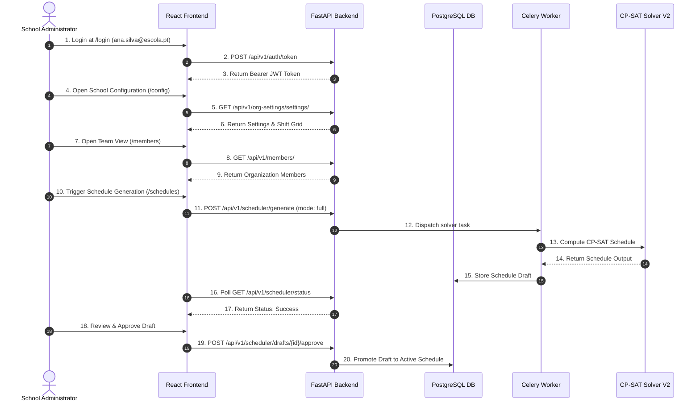
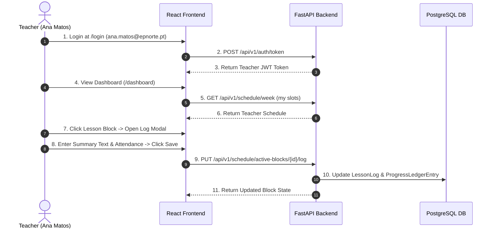

# Technical Walkthrough

## Purpose
This document provides a technical walkthrough of primary administrator and teacher workflows. It replaces the legacy demonstration script.

## Intended Reader
This document targets software developers, QA engineers, and system evaluators.

## Prerequisites
Start the local application using `docker compose up -d` and seed the database using `python backend/scripts/seed.py --scenario small-realistic`.

## Workflow 1: Administrator Initial Setup and Schedule Generation

### Step-by-Step Procedure
1. Access the application at `http://localhost:5173`.
2. Log in using administrator credentials (`ana.silva@escola.pt` / `1234`).
3. Navigate to **Configuração da Escola** (`/config`). Verify weekly shift times, slot durations, and active school year parameters.
4. Navigate to **Equipa** (`/members`). Inspect organization members and role assignments.
5. Navigate to **Horários** (`/schedules`). Click **Gerar Horário Completo**.
6. The system dispatches a Celery task. The status widget displays generation progress.
7. Upon completion, inspect the generated draft. Compare projected completion dates and gap metrics.
8. Click **Aprovar Rascunho**. The system promotes the draft to active schedule status.

## Workflow 2: Teacher Daily Operations and Lesson Logging

### Step-by-Step Procedure
1. Log out from the administrator account.
2. Log in using teacher credentials (`ana.matos@epnorte.pt` / `1234`).
3. View the **Dashboard** (`/dashboard`). The page shows personal daily schedule blocks and pending lesson summaries.
4. Click a scheduled lesson block. The **Registo de Aula** modal opens.
5. Enter lesson summary text, covered module hours, and student attendance status.
6. Click **Guardar Sumário**. The system updates the lesson log and updates module completion progress.

## Source Map
- Admin Pages: `frontend/src/pages/SchoolConfig.jsx`, `frontend/src/pages/Schedules.jsx`
- Teacher Pages: `frontend/src/pages/Dashboard.jsx`, `frontend/src/components/LessonLogModal.jsx`
- API Routers: `backend/app/api/v1/endpoints/scheduler.py`, `backend/app/api/v1/endpoints/schedule.py`

## Related Documents
- [Project Overview](PROJECT_OVERVIEW.md)
- [Scheduler Behavior](../03_scheduler_engine/SCHEDULER_BEHAVIOR.md)
- [Lesson Execution](../04_operational_features/LESSON_EXECUTION.md)
