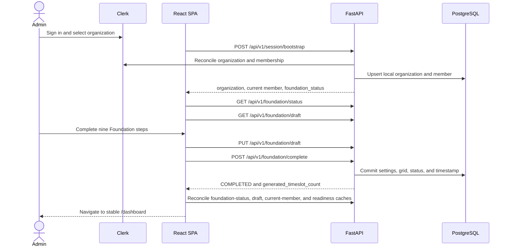
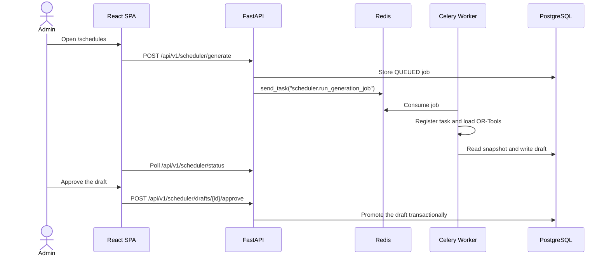

# Technical Walkthrough

## Purpose

This document traces the main administrator and teacher workflows through the current frontend, API, worker, and database.

## Intended Reader

This document targets developers, QA engineers, and system evaluators.

## Prerequisites

Start the local stack and use dedicated Clerk test identities.
Read the [Director Onboarding](ONBOARDING.md) contract before running this walkthrough.
Read the [Routes and Permissions](../06_frontend_ux/ROUTES_AND_PERMISSIONS.md) guide.

## What the System Does

The administrator flow activates a tenant, completes Foundation, builds readiness bases, generates a schedule, and approves a draft.
The teacher flow reads personal blocks and records execution.
The optional tutorial explains the same product sequence with local demo state.

## Why the Behavior Exists

The API keeps long solver work outside the HTTP request.
The API dispatcher imports only `app.celery_worker.celery_app` and publishes the registered task name.
The worker imports `app.scheduler_worker` and the solver dependencies when it starts.
The worker stores an auditable job and draft before an administrator changes the active schedule.

## Components and Ownership

| Component | Source |
| :--- | :--- |
| Frontend routes | `frontend/src/App.jsx` |
| Organization route guards | `frontend/src/routeGuards.jsx` |
| Organization activation | `frontend/src/features/onboarding/useOnboardingCompletion.js` and `frontend/src/features/organization/useCreateActiveOrganization.js` |
| Foundation wizard | `frontend/src/features/foundation/components/FoundationWizard.jsx` |
| Tutorial engine | `frontend/src/features/tutorial/` |
| Admin schedule page | `frontend/src/pages/Schedules.jsx` |
| Session bootstrap | `backend/app/api/v1/endpoints/session.py` |
| Foundation router | `backend/app/api/v1/endpoints/foundation.py` |
| Readiness router | `backend/app/api/v1/endpoints/readiness.py` |
| Teacher schedule page | `frontend/src/pages/MySchedules.jsx` |
| Scheduler router | `backend/app/api/v1/endpoints/scheduler.py` |
| Task dispatcher | `backend/app/scheduler/infrastructure/task_dispatcher.py` |
| Weekly schedule router | `backend/app/api/v1/endpoints/schedule.py` |
| Worker task | `backend/app/scheduler_worker.py` |

## Data or Request Flow

### Authenticated onboarding

The backend commits the database transaction before a successful write response.
The frontend waits for dependent caches before it changes route.
This prevents a route guard or dashboard from reading the previous Foundation state.

The tutorial starts only when the user opens `/guide` or selects a dashboard tutorial action.
Its simulated page actions are intercepted by `TutorialApiBoundary` and do not write operational records.

### Readiness before generation

1. The administrator creates an active class.
2. The administrator adds modules with positive required minutes.
3. The administrator registers an active teacher.
4. The administrator assigns an active competent teacher to a valid class-subject relation.
5. The administrator creates compatible rooms.
6. The administrator confirms possible teacher availability.
7. Foundation provides the timeslot grid and the administrator runs prevalidation to resolve any remaining blockers, including `MISSING_TIMESLOTS`.

## Contracts and Invariants

- Organization onboarding requires a completed Foundation before normal admin and teacher routes open.
- Foundation completion must generate at least one timeslot and must be committed before the response returns.
- Draft writes use `expected_version`; a stale version returns `409`.
- Tutorial state is local and must not be treated as operational seed data.
- Dashboard mode remains `PREPARATION` until the first real schedule approval.
- The API selects complete generation before publication.
- The API selects adaptive repair after publication when debt or scheduler changes exist.
- A pending draft requires explicit replacement confirmation before another generation.
- Teacher-only users can request only their own schedule.
- A lesson log uses `PENDING`, `COMPLETED`, or `OCCURRENCE`.

## States and Transitions

`QUEUED` -> `RUNNING` -> `SUCCEEDED`, `FAILED`, `NO_VALID_OUTPUT`, or `CANCELED`.

Approval changes a pending draft to `APPROVED` and publishes its active blocks.

## Failure Modes

- Missing scheduler configuration returns a generation selection error.
- A pending draft blocks generation without replacement confirmation.
- A worker failure stores a failure code and message on the job.
- A teacher without a linked profile receives `403` on teacher-only routes.

## Verification Procedure

1. Open `http://localhost:5173`.
2. Sign in with an administrator identity and select an organization.
3. If the organization is new, complete `/foundation` and confirm the nine steps.
4. Verify that the response lands on `/dashboard` and that the sidebar shows Dashboard.
5. Open `/guide` and complete, skip, exit, resume, and repeat the local tutorial actions.
6. Configure the readiness bases and inspect the readiness percentage and prevalidation issues.
7. Configure `/config`, then open `/schedules`.
8. Generate, inspect, and approve a real draft.
9. Confirm that the dashboard changes from `PREPARATION` to `OPERATIONAL` only after the first real approval.
10. Sign in with a teacher identity and open `/my-schedules`.
11. Record a lesson log on an eligible block.

## Source Map

- `frontend/src/App.jsx`
- `frontend/src/routeGuards.jsx`
- `frontend/src/features/foundation/components/FoundationWizard.jsx`
- `frontend/src/features/tutorial/tutorialModel.js`
- `frontend/src/features/tutorial/tutorialScenario.js`
- `backend/app/api/v1/endpoints/session.py`
- `backend/app/api/v1/endpoints/foundation.py`
- `backend/app/api/v1/endpoints/readiness.py`
- `frontend/src/pages/Schedules.jsx`
- `frontend/src/pages/MySchedules.jsx`
- `backend/app/api/v1/endpoints/scheduler.py`
- `backend/app/api/v1/endpoints/schedule.py`
- `backend/app/scheduler/infrastructure/task_dispatcher.py`
- `backend/app/celery_worker.py`
- `backend/app/scheduler_worker.py`

## Related Documents

- [Project Overview](PROJECT_OVERVIEW.md)
- [Scheduler Behavior](../03_scheduler_engine/SCHEDULER_BEHAVIOR.md)
- [Lesson Execution](../04_operational_features/LESSON_EXECUTION.md)
