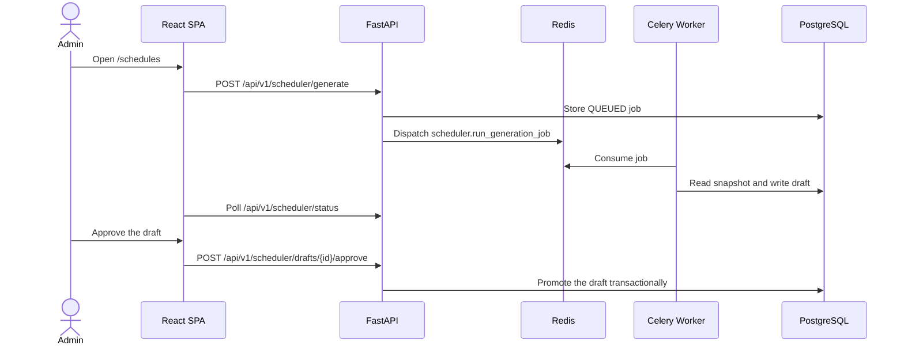

# Technical Walkthrough

## Purpose

This document traces the main administrator and teacher workflows through the current frontend, API, worker, and database.

## Intended Reader

This document targets developers, QA engineers, and system evaluators.

## Prerequisites

Start the local stack and use dedicated Clerk test identities.
Read the [Routes and Permissions](../06_frontend_ux/ROUTES_AND_PERMISSIONS.md) guide.

## What the System Does

The administrator flow configures a tenant, generates a schedule, and approves a draft.
The teacher flow reads personal blocks and records execution.

## Why the Behavior Exists

The API keeps long solver work outside the HTTP request.
The worker stores an auditable job and draft before an administrator changes the active schedule.

## Components and Ownership

| Component | Source |
| :--- | :--- |
| Frontend routes | `frontend/src/App.jsx` |
| Admin schedule page | `frontend/src/pages/Schedules.jsx` |
| Teacher schedule page | `frontend/src/pages/MySchedules.jsx` |
| Scheduler router | `backend/app/api/v1/endpoints/scheduler.py` |
| Weekly schedule router | `backend/app/api/v1/endpoints/schedule.py` |
| Worker task | `backend/app/scheduler_worker.py` |

## Data or Request Flow

## Contracts and Invariants

- The API selects complete generation before publication.
- The API selects adaptive repair after publication when debt or scheduler changes exist.
- A pending draft requires explicit replacement confirmation before another generation.
- Teacher-only users can request only their own schedule.
- A lesson log uses `PENDING`, `COMPLETED`, or `OCCURRENCE`.

## States and Transitions

`QUEUED` -> `RUNNING` -> `SUCCEEDED`, `FAILED`, `NO_VALID_OUTPUT`, or `CANCELED`.

Approval changes a pending draft to `APPROVED` and publishes its active blocks.

## Failure Modes

- Missing scheduler configuration returns a generation selection error.
- A pending draft blocks generation without replacement confirmation.
- A worker failure stores a failure code and message on the job.
- A teacher without a linked profile receives `403` on teacher-only routes.

## Verification Procedure

1. Open `http://localhost:8080`.
2. Sign in with an administrator identity.
3. Configure `/config`, then open `/schedules`.
4. Generate, inspect, and approve a draft.
5. Sign in with a teacher identity and open `/my-schedules`.
6. Record a lesson log on an eligible block.

## Source Map

- `frontend/src/App.jsx`
- `frontend/src/pages/Schedules.jsx`
- `frontend/src/pages/MySchedules.jsx`
- `backend/app/api/v1/endpoints/scheduler.py`
- `backend/app/api/v1/endpoints/schedule.py`
- `backend/app/scheduler_worker.py`

## Related Documents

- [Project Overview](PROJECT_OVERVIEW.md)
- [Scheduler Behavior](../03_scheduler_engine/SCHEDULER_BEHAVIOR.md)
- [Lesson Execution](../04_operational_features/LESSON_EXECUTION.md)
