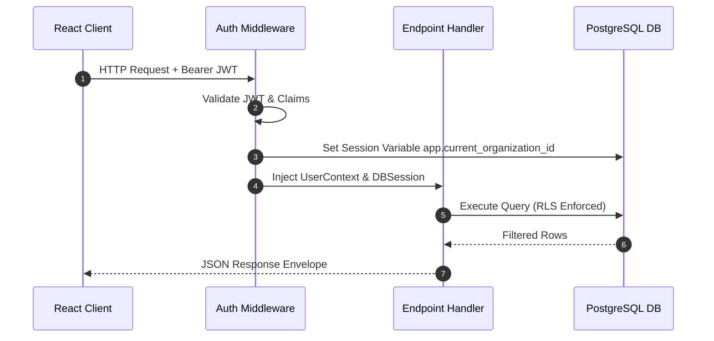

# Runtime Flows

## Purpose
This document details execution flows for API requests, authentication checks, background solver jobs, and Clerk webhooks.

## Intended Reader
This document targets backend developers and security engineers.

## Prerequisites
Read [System Architecture](SYSTEM_ARCHITECTURE.md).

## What the System Does
Cronos handles HTTP requests synchronously while offloading schedule generation and heavy calculations to Celery workers.

## Request Execution Flow

## Asynchronous Worker Flow
1. An administrator requests schedule generation via `POST /api/v1/scheduler/generate`.
2. The endpoint creates a `ScheduleGenerationJob` record with status `SUBMITTED`.
3. FastAPI dispatches the task ID to the Redis queue.
4. A Celery worker consumes the task, loads school constraints, and invokes OR-Tools CP-SAT.
5. The worker stores the generated output as a `ScheduleDraft` and updates job status to `SUCCESS`.
6. The frontend polls `GET /api/v1/scheduler/status` until job completion.

## Clerk Webhook Flow
1. Clerk issues HTTP `POST /api/v1/webhooks/clerk` on user or organization events.
2. The endpoint verifies SVIX webhook signatures using `CLERK_WEBHOOK_SECRET`.
3. The service processes `user.created`, `organization.created`, or `organizationMembership.created` events.
4. The service updates `User`, `Organization`, and `OrganizationMembership` database rows.

## Contracts and Invariants
- Webhook endpoints must verify SVIX signatures before processing payloads.
- Background worker tasks must establish independent database sessions and set RLS tenant variables.

## Failure Modes
- Invalid Webhook Signature: Endpoint returns HTTP `400 Bad Request`.
- Task Timeout: Celery revokes tasks exceeding maximum execution time limits.

## Verification Procedure
Trigger user creation in Clerk dev dashboard. Verify database row creation in `users` and `organization_memberships` tables.

## Source Map
- Auth Middleware: `backend/app/api/deps.py`
- Webhook Endpoint: `backend/app/api/v1/endpoints/webhooks.py`
- Celery Worker Tasks: `backend/app/worker/tasks.py`

## Related Documents
- [System Architecture](SYSTEM_ARCHITECTURE.md)
- [API Reference](../05_backend_api/API_REFERENCE.md)
