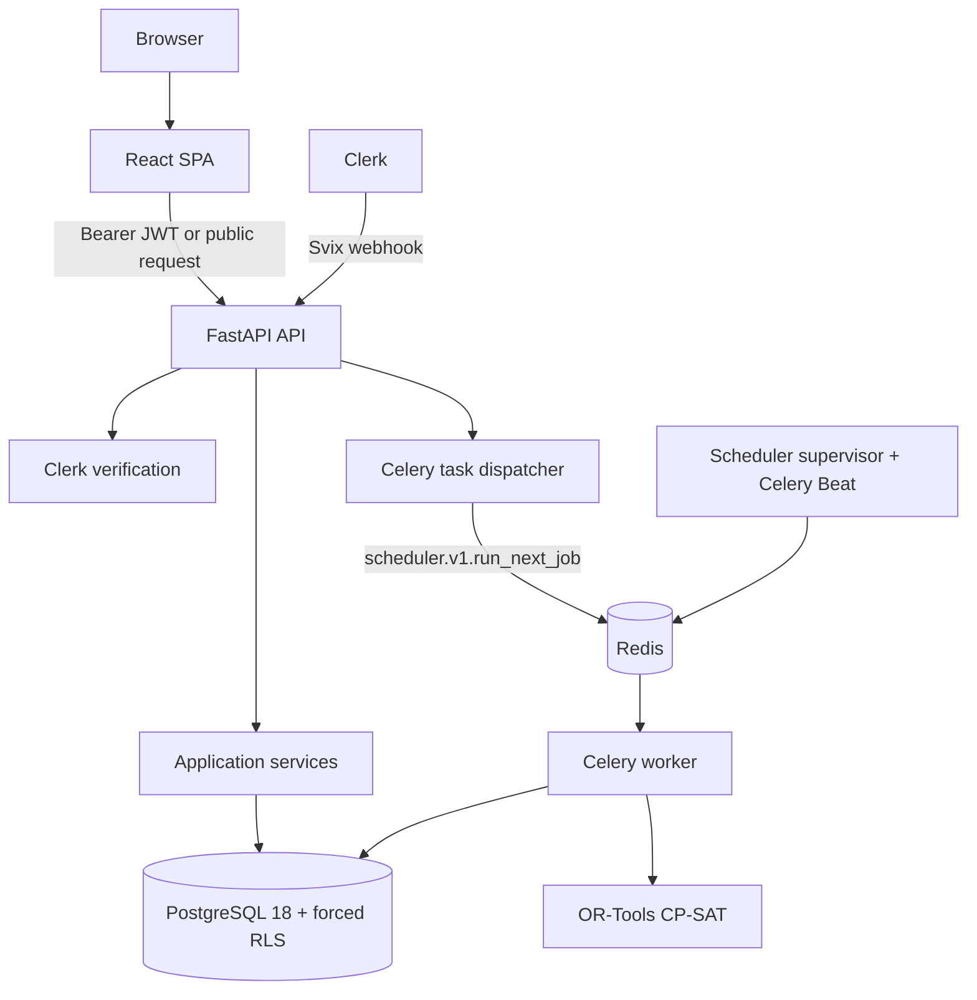

# System Architecture

## Purpose

This document describes the current Cronos runtime, application boundaries, and deployment units.

## Intended Reader

This document targets architects, backend engineers, frontend engineers, and release engineers.

## Prerequisites

Read the [Project Overview](../00_getting_started/PROJECT_OVERVIEW.md).

## What the System Does

Cronos combines a React SPA, a FastAPI API, PostgreSQL, Redis, and Celery processes.

The API serves HTTP requests and publishes named Celery tasks.
It does not import the solver or OR-Tools to dispatch a job.
The worker executes generation and repair.
Beat runs inside the supervisor process and dispatches member reconciliation hourly, privacy maintenance daily, and scheduler supervision every 60 seconds.

## Why the Behavior Exists

The SPA keeps the user interface independent from backend deployment.
The API remains responsive while the worker executes bounded CP-SAT jobs.
PostgreSQL RLS protects tenant-owned data.

## Components and Ownership

| Component | Source or configuration | Responsibility |
| :--- | :--- | :--- |
| SPA | `frontend/src/` | Routes, UI, Clerk session, API calls |
| API | `backend/app/main.py` | HTTP lifecycle, middleware, routers |
| Domain services | `backend/app/services/` | Business rules and transactions |
| Scheduler domain | `backend/app/scheduler/` | Solver contracts, constraints, quality |
| Task dispatcher | `backend/app/scheduler/infrastructure/task_dispatcher.py` | Publish `scheduler.v1.run_next_job` without loading the solver |
| Worker | `backend/app/scheduler_v1_worker.py` | Global executor: complete and adaptive jobs |
| Supervisor | `backend/app/scheduler_recovery_worker.py` | Recover abandoned attempts and wake the executor |
| Member worker | `backend/app/member_reconciliation_worker.py` | Hourly member reconciliation |
| Privacy worker | `backend/app/privacy_maintenance_worker.py` | Daily privacy maintenance |
| Beat | `backend/app/celery_worker.py` | Reconciliation, privacy, and supervisor schedules |
| Persistence | `backend/app/models.py`, `backend/app/scheduler/infrastructure/models.py`, and `backend/alembic/` | Schema and records |
| Local runtime | `docker-compose.yml` | Containers and maintenance profiles |

## Data or Request Flow

1. The client sends a request to the SPA or API.
2. Authenticated dependencies verify Clerk and resolve the active membership.
3. The database dependency installs the tenant context before protected queries.
4. Services validate domain rules and commit a transaction.
5. The API publishes `scheduler.v1.run_next_job` through the lightweight dispatcher.
6. The global executor claims the next eligible job, loads OR-Tools, and runs the solve in a worker thread.

## Contracts and Invariants

- Tenant queries use the active `organization_id` and PostgreSQL tenant context.
- The runtime application role is `cronos_app` with `NOBYPASSRLS`.
- The migrator role is separate and uses `BYPASSRLS`.
- The `app_security` schema holds `SECURITY DEFINER` helper functions.
- The API mounts every route under `/api/v1`.
- Middleware runs outermost to innermost: security headers, request context, CORS, body limit, rate limit.
- Exception handlers return one standard error envelope with a request reference.
- The API does not run Alembic migrations during application startup.
- The API exposes `/health/live` and `/health/ready` outside `/api/v1`.

## States and Transitions

The main asynchronous path is:

`HTTP request` -> `QUEUED job` -> `RUNNING job` -> `VALIDATING` -> `PENDING proposal` -> `APPROVED` or `REJECTED`.

The Beat path dispatches `members.run_scheduled_reconciliation` hourly, `privacy.run_maintenance` daily, and `scheduler.v1.supervise` every 60 seconds.

## Failure Modes

- Clerk verification failure blocks the protected request.
- Missing tenant context blocks tenant data access.
- PostgreSQL or Redis failure makes readiness return `503`.
- Worker failure records a terminal job status and diagnostic fields.

## Verification Procedure

1. Run `docker compose config` with required variables.
2. Verify `docker compose ps` shows healthy dependencies.
3. Query `/health/live` and `/health/ready`.
4. Inspect worker registration with `celery inspect registered`.

## Source Map

- API lifecycle: `backend/app/main.py`
- API router: `backend/app/api/api.py`
- Tenant context: `backend/app/db/tenant.py`
- Worker task: `backend/app/scheduler_v1_worker.py`
- Scheduler supervisor: `backend/app/scheduler_recovery_worker.py`
- Beat schedule: `backend/app/celery_worker.py`
- Frontend entry: `frontend/src/main.jsx`
- Runtime contract: `docker-compose.yml`

## Onboarding Placement

Onboarding is a cross-layer workflow, not a separate bounded context.
Clerk and the session endpoint establish tenant identity.
Foundation services validate and persist the school grid.
Frontend route guards enforce the user journey, while backend actor dependencies enforce authorization.
The local tutorial remains a frontend simulation with a minimal, expiring browser checkpoint and no telemetry.

See the [Director Onboarding](../00_getting_started/ONBOARDING.md) guide for the complete contract.

## Related Documents

- [Runtime Flows](RUNTIME_FLOWS.md)
- [Data Model](DATA_MODEL.md)
- [Backend Architecture](../05_backend_api/BACKEND_ARCHITECTURE.md)
