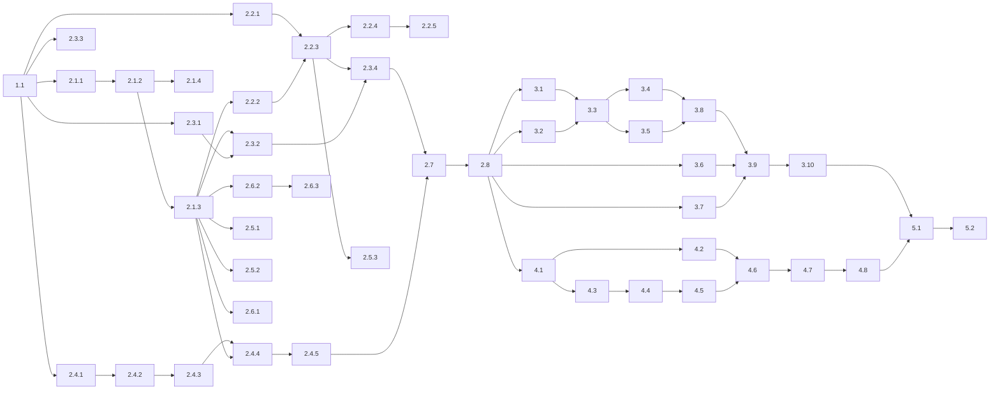

# WBS — Disponibilidade das Turmas

## Purpose

Este documento decompõe a implementação do [Tech Spec — Disponibilidade das Turmas](CLASS_AVAILABILITY_TECH_SPEC.md) em pacotes de trabalho.
Define entregáveis, testes iniciais, dependências, critérios de conclusão e a ordem de execução.

**Estado:** implementação local presente no ramo `feat/class-availability-engine`; verificação final e entrega pendentes.
**Data:** 14 de outubro de 2026.

O tech spec é dono das decisões, dos contratos e dos cenários de teste.
Este documento não repete essas regras. Cada pacote indica a secção do spec que aplica.

## Estado de implementação e rastreabilidade

O responsável de produto pediu um único ramo e worktree novos.
As três fases lógicas (PR 1 a PR 3) foram consolidadas localmente em `feat/class-availability-engine`.
A sequência original de três pull requests não foi executada.

Evidência local em `.test-artifacts/*/run.json`, no commit do ramo `c7618ce`, com árvores de teste não limpas (a linha de base foi medida numa árvore limpa):

| Medição | Linha de base | Ramo da funcionalidade |
| :--- | :--- | :--- |
| Backend `fast --scope backend` | 739 | 778 |
| Frontend `fast --scope frontend` | 592 | 622 (85 ficheiros) |
| `integration` | 426 + 61 contratos | 518 + 66 contratos (artifact `1792014351559-27680`) |
| `ruff check` e `ruff format --check` | — | verde (315 ficheiros) |
| `npm run verify:checks` | — | verde |

Grupos implementados e testados localmente: 2.1 a 2.6 (servidor e motor), 3.1 a 3.7 (ecrãs) e 4.1 a 4.6 (importação CSV).

Os pacotes de documentação 2.7, 3.9 e 4.7 são atualizados no mesmo ramo, nos guias da secção [Documentação a atualizar](CLASS_AVAILABILITY_TECH_SPEC.md#documentação-a-atualizar).

As provas de migração correram numa stack de teste descartável e isolada e passaram: `alembic upgrade head` (`0001 → 0002 → 0003`), `alembic check` sem drift, `alembic downgrade 0002_class_subject_modules`, nova subida para head, `python -m scripts.audit_triggers` e `python -m scripts.audit_database_integrity`. Evidência sanitizada em `.test-artifacts/cronos-avail-verify-migration-evidence.md`.

Pendentes: 2.8, 3.10 e 4.8 (entrega de pull request), 5.1 (verificação manual) e 5.2 (estado final dos documentos).
O percurso 3.8 continua pendente: a verificação e2e local funciona (`doctor --profile e2e` devolve exit 0); a primeira tentativa de execução parou por porto 5174 ocupado.
A entrega e o estado da CI são acompanhados no pull request [#133](https://github.com/ORIOP25/Cronos/pull/133). A CI obrigatória final não é reclamada.

## Intended Reader

Este documento destina-se aos agentes e engenheiros que implementam a funcionalidade, e ao responsável de produto que acompanha o progresso.

## Prerequisites

- Leia o [tech spec](CLASS_AVAILABILITY_TECH_SPEC.md) completo.
- Siga o [AGENTS.md](../../AGENTS.md): clean code, Clean Architecture, TDD e Ponytail (`full`).
- Use apenas comandos da [Command Reference](../00_getting_started/COMMAND_REFERENCE.md).

## Convenções

| Campo | Significado |
| :--- | :--- |
| ID | Posição na árvore. `2.4.3` é o terceiro pacote do grupo 2.4. |
| Dimensão | **P**: um ficheiro e testes simples. **M**: vários ficheiros ou testes de integração. **G**: motor de horários com cenários longos. |
| Teste primeiro | O teste que falha antes da alteração. |
| Concluído quando | A condição observável que fecha o pacote. |
| Depende de | Os pacotes que têm de estar concluídos antes. |

Cada pacote termina num commit com mensagem Conventional Commit.
Um pacote sem alteração de comportamento, como documentação, não precisa de teste inicial.

## Árvore de trabalho

```text
1   Preparação
1.1   Linha de base verde
2   PR 1 — Servidor e motor
2.1   Base de dados
2.1.1   Contrato da cadeia de migrações
2.1.2   Migração class_availability
2.1.3   Modelos SQLAlchemy
2.1.4   Privacidade
2.2   API da disponibilidade
2.2.1   Esquemas
2.2.2   Leitura da grelha da turma
2.2.3   Gravação da grelha da turma
2.2.4   Cópia entre turmas
2.2.5   Isolamento e permissões
2.3   Leitura pelo motor
2.3.1   Função _preference_unavailability
2.3.2   Linhas da turma no snapshot
2.3.3   Desempate da construção de recuperação
2.3.4   Geração respeita a grelha da turma
2.4   Défice por turma e diagnósticos
2.4.1   class_deficits na verificação de capacidade
2.4.2   Diagnóstico INSUFFICIENT_CLASS_TIME
2.4.3   Diagnósticos no resultado da geração inicial
2.4.4   Persistência dos diagnósticos do job
2.4.5   Leitura dos diagnósticos do job
2.5   Pré-validação, fingerprint e revisões
2.5.1   Bloqueio CLASS_WITHOUT_AVAILABILITY
2.5.2   Fingerprint de geração
2.5.3   Proposta desatualizada
2.6   Alteração de grelha
2.6.1   Regeneração no lugar
2.6.2   Análise com turmas
2.6.3   Proposta copia as turmas
2.7   Documentação do servidor
2.8   Entrega do PR 1
3   PR 2 — Ecrãs
3.1   Hooks da disponibilidade da turma
3.2   Extração de AvailabilityEditorModal
3.3   ClassAvailabilityModal
3.4   Aplicar a outras turmas
3.5   Cartão na página da turma
3.6   Mensagem de falha
3.7   Painel da alteração de grelha
3.8   Percurso e2e
3.9   Documentação dos ecrãs
3.10  Entrega do PR 2
4   PR 3 — Importação CSV
4.1   Blocos no snapshot da importação
4.2   Modelo dinâmico
4.3   Leitura do cabeçalho dinâmico
4.4   Validação das linhas
4.5   Aplicação no commit
4.6   Secção na página Importar dados
4.7   Documentação da importação
4.8   Entrega do PR 3
5   Fecho
5.1   Verificação manual
5.2   Estado final dos documentos
```

## Pacotes de trabalho

### 1 Preparação

#### 1.1 Linha de base verde — P

- **Entregável:** registo dos testes que já falham no ramo antes de qualquer alteração.
- **Teste primeiro:** não se aplica.
- **Concluído quando:** `fast --scope backend`, `fast --scope frontend` e `integration` correram. As falhas existentes estão anotadas.
- **Depende de:** —
- **Nota:** confirme em `main` se os itens 1 e 2 já integraram migrações. O número da migração depende disso.

### 2 PR 1 — Servidor e motor

Ramo: `feat/class-availability-engine`, a partir de `main`.
Este PR acrescenta o bloqueio da pré-validação e os diagnósticos na API. Os ecrãs novos chegam no PR 2.

#### 2.1 Base de dados

##### 2.1.1 Contrato da cadeia de migrações — P

- **Entregável:** `test_migration_history_has_one_frozen_baseline` aceita uma cadeia linear a partir da baseline.
- **Teste primeiro:** o teste rejeita um ramo e aceita uma revisão com `down_revision` igual à anterior.
- **Concluído quando:** o teste continua a exigir a baseline sem alterações e uma cadeia sem ramos.
- **Depende de:** 1.1
- **Spec:** [Migração](CLASS_AVAILABILITY_TECH_SPEC.md#migração).
- **Nota:** salte este pacote se outro item já integrou a mesma alteração do contrato.

##### 2.1.2 Migração class_availability — M

- **Entregável:** tabela `class_availability`, `CHECK`, RLS forçada, política, permissões e coluna `scheduler_job_v1.diagnostics_json`.
- **Teste primeiro:** um teste de integração confirma que o `CHECK` recusa `score = 1`.
- **Concluído quando:** `backend/tests/contracts/test_rls_database_policies.py` passa com a tabela nova. O `downgrade` funciona.
- **Depende de:** 2.1.1
- **Spec:** [Modelo de dados](CLASS_AVAILABILITY_TECH_SPEC.md#modelo-de-dados) e [Migração](CLASS_AVAILABILITY_TECH_SPEC.md#migração).
- **Risco:** as FKs compostas exigem `uq_class_org_id` e `uq_timeslot_org_id`. As duas existem na baseline.
- **Nota de implementação:** a migração real é `0003_class_availability`, com `down_revision = "0002_class_subject_modules"`. A migração de seleção de módulos por turma integrou em `main`, por isso a cadeia passou a `0001 → 0002 → 0003`.

##### 2.1.3 Modelos SQLAlchemy — P

- **Entregável:** modelo `ClassAvailability` em `backend/app/models.py` e coluna `diagnostics_json` em `SchedulerJobV1`.
- **Teste primeiro:** a verificação de drift falha antes de os modelos existirem.
- **Concluído quando:** a verificação de drift da Command Reference não encontra diferenças.
- **Depende de:** 2.1.2

##### 2.1.4 Privacidade — P

- **Entregável:** entrada `"class_availability": "delete"` em `backend/scripts/privacy.py`.
- **Teste primeiro:** os testes de privacidade falham com a tabela nova sem entrada.
- **Concluído quando:** `test_privacy_administrative_erasure.py` e `test_privacy_maintenance.py` passam.
- **Depende de:** 2.1.2

#### 2.2 API da disponibilidade

Os testes deste grupo ficam num ficheiro novo, `backend/tests/integration/committed/test_class_availability.py`, salvo indicação em contrário.
Spec: [Contrato HTTP](CLASS_AVAILABILITY_TECH_SPEC.md#contrato-http) e [Fluxo de gravação](CLASS_AVAILABILITY_TECH_SPEC.md#fluxo-de-gravação).

##### 2.2.1 Esquemas — P

- **Entregável:** `TeacherAvailabilityPayload` passa a `WeeklyAvailabilityPayload`. Novo `ClassAvailabilityCopyRequest`.
- **Teste primeiro:** em `backend/tests/unit/test_schemas_validation.py`, a cópia recusa uma lista vazia e mais de 500 IDs.
- **Concluído quando:** as rotas dos professores e `test_schemas_validation.py` usam o nome novo.
- **Depende de:** 1.1

##### 2.2.2 Leitura da grelha da turma — M

- **Entregável:** `GET /classes/{class_id}/availability` e `class_availability_service.get_class_availability`.
- **Teste primeiro:** uma turma sem linhas devolve `score = 1` em cada bloco da versão visível.
- **Concluído quando:** `on_date` escolhe a versão da grelha, como na leitura dos professores.
- **Depende de:** 2.1.3

##### 2.2.3 Gravação da grelha da turma — M

- **Entregável:** `PUT /classes/{class_id}/availability` e `replace_class_availability`.
- **Teste primeiro:** gravar Neutro, Evitar e Impossível guarda só duas linhas e regista `CLASS_AVAILABILITY`.
- **Concluído quando:**
  1. Blocos repetidos, conjunto inválido e turma arquivada devolvem os erros do spec.
  2. `active_resource` é falso para uma turma sem ligações turma–disciplina.
  3. As linhas de outras versões da grelha não mudam.
- **Depende de:** 2.2.1, 2.2.2

##### 2.2.4 Cópia entre turmas — M

- **Entregável:** `POST /classes/{class_id}/availability/copy`.
- **Teste primeiro:** copiar para duas turmas substitui a grelha de ambas pela grelha guardada da origem.
- **Concluído quando:**
  1. IDs repetidos, a origem na lista e uma turma arquivada devolvem `400`.
  2. Um pedido com uma turma inválida não altera nenhuma turma.
  3. Cada turma de destino gera um registo `CLASS_AVAILABILITY`.
- **Depende de:** 2.2.3

##### 2.2.5 Isolamento e permissões — P

- **Entregável:** as três rotas recusam turmas de outra organização e utilizadores sem capacidade de administração.
- **Teste primeiro:** casos novos em `test_tenant_isolation_business.py` (404) e `test_teacher_role_regression.py` (403).
- **Concluído quando:** os testes passam e cada consulta filtra por `organization_id`.
- **Depende de:** 2.2.4

#### 2.3 Leitura pelo motor

Spec: [Leitura das preferências](CLASS_AVAILABILITY_TECH_SPEC.md#leitura-das-preferências).

##### 2.3.1 Função _preference_unavailability — M

- **Entregável:** a função pura extraída de `_load_unavailability` em `snapshot.py`. Os professores passam a usá-la.
- **Teste primeiro:** não se aplica. É uma refatoração sem alteração de comportamento.
- **Concluído quando:** `fast --scope backend -- -k scheduler` e `integration -- -k scheduler` passam sem alterar asserções.
- **Depende de:** 1.1

##### 2.3.2 Linhas da turma no snapshot — M

- **Entregável:** `_load_unavailability` chama a função para `CLASS` com as linhas de `class_availability`.
- **Teste primeiro:** num teste de snapshot, Impossível da turma vira `CLASS` obrigatório. Evitar e a regra do Preferencial viram `CLASS` preferencial.
- **Concluído quando:**
  1. O teste passa e a indisponibilidade dos professores no snapshot não muda.
  2. Um teste unitário confirma que `measure_initial_quality` conta uma aula num período Evitar da turma.
- **Depende de:** 2.1.3, 2.3.1

##### 2.3.3 Desempate da construção de recuperação — P

- **Entregável:** `recovery_construction.py` acrescenta a preferência da turma ao critério de desempate.
- **Teste primeiro:** entre duas opções iguais, a construção escolhe a que não cai num bloco Evitar da turma.
- **Concluído quando:** o teste passa e os testes atuais de recuperação continuam verdes.
- **Depende de:** 1.1
- **Nota:** o teste fica em `backend/tests/unit/test_scheduler_recovery_construction_v1.py`. Não precisa da base de dados.

##### 2.3.4 Geração respeita a grelha da turma — G

- **Entregável:** prova de ponta a ponta com o motor real.
- **Teste primeiro:** uma geração completa com sexta à tarde Impossível para uma turma não coloca aulas dessa turma nesses blocos.
- **Concluído quando:** `integration -- -k scheduler` passa. A CI não corre todos estes testes.
- **Depende de:** 2.2.3, 2.3.2
- **Risco:** os testes do motor real demoram minutos. Use o cenário mais pequeno que prova a regra.

#### 2.4 Défice por turma e diagnósticos

Spec: [Défice por turma](CLASS_AVAILABILITY_TECH_SPEC.md#défice-por-turma) e [Diagnósticos de falha](CLASS_AVAILABILITY_TECH_SPEC.md#diagnósticos-de-falha).

##### 2.4.1 class_deficits na verificação de capacidade — M

- **Entregável:** `CapacityCheck.class_deficits` em `capacity.py`. `proven_infeasible` considera os dois défices.
- **Teste primeiro:** em `backend/tests/unit/test_scheduler_diagnostics_v1.py` ou ficheiro novo do mesmo padrão:
  1. Uma turma com a soma das disciplinas acima dos períodos livres tem défice igual à diferença.
  2. Um período elegível para duas disciplinas conta uma vez.
  3. Uma turma com tempo suficiente ou com atribuições concluídas não tem défice.
- **Concluído quando:** os testes passam e os períodos elegíveis de cada atribuição são calculados uma só vez.
- **Depende de:** 1.1

##### 2.4.2 Diagnóstico INSUFFICIENT_CLASS_TIME — P

- **Entregável:** `DiagnosisCode.INSUFFICIENT_CLASS_TIME`, `Diagnosis.affected_subject_id` e `diagnose_capacity` com o `CapacityCheck` calculado.
- **Teste primeiro:** `diagnose_capacity` devolve `CLASS:{id}` com o défice, e `affected_subject_id` nos diagnósticos por atribuição.
- **Concluído quando:** a recuperação adaptativa (`recovery.py`) usa a assinatura nova e os testes atuais passam.
- **Depende de:** 2.4.1

##### 2.4.3 Diagnósticos no resultado da geração inicial — P

- **Entregável:** `GenerationResult.diagnoses`. `generate_complete` devolve os diagnósticos quando a verificação prova a impossibilidade.
- **Teste primeiro:** em `backend/tests/unit/test_scheduler_generation_v1.py`, um défice por turma devolve `OUTCOME_INFEASIBLE` com diagnósticos, sem chamar a pesquisa.
- **Concluído quando:** o teste passa e os casos atuais de `generate_complete` continuam verdes.
- **Depende de:** 2.4.2

##### 2.4.4 Persistência dos diagnósticos do job — M

- **Entregável:** `_diagnostics_summary` pública. `_finish` e `finish_job` gravam `diagnostics_json`.
- **Teste primeiro:** em `test_scheduler_v1_lifecycle.py`, terminar um job `INFEASIBLE` com diagnósticos grava a coluna.
- **Concluído quando:**
  1. Um job `CANCELLED` ou `STALE` não grava diagnósticos.
  2. As propostas de recuperação mantêm a mesma forma de `metrics["diagnostics"]`.
- **Depende de:** 2.1.3, 2.4.3

##### 2.4.5 Leitura dos diagnósticos do job — M

- **Entregável:** `SchedulerV1JobDiagnosticRead` e `queries.get_job` com nomes de turma e de disciplina.
- **Teste primeiro:** em `test_scheduler_v1_lifecycle.py`, o `GET` do job devolve uma entrada por turma afetada com o nome atual.
- **Concluído quando:** uma turma apagada aparece com `class_name = None` e a consulta filtra por `organization_id`.
- **Depende de:** 2.4.4

#### 2.5 Pré-validação, fingerprint e revisões

Spec: [Pré-validação](CLASS_AVAILABILITY_TECH_SPEC.md#pré-validação) e [Fingerprint](CLASS_AVAILABILITY_TECH_SPEC.md#fingerprint).

##### 2.5.1 Bloqueio CLASS_WITHOUT_AVAILABILITY — M

- **Entregável:** um bloqueio por turma em `PreflightService.evaluate`, com a rota da turma.
- **Teste primeiro:** em `backend/tests/contracts/test_preflight_service.py`, uma turma com todos os blocos Impossível devolve o bloqueio.
- **Concluído quando:**
  1. Uma turma com um bloco sem linha não é bloqueada.
  2. Uma turma arquivada ou sem disciplinas com professor não é bloqueada.
- **Depende de:** 2.1.3

##### 2.5.2 Fingerprint de geração — P

- **Entregável:** `class_availability` em `generation_input_snapshot`.
- **Teste primeiro:** em `test_scheduler_fingerprint_service.py`, a fingerprint muda quando a disponibilidade da turma muda.
- **Concluído quando:** o teste passa e uma turma arquivada não muda a fingerprint.
- **Depende de:** 2.1.3

##### 2.5.3 Proposta desatualizada — P

- **Entregável:** prova de que a gravação consome uma revisão de planeamento.
- **Teste primeiro:** em `test_scheduler_v1_rule_revisions.py`, gravar a grelha de uma turma com disciplinas desatualiza a proposta pendente.
- **Concluído quando:** o teste passa. O mesmo cenário numa turma sem disciplinas não desatualiza a proposta.
- **Depende de:** 2.2.3

#### 2.6 Alteração de grelha

Spec: [Alteração de grelha](CLASS_AVAILABILITY_TECH_SPEC.md#alteração-de-grelha).

##### 2.6.1 Regeneração no lugar — M

- **Entregável:** `apply_grid_regeneration` lê e repõe as linhas das turmas por assinatura de bloco.
- **Teste primeiro:** em `test_grid_version_service.py`, um bloco com a mesma assinatura mantém o nível da turma. Um bloco novo fica Neutro.
- **Concluído quando:** o teste passa e a disponibilidade dos professores não muda.
- **Depende de:** 2.1.3

##### 2.6.2 Análise com turmas — M

- **Entregável:** `affected_availabilities` com `classes`, entradas só com turmas e fingerprint da análise com `class_availabilities`.
- **Teste primeiro:** em `test_grid_change_preview.py`, um bloco movido com uma linha de turma aparece com `classes`.
- **Concluído quando:** mudar a grelha de uma turma muda a fingerprint da análise.
- **Depende de:** 2.1.3

##### 2.6.3 Proposta copia as turmas — M

- **Entregável:** a proposta copia as linhas das turmas com `EXACT` ou decisão `COPY`.
- **Teste primeiro:** em `test_grid_change_proposal.py`, `COPY` cria a linha da turma no bloco novo e `DISCARD` não a cria.
- **Concluído quando:** um bloco só com turmas exige decisão quando não é `EXACT`.
- **Depende de:** 2.6.2

#### 2.7 Documentação do servidor — M

- **Entregável:** as linhas de servidor da secção [Documentação a atualizar](CLASS_AVAILABILITY_TECH_SPEC.md#documentação-a-atualizar): Data Model, API Reference, Scheduler Engine e School Configuration.
- **Teste primeiro:** não se aplica. Verifique cada afirmação contra o código.
- **Concluído quando:** as ligações relativas resolvem e `git diff --check` não reporta erros.
- **Depende de:** 2.1 a 2.6

#### 2.8 Entrega do PR 1 — M

- **Entregável:** pull request integrado em `main`.
- **Teste primeiro:** não se aplica.
- **Concluído quando:**
  1. As provas locais da [Verification Procedure](CLASS_AVAILABILITY_TECH_SPEC.md#verification-procedure) passaram, incluindo `integration -- -k scheduler`.
  2. As verificações de drift e de auditoria da migração passaram.
  3. `backend`, `frontend`, `e2e-runtime` e `e2e-browser` estão verdes.
  4. O PR foi integrado com squash e o `Deploy check` em `main` passou.
- **Depende de:** 2.7
- **Risco:** se o item 1 ou o item 2 integrar antes, renumere a migração e resolva os conflitos em `snapshot.py`, `preflight_service.py` e `scheduler_fingerprint_service.py`.

### 3 PR 2 — Ecrãs

Ramo: `feat/class-availability-ui`, a partir de `main` depois de 2.8. Carregue também `cronos-frontend-designer`.
Spec: [Interface](CLASS_AVAILABILITY_TECH_SPEC.md#interface).

#### 3.1 Hooks da disponibilidade da turma — P

- **Entregável:** `useClassAvailability`, `useSaveClassAvailability` e `useCopyClassAvailability` em `frontend/src/features/catalog/data.js`.
- **Teste primeiro:** em `frontend/src/test/featureDataHooks.test.jsx`, cada hook chama a rota certa e invalida as consultas do spec.
- **Concluído quando:** o teste passa. A chave `class-availability` usa `orgQueryKey`.
- **Depende de:** 2.8
- **Spec:** [Hooks](CLASS_AVAILABILITY_TECH_SPEC.md#hooks).

#### 3.2 Extração de AvailabilityEditorModal — M

- **Entregável:** `frontend/src/components/AvailabilityEditorModal.jsx`. `TeacherAvailabilityModal` passa a configurá-lo.
- **Teste primeiro:** não se aplica. É uma refatoração sem alteração de comportamento.
- **Concluído quando:** `frontend/src/test/TeacherAvailabilityModal.test.jsx` e `frontend/src/test/Members.test.jsx` passam sem alterar asserções.
- **Depende de:** 2.8. Pode correr em paralelo com 3.1.

#### 3.3 ClassAvailabilityModal — M

- **Entregável:** `frontend/src/components/ClassAvailabilityModal.jsx` com título, nota, gravação e toast do spec.
- **Teste primeiro:** novo `frontend/src/test/ClassAvailabilityModal.test.jsx`. Guardar envia uma entrada por bloco e mostra `Disponibilidade da turma guardada.`
- **Concluído quando:** com alterações por guardar, `Aplicar a outras turmas…` fica desativado com `Guarde primeiro as alterações.`
- **Depende de:** 3.1, 3.2

#### 3.4 Aplicar a outras turmas — M

- **Entregável:** a vista da lista de turmas dentro da janela, a confirmação com `ConfirmationModal` e a mutação de cópia.
- **Teste primeiro:** em `ClassAvailabilityModal.test.jsx`, escolher duas turmas e confirmar envia os dois IDs.
- **Concluído quando:**
  1. A lista agrupa por curso, ordena por nome e omite a turma de origem.
  2. `Aplicar a {n} turmas` fica desativado com zero turmas.
  3. O sucesso mostra `Disponibilidade aplicada a {n} turmas.` e volta à grelha.
  4. Cada caixa tem rótulo acessível e a vista funciona com teclado.
- **Depende de:** 3.3

#### 3.5 Cartão na página da turma — P

- **Entregável:** o cartão "Disponibilidade" em `ClassDetails.jsx`, com resumo e botão.
- **Teste primeiro:** em `frontend/src/test/ClassDetails.test.jsx`, uma turma sem linhas mostra `Sem restrições. Todos os blocos estão em Neutro.`
- **Concluído quando:** o resumo omite os níveis com zero e a turma arquivada não mostra o botão.
- **Depende de:** 3.3

#### 3.6 Mensagem de falha — M

- **Entregável:** `GenerationStatusPanel.jsx` mostra as turmas dos diagnósticos, com ligações e horas em falta.
- **Teste primeiro:** em `frontend/src/test/GenerationStatusPanel.test.jsx`, um job `INFEASIBLE` com `INSUFFICIENT_CLASS_TIME` mostra o nome da turma e a ligação.
- **Concluído quando:**
  1. `INSUFFICIENT_INTERSECTION` mostra a turma e a disciplina.
  2. Os minutos aparecem em horas e minutos, arredondados para cima.
  3. Sem diagnósticos de turma, a mensagem genérica atual fica igual.
- **Depende de:** 2.8. Pode correr em paralelo com 3.1 a 3.5.

#### 3.7 Painel da alteração de grelha — P

- **Entregável:** o texto `{p} professor(es) e {t} turma(s) com disponibilidade neste bloco.` em `SchoolConfigSections.jsx`.
- **Teste primeiro:** em `frontend/src/test/SchoolConfigGridChange.test.jsx`, um bloco só com turmas mostra a contagem de turmas.
- **Concluído quando:** a parte com zero fica omitida.
- **Depende de:** 2.8. Pode correr em paralelo com 3.1 a 3.6.

#### 3.8 Percurso e2e — M

- **Entregável:** o percurso da secção [E2E](CLASS_AVAILABILITY_TECH_SPEC.md#e2e).
- **Teste primeiro:** o percurso falha antes do cartão existir.
- **Concluído quando:** `e2e --project <nome>` passa quando existirem as credenciais de teste do Clerk.
- **Depende de:** 3.4, 3.5

#### 3.9 Documentação dos ecrãs — P

- **Entregável:** a linha da Feedback Message Matrix na secção [Documentação a atualizar](CLASS_AVAILABILITY_TECH_SPEC.md#documentação-a-atualizar).
- **Teste primeiro:** não se aplica.
- **Concluído quando:** as ligações relativas resolvem e `git diff --check` não reporta erros.
- **Depende de:** 3.1 a 3.8

#### 3.10 Entrega do PR 2 — M

- **Entregável:** pull request integrado em `main`.
- **Teste primeiro:** não se aplica.
- **Concluído quando:**
  1. `npm run verify:checks` passou.
  2. O contentor local foi reconstruído com `docker compose up -d --build frontend`.
  3. `backend`, `frontend`, `e2e-runtime` e `e2e-browser` estão verdes.
  4. O PR foi integrado com squash e o `Deploy check` em `main` passou.
- **Depende de:** 3.9

### 4 PR 3 — Importação CSV

Ramo: `feat/class-availability-csv`, a partir de `main` depois de 2.8.
O PR 3 pode correr em paralelo com o PR 2. Os dois PRs alteram ficheiros diferentes.
Spec: [Importação CSV](CLASS_AVAILABILITY_TECH_SPEC.md#importação-csv).

#### 4.1 Blocos no snapshot da importação — P

- **Entregável:** `ImportSnapshot` com os blocos da versão visível. `load_snapshot` carrega-os.
- **Teste primeiro:** em `test_bulk_import.py`, o snapshot de uma escola com grelha tem os blocos com dia e hora de início.
- **Concluído quando:** o teste passa e os recursos atuais validam como antes.
- **Depende de:** 2.8

#### 4.2 Modelo dinâmico — M

- **Entregável:** `render_class_availability_template` pura, o carregamento no serviço e `download_template` com sessão e organização.
- **Teste primeiro:** em `backend/tests/unit/test_bulk_import_policy.py`, o modelo tem as horas por ordem, uma linha por turma e dia, e os níveis guardados.
- **Concluído quando:**
  1. Uma hora sem bloco nesse dia fica vazia.
  2. Sem turmas, o modelo traz só o cabeçalho.
  3. Sem blocos, o pedido devolve `400` com `A escola ainda não configurou blocos.`
  4. Os modelos fixos não mudam.
- **Depende de:** 4.1

#### 4.3 Leitura do cabeçalho dinâmico — M

- **Entregável:** `parse_resource_file` aceita as colunas de hora de `class_availability`. `BulkImportFiles` e `IMPORT_RESOURCES` acrescentam o recurso.
- **Teste primeiro:** em `test_bulk_import_policy.py`, um ficheiro com as três colunas fixas e colunas de hora é lido. Uma hora inválida ou repetida dá `header_invalid`.
- **Concluído quando:** as horas aceitam `H:MM`, `HH:MM` e `HH:MM:SS`, e a deteção de ficheiro trocado continua a funcionar.
- **Depende de:** 4.1

#### 4.4 Validação das linhas — M

- **Entregável:** `_validate_class_availability` puro em `bulk_import_policy.py`.
- **Teste primeiro:** em `test_bulk_import_policy.py`, um caso por linha da tabela [Validação](CLASS_AVAILABILITY_TECH_SPEC.md#validação).
- **Concluído quando:**
  1. Dias e níveis aceitam acentos, maiúsculas e o sufixo `-feira`.
  2. Uma turma do mesmo lote é aceite.
  3. O campo do erro numa célula é o título da coluna.
- **Depende de:** 4.3

#### 4.5 Aplicação no commit — M

- **Entregável:** `commit_import` chama `replace_class_availability` por turma, depois de cursos, turmas e atribuições.
- **Teste primeiro:** em `test_bulk_import.py`, importar uma turma substitui a grelha inteira e deixa as outras turmas iguais.
- **Concluído quando:**
  1. Um dia sem linha e uma célula vazia contam como Neutro.
  2. Uma turma criada no mesmo lote recebe a grelha.
  3. `created_counts["class_availability"]` conta as turmas atualizadas.
  4. Um ficheiro com erros não grava nada.
- **Depende de:** 4.4

#### 4.6 Secção na página Importar dados — M

- **Entregável:** a entrada `class_availability` em `frontend/src/features/imports/data.js` e a descrição nova em `BulkImport.jsx`.
- **Teste primeiro:** em `frontend/src/test/BulkImport.test.jsx`, a secção aparece com as instruções do spec.
- **Concluído quando:**
  1. Um erro numa célula mostra o título da coluna, por exemplo `08:30`.
  2. A importação invalida `class-availability`.
  3. `npm run verify:checks` passa.
- **Depende de:** 4.5

#### 4.7 Documentação da importação — P

- **Entregável:** a secção "Disponibilidade das turmas" no [Bulk Import CSV](../07_data_and_seed/BULK_IMPORT_CSV.md).
- **Teste primeiro:** não se aplica. Verifique cada afirmação contra o código.
- **Concluído quando:** as ligações relativas resolvem e `git diff --check` não reporta erros.
- **Depende de:** 4.1 a 4.6

#### 4.8 Entrega do PR 3 — M

- **Entregável:** pull request integrado em `main`.
- **Teste primeiro:** não se aplica.
- **Concluído quando:**
  1. `fast --scope backend`, `integration -- -k bulk_import` e `npm run verify:checks` passaram.
  2. O contentor local foi reconstruído com `docker compose up -d --build frontend`.
  3. `backend`, `frontend`, `e2e-runtime` e `e2e-browser` estão verdes.
  4. O PR foi integrado com squash e o `Deploy check` em `main` passou.
- **Depende de:** 4.7

### 5 Fecho

#### 5.1 Verificação manual — P

- **Entregável:** os seis passos manuais da [Verification Procedure](CLASS_AVAILABILITY_TECH_SPEC.md#verification-procedure), feitos no contentor local.
- **Concluído quando:** os seis passos produzem o resultado esperado.
- **Depende de:** 3.10, 4.8

#### 5.2 Estado final dos documentos — P

- **Entregável:** o tech spec e este WBS passam a `Estado: implementado`. O Glossary recebe o termo, se o exigir.
- **Concluído quando:** os guias descrevem o comportamento e o relatório ao responsável de produto está entregue.
- **Depende de:** 5.1

## Dependências e caminho crítico



O diagrama omite as setas de 2.1.4, 2.2.5, 2.3.3, 2.5 e 2.6 para 2.7. Todos esses pacotes precedem 2.7.

Caminho crítico:
`1.1 → 2.1.1 → 2.1.2 → 2.1.3 → 2.3.2 → 2.3.4 → 2.7 → 2.8 → 3.1 → 3.3 → 3.4 → 3.8 → 3.9 → 3.10 → 5.1 → 5.2`.

- Os grupos 2.2, 2.5 e 2.6 correm em paralelo com o caminho crítico depois de 2.1.3.
- Os pacotes 2.2.1, 2.3.1, 2.3.3 e 2.4.1 a 2.4.3 não precisam da base de dados. Comece-os logo depois de 1.1.
- O PR 3 corre em paralelo com o PR 2 depois de 2.8.
- O pacote 2.3.4 tem o maior risco. Comece-o assim que 2.2.3 e 2.3.2 terminarem.

## Rastreabilidade das decisões

| Decisão | Pacotes |
| :--- | :--- |
| D01 Mesmos 4 níveis e nomes | 2.1.2, 2.2.1, 3.3 |
| D02 Mesmas regras do motor | 2.3.1, 2.3.2, 2.3.3, 2.3.4 |
| D03 Cartão na página da turma | 3.5 |
| D04 Mesma janela dos professores | 3.2, 3.3 |
| D05 Uma grelha por turma, sem ano letivo | 2.1.2 |
| D06 Só o administrador | 2.2.5 |
| D07 Turma nova em Neutro | 2.1.2, 2.2.2 |
| D08 Gravar desatualiza a proposta | 2.2.3, 2.5.2, 2.5.3 |
| D09 Bloqueio com todos os blocos Impossível | 2.5.1 |
| D10 Mensagem de falha com as turmas | 2.4.1 a 2.4.5, 3.6 |
| D11 Alteração de grelha como os professores | 2.6.1 a 2.6.3, 3.7 |
| D12 Importação CSV nesta entrega | 4.1 a 4.8 |
| D13 Linha por turma e dia, coluna por bloco | 4.2, 4.3 |
| D14 O ficheiro substitui a grelha inteira | 4.4, 4.5 |
| D15 Aplicar a outras turmas | 2.2.4, 3.4 |
| D16 Cópia exige alterações guardadas | 3.3 |

## Definição de concluído

Um pacote está concluído quando:

1. O teste inicial falhou antes da alteração e passa depois.
2. A alteração é a menor que satisfaz o teste, segundo o Ponytail.
3. Nenhum teste existente foi enfraquecido, saltado ou apagado.
4. O commit nomeia o pacote, por exemplo `feat(classes): copy class availability (WBS 2.2.4)`.

Um pull request está concluído quando a descrição indica os pacotes, os comandos exatos e os resultados.

## Related Documents

- [Tech Spec — Disponibilidade das Turmas](CLASS_AVAILABILITY_TECH_SPEC.md)
- [School Configuration](SCHOOL_CONFIGURATION.md)
- [Testing and CI](../08_security_quality/TESTING_AND_CI.md)
- [Command Reference](../00_getting_started/COMMAND_REFERENCE.md)
