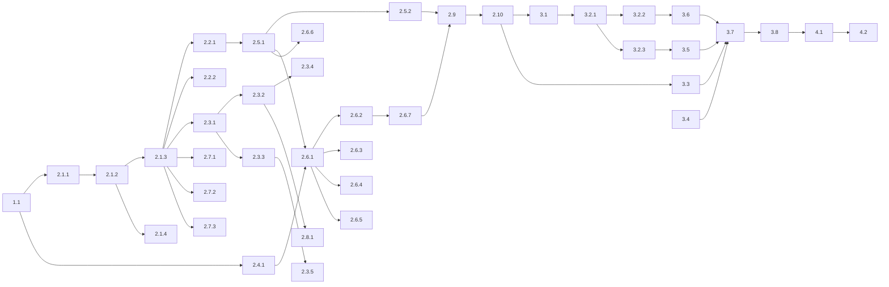

# WBS — Módulos por Turma

## Purpose

Este documento decompõe a implementação do [Tech Spec — Módulos por Turma](CLASS_MODULE_SELECTION_TECH_SPEC.md) em pacotes de trabalho.
Define entregáveis, testes iniciais, dependências, critérios de conclusão e a ordem de execução.

**Estado:** em implementação. A implementação local e a verificação de app estão concluídas; a aceitação completa e a entrega estão pendentes.
**Data:** 14 de outubro de 2026.

O tech spec é dono das decisões, dos contratos e dos cenários de teste.
Este documento não repete essas regras. Cada pacote indica a secção do spec que aplica.

## Estado de execução

Verificação contra a árvore de trabalho, em 15 de outubro de 2026.
O código local e os testes não dispensam a verificação independente final.

| Categoria | Estado local |
| :--- | :--- |
| 2 — Servidor e motor | Implementação local e testes. Ver [class_service.py](../../backend/app/services/class_service.py), [curriculum.py](../../backend/app/scheduler/infrastructure/curriculum.py) e [0002_class_subject_modules.py](../../backend/alembic/versions/0002_class_subject_modules.py). |
| 3 — Ecrãs | Implementação local e testes. Ver `frontend/src/pages/ClassSubjects.jsx` e os testes em `frontend/src/test/`. |
| Verificação independente final | Verificação local e verificação do projeto app concluídas; as restantes verificações de navegador e a CI não correram agora. Ver [Command Reference](../00_getting_started/COMMAND_REFERENCE.md) e [scripts/test.mjs](../../scripts/test.mjs). |
| Percurso e2e (project app) | Verificado com `node scripts/test.mjs e2e --project app`, incluindo os percursos de seleção de módulos e de aulas conjuntas e as regressões de operação, geração e QA; registo `e2e-app.xml` em `.test-artifacts/`. Os restantes projetos e a CI não correram agora. |
| Aceitação manual | Pendente. Os quatro passos manuais da secção de verificação não estão todos executados como percurso completo. Ver [Verification Procedure](CLASS_MODULE_SELECTION_TECH_SPEC.md#verification-procedure). |
| Entrega (PR, CI e publicação) | Não realizada. |

## Intended Reader

Este documento destina-se aos agentes e engenheiros que implementam a funcionalidade, e ao responsável de produto que acompanha o progresso.

## Prerequisites

- Leia o [tech spec](CLASS_MODULE_SELECTION_TECH_SPEC.md) completo.
- Siga o [AGENTS.md](../../AGENTS.md): clean code, Clean Architecture, TDD e Ponytail (`full`).
- Use apenas comandos da [Command Reference](../00_getting_started/COMMAND_REFERENCE.md).

## Convenções

| Campo | Significado |
| :--- | :--- |
| ID | Posição na árvore. `2.6.3` é o terceiro pacote do grupo 2.6. |
| Dimensão | **P**: um ficheiro e testes simples. **M**: vários ficheiros ou testes de integração. **G**: motor de horários com cenários longos. |
| Teste primeiro | O teste que falha antes da alteração. |
| Concluído quando | A condição observável que fecha o pacote. |
| Depende de | Os pacotes que têm de estar concluídos antes. |

Cada pacote termina num commit com mensagem Conventional Commit.
Um pacote sem alteração de comportamento, como documentação, não precisa de teste inicial.

## Árvore de trabalho

```text
1   Preparação
1.1   Linha de base verde
2   PR 1 — Servidor e motor
2.1   Base de dados
2.1.1   Contrato da cadeia de migrações
2.1.2   Migração 0002_class_subject_modules
2.1.3   Modelos SQLAlchemy
2.1.4   Privacidade
2.2   Fixtures de teste
2.2.1   Seed do motor com seleção
2.2.2   Construções diretas de ClassSubjectLink
2.3   API da seleção
2.3.1   Esquemas
2.3.2   Leitura dos módulos da turma
2.3.3   Gravação de module_ids
2.3.4   Disciplina nova com todos os módulos
2.3.5   Isolamento entre escolas
2.4   Domínio do motor
2.4.1   close_retired_modules
2.5   Projeção curricular
2.5.1   Requisitos a partir da seleção
2.5.2   Erro CLASS_SUBJECT_WITHOUT_MODULES
2.6   Leitores do motor
2.6.1   Carregador da visão de planeamento
2.6.2   Snapshot de geração
2.6.3   Crédito dos sumários
2.6.4   Capacidade das substituições
2.6.5   Liquidação no reinício do ano
2.6.6   Painel e alteração de grelha
2.6.7   Histórico nas propostas
2.7   Pré-validação, prontidão e fingerprint
2.7.1   Bloqueio na pré-validação
2.7.2   Prontidão da escola
2.7.3   Fingerprint de geração
2.8   Progresso
2.8.1   Progresso da turma e do professor
2.9   Documentação do servidor
2.10  Entrega do PR 1
3   PR 2 — Ecrãs
3.1   Hook useUpdateClassSubject
3.2   Checklist em Disciplinas e Professores
3.2.1   Botão de resumo e lista expansível
3.2.2   Gravação ao clicar
3.2.3   Avisos e estados
3.3   Página da turma
3.4   Aviso na página Disciplinas
3.5   Tutorial
3.6   Percurso e2e
3.7   Documentação dos ecrãs
3.8   Entrega do PR 2
4   Fecho
4.1   Verificação manual
4.2   Estado final dos documentos
```

## Pacotes de trabalho

### 1 Preparação

#### 1.1 Linha de base verde — P

- **Entregável:** registo dos testes que já falham no ramo antes de qualquer alteração.
- **Teste primeiro:** não se aplica.
- **Concluído quando:** `fast --scope backend`, `fast --scope frontend` e `integration` correram. As falhas existentes estão anotadas.
- **Depende de:** —

### 2 PR 1 — Servidor e motor

Ramo: `feat/class-module-selection`. Este PR não muda o que o utilizador vê.

#### 2.1 Base de dados

##### 2.1.1 Contrato da cadeia de migrações — P

- **Entregável:** `test_migration_history_has_one_frozen_baseline` aceita uma cadeia linear a partir da baseline.
- **Teste primeiro:** o teste rejeita um ramo e aceita uma revisão com `down_revision` igual à anterior.
- **Concluído quando:** o teste continua a exigir a baseline sem alterações e uma cadeia sem ramos.
- **Depende de:** 1.1
- **Spec:** [Migração](CLASS_MODULE_SELECTION_TECH_SPEC.md#migração).

##### 2.1.2 Migração 0002_class_subject_modules — M

- **Entregável:** tabela `class_subject_module`, RLS, permissões, preenchimento inicial e coluna `planned`.
- **Teste primeiro:** um teste de integração cria ligações antes da migração e confirma todos os módulos marcados depois.
- **Concluído quando:** `test_rls_database_policies.py` passa com a tabela nova. O `downgrade` funciona.
- **Depende de:** 2.1.1
- **Spec:** [Modelo de dados](CLASS_MODULE_SELECTION_TECH_SPEC.md#modelo-de-dados) e [Migração](CLASS_MODULE_SELECTION_TECH_SPEC.md#migração).
- **Risco:** a FK composta exige as restrições `uq_class_subject_link_org_id` e `uq_module_org_id`.

##### 2.1.3 Modelos SQLAlchemy — P

- **Entregável:** `Table` `class_subject_module` em `models.py` e coluna `planned` em `CurricularRequirement`.
- **Teste primeiro:** a verificação de drift falha antes de os modelos existirem.
- **Concluído quando:** a verificação de drift da Command Reference não encontra diferenças.
- **Depende de:** 2.1.2

##### 2.1.4 Privacidade — P

- **Entregável:** entrada `"class_subject_module": "delete"` em `backend/scripts/privacy.py`.
- **Teste primeiro:** os testes de privacidade falham com a tabela nova sem entrada.
- **Concluído quando:** `test_privacy_administrative_erasure.py` e `test_privacy_maintenance.py` passam.
- **Depende de:** 2.1.2

#### 2.2 Fixtures de teste

##### 2.2.1 Seed do motor com seleção — P

- **Entregável:** `seed_v1_assignment` em `backend/tests/_support/scheduler_v1.py` insere a seleção.
- **Teste primeiro:** não se aplica. O pacote 2.5.1 torna a seleção obrigatória para a geração.
- **Concluído quando:** os testes do motor que usam o seed geram horários como antes.
- **Depende de:** 2.1.3

##### 2.2.2 Construções diretas de ClassSubjectLink — M

- **Entregável:** os testes que criam `ClassSubjectLink(` diretamente inserem a seleção quando chegam ao sync, à pré-validação, à prontidão ou ao progresso.
- **Teste primeiro:** não se aplica.
- **Concluído quando:** `integration` passa sem alterar asserções. Procure as construções em `backend/tests/`.
- **Depende de:** 2.1.3

#### 2.3 API da seleção

##### 2.3.1 Esquemas — P

- **Entregável:** `ClassSubjectModuleRead`, `ClassSubjectRead.modules` e `ClassSubjectUpdate.module_ids`.
- **Teste primeiro:** coberto pelos testes de 2.3.2 e 2.3.3.
- **Concluído quando:** os esquemas correspondem ao [Contrato HTTP](CLASS_MODULE_SELECTION_TECH_SPEC.md#contrato-http).
- **Depende de:** 2.1.3

##### 2.3.2 Leitura dos módulos da turma — M

- **Entregável:** `get_class_subjects` devolve `modules` com `selected`, por `order`.
- **Teste primeiro:** `test_class_subjects.py` pede a lista e espera `modules`.
- **Concluído quando:** a leitura usa uma consulta adicional, no máximo. O número de consultas não depende do número de disciplinas.
- **Depende de:** 2.3.1

##### 2.3.3 Gravação de module_ids — M

- **Entregável:** `update_class_subject_teacher` passa a `update_class_subject` e aceita `module_ids`.
- **Teste primeiro:** em `test_class_subjects.py`: lista vazia aceite, IDs repetidos rejeitados, módulo de outra disciplina rejeitado.
- **Concluído quando:** a gravação substitui a seleção e regista `record_scheduler_change`. `_class_subject_snapshot` inclui `module_ids`.
- **Depende de:** 2.3.1
- **Nota:** atualize os chamadores, incluindo `classes.py` e `bulk_import_service.py`.

##### 2.3.4 Disciplina nova com todos os módulos — P

- **Entregável:** `add_class_subject` insere todos os módulos da disciplina.
- **Teste primeiro:** `test_class_subjects.py` (`POST`) e `test_bulk_import.py` (Atribuições) esperam todos os módulos marcados.
- **Concluído quando:** os dois testes passam.
- **Depende de:** 2.3.2

##### 2.3.5 Isolamento entre escolas — P

- **Entregável:** a gravação rejeita módulos de outra organização com `404 resource_not_found`.
- **Teste primeiro:** caso novo em `test_tenant_isolation_business.py`.
- **Concluído quando:** o teste passa e a consulta filtra por `organization_id`.
- **Depende de:** 2.3.3

#### 2.4 Domínio do motor

##### 2.4.1 close_retired_modules — P

- **Entregável:** a função pura em `backend/app/scheduler/domain/demand.py`.
- **Teste primeiro:** os quatro casos da secção [Domínio (unitários)](CLASS_MODULE_SELECTION_TECH_SPEC.md#domínio-unitários).
- **Concluído quando:** os testes unitários passam com `fast --scope backend -- -k scheduler`.
- **Depende de:** 1.1. Pode correr em paralelo com 2.1 a 2.3.
- **Spec:** [Regra do módulo retirado](CLASS_MODULE_SELECTION_TECH_SPEC.md#regra-do-módulo-retirado).

#### 2.5 Projeção curricular

##### 2.5.1 Requisitos a partir da seleção — G

- **Entregável:** `sync_curricular_projection` lê a seleção, define `planned` e usa `sequence = module.order + 1`.
- **Teste primeiro:** em `test_scheduler_v1_projection.py`: só os módulos marcados; desmarcado sem créditos apagado; desmarcado com créditos fica `planned = false`.
- **Concluído quando:** os três cenários passam e voltar a marcar repõe `planned = true`.
- **Depende de:** 2.2.1. Os testes escrevem a seleção diretamente na tabela.
- **Spec:** [Projeção curricular](CLASS_MODULE_SELECTION_TECH_SPEC.md#projeção-curricular).

##### 2.5.2 Erro CLASS_SUBJECT_WITHOUT_MODULES — M

- **Entregável:** o sync levanta `SnapshotConfigurationError` para uma ligação ativa sem módulos marcados.
- **Teste primeiro:** em `test_scheduler_v1_projection.py`, uma ligação sem módulos levanta o erro.
- **Concluído quando:** o pedido de geração e o pedido de alteração de grelha devolvem o código.
- **Depende de:** 2.5.1

#### 2.6 Leitores do motor

##### 2.6.1 Carregador da visão de planeamento — M

- **Entregável:** um carregador em `backend/app/scheduler/infrastructure/progress.py` que devolve requisitos e minutos na visão de planeamento.
- **Teste primeiro:** um teste de integração com um módulo retirado com créditos espera o módulo fechado nesses minutos.
- **Concluído quando:** a reprodução do histórico continua a usar todas as linhas com os minutos do catálogo.
- **Depende de:** 2.4.1, 2.5.1
- **Spec:** [Leitores dos requisitos](CLASS_MODULE_SELECTION_TECH_SPEC.md#leitores-dos-requisitos).

##### 2.6.2 Snapshot de geração — G

- **Entregável:** `snapshot.py` usa o carregador antes de `_build_assignments`.
- **Teste primeiro:** desmarcar um módulo com sumários e gerar. O horário não tem aulas desse módulo.
- **Concluído quando:** o cenário passa e o histórico fica intacto.
- **Depende de:** 2.6.1

##### 2.6.3 Crédito dos sumários — M

- **Entregável:** o crédito com `frontier_credit` em `operations.py` usa a visão de planeamento.
- **Teste primeiro:** em `test_scheduler_v1_operations.py`, um sumário depois de desmarcar credita o módulo marcado seguinte.
- **Concluído quando:** o teste passa.
- **Depende de:** 2.6.1

##### 2.6.4 Capacidade das substituições — P

- **Entregável:** a verificação de capacidade em `occurrences.py` usa a visão de planeamento.
- **Teste primeiro:** em `test_scheduler_v1_occurrences.py`, um módulo retirado não conta como capacidade disponível.
- **Concluído quando:** o teste passa.
- **Depende de:** 2.6.1

##### 2.6.5 Liquidação no reinício do ano — P

- **Entregável:** a liquidação de dívida em `progress.py` usa a visão de planeamento.
- **Teste primeiro:** a liquidação não credita um módulo retirado.
- **Concluído quando:** o teste passa.
- **Depende de:** 2.6.1

##### 2.6.6 Painel e alteração de grelha — P

- **Entregável:** `dashboard_service.py` e `grid_change_service.py` filtram `planned = true`.
- **Teste primeiro:** o progresso da turma no painel ignora um módulo retirado.
- **Concluído quando:** o teste passa e os limites de `test_query_budgets.py` ficam iguais.
- **Depende de:** 2.5.1

##### 2.6.7 Histórico nas propostas — G

- **Entregável:** confirmação de que `proposals.py` e a cópia das aulas registadas aceitam módulos fechados.
- **Teste primeiro:** em `test_scheduler_v1_recovery.py`, uma falta registada num módulo retirado. A recuperação gera e aprova a proposta.
- **Concluído quando:** este cenário passa. O cenário de voltar a marcar um módulo anterior também passa.
- **Depende de:** 2.6.2
- **Risco:** é o pacote com mais incerteza. Se um validador falhar, corrija a causa no carregador, não no validador.

#### 2.7 Pré-validação, prontidão e fingerprint

##### 2.7.1 Bloqueio na pré-validação — M

- **Entregável:** o bloqueio `CLASS_SUBJECT_WITHOUT_MODULES` em `PreflightService.evaluate`.
- **Teste primeiro:** em `backend/tests/contracts/test_preflight_service.py`, o bloqueio aparece com a rota da turma.
- **Concluído quando:** o teste passa e os limites de `test_query_budgets.py` ficam iguais.
- **Depende de:** 2.1.3
- **Spec:** [Pré-validação, prontidão e fingerprint](CLASS_MODULE_SELECTION_TECH_SPEC.md#pré-validação-prontidão-e-fingerprint).
- **Risco:** o painel chama a pré-validação. Junte a consulta nova a uma existente se o limite de consultas do painel falhar.

##### 2.7.2 Prontidão da escola — P

- **Entregável:** `valid_link` em `school_readiness_service.py` exige um módulo marcado.
- **Teste primeiro:** em `backend/tests/contracts/test_school_readiness_service.py`, uma ligação sem módulos não conta.
- **Concluído quando:** o teste passa.
- **Depende de:** 2.1.3

##### 2.7.3 Fingerprint de geração — P

- **Entregável:** `class_subject_modules` em `generation_input_snapshot`.
- **Teste primeiro:** em `test_scheduler_fingerprint_service.py`, a fingerprint muda quando a seleção muda.
- **Concluído quando:** o teste passa.
- **Depende de:** 2.1.3

#### 2.8 Progresso

##### 2.8.1 Progresso da turma e do professor — M

- **Entregável:** `_build_subject_with_progress` recebe os módulos marcados.
- **Teste primeiro:** em `test_module_progress.py`, o progresso da turma e do professor mostra só os módulos marcados.
- **Concluído quando:** `update_class_progress` rejeita um módulo não marcado com o erro atual.
- **Depende de:** 2.3.2
- **Spec:** [Progresso](CLASS_MODULE_SELECTION_TECH_SPEC.md#progresso).

#### 2.9 Documentação do servidor — M

- **Entregável:** as linhas de servidor da secção [Documentação a atualizar](CLASS_MODULE_SELECTION_TECH_SPEC.md#documentação-a-atualizar).
- **Teste primeiro:** não se aplica. Verifique cada afirmação contra o código.
- **Concluído quando:** as ligações relativas resolvem e `git diff --check` não reporta erros.
- **Depende de:** 2.1 a 2.8

#### 2.10 Entrega do PR 1 — M

- **Entregável:** pull request integrado em `main`.
- **Teste primeiro:** não se aplica.
- **Concluído quando:**
  1. As provas locais da [Verification Procedure](CLASS_MODULE_SELECTION_TECH_SPEC.md#verification-procedure) passaram, incluindo `integration -- -k scheduler`.
  2. `backend`, `frontend`, `e2e-runtime` e `e2e-browser` estão verdes.
  3. O PR foi integrado com squash e o `Deploy check` em `main` passou.
- **Depende de:** 2.9

### 3 PR 2 — Ecrãs

Ramo novo a partir de `main` depois de 2.10. Carregue também `cronos-frontend-designer`.

#### 3.1 Hook useUpdateClassSubject — P

- **Entregável:** `useUpdateClassSubject` substitui `useUpdateClassSubjectTeacher`.
- **Teste primeiro:** em `frontend/src/test/featureDataHooks.test.jsx`, o hook envia `module_ids` e invalida `classes` e `teacher-progress`.
- **Concluído quando:** o teste passa e `ClassSubjects.jsx` usa o hook novo.
- **Depende de:** 2.10
- **Spec:** [Hooks](CLASS_MODULE_SELECTION_TECH_SPEC.md#hooks).

#### 3.2 Checklist em Disciplinas e Professores

Todos os testes deste grupo ficam em `frontend/src/test/ClassSubjects.test.jsx`.
Spec: [Disciplinas e Professores](CLASS_MODULE_SELECTION_TECH_SPEC.md#disciplinas-e-professores-classsubjectsjsx).

##### 3.2.1 Botão de resumo e lista expansível — M

- **Entregável:** o botão `Módulos: {marcados} de {total} · {horas} h` e a lista de `CFormCheck`.
- **Teste primeiro:** o botão mostra o contador. Ao clicar, `aria-expanded` muda e a lista aparece.
- **Concluído quando:** a lista funciona com teclado e cada caixa tem rótulo acessível.
- **Depende de:** 3.1

##### 3.2.2 Gravação ao clicar — M

- **Entregável:** cada clique envia a lista completa. Os controlos ficam desativados durante a gravação.
- **Teste primeiro:** desmarcar um módulo chama a mutação sem esse módulo. Durante a gravação, as caixas estão desativadas.
- **Concluído quando:** o sucesso mostra o toast `Módulos atualizados.` com `id` fixo. Um erro transitório mostra um toast.
- **Depende de:** 3.2.1

##### 3.2.3 Avisos e estados — P

- **Entregável:** `Sem módulos`, `{n} sem módulos`, a mensagem de disciplina sem módulos e o modo só de leitura.
- **Teste primeiro:** uma disciplina sem módulos marcados mostra `Sem módulos`. Em `readOnly`, as caixas estão desativadas.
- **Concluído quando:** os testes passam.
- **Depende de:** 3.2.1

#### 3.3 Página da turma — P

- **Entregável:** coluna `Módulos` e mensagem `Nenhum módulo selecionado para esta turma.` em `ClassDetails.jsx`.
- **Teste primeiro:** em `frontend/src/test/ClassDetails.test.jsx`, a coluna mostra `{marcados}/{total}`.
- **Concluído quando:** o teste passa.
- **Depende de:** 2.10

#### 3.4 Aviso na página Disciplinas — P

- **Entregável:** o toast de módulo novo em `Subjects.jsx`.
- **Teste primeiro:** novo `frontend/src/test/Subjects.test.jsx`. Atualizar uma disciplina com um módulo sem `id` mostra o aviso.
- **Concluído quando:** criar uma disciplina nova não mostra o aviso.
- **Depende de:** —. Pode correr em paralelo com 3.1.

#### 3.5 Tutorial — P

- **Entregável:** `getClassSubjects` em `tutorialApiAdapter.js` devolve `modules`.
- **Teste primeiro:** em `frontend/src/test/tutorialApiAdapter.test.js`, a resposta tem `modules`, todos marcados.
- **Concluído quando:** a página do tutorial mostra a lista só de leitura.
- **Depende de:** 3.2.3

#### 3.6 Percurso e2e — M

- **Entregável:** o percurso da secção [E2E](CLASS_MODULE_SELECTION_TECH_SPEC.md#e2e).
- **Teste primeiro:** o percurso falha antes da checklist existir.
- **Concluído quando:** `e2e --project <nome>` passa quando existirem as credenciais de teste do Clerk.
- **Depende de:** 3.2.2

#### 3.7 Documentação dos ecrãs — P

- **Entregável:** as linhas de frontend da secção [Documentação a atualizar](CLASS_MODULE_SELECTION_TECH_SPEC.md#documentação-a-atualizar).
- **Teste primeiro:** não se aplica.
- **Concluído quando:** as ligações relativas resolvem e `git diff --check` não reporta erros.
- **Depende de:** 3.1 a 3.6

#### 3.8 Entrega do PR 2 — M

- **Entregável:** pull request integrado em `main`.
- **Teste primeiro:** não se aplica.
- **Concluído quando:**
  1. `npm run verify:checks` passou.
  2. O contentor local foi reconstruído com `docker compose up -d --build frontend`.
  3. `backend`, `frontend`, `e2e-runtime` e `e2e-browser` estão verdes.
  4. O PR foi integrado com squash e o `Deploy check` em `main` passou.
- **Depende de:** 3.7

### 4 Fecho

#### 4.1 Verificação manual — P

- **Entregável:** os quatro passos manuais da [Verification Procedure](CLASS_MODULE_SELECTION_TECH_SPEC.md#verification-procedure), feitos no contentor local.
- **Concluído quando:** os quatro passos produzem o resultado esperado.
- **Depende de:** 3.8

#### 4.2 Estado final dos documentos — P

- **Entregável:** o tech spec e este WBS passam a `Estado: implementado`.
- **Concluído quando:** os guias descrevem o comportamento e o relatório ao responsável de produto está entregue.
- **Depende de:** 4.1

## Dependências e caminho crítico



O diagrama omite as setas de 2.1.4, 2.2.2, 2.3.4, 2.3.5, 2.6.3 a 2.6.6, 2.7 e 2.8 para 2.9. Todos esses pacotes precedem 2.9.

Caminho crítico:
`1.1 → 2.1.1 → 2.1.2 → 2.1.3 → 2.2.1 → 2.5.1 → 2.6.1 → 2.6.2 → 2.6.7 → 2.9 → 2.10 → 3.1 → 3.2.1 → 3.2.2 → 3.6 → 3.7 → 3.8 → 4.1 → 4.2`.

Os grupos 2.3, 2.7 e 2.8 correm em paralelo com o caminho crítico depois de 2.1.3.
O pacote 2.4.1 corre em paralelo com 2.1 a 2.3. O pacote 3.4 corre em paralelo com todo o PR 2.
O pacote 2.6.7 tem o maior risco. Comece-o assim que 2.6.2 terminar.

## Rastreabilidade das decisões

| Decisão | Pacotes |
| :--- | :--- |
| D01 Seleção por ano escolar | 2.1.2, 2.3.2 |
| D02 Checklist em "Disciplinas e Professores" | 3.2.1 |
| D03 Disciplina nova com todos os módulos | 2.3.4 |
| D04 Ligações existentes com todos os módulos | 2.1.2 |
| D05 Módulo novo sem marcação automática | 2.5.1, 3.4 |
| D06 Desmarcar sempre permitido | 2.3.3, 2.5.1 |
| D07 Histórico preservado e módulo fechado | 2.4.1, 2.6.1 a 2.6.7 |
| D08 Bloqueio sem módulos marcados | 2.5.2, 2.7.1, 3.2.3 |
| D09 Gravação ao clicar | 3.2.2 |
| D10 Progresso só dos módulos marcados | 2.6.6, 2.8.1, 3.3 |
| D11 Voltar a marcar retoma o histórico | 2.5.1, 2.6.7 |

## Definição de concluído

Um pacote está concluído quando:

1. O teste inicial falhou antes da alteração e passa depois.
2. A alteração é a menor que satisfaz o teste, segundo o Ponytail.
3. Nenhum teste existente foi enfraquecido, saltado ou apagado.
4. O commit nomeia o pacote, por exemplo `feat(classes): accept module_ids (WBS 2.3.3)`.

Um pull request está concluído quando a descrição indica os pacotes, os comandos exatos e os resultados.

## Related Documents

- [Tech Spec — Módulos por Turma](CLASS_MODULE_SELECTION_TECH_SPEC.md)
- [Professional Education](PROFESSIONAL_EDUCATION.md)
- [Testing and CI](../08_security_quality/TESTING_AND_CI.md)
- [Command Reference](../00_getting_started/COMMAND_REFERENCE.md)
