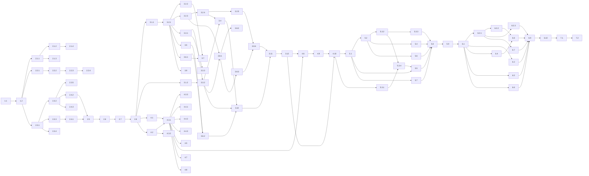

# WBS — Aulas Conjuntas

## Purpose

Este documento decompõe a implementação do [Tech Spec — Aulas Conjuntas](JOINT_LESSONS_TECH_SPEC.md) em pacotes de trabalho.
Define entregáveis, testes iniciais, dependências, critérios de conclusão e a ordem de execução.

**Estado:** em implementação. A implementação local e a verificação de app estão concluídas; a aceitação completa e a entrega estão pendentes.
**Data:** 14 de outubro de 2026.

O tech spec é dono das decisões, dos contratos e dos cenários de teste.
Este documento não repete essas regras. Cada pacote indica a secção do spec que aplica.

## Estado de execução

Verificação contra a árvore de trabalho, em 15 de outubro de 2026.
O código local e os testes não dispensam a verificação independente final.

| Categoria | Estado local |
| :--- | :--- |
| 2 — Base de dados e domínio | Implementação local e testes. Ver [models.py](../../backend/app/models.py), [teaching_units.py](../../backend/app/scheduler/domain/teaching_units.py) e [test_scheduler_teaching_units.py](../../backend/tests/unit/test_scheduler_teaching_units.py). |
| 3 — Motor | Implementação local e testes. Ver [snapshot.py](../../backend/app/scheduler/infrastructure/snapshot.py) e os testes `backend/tests/integration/committed/test_joint_lesson_engine.py` e `test_joint_lesson_recovery.py`. |
| 4 — Configuração | Implementação local e testes. Ver [joint_lesson_policy.py](../../backend/app/services/joint_lesson_policy.py), [joint_lesson_service.py](../../backend/app/services/joint_lesson_service.py) e [test_joint_lesson_groups.py](../../backend/tests/integration/committed/test_joint_lesson_groups.py). |
| 5 — Operação | Implementação local e testes. Ver `backend/tests/integration/committed/test_joint_lesson_operations.py`, `test_joint_lesson_occurrences.py`, `test_joint_lesson_timesheets.py` e `test_joint_lesson_internship.py`. |
| 6 — Ecrãs | Implementação local e testes. Ver `frontend/src/` e os testes em `frontend/src/test/`. |
| 3.9 e 3.10 — Diagnóstico e laboratório | Implementação e prova local com resultado do job persistido; verificação final pendente. Ver [diagnostics.py](../../backend/app/scheduler/domain/diagnostics.py), [typology.py](../../backend/app/scheduler/lab/typology.py), [test_joint_lesson_diagnostics.py](../../backend/tests/unit/test_joint_lesson_diagnostics.py), [test_joint_lesson_lab.py](../../backend/tests/unit/test_joint_lesson_lab.py) e [test_joint_lesson_diagnostic_job.py](../../backend/tests/integration/committed/test_joint_lesson_diagnostic_job.py). |
| Verificação independente final | Verificação local e verificação do projeto app concluídas; as restantes verificações de navegador e a CI não correram agora. Ver [Command Reference](../00_getting_started/COMMAND_REFERENCE.md) e [scripts/test.mjs](../../scripts/test.mjs). |
| Percurso e2e (project app) | Verificado com `node scripts/test.mjs e2e --project app`, incluindo os percursos de seleção de módulos e de aulas conjuntas e as regressões de operação, geração e QA; registo `e2e-app.xml` em `.test-artifacts/`. Os restantes projetos e a CI não correram agora. |
| Aceitação manual | Pendente. Os seis passos manuais da secção de verificação, incluindo a checklist conjunta, a vista da turma, o sumário com turma ausente e a aula de reposição, não estão todos executados na interface. Ver [Verification Procedure](JOINT_LESSONS_TECH_SPEC.md#verification-procedure). |
| Mensagem de diagnóstico | Lacuna de texto: a interface de `JOINT_NO_COMMON_TIME` mostra uma mensagem genérica, sem nomes das turmas e da disciplina. Ver [GenerationStatusPanel.jsx](../../frontend/src/components/schedules/GenerationStatusPanel.jsx) e [diagnostics.py](../../backend/app/scheduler/domain/diagnostics.py). |
| Entrega (PR, CI e publicação) | Não realizada. |

## Intended Reader

Este documento destina-se aos agentes e engenheiros que implementam a funcionalidade, e ao responsável de produto que acompanha o progresso.

## Prerequisites

- Leia o [tech spec](JOINT_LESSONS_TECH_SPEC.md) completo.
- Leia o tech spec do item 1, Módulos por Turma. Esta funcionalidade usa a seleção de módulos e a visão de planeamento desse item.
- Siga o [AGENTS.md](../../AGENTS.md): clean code, Clean Architecture, TDD e Ponytail (`full`).
- Use apenas comandos da [Command Reference](../00_getting_started/COMMAND_REFERENCE.md).

## Convenções

| Campo | Significado |
| :--- | :--- |
| ID | Posição na árvore. `3.6.2` é o segundo pacote do grupo 3.6. |
| Dimensão | **P**: um ficheiro e testes simples. **M**: vários ficheiros ou testes de integração. **G**: motor de horários, cenários longos ou alteração em muitos ficheiros. |
| Teste primeiro | O teste que falha antes da alteração. |
| Concluído quando | A condição observável que fecha o pacote. |
| Depende de | Os pacotes que têm de estar concluídos antes. |

Cada pacote termina num commit com mensagem Conventional Commit.
Um pacote sem alteração de comportamento, como documentação, não precisa de teste inicial.

## Ordem dos pull requests

| PR | Ramo | Desenvolvimento | Integração em `main` |
| :--- | :--- | :--- | :--- |
| 1 — Base de dados e domínio | `feat/joint-lessons-domain` | Depois de 1.2. | Primeiro. |
| 2 — Motor | `feat/joint-lessons-engine` | Depois de 2.8. | Depois do PR 1. |
| 3 — Configuração | `feat/joint-lessons-config` | Em paralelo com o PR 2, depois de 2.8. | Só depois do PR 2. |
| 4 — Operação | `feat/joint-lessons-operations` | Depois de 3.12. | Depois do PR 3. |
| 5 — Ecrãs | `feat/joint-lessons-ui` | Depois de 4.10 e 5.9. | Por último. |

O PR 3 nunca entra antes do PR 2.
Sem o motor novo, uma junção criada pela API seria planeada como turmas separadas, sem aviso.

## Árvore de trabalho

```text
1   Preparação
1.1   Contratos do item 1 confirmados
1.2   Linha de base verde
2   PR 1 — Base de dados e domínio
2.1   Base de dados
2.1.1   Migração 0004_joint_lesson_groups
2.1.2   Modelos SQLAlchemy
2.1.3   Privacidade
2.1.4   Chave da unidade nas aulas gravadas
2.2   Unidades de ensino
2.2.1   Segmentação
2.2.2   Unidades, chaves e identificadores
2.2.3   Progresso conjunto e défice
2.2.4   Precedências
2.3   Contratos do domínio
2.3.1   class_ids em Assignment e ScheduledLesson
2.3.2   precedences e claim_classes no snapshot
2.3.3   Elegibilidade por turma membro
2.3.4   Qualidade e recuperação por turma membro
2.3.5   Serialização compatível
2.4   Validador v5
2.4.1   Recursos por turma membro
2.4.2   PRECEDENCE_VIOLATION
2.4.3   Reservas por aula e turma
2.5   Oráculo
2.6   Documentação do PR 1
2.7   Revisão de compatibilidade
2.8   Entrega do PR 1
3   PR 2 — Motor
3.1   Fixtures
3.1.1   Seed de junções nos testes
3.1.2   Família de laboratório com junções
3.2   Snapshot
3.2.1   Unidades no snapshot
3.2.2   Salas da unidade conjunta
3.2.3   Aulas irmãs e associação à unidade
3.2.4   Dívidas por unidade e turma
3.2.5   Histórico e reprojeção por unidade
3.3   Construção cronológica
3.3.1   Seleção do período com unidades conjuntas
3.3.2   Precedência na construção
3.3.3   Prioridade e padrão semanal por turma membro
3.4   Recuperação adaptativa
3.5   Modelo anual
3.6   Modelo de colocação
3.6.1   Turmas membro na colocação
3.6.2   Precedência linear
3.7   Salas e continuidade
3.8   Persistência e propostas
3.8.1   Gravar aulas irmãs
3.8.2   Diferença da proposta
3.8.3   Reservas por aula irmã
3.8.4   Aprovação e registos
3.9   Diagnóstico de horas em comum
3.10  Medição de desempenho
3.11  Documentação do PR 2
3.12  Entrega do PR 2
4   PR 3 — Configuração
4.1   Regras puras
4.2   Esquemas
4.3   Serviço e rotas novas
4.3.1   Criar, editar e desfazer
4.3.2   Turmas candidatas
4.3.3   Isolamento entre escolas
4.4   Bloqueios nas rotas existentes
4.4.1   Módulo conjunto na checklist
4.4.2   Professor propagado
4.4.3   Ligação, turma e módulo em uso
4.5   Junção na lista de disciplinas da turma
4.6   Pré-validação
4.7   Prontidão
4.8   Fingerprint
4.9   Documentação do PR 3
4.10  Entrega do PR 3
5   PR 4 — Operação
5.1   Sumário com presenças
5.2   Ocorrências por turma e conjuntas
5.3   Substitutos
5.3.1   joint_frontier_credit
5.3.2   Candidatos de uma aula conjunta
5.3.3   Exclusão numa aula de uma turma
5.3.4   Substituição conjunta e conclusão
5.4   Reposição ponta a ponta
5.5   Folha semanal e totais do professor
5.6   Estágio
5.7   Vista semanal
5.8   Documentação do PR 4
5.9   Entrega do PR 4
6   PR 5 — Ecrãs
6.1   Hooks
6.2   Disciplinas e Professores
6.2.1   Resumo da junção e módulo bloqueado
6.2.2   Modal Aula conjunta
6.2.3   Desfazer e mudar professor
6.3   Página da turma
6.4   Horários
6.5   Sumário
6.6   Faltas e Ocorrências
6.7   Tutorial
6.8   Percurso e2e
6.9   Documentação dos ecrãs
6.10  Entrega do PR 5
7   Fecho
7.1   Verificação manual
7.2   Estado final dos documentos
```

## Pacotes de trabalho

### 1 Preparação

#### 1.1 Contratos do item 1 confirmados — P

- **Entregável:** confirmação, contra `main`, dos contratos do item 1 que este spec usa.
- **Teste primeiro:** não se aplica.
- **Concluído quando:**
  1. O PR de servidor e motor do item 1 está integrado em `main`. Os ecrãs do item 1 só são precisos antes de 6.2.1.
  2. Existem a tabela `class_subject_module`, a coluna `curricular_requirement.planned`, o carregador da visão de planeamento e `module_ids` no `PATCH` da disciplina da turma.
  3. O nome da migração do item 1 está registado como `down_revision` da `0003`.
  4. Qualquer diferença atualiza o tech spec antes de começar o PR 1.
- **Depende de:** —

#### 1.2 Linha de base verde — P

- **Entregável:** registo dos testes que já falham em `main` antes de qualquer alteração.
- **Teste primeiro:** não se aplica.
- **Concluído quando:** `fast --scope backend`, `fast --scope frontend` e `integration` correram. As falhas existentes estão anotadas.
- **Depende de:** 1.1

### 2 PR 1 — Base de dados e domínio

Ramo: `feat/joint-lessons-domain`. Este PR não muda o que o utilizador vê.
Todas as aulas continuam a ter uma turma e a chave `A:{assignment_id}`.

#### 2.1 Base de dados

##### 2.1.1 Migração 0004_joint_lesson_groups — M

- **Entregável:** as três tabelas, RLS, permissões, a coluna `teaching_unit_key` preenchida e a nova restrição única de `stable_key`.
- **Teste primeiro:** um teste de integração cria aulas antes da migração e confirma `A:{assignment_id}` depois.
- **Concluído quando:** `test_rls_database_policies.py` passa com as tabelas novas. O `downgrade` funciona numa base sem aulas irmãs.
- **Depende de:** 1.2
- **Spec:** [Modelo de dados](JOINT_LESSONS_TECH_SPEC.md#modelo-de-dados) e [Migração](JOINT_LESSONS_TECH_SPEC.md#migração).
- **Risco:** as FKs compostas usam `uq_subject_org_id`, `uq_class_subject_link_org_id` e `uq_module_org_id`, que já existem.

##### 2.1.2 Modelos SQLAlchemy — P

- **Entregável:** as três tabelas em `backend/app/models.py` e `teaching_unit_key` em `SchedulerLessonV1`.
- **Teste primeiro:** a verificação de drift falha antes de os modelos existirem.
- **Concluído quando:** a verificação de drift da Command Reference não encontra diferenças.
- **Depende de:** 2.1.1

##### 2.1.3 Privacidade — P

- **Entregável:** as três tabelas em `backend/scripts/privacy.py` com a ação `delete`.
- **Teste primeiro:** os testes de privacidade falham com as tabelas novas sem entrada.
- **Concluído quando:** `test_privacy_administrative_erasure.py` e `test_privacy_maintenance.py` passam.
- **Depende de:** 2.1.1

##### 2.1.4 Chave da unidade nas aulas gravadas — M

- **Entregável:** todo o código que cria `SchedulerLessonV1` escreve `teaching_unit_key`. Hoje é sempre `A:{assignment_id}`.
- **Teste primeiro:** gerar e aprovar um horário falha com a coluna `NOT NULL` antes da alteração.
- **Concluído quando:** `integration -- -k scheduler` passa. Procure `SchedulerLessonV1(` em `backend/app/` e `backend/tests/`.
- **Depende de:** 2.1.2

#### 2.2 Unidades de ensino

Todos os testes deste grupo ficam no novo `backend/tests/unit/test_scheduler_teaching_units.py`.
O módulo novo é `backend/app/scheduler/domain/teaching_units.py`. Não importa SQLAlchemy, FastAPI nem OR-Tools.
Spec: [Do plano curricular às unidades de ensino](JOINT_LESSONS_TECH_SPEC.md#do-plano-curricular-às-unidades-de-ensino).

##### 2.2.1 Segmentação — M

- **Entregável:** a divisão dos módulos conjuntos em segmentos e a sequência `S0, J1, S1, ...` de cada turma.
- **Teste primeiro:** o exemplo de referência produz `J1 = M1..M4`, `S1 = {M5}` na MKT e `S1 = {M6}` na MAS.
- **Concluído quando:** o caso da fronteira (módulo separado entre dois conjuntos) produz dois segmentos conjuntos. Um módulo retirado e fechado não cria fronteira.
- **Depende de:** 1.2. Pode correr em paralelo com 2.1.

##### 2.2.2 Unidades, chaves e identificadores — M

- **Entregável:** as unidades `A`, `S` e `J`, as suas chaves e os identificadores.
- **Teste primeiro:** uma atribuição sem junção produz uma unidade `A` com o identificador da atribuição.
- **Concluído quando:** as outras unidades têm identificadores acima do maior identificador de atribuição, pela ordem das chaves. A mesma entrada dá sempre o mesmo resultado. Professores diferentes numa junção levantam `JOINT_TEACHER_MISMATCH`.
- **Depende de:** 2.2.1

##### 2.2.3 Progresso conjunto e défice — M

- **Entregável:** os minutos executados da unidade `J` e a unidade `D`.
- **Teste primeiro:** uma turma com menos 50 minutos num módulo conjunto produz uma unidade `D` com 50 minutos em falta.
- **Concluído quando:** uma correção que põe uma turma à frente cria défice nas outras. Uma chave `D` publicada mantém a unidade mesmo com défice zero.
- **Depende de:** 2.2.2
- **Spec:** [Progresso conjunto e défice](JOINT_LESSONS_TECH_SPEC.md#progresso-conjunto-e-défice).

##### 2.2.4 Precedências — M

- **Entregável:** as precedências por etapas de cada turma.
- **Teste primeiro:** no exemplo de referência, `J1 → S1` em cada turma e nenhuma precedência entre `J1` e `D1`.
- **Concluído quando:** uma unidade sem minutos em falta não cria precedência e a cadeia salta-a. Todas as precedências ligam unidades com minutos em falta.
- **Depende de:** 2.2.3
- **Spec:** [Precedência](JOINT_LESSONS_TECH_SPEC.md#precedência).

#### 2.3 Contratos do domínio

Spec: [Contratos do domínio](JOINT_LESSONS_TECH_SPEC.md#contratos-do-domínio).

##### 2.3.1 class_ids em Assignment e ScheduledLesson — G

- **Entregável:** `class_id` passa a `class_ids` nos dois contratos. Cada leitor no domínio e na infraestrutura itera as turmas.
- **Teste primeiro:** em `test_scheduler_candidate_contracts.py`, `Assignment` aceita duas turmas e recusa zero.
- **Concluído quando:** `fast --scope backend -- -k scheduler` passa sem alterar asserções existentes. Nenhuma ocorrência de `.class_id` sobre uma atribuição fica em `backend/app/scheduler/`.
- **Depende de:** 1.2
- **Risco:** a alteração toca muitos ficheiros. Faça-a mecânica, sem mudar comportamento. As regras novas para várias turmas entram nos pacotes seguintes, cada uma com o seu teste.

##### 2.3.2 precedences e claim_classes no snapshot — M

- **Entregável:** os campos novos de `PlanningSnapshot` e a validação.
- **Teste primeiro:** o snapshot recusa uma unidade desconhecida, `u → u` e um ciclo.
- **Concluído quando:** os três testes passam e um snapshot sem os campos fica igual ao de hoje.
- **Depende de:** 2.3.1

##### 2.3.3 Elegibilidade por turma membro — M

- **Entregável:** `capacity.py` exclui um período quando qualquer turma da unidade está indisponível, bloqueada ou ocupada.
- **Teste primeiro:** em `test_scheduler_eligibility_v1.py`, uma unidade com duas turmas perde o período em que só a segunda está bloqueada.
- **Concluído quando:** os casos de indisponibilidade, dia bloqueado e ocupação fixa passam.
- **Depende de:** 2.3.1
- **Decisão:** J11.

##### 2.3.4 Qualidade e recuperação por turma membro — M

- **Entregável:** datas de conclusão, furos de turma, progresso e continuidade de sala contam em cada turma membro, em `quality.py` e `recovery.py`.
- **Teste primeiro:** em `test_scheduler_quality.py`, uma aula de duas turmas fecha a data de conclusão das duas.
- **Concluído quando:** os furos e o progresso também contam nas duas turmas.
- **Depende de:** 2.3.1

##### 2.3.5 Serialização compatível — P

- **Entregável:** `serialization.py` escreve `class_id` numa unidade com uma turma e `class_ids` só com várias. `precedences` e `claim_classes` só aparecem quando existem.
- **Teste primeiro:** a digest de um snapshot sem junções é igual à digest calculada antes da alteração. Guarde-a no teste.
- **Concluído quando:** o teste passa e a ida e volta da serialização preserva unidades conjuntas e precedências.
- **Depende de:** 2.3.2

#### 2.4 Validador v5

Todos os testes deste grupo ficam em `test_scheduler_candidate_validation.py`, salvo indicação.
Spec: [Validador independente](JOINT_LESSONS_TECH_SPEC.md#validador-independente).

##### 2.4.1 Recursos por turma membro — M

- **Entregável:** ocupação, almoço, dias bloqueados, indisponibilidade e datas de conclusão por turma membro.
- **Teste primeiro:** uma aula de duas turmas sobreposta a uma aula de uma delas devolve `RESOURCE_CONFLICT`.
- **Concluído quando:** o caso do almoço passa também em `test_scheduler_lunch_break_v1.py`. `VALIDATOR_VERSION` é `v5`.
- **Depende de:** 2.3.3

##### 2.4.2 PRECEDENCE_VIOLATION — M

- **Entregável:** o código novo e a verificação.
- **Teste primeiro:** uma aula nova de `v` antes do fim de uma aula de `u` devolve `PRECEDENCE_VIOLATION`.
- **Concluído quando:** uma aula protegida de `v` antes de `u` não é violação.
- **Depende de:** 2.3.2

##### 2.4.3 Reservas por aula e turma — M

- **Entregável:** `RESERVATION_OVERFLOW` por aula e turma. `RESERVATION_ASSIGNMENT_MISMATCH` exige a turma da dívida na aula.
- **Teste primeiro:** duas turmas reservam 50 minutos cada numa aula conjunta de 50 minutos. O validador aceita.
- **Concluído quando:** 60 minutos de uma só turma numa aula de 50 devolvem `RESERVATION_OVERFLOW`.
- **Depende de:** 2.3.2

#### 2.5 Oráculo — M

- **Entregável:** `oracle.py` aceita `class_ids` e precedências.
- **Teste primeiro:** em `test_scheduler_oracle.py`, uma instância pequena com uma unidade conjunta e uma precedência tem a solução conhecida.
- **Concluído quando:** o oráculo concorda com o validador em todas as soluções enumeradas.
- **Depende de:** 2.4.1, 2.4.2

#### 2.6 Documentação do PR 1 — P

- **Entregável:** as linhas da [Documentação a atualizar](JOINT_LESSONS_TECH_SPEC.md#documentação-a-atualizar) que este PR torna verdadeiras: Data Model e a secção de validação do Scheduler V1 Tech Spec.
- **Teste primeiro:** não se aplica. Verifique cada afirmação contra o código.
- **Concluído quando:** as ligações relativas resolvem e `git diff --check` não reporta erros.
- **Depende de:** 2.1 a 2.5

#### 2.7 Revisão de compatibilidade — P

- **Entregável:** prova de que uma escola sem junções não muda.
- **Teste primeiro:** não se aplica.
- **Concluído quando:** `fast --scope backend -- -k scheduler` e `integration -- -k scheduler` passam sem alterar asserções existentes, além das que dizem `class_ids`.
- **Depende de:** 2.6

#### 2.8 Entrega do PR 1 — M

- **Entregável:** pull request integrado em `main`.
- **Teste primeiro:** não se aplica.
- **Concluído quando:**
  1. As provas locais da [Verification Procedure](JOINT_LESSONS_TECH_SPEC.md#verification-procedure) passaram para migração, RLS, lógica pura e motor.
  2. `backend`, `frontend`, `e2e-runtime` e `e2e-browser` estão verdes.
  3. O PR foi integrado com squash e o `Deploy check` em `main` passou.
- **Depende de:** 2.7

### 3 PR 2 — Motor

Ramo novo a partir de `main` depois de 2.8. Este PR não muda o que o utilizador vê.
Só os testes criam junções. A API de configuração chega no PR 3.

#### 3.1 Fixtures

##### 3.1.1 Seed de junções nos testes — P

- **Entregável:** um auxiliar em `backend/tests/_support/scheduler_v1.py` que cria uma junção com turmas, módulos e professor comum.
- **Teste primeiro:** não se aplica. Os pacotes seguintes usam o auxiliar.
- **Concluído quando:** o auxiliar escreve nas três tabelas e iguala `teacher_id` nas ligações membro.
- **Depende de:** 2.8

##### 3.1.2 Família de laboratório com junções — M

- **Entregável:** uma família nova em `backend/app/scheduler/lab/typology.py`, com disciplinas gerais em junção e técnicas separadas, como no exemplo de referência.
- **Teste primeiro:** em `test_scheduler_typology_v1.py`, a família produz unidades conjuntas e precedências válidas.
- **Concluído quando:** a família tem uma versão pequena para os testes rápidos e uma à escala da escola piloto para medição.
- **Depende de:** 2.8

#### 3.2 Snapshot

Spec: [Snapshot](JOINT_LESSONS_TECH_SPEC.md#snapshot).

##### 3.2.1 Unidades no snapshot — G

- **Entregável:** `load_snapshot` carrega as junções e constrói os `Assignment` com `build_teaching_units`.
- **Teste primeiro:** em `test_scheduler_v1_projection.py`, uma escola com uma junção produz uma unidade `J` com as duas turmas e as unidades `S` de cada turma.
- **Concluído quando:** uma escola sem junções produz o mesmo snapshot e a mesma digest de antes.
- **Depende de:** 3.1.1

##### 3.2.2 Salas da unidade conjunta — M

- **Entregável:** salas elegíveis com lotação para a soma dos alunos e interseção das salas específicas.
- **Teste primeiro:** em `test_scheduler_room_eligibility.py`, duas turmas de 18 e 15 alunos excluem uma sala de 30.
- **Concluído quando:** sem sala válida, o snapshot devolve o problema de sala com `required_capacity` igual a 33. A interseção vazia também é um problema de sala.
- **Depende de:** 3.2.1
- **Decisão:** J10.

##### 3.2.3 Aulas irmãs e associação à unidade — G

- **Entregável:** o carregamento agrupa as linhas por `(version_id, stable_key)` e associa cada grupo pela chave.
- **Teste primeiro:** uma aula protegida com uma chave que já não existe levanta `JOINT_PUBLISHED_LESSONS_CONFLICT`.
- **Concluído quando:** aulas irmãs diferentes ou retiradas em parte levantam `JOINT_LESSON_INCONSISTENT`. Uma aula editável sem unidade só emparelha identidades.
- **Depende de:** 3.2.1

##### 3.2.4 Dívidas por unidade e turma — M

- **Entregável:** `claim_assignments` e `claim_classes` pela regra do spec.
- **Teste primeiro:** uma dívida de `GAP` em todas as aulas irmãs aponta para a unidade `J`. Uma dívida de turma ausente aponta para a unidade `D`.
- **Concluído quando:** uma dívida cuja unidade não tem minutos em falta aponta para a primeira unidade da turma com minutos em falta.
- **Depende de:** 3.2.3

##### 3.2.5 Histórico e reprojeção por unidade — G

- **Entregável:** `split_version_history` e `_reproject_baseline` trabalham por unidade. O histórico de uma aula conjunta ocupa todas as turmas.
- **Teste primeiro:** em `test_scheduler_v1_recovery.py`, uma aula conjunta registada no passado bloqueia as duas turmas no mesmo intervalo.
- **Concluído quando:** uma turma ausente numa aula conjunta passada fica com défice e a reprojeção dos slices das outras não muda.
- **Depende de:** 3.2.3, 3.2.4
- **Risco:** é o pacote com mais incerteza no snapshot. Se um validador falhar, corrija a causa no carregamento, não no validador.

#### 3.3 Construção cronológica

A construção é a rota normal de produção. Todos os testes deste grupo ficam em `test_scheduler_constructive_progress_v1.py`.
Spec: [Construção cronológica](JOINT_LESSONS_TECH_SPEC.md#construção-cronológica).

##### 3.3.1 Seleção do período com unidades conjuntas — M

- **Entregável:** `_select_period` verifica todas as turmas. Com uma unidade conjunta, o período usa o modelo CP-SAT pequeno e não o fluxo.
- **Teste primeiro:** um período com uma unidade conjunta e uma unidade de uma das turmas escolhe só uma delas.
- **Concluído quando:** um período só com unidades de uma turma continua a usar `_flow_selection`.
- **Depende de:** 3.2.1

##### 3.3.2 Precedência na construção — G

- **Entregável:** uma unidade só fica ativa quando as antecessoras acabaram antes do período.
- **Teste primeiro:** no exemplo de referência, nenhuma aula de M5 da MKT começa antes do fim da última aula de M4 conjunta.
- **Concluído quando:** a família pequena de 3.1.2 constrói um candidato válido, sem recurso à pesquisa completa.
- **Depende de:** 3.3.1, 3.1.2
- **Risco:** a precedência pode levar a construção a um beco sem saída. Registe a taxa de recurso em 3.10. Não relaxe a precedência para a evitar.

##### 3.3.3 Prioridade e padrão semanal por turma membro — M

- **Entregável:** `started_classes`, `class_remaining` e o padrão semanal contam em cada turma membro.
- **Teste primeiro:** uma unidade conjunta marca as duas turmas como começadas.
- **Concluído quando:** o padrão semanal repete a aula conjunta nas duas turmas.
- **Depende de:** 3.3.1

#### 3.4 Recuperação adaptativa — G

- **Entregável:** `construct_recovery` aplica a ocupação por turma e a precedência. A unidade `D` usa a prioridade da dívida.
- **Teste primeiro:** em `test_scheduler_recovery_construction_v1.py`, o défice de uma turma é reposto antes do primeiro período do segmento seguinte.
- **Concluído quando:** uma falta do professor numa aula conjunta é reposta numa aula conjunta.
- **Depende de:** 3.3.2, 3.2.4
- **Spec:** [Recuperação adaptativa](JOINT_LESSONS_TECH_SPEC.md#recuperação-adaptativa).

#### 3.5 Modelo anual — M

- **Entregável:** cargas por turma membro e quotas nulas antes da última semana da antecessora.
- **Teste primeiro:** em `test_scheduler_annual_planning_v1.py`, a sucessora não tem quota numa semana anterior à última semana da antecessora.
- **Concluído quando:** a mesma semana é permitida. A carga de uma unidade conjunta conta nas duas turmas.
- **Depende de:** 3.2.1
- **Spec:** [Modelo anual](JOINT_LESSONS_TECH_SPEC.md#modelo-anual).

#### 3.6 Modelo de colocação

Spec: [Modelo de colocação](JOINT_LESSONS_TECH_SPEC.md#modelo-de-colocação).

##### 3.6.1 Turmas membro na colocação — M

- **Entregável:** exclusividade, almoço, medida de conclusão e furos por turma membro.
- **Teste primeiro:** em `test_scheduler_resource_exclusivity_v1.py`, a colocação nunca sobrepõe uma unidade conjunta a uma unidade de uma das turmas.
- **Concluído quando:** o caso do almoço passa em `test_scheduler_lunch_solver_v1.py`.
- **Depende de:** 3.2.1

##### 3.6.2 Precedência linear — G

- **Entregável:** `last_end[u]`, `first_start[v]` e `last_end[u] <= first_start[v]`, com as aulas protegidas de `u`.
- **Teste primeiro:** em `test_scheduler_search_v1.py`, antecessora e sucessora na mesma semana ficam ordenadas.
- **Concluído quando:** o modo sem distribuição também respeita a precedência. O número de restrições cresce de forma linear com os períodos.
- **Depende de:** 3.6.1, 3.5

#### 3.7 Salas e continuidade — M

- **Entregável:** `_optimize_rooms` atribui uma sala por aula conjunta. A continuidade conta em cada par turma e disciplina.
- **Teste primeiro:** em `test_scheduler_annual_room_sets_v1.py`, uma aula conjunta recebe uma sala com lotação para as duas turmas.
- **Concluído quando:** a continuidade de sala de uma turma conta as suas aulas conjuntas e separadas.
- **Depende de:** 3.2.2, 3.6.1
- **Spec:** [Salas](JOINT_LESSONS_TECH_SPEC.md#salas).

#### 3.8 Persistência e propostas

Spec: [Propostas](JOINT_LESSONS_TECH_SPEC.md#propostas).

##### 3.8.1 Gravar aulas irmãs — M

- **Entregável:** `persist_proposal` grava uma linha por turma membro, com a mesma `stable_key`, slices e chave.
- **Teste primeiro:** em `test_scheduler_v1_projection.py`, gerar com uma junção grava duas linhas iguais exceto `assignment_id`.
- **Concluído quando:** a restrição única aceita as aulas irmãs e recusa duas linhas da mesma turma com a mesma `stable_key`.
- **Depende de:** 3.2.3, 3.3.2

##### 3.8.2 Diferença da proposta — P

- **Entregável:** `build_diff` devolve uma entrada por aula e turma, com `joint_class_ids`.
- **Teste primeiro:** em `test_scheduler_publishing_v1.py`, uma aula conjunta nova aparece nas duas turmas.
- **Concluído quando:** o teste passa.
- **Depende de:** 3.8.1

##### 3.8.3 Reservas por aula irmã — M

- **Entregável:** `plan_recovery_allocations` limita por aula e turma. Cada reserva aponta para a aula irmã da turma da dívida.
- **Teste primeiro:** em `test_scheduler_publishing_v1.py`, duas turmas com 50 minutos de dívida reservam a mesma aula conjunta de 50 minutos.
- **Concluído quando:** as FKs das reservas aceitam as linhas gravadas.
- **Depende de:** 3.8.1

##### 3.8.4 Aprovação e registos — G

- **Entregável:** aprovação, `_carry_consumed_lessons` e `_repoint_lesson_logs` tratam cada aula irmã pela sua turma.
- **Teste primeiro:** em `test_scheduler_v1_recovery.py`, um sumário numa aula conjunta segue a aula irmã da mesma turma na versão nova.
- **Concluído quando:** gerar, aprovar, registar e reparar funciona com uma junção, sem `STALE` inesperado.
- **Depende de:** 3.8.1, 3.8.3, 3.2.5

#### 3.9 Diagnóstico de horas em comum — P

- **Entregável:** o diagnóstico `JOINT_NO_COMMON_TIME`.
- **Teste primeiro:** em `test_scheduler_diagnostics_v1.py`, duas turmas sem períodos livres em comum devolvem o código com as turmas e a disciplina.
- **Concluído quando:** o teste passa.
- **Depende de:** 3.2.1
- **Spec:** [Diagnóstico](JOINT_LESSONS_TECH_SPEC.md#diagnóstico).

#### 3.10 Medição de desempenho — M

- **Entregável:** tempos de geração e taxa de recurso à pesquisa completa da família de 3.1.2, à escala da escola piloto.
- **Teste primeiro:** não se aplica.
- **Concluído quando:** a descrição do PR regista os tempos, comparados com a mesma escola sem junções. Não há meta de p95 (D05 do Scheduler V1).
- **Depende de:** 3.3.2, 3.4, 3.6.2

#### 3.11 Documentação do PR 2 — M

- **Entregável:** as linhas do Scheduler V1 Tech Spec e do Scheduler Engine da [Documentação a atualizar](JOINT_LESSONS_TECH_SPEC.md#documentação-a-atualizar).
- **Teste primeiro:** não se aplica. Verifique cada afirmação contra o código.
- **Concluído quando:** as ligações relativas resolvem e `git diff --check` não reporta erros.
- **Depende de:** 3.1 a 3.10

#### 3.12 Entrega do PR 2 — M

- **Entregável:** pull request integrado em `main`.
- **Teste primeiro:** não se aplica.
- **Concluído quando:**
  1. `fast --scope backend -- -k scheduler` e `integration -- -k scheduler` passaram. A CI não corre `test_scheduler_v1_api.py` nem `test_scheduler_v1_lifecycle.py`.
  2. `backend`, `frontend`, `e2e-runtime` e `e2e-browser` estão verdes.
  3. O PR foi integrado com squash e o `Deploy check` em `main` passou.
- **Depende de:** 3.11

### 4 PR 3 — Configuração

Ramo novo a partir de `main` depois de 2.8. O desenvolvimento pode correr em paralelo com o PR 2.
A integração em `main` só acontece depois de 3.12. Faça rebase sobre `main` antes da entrega.

#### 4.1 Regras puras — M

- **Entregável:** `backend/app/services/joint_lesson_policy.py` com uma função por regra.
- **Teste primeiro:** no novo `backend/tests/unit/test_joint_lesson_policy.py`, um teste por código da tabela de regras.
- **Concluído quando:** o módulo não importa SQLAlchemy nem FastAPI. Um módulo começado que fica com as mesmas turmas é aceite.
- **Depende de:** 2.8
- **Spec:** [Regras de configuração](JOINT_LESSONS_TECH_SPEC.md#regras-de-configuração).
- **Decisões:** J03 a J06, J19.

#### 4.2 Esquemas — P

- **Entregável:** `JointLessonGroupWrite`, `JointLessonGroupRead`, `JointCandidateRead` e `ClassSubjectRead.joint_group`.
- **Teste primeiro:** coberto pelos testes de 4.3 e 4.5.
- **Concluído quando:** os esquemas correspondem ao [Contrato HTTP](JOINT_LESSONS_TECH_SPEC.md#contrato-http).
- **Depende de:** 2.8

#### 4.3 Serviço e rotas novas

Todos os testes deste grupo ficam no novo `backend/tests/integration/committed/test_joint_lesson_groups.py`.

##### 4.3.1 Criar, editar e desfazer — M

- **Entregável:** `joint_lesson_service.py` e as rotas `POST`, `PUT` e `DELETE` em `joint_lesson_groups.py`.
- **Teste primeiro:** criar uma junção iguala o professor das ligações membro e regista `record_scheduler_change` com `entity_type="JOINT_LESSON_GROUP"`.
- **Concluído quando:** editar e desfazer funcionam. Um utilizador sem `admin` recebe `403`. As ligações são bloqueadas por ordem de `id`.
- **Depende de:** 4.1, 4.2

##### 4.3.2 Turmas candidatas — M

- **Entregável:** `GET /api/v1/subjects/{subject_id}/joint-candidates`.
- **Teste primeiro:** a lista exclui a própria turma, turmas sem a disciplina no ano atual e turmas já noutra junção da disciplina.
- **Concluído quando:** cada candidata traz `selected_module_ids` e `started_module_ids`. O número de consultas não depende do número de turmas.
- **Depende de:** 4.2

##### 4.3.3 Isolamento entre escolas — P

- **Entregável:** junções, turmas e módulos de outra organização devolvem `404 resource_not_found`.
- **Teste primeiro:** caso novo em `test_tenant_isolation_business.py`.
- **Concluído quando:** o teste passa e todas as consultas filtram por `organization_id`.
- **Depende de:** 4.3.1

#### 4.4 Bloqueios nas rotas existentes

Spec: [Alterações em rotas existentes](JOINT_LESSONS_TECH_SPEC.md#alterações-em-rotas-existentes).

##### 4.4.1 Módulo conjunto na checklist — P

- **Entregável:** o `PATCH` de `module_ids` do item 1 recusa retirar um módulo conjunto com `409 JOINT_MODULE_LOCKED`.
- **Teste primeiro:** em `test_class_subjects.py`, desmarcar um módulo conjunto devolve o erro e não muda a seleção.
- **Concluído quando:** desmarcar um módulo separado continua permitido (D06 do item 1).
- **Depende de:** 4.3.1
- **Decisão:** J20.

##### 4.4.2 Professor propagado — P

- **Entregável:** o `PATCH` de `teacher_id` numa ligação membro muda o professor em todas, na mesma transação.
- **Teste primeiro:** em `test_class_subjects.py`, mudar o professor numa turma muda-o na outra turma da junção.
- **Concluído quando:** a resposta inclui `joint_group` e regista uma só alteração de planeamento.
- **Depende de:** 4.3.1
- **Decisão:** J06.

##### 4.4.3 Ligação, turma e módulo em uso — M

- **Entregável:** `409 resource_in_use` ao remover uma ligação membro, arquivar uma turma membro ou remover um módulo conjunto.
- **Teste primeiro:** em `test_joint_lesson_groups.py`, os três pedidos devolvem `409` e nada muda.
- **Concluído quando:** as mensagens seguem [Resource Removal](../05_backend_api/RESOURCE_REMOVAL.md).
- **Depende de:** 4.3.1

#### 4.5 Junção na lista de disciplinas da turma — P

- **Entregável:** `GET /api/v1/classes/{class_id}/subjects` devolve `joint_group`.
- **Teste primeiro:** em `test_class_subjects.py`, as duas turmas da junção recebem o mesmo `joint_group`.
- **Concluído quando:** a leitura usa uma consulta adicional, no máximo.
- **Depende de:** 4.3.1

#### 4.6 Pré-validação — M

- **Entregável:** os bloqueios `JOINT_ROOM_CAPACITY` e `JOINT_GROUP_INCOMPLETE` em `PreflightService.evaluate`, e as mesmas verificações no snapshot.
- **Teste primeiro:** em `backend/tests/contracts/test_preflight_service.py`, duas turmas sem sala com lugares suficientes devolvem `JOINT_ROOM_CAPACITY`.
- **Concluído quando:** os dois bloqueios têm mensagem e rota do spec. Os limites de `test_query_budgets.py` ficam iguais.
- **Depende de:** 4.3.1, 3.12
- **Spec:** [Pré-validação, prontidão e fingerprint](JOINT_LESSONS_TECH_SPEC.md#pré-validação-prontidão-e-fingerprint).
- **Risco:** o painel chama a pré-validação. Junte a consulta nova a uma existente se o limite de consultas falhar.

#### 4.7 Prontidão — P

- **Entregável:** uma junção conta como válida quando todas as ligações membro são válidas.
- **Teste primeiro:** em `backend/tests/contracts/test_school_readiness_service.py`, uma ligação membro inválida invalida a junção.
- **Concluído quando:** o teste passa.
- **Depende de:** 4.3.1

#### 4.8 Fingerprint — P

- **Entregável:** `joint_lesson_groups` em `generation_input_snapshot`.
- **Teste primeiro:** em `test_scheduler_fingerprint_service.py`, a fingerprint muda quando muda um módulo da junção.
- **Concluído quando:** uma escola sem junções mantém a fingerprint.
- **Depende de:** 4.3.1
- **Decisão:** J21.

#### 4.9 Documentação do PR 3 — P

- **Entregável:** as linhas de API Reference, Resource Removal, Professional Education e Glossary da [Documentação a atualizar](JOINT_LESSONS_TECH_SPEC.md#documentação-a-atualizar).
- **Teste primeiro:** não se aplica. Verifique cada afirmação contra o código.
- **Concluído quando:** as ligações relativas resolvem e `git diff --check` não reporta erros.
- **Depende de:** 4.1 a 4.8

#### 4.10 Entrega do PR 3 — M

- **Entregável:** pull request integrado em `main`, depois de 3.12.
- **Teste primeiro:** não se aplica.
- **Concluído quando:**
  1. `fast --scope backend` e `integration` passaram depois do rebase sobre o PR 2.
  2. Um teste de integração cria a junção pela API, gera e aprova o horário com aulas irmãs.
  3. `backend`, `frontend`, `e2e-runtime` e `e2e-browser` estão verdes.
  4. O PR foi integrado com squash e o `Deploy check` em `main` passou.
- **Depende de:** 4.9, 3.12

### 5 PR 4 — Operação

Ramo novo a partir de `main` depois de 4.10. Carregue também `cronos-operations`.
Spec: [Operação](JOINT_LESSONS_TECH_SPEC.md#operação).

#### 5.1 Sumário com presenças — G

- **Entregável:** `absent_class_ids` em `PUT /api/v1/schedule/lessons/{lesson_id}/log` e o registo atómico das aulas irmãs.
- **Teste primeiro:** em `test_scheduler_v1_operations.py`, um sumário com a MAS ausente credita a MKT e deixa a MAS em `OCCURRENCE` pendente.
- **Concluído quando:**
  1. Sem ausências, todas as turmas recebem o crédito.
  2. Todas as turmas ausentes devolvem `422`.
  3. Corrigir as presenças depois reverte a execução da turma afetada.
  4. A semana fechada recusa o pedido para todas as turmas.
- **Depende de:** 4.10
- **Decisão:** J12.
- **Risco:** bloqueie as aulas irmãs sempre por ordem de `id`, para evitar bloqueios cruzados.

#### 5.2 Ocorrências por turma e conjuntas — M

- **Entregável:** a lista agrupa as aulas irmãs. `PATCH /api/v1/occurrences/{id}` aceita `class_ids`.
- **Teste primeiro:** em `test_scheduler_v1_occurrences.py`, `GAP` só na turma ausente cria dívida só nessa turma.
- **Concluído quando:** `SUBSTITUTED` com uma aula irmã sem ocorrência é recusado. A falta do professor com `GAP` para todas cria uma dívida por turma.
- **Depende de:** 5.1
- **Decisão:** J13.

#### 5.3 Substitutos

Todos os testes deste grupo ficam em `test_scheduler_v1_occurrences.py`, salvo indicação.
Spec: [Substitutos](JOINT_LESSONS_TECH_SPEC.md#substitutos).

##### 5.3.1 joint_frontier_credit — P

- **Entregável:** a função pura em `backend/app/scheduler/domain/demand.py`.
- **Teste primeiro:** em `test_scheduler_progress_domain.py`, duas turmas com progresso diferente recebem o mesmo crédito sobre o progresso conjunto.
- **Concluído quando:** o crédito nunca excede o requisito de nenhuma turma.
- **Depende de:** 4.10

##### 5.3.2 Candidatos de uma aula conjunta — M

- **Entregável:** as regras novas em `_substitute_exclusions` e em `get_substitute_recommendations`.
- **Teste primeiro:** o professor de Inglês com junção nas mesmas turmas aparece como candidato. O de Matemática só da MKT não aparece.
- **Concluído quando:** o diagnóstico devolve `joint_classes_mismatch` e `joint_not_in_progress`. A deteção de conflitos conta cada aula conjunta uma vez.
- **Depende de:** 5.2
- **Decisão:** J14.

##### 5.3.3 Exclusão numa aula de uma turma — P

- **Entregável:** a exclusão `joint_in_progress`.
- **Teste primeiro:** numa aula só da MKT, o professor de Português conjunto não aparece enquanto a MKT está na parte conjunta.
- **Concluído quando:** aparece quando a MKT já está no M5 separado.
- **Depende de:** 5.3.2
- **Decisão:** J15.

##### 5.3.4 Substituição conjunta e conclusão — M

- **Entregável:** um bloco operacional por aula irmã e a conclusão conjunta com `absent_class_ids`.
- **Teste primeiro:** concluir a substituição conjunta credita a disciplina do substituto nas duas turmas, com `joint_frontier_credit`.
- **Concluído quando:** o bloco de uma turma ausente fica cancelado, sem crédito. A reversão continua por linha.
- **Depende de:** 5.3.1, 5.3.2

#### 5.4 Reposição ponta a ponta — G

- **Entregável:** prova completa da reposição do défice e da dívida conjunta.
- **Teste primeiro:** em `test_scheduler_v1_recovery.py`: turma ausente, `GAP`, reparação, aula `D` antes do segmento seguinte, sumário da aula `D`.
- **Concluído quando:** depois do sumário da aula `D`, o défice é zero e as turmas voltam a estar alinhadas. A falta do professor é reposta numa aula conjunta.
- **Depende de:** 5.2

#### 5.5 Folha semanal e totais do professor — M

- **Entregável:** `timesheet_service.py` agrupa as aulas irmãs. Os totais por professor contam cada aula conjunta uma vez.
- **Teste primeiro:** em `test_timesheets_v1.py`, uma semana com uma aula conjunta conta uma aula.
- **Concluído quando:** a submissão exige registo em todas as aulas irmãs. Os blocos de uma substituição conjunta contam uma vez.
- **Depende de:** 5.1, 5.3.4
- **Decisão:** J16.

#### 5.6 Estágio — M

- **Entregável:** `internship_flow_service.py` retira as aulas irmãs e regista `GAP` em todas, com as razões do spec.
- **Teste primeiro:** em `test_internship_flows.py`, o estágio da MKT retira a aula conjunta também da MAS.
- **Concluído quando:** a MAS fica com `GAP` e dívida. A reparação repõe a aula em conjunto.
- **Depende de:** 5.2
- **Decisão:** J18.

#### 5.7 Vista semanal — M

- **Entregável:** `joint_classes` na vista da turma e um só item com `class_infos` na vista do professor.
- **Teste primeiro:** em `test_scheduler_v1_operations.py`, a vista do professor devolve um item para uma aula conjunta.
- **Concluído quando:** cada turma em `class_infos` traz o estado do seu registo. As aulas de uma turma ficam iguais.
- **Depende de:** 5.1
- **Decisão:** J17.

#### 5.8 Documentação do PR 4 — P

- **Entregável:** as linhas de Lesson Execution, Occurrences and Substitutions e Timesheets and Progress da [Documentação a atualizar](JOINT_LESSONS_TECH_SPEC.md#documentação-a-atualizar).
- **Teste primeiro:** não se aplica. Verifique cada afirmação contra o código.
- **Concluído quando:** as ligações relativas resolvem e `git diff --check` não reporta erros.
- **Depende de:** 5.1 a 5.7

#### 5.9 Entrega do PR 4 — M

- **Entregável:** pull request integrado em `main`.
- **Teste primeiro:** não se aplica.
- **Concluído quando:**
  1. `fast --scope backend` e `integration -- -k "scheduler or timesheet or internship"` passaram.
  2. `backend`, `frontend`, `e2e-runtime` e `e2e-browser` estão verdes.
  3. O PR foi integrado com squash e o `Deploy check` em `main` passou.
- **Depende de:** 5.8

### 6 PR 5 — Ecrãs

Ramo novo a partir de `main` depois de 5.9. Carregue também `cronos-frontend-designer`.
Spec: [Interface](JOINT_LESSONS_TECH_SPEC.md#interface).

#### 6.1 Hooks — P

- **Entregável:** `useJointCandidates`, `useCreateJointGroup`, `useUpdateJointGroup` e `useDeleteJointGroup`. O hook do sumário envia `absent_class_ids` e o da decisão envia `class_ids`.
- **Teste primeiro:** em `frontend/src/test/featureDataHooks.test.jsx`, criar uma junção invalida `class-subjects` das duas turmas.
- **Concluído quando:** as invalidações incluem `classes`, `readiness` e `invalidatePreparationQueries`.
- **Depende de:** 5.9

#### 6.2 Disciplinas e Professores

Todos os testes deste grupo ficam em `frontend/src/test/ClassSubjects.test.jsx`.

##### 6.2.1 Resumo da junção e módulo bloqueado — M

- **Entregável:** o botão "Dar em conjunto com…", o resumo "Em conjunto com…" e o módulo conjunto desativado na checklist.
- **Teste primeiro:** uma disciplina com junção mostra o resumo e a caixa do módulo conjunto desativada, com o texto de ajuda.
- **Concluído quando:** no tutorial e em `readOnly`, a junção é só de leitura.
- **Depende de:** 6.1 e o PR de ecrãs do item 1 integrado em `main`. A checklist de módulos vem desse PR.
- **Decisões:** J02, J20.

##### 6.2.2 Modal Aula conjunta — G

- **Entregável:** o modal com turmas, módulos, professor e aviso das outras turmas.
- **Teste primeiro:** escolher duas turmas marca só os módulos comuns. Um módulo começado fica desativado com "Já começou".
- **Concluído quando:**
  1. A escolha do professor só aparece com professores diferentes e é obrigatória.
  2. Os erros da API aparecem junto ao campo.
  3. O modal funciona com teclado e cada caixa tem rótulo acessível.
- **Depende de:** 6.2.1
- **Decisões:** J03 a J06, J19.

##### 6.2.3 Desfazer e mudar professor — P

- **Entregável:** as duas confirmações do spec.
- **Teste primeiro:** mudar o professor de uma disciplina conjunta abre a confirmação com as outras turmas.
- **Concluído quando:** "Desfazer" pede confirmação e chama a mutação.
- **Depende de:** 6.2.1

#### 6.3 Página da turma — P

- **Entregável:** a etiqueta "Conjunta" em `ClassDetails.jsx`.
- **Teste primeiro:** em `frontend/src/test/ClassDetails.test.jsx`, a etiqueta aparece com as outras turmas na dica.
- **Concluído quando:** o teste passa.
- **Depende de:** 6.1

#### 6.4 Horários — M

- **Entregável:** texto da vista da turma, bloco único na vista do professor e marca na diferença da proposta.
- **Teste primeiro:** em `frontend/src/test/WeekGrid.test.jsx`, a vista do professor mostra "10.º MKT + 10.º MAS" num só bloco.
- **Concluído quando:** a dica e o `aria-label` incluem todas as turmas. `SchedulesSchedulerFlow.test.jsx` cobre a marca na diferença.
- **Depende de:** 6.1
- **Decisão:** J17.

#### 6.5 Sumário — M

- **Entregável:** a secção "Turmas presentes" em `LessonLogModal.jsx`.
- **Teste primeiro:** em `frontend/src/test/LessonLogModal.test.jsx`, desmarcar uma turma mostra o aviso e envia `absent_class_ids`.
- **Concluído quando:** a última turma marcada não se pode desmarcar.
- **Depende de:** 6.1
- **Decisão:** J12.

#### 6.6 Faltas e Ocorrências — M

- **Entregável:** o cartão da aula conjunta, a decisão para todas e por turma, e os códigos novos dos substitutos.
- **Teste primeiro:** em `frontend/src/test/OccurrencesTabs.test.jsx`, "Decidir para todas" envia as turmas todas em `class_ids`.
- **Concluído quando:** a ação por turma só oferece `GIVEN` e `GAP`.
- **Depende de:** 6.1
- **Decisões:** J13, J14.

#### 6.7 Tutorial — P

- **Entregável:** `getClassSubjects` em `tutorialApiAdapter.js` devolve `joint_group: null`.
- **Teste primeiro:** em `frontend/src/test/tutorialApiAdapter.test.js`, a resposta tem `joint_group`.
- **Concluído quando:** a página do tutorial não mostra o botão de junção.
- **Depende de:** 6.2.1

#### 6.8 Percurso e2e — M

- **Entregável:** o percurso da secção [E2E](JOINT_LESSONS_TECH_SPEC.md#e2e).
- **Teste primeiro:** o percurso falha antes do modal existir.
- **Concluído quando:** `e2e --project <nome>` passa quando existirem as credenciais de teste do Clerk.
- **Depende de:** 6.2.2, 6.4

#### 6.9 Documentação dos ecrãs — P

- **Entregável:** a linha da Feedback Message Matrix da [Documentação a atualizar](JOINT_LESSONS_TECH_SPEC.md#documentação-a-atualizar).
- **Teste primeiro:** não se aplica.
- **Concluído quando:** as ligações relativas resolvem e `git diff --check` não reporta erros.
- **Depende de:** 6.1 a 6.8

#### 6.10 Entrega do PR 5 — M

- **Entregável:** pull request integrado em `main`.
- **Teste primeiro:** não se aplica.
- **Concluído quando:**
  1. `npm run verify:checks` passou.
  2. O contentor local foi reconstruído com `docker compose up -d --build frontend`.
  3. `backend`, `frontend`, `e2e-runtime` e `e2e-browser` estão verdes.
  4. O PR foi integrado com squash e o `Deploy check` em `main` passou.
- **Depende de:** 6.9

### 7 Fecho

#### 7.1 Verificação manual — P

- **Entregável:** os seis passos manuais da [Verification Procedure](JOINT_LESSONS_TECH_SPEC.md#verification-procedure), feitos no contentor local.
- **Concluído quando:** os seis passos produzem o resultado esperado.
- **Depende de:** 6.10

#### 7.2 Estado final dos documentos — P

- **Entregável:** o tech spec e este WBS passam a `Estado: implementado`.
- **Concluído quando:** os guias descrevem o comportamento e o relatório ao responsável de produto está entregue.
- **Depende de:** 7.1

## Dependências e caminho crítico



O diagrama omite as setas de 2.1.3, 2.1.4, 2.2.4, 2.3.4, 2.3.5 e 2.4.3 para 2.6, as de 3.2.2, 3.3.3, 3.7, 3.8.2 e 3.9 para 3.11, e as de 4.3.2, 4.3.3, 4.4, 4.5, 4.7 e 4.8 para 4.9.
Todos esses pacotes precedem o pacote de documentação do seu PR.

Caminho crítico:
`1.1 → 1.2 → 2.3.1 → 2.3.3 → 2.4.1 → 2.5 → 2.6 → 2.7 → 2.8 → 3.1.1 → 3.2.1 → 3.3.1 → 3.3.2 → 3.8.1 → 3.8.3 → 3.8.4 → 3.11 → 3.12 → 4.10 → 5.1 → 5.2 → 5.3.2 → 5.3.4 → 5.5 → 5.8 → 5.9 → 6.1 → 6.2.1 → 6.2.2 → 6.8 → 6.9 → 6.10 → 7.1 → 7.2`.

Notas de planeamento:

- Os grupos 2.1 e 2.2 correm em paralelo com 2.3. O grupo 2.2 é puro e não precisa da base de dados.
- O PR 3 (grupo 4) corre em paralelo com todo o PR 2. Só a entrega 4.10 espera por 3.12.
- No PR 2, comece 3.3.2 e 3.2.5 cedo. São os pacotes com mais risco.
- No PR 5, 6.3 a 6.6 correm em paralelo depois de 6.1.

## Rastreabilidade das decisões

| Decisão | Pacotes |
| :--- | :--- |
| J01 Junção com disciplina, turmas e módulos conjuntos | 2.1.1, 4.3.1 |
| J02 Configuração em "Disciplinas e Professores" | 4.5, 6.2.1 |
| J03 Qualquer número de turmas, curso e ano | 4.1, 6.2.2 |
| J04 Uma junção por turma e disciplina, sem subgrupos | 2.1.1, 4.1 |
| J05 Módulos conjuntos marcados em todas as turmas | 4.1, 4.3.2, 6.2.2 |
| J06 Mesmo professor em todas as turmas | 2.2.2, 4.3.1, 4.4.2, 6.2.3 |
| J07 Sequência estrita por horas | 2.2.1, 2.2.4, 3.3.2, 3.5, 3.6.2 |
| J08 As turmas esperam umas pelas outras | 2.2.4, 2.4.2, 3.3.2 |
| J09 Aula sem mistura de parte conjunta e separada | 2.2.1, 3.3.2 |
| J10 Sala com lugares para a soma dos alunos | 3.2.2, 3.7, 4.6 |
| J11 Todas as turmas livres | 2.3.3, 2.4.1, 3.6.1 |
| J12 Um sumário, presenças e reposição só da turma ausente | 2.2.3, 3.4, 5.1, 5.4, 6.5 |
| J13 Falta do professor vale para todas | 5.2, 5.4, 6.6 |
| J14 Substituto conjunto | 5.3.2, 5.3.4, 6.6 |
| J15 Exclusão do substituto numa aula de uma turma | 5.3.3 |
| J16 Aula conjunta conta uma vez nas horas do professor | 5.5 |
| J17 Vistas da turma e do professor | 5.7, 6.4 |
| J18 Estágio retira a aula para todas as turmas | 5.6 |
| J19 Módulos e turmas já começados | 4.1, 6.2.2 |
| J20 Módulo conjunto bloqueado na checklist | 4.4.1, 6.2.1 |
| J21 Nova geração depois de mudar a junção | 3.2.3, 4.8 |
| J22 Sem CSV de junções | Nenhum pacote. Fora de âmbito. |

## Definição de concluído

Um pacote está concluído quando:

1. O teste inicial falhou antes da alteração e passa depois.
2. A alteração é a menor que satisfaz o teste, segundo o Ponytail.
3. Nenhum teste existente foi enfraquecido, saltado ou apagado.
4. O commit nomeia o pacote, por exemplo `feat(scheduler): build teaching units (WBS 2.2.2)`.

Um pull request está concluído quando a descrição indica os pacotes, os comandos exatos e os resultados.

## Related Documents

- [Tech Spec — Aulas Conjuntas](JOINT_LESSONS_TECH_SPEC.md)
- [Professional Education](PROFESSIONAL_EDUCATION.md)
- [Scheduler V1 Tech Spec](../03_scheduler_engine/SCHEDULER_V1_TECH_SPEC_V2.md)
- [Testing and CI](../08_security_quality/TESTING_AND_CI.md)
- [Command Reference](../00_getting_started/COMMAND_REFERENCE.md)
