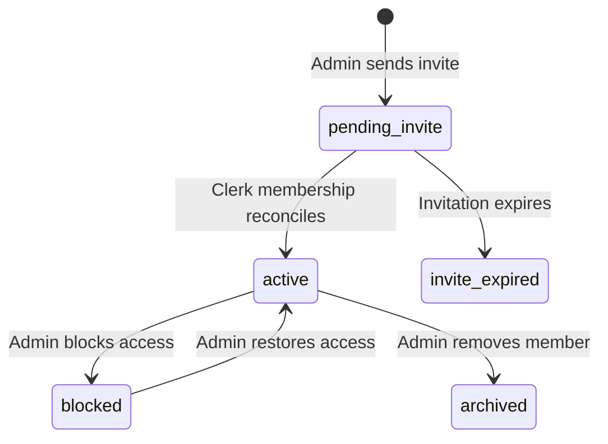

# Members and Access

## Purpose
This document details organization member management (`Equipa`), access roles, user capabilities, and Clerk synchronization.

## Intended Reader
This document targets backend and frontend developers implementing authorization logic.

## Prerequisites
Read [Data Model](../01_system_architecture/DATA_MODEL.md).

## What the System Does
Cronos handles team access through organization memberships. Clerk supplies identity and organization context.

## User Access Roles

| Role | Interface View | Endpoint Capabilities |
| :--- | :--- | :--- |
| **`admin` capability** | Administrative application | Curriculum, members, settings, scheduler, occurrences, and timesheets |
| **`teacher` capability** | Self-service application | Personal availability, progress, schedule, lesson logs, and week submission |

## Membership Lifecycle States

## Role Capabilities Table

| Capability Identifier | Admin | Teacher | Description |
| :--- | :--- | :--- | :--- |
| `admin` | Yes | No | Pass administrative backend and frontend guards |
| `teacher` | Optional | Yes | Access teacher routes when a linked teacher profile exists |

## Contracts and Invariants
- Every principal must have `lifecycle_status=active` and `access_status=active` for the Clerk organization.
- One membership can hold both `admin` and `teacher` capabilities.
- Teacher endpoints inspect user identity to prevent accessing unauthorized class data.

## Failure Modes
- Insufficient Privileges: A teacher attempting administrative operations receives HTTP `403 Forbidden`.

## Verification Procedure
Inspect `/members` view as administrator. Verify invitation buttons, member lists, and role badges.

## Source Map
- Role Dependency: `backend/app/api/deps.py` (`AdminActor`, capability helpers)
- Member Router: `backend/app/api/v1/endpoints/members.py`
- Frontend Guard: `frontend/src/routeGuards.jsx`

## Related Documents
- [Professional Education](PROFESSIONAL_EDUCATION.md)
- [Security and Tenant Isolation](../08_security_quality/SECURITY_AND_TENANT_ISOLATION.md)
