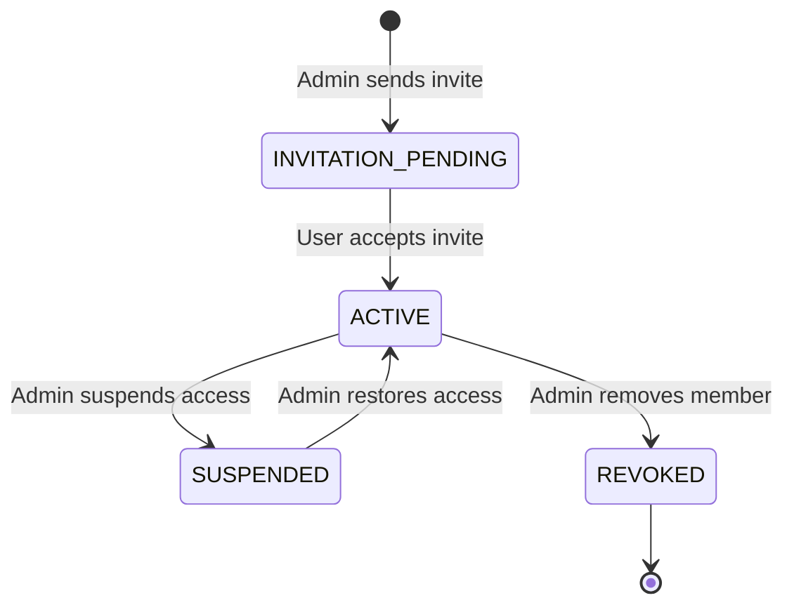

# Members and Access

## Purpose
This document details organization member management (`Equipa`), access roles, user capabilities, and Clerk synchronization.

## Intended Reader
This document targets backend and frontend developers implementing authorization logic.

## Prerequisites
Read [Data Model](../01_system_architecture/DATA_MODEL.md).

## What the System Does
Cronos handles team access through organization memberships (`OrganizationMembership`). User identity originates in Clerk.

## User Access Roles

| Role | Interface View | Endpoint Capabilities |
| :--- | :--- | :--- |
| **`admin`** | Full access to all pages and settings | Full CRUD on school settings, classes, subjects, solver jobs, draft approvals |
| **`teacher`** | Self-service portal only (`/dashboard`, `/my-availability`, `/my-progress`, `/schedules`) | Read personal schedules, update availability, create lesson logs for assigned classes |

## Membership Lifecycle States

## Role Capabilities Table

| Capability Identifier | Admin | Teacher | Description |
| :--- | :--- | :--- | :--- |
| `MANAGE_ORGANIZATION` | Yes | No | Modify school configuration and settings |
| `MANAGE_MEMBERS` | Yes | No | Invite, suspend, or remove team members |
| `MANAGE_CURRICULUM` | Yes | No | Create and edit courses, classes, subjects, rooms |
| `EXECUTE_SOLVER` | Yes | No | Trigger full or repair schedule generation |
| `APPROVE_SCHEDULE` | Yes | No | Promote schedule drafts to active timetable |
| `LOG_LESSON` | Yes | Assigned Only | Create lesson summaries (*Sumários*) for classes |
| `VIEW_PERSONAL_SCHEDULE` | Yes | Yes | View individual weekly schedule grid |

## Contracts and Invariants
- Every active user must have an active `OrganizationMembership` row matching the requested `organization_id`.
- Teacher endpoints inspect user identity to prevent accessing unauthorized class data.

## Failure Modes
- Insufficient Privileges: A teacher attempting administrative operations receives HTTP `403 Forbidden`.

## Verification Procedure
Inspect `/members` view as administrator. Verify invitation buttons, member lists, and role badges.

## Source Map
- Role Dependency: `backend/app/api/deps.py` (`require_admin`, `require_teacher`)
- Member Router: `backend/app/api/v1/endpoints/members.py`
- Frontend Guard: `frontend/src/routeGuards.jsx`

## Related Documents
- [Professional Education](PROFESSIONAL_EDUCATION.md)
- [Security and Tenant Isolation](../08_security_quality/SECURITY_AND_TENANT_ISOLATION.md)
