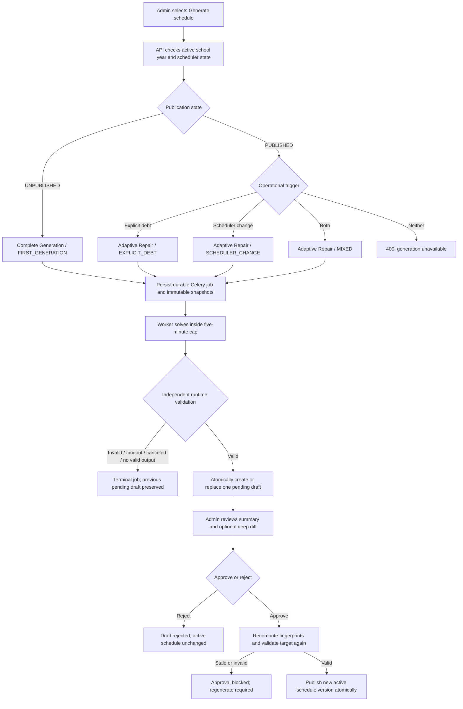

# Cronos Schedule Generator — Beta Readiness Audit

**Audit date:** 14 July 2026  
**Audited revision:** `ff9802b8d391ed159589e822e9ead9add037c4dc` (`main`)  
**Scope:** schedule-generation selection, Complete Generation, Adaptive Repair, job execution, validation, draft lifecycle, approval, API/UI integration, migrations, automated tests, and adversarial probes  
**Change policy:** audit only; no scheduler implementation was modified

## Executive verdict

**NO-GO for a client-facing beta of the schedule generator in its current form.**

The overall architecture is strong: generation is tenant-scoped, asynchronous, time-bounded, draft-first, independently validated, and approval-gated. The complete automated backend suite passes, the frontend quality gates pass when run normally, database integrity checks pass, and the current runtime correctly prevents a hard-invalid draft from being persisted or published.

However, one high-severity scheduler defect blocks the beta:

> **Adaptive Repair does not apply the custom scheduler-constraint rules while detecting impacted blocks or constructing repair placements.** A change such as marking a teacher unavailable can therefore produce an internal `COMPLETE_SUCCESS` proposal that keeps the forbidden block unchanged. The independent runtime validator catches the violation and fails the job, so an invalid schedule is not published—but the repair feature does not perform its core job.

The isolated authenticated walkthrough also found a separate application-integration blocker: after a fresh Clerk organization was created, Cronos continued to see no active organization and redirected back to `/create-org`. This prevented the planned live schedule-page scenario and would block the same first-time beta-user path.

Both blockers should be fixed and regression-tested before showing generation/repair to clients. A controlled internal demo limited to a pre-provisioned organization and first-time Complete Generation is possible only if custom constraints and post-publication repair are explicitly excluded; that is not equivalent to a beta of the complete generator.

## 1. What was reviewed

### Product and technical contracts

- [Product requirements](./PRD_SCHEDULE_GENERATOR_NEW_BASELINE.md)
- [Technical specification](./TECH_SPEC_SCHEDULE_GENERATOR_NEW_BASELINE.md)
- [Hard constraints and soft objectives](./HARD_CONSTRAINTS_SOFT_OBJECTIVES.md)
- [Manual QA guide](./MANUAL_QA_SCHEDULE_GENERATOR_NEW_BASELINE.md)
- [Previous closure report](./CLOSURE_SCHEDULE_GENERATOR_NEW_BASELINE.md)

### Principal implementation areas

- `backend/app/services/scheduler_generation_service.py` — automatic strategy and trigger selection
- `backend/app/services/scheduler_job_runtime.py` — five-minute job envelope, cancellation, validation, and atomic persistence
- `backend/app/services/scheduler_complete_engine.py` — first full schedule generation
- `backend/app/services/scheduler_adaptive_engine.py` — post-publication repair and adaptation
- `backend/app/services/scheduler_candidates.py` — candidate construction and hard pruning for Complete Generation
- `backend/app/services/scheduler_near_optimizer.py` — CP-SAT near-horizon optimization
- `backend/app/services/scheduler_far_fill.py` — capacity-aware far-future completion
- `backend/app/services/scheduler_recovery_ladder.py` — debt-recovery escalation
- `backend/app/services/scheduler_adaptation_ladder.py` — scheduler-change impact detection and adaptation scopes
- `backend/app/services/scheduler_constraint_rules.py` — custom constraint parsing, candidate rules, and final validation
- `backend/app/services/scheduler_approval_service.py` — staleness checks and publication
- `backend/app/services/scheduler_target_validator.py` — approval-time independent hard validation
- `backend/app/services/scheduler_fingerprint_service.py` — immutable generation/debt/policy bases
- `backend/app/api/v1/endpoints/scheduler.py` — public scheduler API
- `frontend/src/pages/Schedules.jsx` and `frontend/src/components/schedules/*` — generation, status, draft summary, diff, approval, rejection, and replacement UX

## 2. How generation works end to end



### 2.1 One public action; strategy is automatic

The user does not choose an algorithm. `SchedulerGenerationService.select_strategy()` applies these rules:

1. There must be an active scheduler school year and a lifecycle state.
2. If a pending draft already exists, a new request is rejected unless the user explicitly confirms replacement.
3. If the year is `UNPUBLISHED`, the engine selects `COMPLETE_GENERATION` with trigger `FIRST_GENERATION`.
4. If the year is `PUBLISHED`, it calculates:
   - whether unresolved explicit debt exists; and
   - whether `scheduler_state_version` is greater than the version captured at the last approval.
5. Debt only selects `ADAPTIVE_REPAIR / EXPLICIT_DEBT`.
6. Scheduler change only selects `ADAPTIVE_REPAIR / SCHEDULER_CHANGE`.
7. Both select `ADAPTIVE_REPAIR / MIXED`.
8. Neither returns a no-operational-trigger conflict; users cannot regenerate arbitrarily after publication.

This behavior is implemented at `scheduler_generation_service.py:68-155` and matches the PRD.

### 2.2 Durable asynchronous job

Generation is never performed inside the HTTP request. The API creates a durable generation job carrying:

- organization and school-year scope;
- selected strategy and trigger;
- scheduler state versions;
- generation-input fingerprint and immutable input snapshot;
- debt basis/fingerprint when relevant;
- repair-policy snapshot when relevant;
- idempotency and pending-draft replacement metadata.

A Celery worker executes the job. The runtime uses:

- a hard wall-clock cap of **300 seconds**;
- a **15-second finalization reserve**, leaving solver time for final validation and commit;
- cancellation/deadline checkpoints before and between expensive phases;
- distinct terminal outcomes for canceled, timed out, no valid output, validation failure, and system error;
- an atomic transaction for successful draft creation/replacement.

If regeneration was meant to replace a pending draft, the old draft is canceled only inside the successful commit path. A failed, canceled, timed-out, or invalid replacement leaves the existing pending draft intact.

## 3. Complete Generation

Complete Generation is allowed only before the school year has a published schedule. It must return either a complete, hard-valid schedule or `NO_VALID_OUTPUT`; a partial first schedule is forbidden.

### 3.1 Demand ledger

The engine builds demand at **class + subject** level, not module level. For every class/subject assignment it resolves:

- the assigned teacher;
- teacher eligibility for the subject;
- required room type and class capacity;
- total required subject minutes;
- minutes already delivered;
- remaining minutes to schedule;
- sequential module boundaries used to label scheduled blocks.

Modules are accounting milestones. The generator schedules the subject's remaining minutes continuously and assigns the corresponding module sequence as those minutes are consumed.

### 3.2 Adaptive near horizon

The engine divides the year into two regions:

- **Near future:** CP-SAT optimized in detail.
- **Far future:** capacity-aware greedy placement so the full year can be produced inside the time cap.

`AdaptiveHorizonSelector` chooses a near horizon between **14 and 84 days** using problem complexity and remaining solver time. This is an internal strategy, not a user setting.

### 3.3 Candidate construction and hard pruning

For every demand item, date, timetable slot, and eligible room, the candidate builder removes placements that violate hard conditions before optimization:

- date outside the configured start/hard-end interval;
- blocked calendar date;
- timetable slot on the wrong weekday or malformed slot;
- teacher availability `IMPOSSIBLE` (`-1`);
- fixed teacher, class, or room conflict;
- room capacity or room-type incompatibility;
- lunch protection;
- custom `specific_room`, `lock_time`, or `teacher_unavailable` rule;
- candidate-count or deadline safety limit.

`teacher_preferred` is not hard pruning; it adds a preference bonus.

### 3.4 Near-horizon CP-SAT objectives

The optimizer applies resource non-overlap and lunch constraints, then solves lexicographically in three stages:

1. **Maximize selected near-future blocks.**
2. Holding that count, **minimize date cost** so blocks occur as early as possible.
3. Holding the first two outcomes, maximize a quality expression consisting of:
   - minimum proportional class coverage;
   - teacher-availability/custom-preference score;
   - fewer distinct rooms per class/subject;
   - a penalty when a class has more than four blocks on one day.

### 3.5 Far-future fill

The greedy phase begins with the optimized near blocks and fills residual demand in this order of influence:

- chronological date/time;
- scarcity of alternatives for the class/subject demand;
- teacher preference score;
- continuity with the previously used room;
- deterministic resource identifiers as tie-breakers.

Every placement rechecks resource conflicts and the aggregate lunch gap. If exact remaining demand cannot fit before hard end, the entire Complete Generation returns `NO_VALID_OUTPUT`; it does not persist an incomplete draft.

### 3.6 Complete Generation result

A success contains the complete set of concrete dated blocks. Each is marked as either:

- `OPTIMIZED_NEAR_FUTURE`; or
- `PROVISIONAL_FAR_FUTURE`.

“Provisional” describes optimization quality, not publication status: every block is still a concrete part of the draft and becomes active on approval.

## 4. Adaptive Repair

Adaptive Repair starts from the active published schedule and creates a full proposed future target. It is not an incremental patch applied without review.

### 4.1 Immutable and editable schedule

The editable boundary is:

`editable_start_date = school_today + repair_stability_window_days`

The window is counted in calendar days and may be zero. These remain immutable regardless of that setting:

- past blocks;
- executed/delivered blocks;
- blocks inside the configured stability window.

Only future editable blocks may move, and only after a repair draft is approved.

### 4.2 Explicit debt

Debt is human/operationally declared; the scheduler does not infer that every missing or unregistered lesson is debt. Unresolved debt is calculated from the occurrence revision and recovery lineage. Recovery blocks carry:

- source occurrence ID;
- source occurrence revision;
- exact recovered duration.

This prevents duplicate recovery and makes later delivery/reversal auditable.

### 4.3 Recovery escalation ladder

The engine tries progressively broader scopes:

| Level | Name | Blocks allowed to move | Intent |
|---|---|---|---|
| 1 | Append-only recovery | None | Add recovery blocks without changing the published plan. |
| 2 | Affected class | Editable blocks of affected classes | Make local room for the debt. |
| 3 | Affected teacher/class | Editable blocks tied to affected classes or teachers | Broaden the local repair. |
| 4 | Controlled school-wide | All editable future blocks | Rebalance conservatively across the school. |
| 5 | Deadline rescue | All editable future blocks | Prioritize mandatory recovery over workload comfort. |
| 6 | Impossible with explanation | None | Diagnostic outcome mapped to `NO_VALID_OUTPUT`. |

For each feasible scope, CP-SAT first maximizes recovered minutes and then minimizes a disruption cost.

### 4.4 Scheduler-change adaptation ladder

For resource/configuration changes, the intended ladder is:

| Level | Name | Intent |
|---|---|---|
| A | Same-time resource adaptation | Preserve date/time and replace only an invalid resource. |
| B | Affected resource/class/teacher refit | Move directly related editable blocks. |
| C | Calendar/grid reflow | Reflow affected blocks onto the current calendar/grid. |
| D | Controlled school-wide adaptation | Rebalance all editable future blocks. |
| E | Impossible with explanation | Report that no valid future adaptation exists. |

If debt and a scheduler change coexist, the engine combines adaptation and recovery scopes into one target draft.

### 4.5 Disruption score

Adaptive Repair minimizes weighted disruption after maximizing recovery. The current score counts:

- block additions, removals, and changes;
- room-only changes separately;
- affected classes and teachers;
- ripple outside the directly affected set;
- urgency/near-term timing of changes.

This makes preserving the published operational reality more important in repair than in first generation.

### 4.6 Partial recovery

Partial recovery is allowed only for Adaptive Repair and only when it produces a useful, hard-valid draft. The result records:

- required, recovered, and residual minutes;
- escalation history;
- whether the main blocker is stability-window protection or resource/hard-end capacity;
- a stable user-facing explanation and recommended actions.

Approving a partial recovery publishes the valid target and keeps the residual debt open for later action.

## 5. Rules enforced by the generator

### 5.1 Hard constraints — must always hold

| Rule | Meaning | Enforcement layers |
|---|---|---|
| Tenant and school-year scope | Every referenced entity and resulting block belongs to the same organization/year. | DB composite keys/triggers, snapshot construction, runtime resource-scope validation, approval validation. |
| Date boundaries | Blocks must lie between school-year start and hard end. | Candidate construction, both engines, runtime, approval. |
| Timetable grid | Date weekday must match the slot; duration must fit the slot. | Candidate construction/repair placement, runtime, approval. |
| Calendar blocks | No block on holidays or configured blocked dates. | Candidate construction/impact analysis, repair validation, approval. |
| Class non-overlap | A class cannot occupy overlapping blocks. | CP-SAT/greedy placement, runtime, approval. |
| Teacher non-overlap | A teacher cannot occupy overlapping blocks. | CP-SAT/greedy placement, runtime, approval. |
| Room non-overlap | A room cannot occupy overlapping blocks. | CP-SAT/greedy placement, runtime, approval. |
| Teacher assignment | The class/subject must have the selected assigned teacher. | Demand/task creation, runtime, approval. |
| Teacher eligibility | The teacher must be qualified for the subject. | Demand/task creation, runtime, approval. |
| Room capacity | Room capacity must be at least class size. | Demand/candidate construction, repair placement, runtime, approval. |
| Room type | Room type must match the subject requirement. | Demand/candidate construction, repair placement, runtime, approval. |
| Impossible availability | `IMPOSSIBLE` availability is forbidden. | Candidate/repair placement, runtime, approval. |
| Lunch | Each class and teacher must retain the configured contiguous minimum break inside the lunch window. | Complete and repair solvers; approval validator. Runtime persistence validation does **not** repeat this aggregate check (finding SCHED-004). |
| Stability/history | Past, executed, and stability-window blocks cannot be changed by repair. | Editable-boundary builder, repair engine, runtime repair validation, approval reconciliation. |
| Exact complete demand | First generation must schedule all remaining required minutes exactly. | Engine assembly and independent runtime/approval demand validation. |
| Recovery lineage | Recovery metadata must be complete and recovery cannot exceed/deviate from debt basis. | Repair engine, runtime repair validation, DB recovery links, approval. |
| Custom `specific_room` | Matching class/subject blocks must use an allowed specified room. | Complete candidates, runtime, approval; **missing in Adaptive Repair solving** (SCHED-001). |
| Custom `lock_time` | Matching class/subject blocks must use an allowed specified slot. | Complete candidates, runtime, approval; **missing in Adaptive Repair solving** (SCHED-001). |
| Custom `teacher_unavailable` | Matching teacher/date/day/slot must not be scheduled. | Complete candidates, runtime, approval; **missing in Adaptive Repair solving and impact analysis** (SCHED-001). |

### 5.2 Soft objectives — preferences, not guarantees

The specification describes these quality goals:

- finish all curriculum as early as feasible;
- provide fair progress across classes;
- avoid unhealthy daily workload;
- reduce teacher/class gaps;
- prefer better availability tiers;
- maintain room consistency;
- minimize disruption during repair.

The implementation currently represents them as follows:

| Objective | Current implementation status |
|---|---|
| Earliest completion | Strongly represented: early-date objective near term and chronological far fill. |
| Fair class progress | Partially represented: near optimizer maximizes minimum proportional class coverage. |
| Availability preference | Represented in near quality and far-fill ordering; `IMPOSSIBLE` remains hard. |
| Room consistency | Represented by distinct-room penalty and far-fill preferred-room continuity. |
| Daily workload sanity | Partially represented only as a class penalty above four near-horizon blocks/day. No equivalent teacher model is present. |
| Teacher/class gaps | Not explicitly scored. |
| Completion-date fairness | Not explicitly scored beyond near class coverage. |
| Minimal repair disruption | Represented by disruption cost and escalation scopes. |
| Emergency workload override | Declared by recovery-level data, but the solve scope drops the `allow_workload_override` flag and no workload constraint/objective changes between normal repair and deadline rescue. |

Therefore the generator guarantees hard validity, not a universally “ideal” timetable. Some soft-goal language in the PRD is aspirational beyond the current objective function.

### 5.3 Custom constraint support contract

The public `ConstraintType` enum contains:

- `specific_room` — supported;
- `lock_time` — supported;
- `teacher_unavailable` — supported;
- `teacher_preferred` — supported as a soft bonus;
- `min_gap` — **explicitly rejected by the current generator**;
- `max_days` — **explicitly rejected by the current generator**.

`min_gap` and `max_days` can exist at the API/model vocabulary level but cause generation validation blockers. This mismatch is finding SCHED-003.

## 6. Draft, staleness, and publication rules

### 6.1 Single pending draft

There may be at most one current pending draft per organization/school year. Ordinary generation is blocked while it exists. Regeneration requires an explicit replacement confirmation.

### 6.2 Replacement safety

The generation job stores the ID it intends to replace. At commit time it checks that this is still the current pending draft. The old draft and recovery links are canceled only as part of the same transaction that persists the new validated draft.

### 6.3 Review

The primary review surface is a summary containing strategy, result category, completion/hard-end position, block and change counts, debt recovery, disruption metrics, warnings, and blockers. A full block-level diff is optional and available through a separate endpoint.

### 6.4 Approval revalidation

Approval is not a blind state change. It verifies:

- the draft is still the current pending draft;
- publication state still matches the draft's strategy;
- generation-input fingerprint still matches current configuration/resources;
- repair-policy snapshot still matches;
- debt fingerprint and trigger conditions still match for repair;
- scheduler state versions still match;
- the full target still satisfies hard constraints.

If any basis changed, the draft becomes `STALE`, approval is blocked, and regeneration is required.

### 6.5 Atomic publication

Successful approval creates a new schedule version, reconciles the future active schedule, updates recovery planning links, advances approved scheduler-state version, clears the pending draft, and marks the school year `PUBLISHED`—all within the approval transaction. Rejection leaves the active schedule unchanged.

## 7. Scheduler API and UI behavior

The scheduler endpoint group exposes:

- `POST /scheduler/generate`
- job status/list/detail and cancellation
- overall scheduler status
- current draft and draft summary
- optional draft diff
- approve and reject
- school-year reset

The UI follows the backend lifecycle:

- it displays why generation is or is not available;
- a pending draft takes priority over ordinary generation;
- replacement requires explicit confirmation;
- job polling shows queued/running/terminal state;
- approval and rejection are explicit actions;
- a stale approval response directs the admin to regenerate;
- partial recovery is shown as a warning state, not silently as complete success.

## 8. Verification evidence

### 8.1 Isolated audit environment

All destructive tests and live checks used disposable infrastructure, separate from the developer's normal Cronos containers:

- PostgreSQL 16 database `cronos_scheduler_audit_test` on host port `55432`;
- Redis 7 on an isolated Docker network;
- backend on host port `58000`;
- frontend on host port `49173`;
- a dedicated Celery worker;
- images built from audited revision `ff9802b8`.

No normal application database or normal ports (`5432`, `8000`, `5173`) were used for audit mutations.

### 8.2 Database and static gates

| Gate | Result |
|---|---|
| `alembic upgrade head` | PASS — upgraded through `20260706_repair_tenant_refs`. |
| `alembic current` | PASS — at head. |
| `alembic check` | PASS — no new upgrade operations detected. |
| same-tenant trigger audit | PASS. |
| database integrity audit | PASS. |
| `ruff check app scripts` | PASS. |
| `pip-audit -r requirements.txt` | PASS — no reported known vulnerabilities. |

Alembic emitted a SQLAlchemy warning about an unresolvable foreign-key cycle involving `active_schedule_blocks`, `lesson_occurrence`, and `schedule_draft_blocks`. Current migrations succeeded, but the warning should be cleaned up before future SQLAlchemy behavior makes it an error (SCHED-006).

### 8.3 Backend automated tests

Command: full `backend/tests` suite with application coverage and a 70% floor.

| Result | Value |
|---|---:|
| Collected tests | 562 |
| Passed | 560 |
| Skipped | 2 |
| Failed / errors | 0 |
| Duration | 1607.327 s |
| Application coverage | 73% |

The two skips are existing Clerk/seed-related skips, not scheduler failures.

### 8.4 Frontend gates

| Gate | Result |
|---|---|
| ESLint with zero warnings | PASS. |
| Knip dead-code check | PASS. |
| Production Vite build | PASS. |
| Vitest coverage | PASS on isolated rerun: 26 files, 148 tests. |
| Frontend coverage | 34.00% statements, 31.17% branches, 26.57% functions, 34.86% lines; all configured thresholds passed. |

The first coverage run was executed concurrently with lint, dead-code, and build and timed out one `SchoolConfig` test at the fixed five-second test limit (147/148 passed). Running coverage alone immediately afterward passed all 148 tests. This is recorded as a timing-sensitive test/release-gate stability concern, not a reproducible product failure (SCHED-005).

### 8.5 Adversarial custom-constraint probe

The audit constructed a minimal published schedule with:

- one class, subject, teacher, room, Monday slot, and active block;
- a scheduler-version change;
- a new custom `teacher_unavailable` constraint for that teacher and exact slot;
- no debt and no unrelated invalid resource.

Observed result from `AdaptiveRepairEngine.generate()`:

```text
result_type=ValidatedGenerationResult
result_category=COMPLETE_SUCCESS
adaptation_level=SAME_TIME_RESOURCE_ADAPTATION
blocks=[('2026-06-01', 10, 4, 'UNCHANGED')]
violations=['Draft violates a teacher_unavailable scheduler constraint.']
```

Passing that result into the independent runtime validation produced:

```text
runtime_validation=GenerationValidationError
message=Draft violates a teacher_unavailable scheduler constraint.
```

This proves both sides of SCHED-001:

1. repair solving incorrectly returns success without adapting to the custom rule; and
2. the defense-in-depth validator correctly prevents persistence/publication of that invalid target.

### 8.6 Live stack

The audited images built successfully. The isolated backend health endpoint reported PostgreSQL and Redis connected, the Celery worker registered `scheduler.run_generation_job`, and the isolated frontend loaded the Clerk sign-in flow.

**Authenticated UI walkthrough status:** blocked in the first-organization onboarding path.

Observed sequence:

1. the user signed in through the visible isolated frontend;
2. Cronos redirected the signed-in user to `/create-org` because no active organization was present;
3. the embedded Clerk flow created `Cronos Scheduler Audit 2026-07-14` successfully;
4. the flow returned to an empty organization-creation page instead of `/onboarding`;
5. Clerk's organization account portal showed the new organization as active, but revisiting `/schedules` in Cronos still redirected to `/create-org`;
6. the isolated backend received `/api/v1/members/me` without an active organization claim and returned `401`; and
7. no organization row was created in the isolated Cronos database.

The remote Clerk organization was independently confirmed by a read-only Backend API lookup. No real-school organization or data was opened or changed. Because the active-organization handoff failed, the audit could not honestly claim completion of the live Complete Generation, publication, and Adaptive Repair UI scenario.

The exact cause was not established in this audit. Clerk documents active-organization state as session/tab context and supports explicit organization switching, so the first-time creation-to-application handoff needs an application-level regression test rather than an assumption that remote creation implies an active Cronos session ([Clerk Organizations overview](https://clerk.com/docs/guides/organizations/overview), [OrganizationSwitcher reference](https://clerk.com/docs/reference/components/organization/organization-switcher)). See APP-001.

## 9. Findings

### SCHED-001 — P1 / High — Adaptive Repair ignores custom scheduler constraints while solving

**Status:** confirmed by source inspection and executable probe  
**Beta impact:** blocker

`Complete Generation` constructs `SchedulerConstraintRules` and applies them to candidates. `AdaptiveRepairEngine._build_placements()` does not. `SchedulerChangeImpactAnalyzer` also does not inspect those custom rules.

Consequences:

- a newly unavailable teacher/date/day/slot may not be identified as an affected published block;
- a specific-room or locked-time rule is not used to construct repair candidates;
- `teacher_preferred` does not affect repair scoring;
- the engine can label a violating unchanged target `COMPLETE_SUCCESS`;
- runtime validation then fails the generation job instead of producing the required adaptation.

The final validation layers protect data integrity, so this is not silent publication of a bad schedule. It is still a core functional failure because post-publication changes are an advertised Adaptive Repair trigger.

**Required before beta:** use the same parsed rule set in impact analysis and repair candidate generation; test `specific_room`, `lock_time`, `teacher_unavailable` (slot/day/date/date+slot), and `teacher_preferred` across scheduler-change-only and mixed repair.

### SCHED-002 — P2 / Medium — Several documented soft objectives are only partially implemented

**Status:** confirmed by objective-function inspection  
**Beta impact:** quality/expectation risk

The current scoring does not explicitly model teacher workload sanity, teacher/class gaps, or completion-date fairness. The recovery ladder exposes `allow_workload_override`, but `_SolveScope` does not carry it and the repair solver does not change workload behavior for deadline rescue.

**Required product decision:** either implement the missing scoring signals or narrow beta documentation/claims to the objectives actually represented. Hard validity is not affected.

### SCHED-003 — P2 / Medium — `min_gap` and `max_days` are public enum values but unsupported by generation

**Status:** confirmed by executable parser probe  
**Beta impact:** API/configuration contract risk

Both values are accepted vocabulary in the model/schema but `SchedulerConstraintRules` returns blockers stating that the current generator does not support them. An administrator/integration can therefore create a configuration the scheduler categorically refuses.

**Required before exposing custom constraints to beta clients:** remove/hide these values, reject them at constraint creation with a precise validation response, or implement them.

### SCHED-004 — P2 / Medium — Runtime draft validation does not independently repeat aggregate lunch validation

**Status:** confirmed by validation-path inspection  
**Beta impact:** defense-in-depth gap

Both engines model lunch, and `SchedulerTargetValidator` checks aggregate class/teacher lunch again at approval. `SchedulerJobRuntime._validate_result()` checks grid, resources, custom constraints, and demand/repair semantics but does not call the aggregate lunch validator before persisting a pending draft.

An engine regression could therefore persist a lunch-invalid pending draft that later fails approval. It would not publish, but it would waste a generation and present an unapprovable draft.

**Recommended:** share one hard-target validator between runtime commit and approval, with DB scope checks layered around it.

### SCHED-005 — P3 / Low — Frontend coverage gate is timing-sensitive under concurrent load

**Status:** observed once; clean isolated rerun  
**Beta impact:** CI reliability only

One test timed out at five seconds while four frontend gates competed for resources. The same complete coverage run passed alone. Increase that test's explicit timeout only if justified, or avoid running CPU-heavy frontend gates concurrently in CI.

### SCHED-006 — P3 / Low — Alembic/SQLAlchemy reports a foreign-key dependency cycle

**Status:** repeatable warning; migrations pass  
**Beta impact:** future maintenance risk

The cycle covers active blocks, lesson occurrences, and draft blocks. Name/use constraints so drop/sort operations are unambiguous and verify the migration downgrade path in an isolated database.

### SCHED-007 — P3 / Low — Repair/custom-constraint end-to-end coverage is missing

**Status:** confirmed by test inventory  
**Beta impact:** regression risk

The browser E2E scheduler scenario covers first generation, publication, and lesson logging. Complete Generation candidate tests cover custom constraints, but Adaptive Repair tests use an empty `constraints` snapshot. This allowed SCHED-001 to survive while the full suite remained green.

**Required with SCHED-001 fix:** add unit and full-stack regression cases for custom constraint changes after publication, failed replacement preservation, partial recovery approval, stale repair approval, cancel, and timeout.

### APP-001 — P1 / High — Fresh organization creation does not establish an active Cronos organization

**Status:** reproduced once in the isolated authenticated walkthrough; remote and local state independently checked  
**Beta impact:** blocker for first-time users and for completion of live scheduler validation

The embedded organization-creation flow created the Clerk organization, but Cronos continued to render the no-organization guard. The account portal and Backend API proved that the remote organization existed; the application request still lacked the active organization context needed by the backend, which returned `401`, and local tenant onboarding never started.

This finding is outside the solver algorithm, but it blocks access to the scheduler for the exact fresh-tenant beta journey selected for this audit. The audit did not attempt to bypass Clerk state with injected browser values or use an existing real organization, because either action would invalidate the isolation guarantee.

**Required before first-time-client beta:** reproduce with production-like Clerk configuration, identify the active-organization handoff failure, ensure successful creation proceeds to `/onboarding`, and add an authenticated browser regression covering create organization → onboarding → schedules. Also verify refresh, a new tab, and sign-out/sign-in recovery.

## 10. Beta exit criteria

### Mandatory

- Fix SCHED-001 across impact analysis and repair placement/scoring.
- Add regression coverage for every supported custom constraint in Adaptive Repair and mixed-trigger repair.
- Fix APP-001 so a newly created organization becomes active in Cronos and enters onboarding.
- Run the full backend and frontend gates cleanly.
- Execute an authenticated isolated-stack scenario that proves:
  1. Complete Generation queues, completes, creates a draft, and publishes;
  2. a scheduler-relevant custom constraint change triggers Adaptive Repair;
  3. the repair creates a hard-valid changed target and publishes;
  4. a failed replacement preserves the prior pending draft;
  5. stale approval is blocked.

### Strongly recommended

- Resolve the public contract for `min_gap` and `max_days`.
- Reuse aggregate lunch validation at runtime commit.
- Align product claims with the implemented soft objectives.
- Remove the migration dependency-cycle warning.
- Ensure the deployed beta uses Clerk production configuration; the local build correctly warns that the current keys are development keys.

## 11. Final assessment

Cronos has a credible scheduler foundation and unusually good safety boundaries for a pre-beta product: inputs are snapshotted, strategies are automatic, jobs are durable and bounded, drafts are never auto-published, replacement is atomic, staleness is explicit, and approval repeats hard validation.

The scheduler blocker is narrow but central. The system advertises post-publication adaptation to scheduler-relevant changes, yet one of its supported rule families is absent from the Adaptive Repair search itself. The validators turn that defect into a visible failed job instead of corrupted schedule data—which is the correct failure posture—but clients would still experience the feature as broken. Separately, APP-001 currently blocks the fresh-tenant path before the schedule page can be reached.

**Release decision: NO-GO until SCHED-001 and APP-001 are fixed and the mandatory regression/live criteria pass.**
