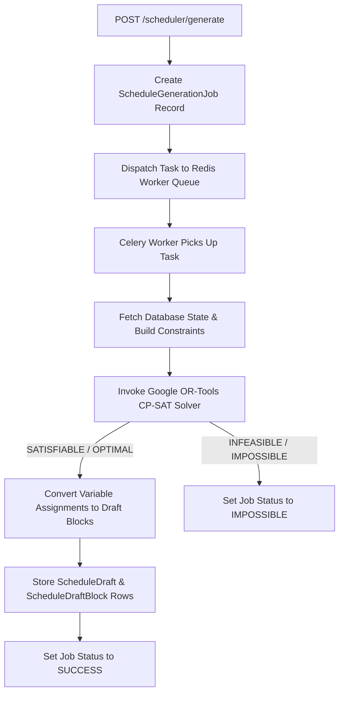

# Scheduler Architecture

## Purpose
This document details CP-SAT decision variables, Celery worker dispatching, state models, and draft approval flows.

## Intended Reader
This document targets backend developers and optimization specialists.

## Prerequisites
Read [Scheduler Behavior](SCHEDULER_BEHAVIOR.md).

## What the System Does
The scheduler converts database records into CP-SAT boolean decision variables, executes the solver asynchronously, and persists results as schedule drafts.

## Solver Execution Pipeline

## CP-SAT Formulation Details
- **Decision Variable**: `x[c, s, t, r, d, p] ∈ {0, 1}` represents Class `c`, Subject `s`, Teacher `t`, Room `r`, Day `d`, and Period `p`.
- **Constraint Expressions**: Linear integer inequalities enforce sum totals across periods and days.
- **Search Parameters**: Worker sets time limit (default 60 seconds) and multithreading search parameters.

## Draft Lifecycle States

| State | Description | Next Allowed State |
| :--- | :--- | :--- |
| `GENERATING` | Solver task currently executing in Celery worker | `REVIEW_PENDING`, `FAILED` |
| `REVIEW_PENDING` | Draft created, awaiting administrative audit | `APPROVED`, `REJECTED` |
| `APPROVED` | Promoted to active schedule (`ActiveScheduleBlock`) | None (Terminal) |
| `REJECTED` | Discarded by administrator | None (Terminal) |

## Contracts and Invariants
- Approving a new draft archives current active schedule blocks and activates the new draft blocks atomically inside a database transaction.

## Failure Modes
- Solver Timeout: If CP-SAT exceeds configured timeout limit, it returns the best feasible solution found or flags timeout.

## Verification Procedure
Run backend scheduler unit tests: `pytest backend/tests/test_solver.py -v`.

## Source Map
- Solver Core: `backend/app/core/solver.py`
- Scheduler Router: `backend/app/api/v1/endpoints/scheduler.py`
- Draft Service: `backend/app/services/draft_service.py`

## Related Documents
- [Scheduler Behavior](SCHEDULER_BEHAVIOR.md)
- [Scheduler Operations](SCHEDULER_OPERATIONS.md)
