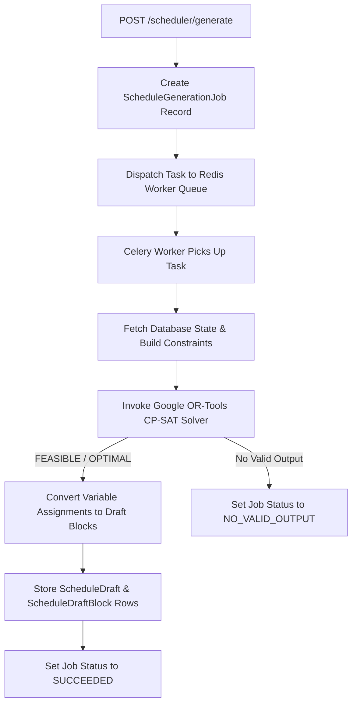

# Scheduler Architecture

## Purpose
This document details CP-SAT decision variables, Celery worker dispatching, state models, and draft approval flows.

## Intended Reader
This document targets backend developers and optimization specialists.

## Prerequisites
Read [Scheduler Behavior](SCHEDULER_BEHAVIOR.md).

## What the System Does
The scheduler converts database records into CP-SAT boolean decision variables, executes the solver asynchronously, and persists results as schedule drafts.

## Solver Execution Pipeline

## CP-SAT Formulation Details
- **Decision Variable**: One Boolean variable selects each precomputed placement candidate.
- **Resource Constraints**: Optional fixed intervals enforce class, teacher, and room non-overlap by date.
- **Search Parameters**: Bounded deterministic stages use one search worker and random seed zero.

## Draft Lifecycle States

| State | Description | Next Allowed State |
| :--- | :--- | :--- |
| `PENDING` | Draft awaits an administrative decision | `APPROVED`, `REJECTED`, `REPLACED`, `STALE`, `INVALIDATED` |
| `APPROVED` | Draft blocks became active schedule blocks | Terminal |
| `REJECTED` | Administrator rejected the draft | Terminal |
| `REPLACED` | A later confirmed generation replaced the draft | Terminal |
| `STALE` | Scheduler state changed after generation | `REJECTED` |
| `INVALIDATED` | Reset or lifecycle action invalidated the draft | `REJECTED` |

## Contracts and Invariants
- Approval locks lifecycle rows, validates fingerprints, applies the diff, publishes state, and reconciles recovery links transactionally.

## Failure Modes
- Partial Optimization: A bounded stage can preserve the best feasible values and mark quality optimization incomplete.

## Verification Procedure
From `backend/`, run `pytest -m solver -v` and the scheduler golden fixture tests.

## Source Map
- Solver Engines: `backend/app/services/scheduler_complete_engine.py`, `backend/app/services/scheduler_adaptive_engine.py`
- Scheduler Router: `backend/app/api/v1/endpoints/scheduler.py`
- Draft Services: `backend/app/services/scheduler_draft_service.py`, `backend/app/services/scheduler_approval_service.py`

## Related Documents
- [Scheduler Behavior](SCHEDULER_BEHAVIOR.md)
- [Scheduler Operations](SCHEDULER_OPERATIONS.md)
