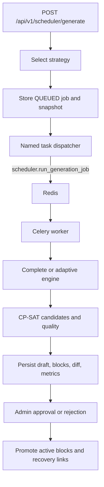

# Scheduler Architecture

## Purpose

This document describes scheduler selection, worker execution, CP-SAT services, drafts, diffs, and approval.

## Intended Reader

This document targets scheduler engineers, backend engineers, and QA engineers.

## Prerequisites

Read [Scheduler Behavior](SCHEDULER_BEHAVIOR.md) and [Data Model](../01_system_architecture/DATA_MODEL.md).

## What the System Does

The scheduler selects complete generation before publication and adaptive repair after publication.
It stores an immutable input snapshot, runs in Celery, and persists a draft before approval.
The API publishes the task name through `celery_app.send_task`; only the worker imports `app.scheduler_worker` and OR-Tools.

## Why the Behavior Exists

The selection service prevents unsupported generation requests.
The runtime makes each solve auditable and keeps long computation outside FastAPI.

## Components and Ownership

| Responsibility | Implementation |
| :--- | :--- |
| Strategy selection | `backend/app/services/scheduler_generation_service.py` |
| Job lifecycle | `backend/app/services/scheduler_job_runtime.py` |
| Complete generation | `backend/app/services/scheduler_complete_engine.py` |
| Adaptive repair | `backend/app/services/scheduler_adaptive_engine.py` |
| Incremental demand | `backend/app/services/scheduler_incremental_demand.py` |
| Candidate generation | `backend/app/services/scheduler_candidates.py` |
| Constraints and quality | `backend/app/scheduler/domain/`, `scheduler_constraint_rules.py` |
| Draft and diff | `scheduler_draft_service.py`, `scheduler_diff_service.py` |
| Approval | `scheduler_approval_service.py`, `scheduler_recovery_service.py` |
| Dispatch | `backend/app/scheduler/infrastructure/task_dispatcher.py` |
| Curriculum validation | `scheduler_curriculum_validation.py` |

## Data or Request Flow

## Contracts and Invariants

- A pending draft requires explicit replacement confirmation.
- A published year requires an approved scheduler state version.
- Every worker solve uses a tenant-scoped session.
- Draft approval validates the fingerprint before promotion.
- Recovery links reconcile with approved active blocks.
- Incremental demand is rebuilt from the immutable snapshot during runtime validation.
- New curriculum blocks promote without recovery links.
- Adaptive curriculum uses counted groups for equivalent class, subject, teacher, module, and duration lessons.
- Quality construction indexes occupancy and load terms during one candidate traversal.
- Runtime passes one absolute deadline and one cooperative stop signal into adaptive execution.
- Each CP-SAT stage uses the remaining execution budget.
- Runtime reserves the final deadline for validation and persistence.
- A separate engine-return reserve allows a stopped solver to return its incumbent.
- Complete generation continues after an empty near horizon and repairs far residuals.
- Adaptive repair omits editable future blocks whose assignments were removed.
- Protected assignment removals return an actionable blocker and preserve history.
- Active curriculum identity is read by joining each active block to its source draft block;
  module sequence is never inferred from subject presence.
- Demand reduction reports editable excess block IDs for omission and protected excess with
  class, subject, and block IDs as an actionable blocker.

## States and Transitions

- Strategy: `COMPLETE_GENERATION` or `ADAPTIVE_REPAIR`.
- Job: `QUEUED`, `RUNNING`, `CANCEL_REQUESTED`, `CANCELED`, `SUCCEEDED`, `FAILED`, `NO_VALID_OUTPUT`.
- Draft: `PENDING`, `APPROVED`, `REJECTED`, `REPLACED`, `STALE`, `INVALIDATED`.

## Failure Modes

- No active school year returns a configuration failure.
- No debt or scheduler change blocks adaptive repair selection.
- A stale fingerprint rejects approval.
- A solver timeout records a failed job.
- Timeout cleanup stops candidate construction and requests CP-SAT termination.
- Runtime reserves 15 seconds for worker cleanup, validation, and final persistence.
- Cancellation polling uses an independent tenant-scoped database session while the engine runs.
- Validation and persistence durations, plus CP-SAT model counts, remain absent when those phases
  or models do not exist.
- An infeasible target records `NO_VALID_OUTPUT` with blockers.

## Verification Procedure

1. Run scheduler generation and job runtime tests.
2. Run draft, diff, approval, and recovery tests.
3. Inspect the job and draft through the scheduler API.

## Source Map

- `backend/app/services/scheduler_generation_service.py`
- `backend/app/services/scheduler_job_runtime.py`
- `backend/app/services/scheduler_complete_engine.py`
- `backend/app/services/scheduler_adaptive_engine.py`
- `backend/app/api/v1/endpoints/scheduler.py`

## Related Documents

- [Scheduler Behavior](SCHEDULER_BEHAVIOR.md)
- [Scheduler Operations](SCHEDULER_OPERATIONS.md)
