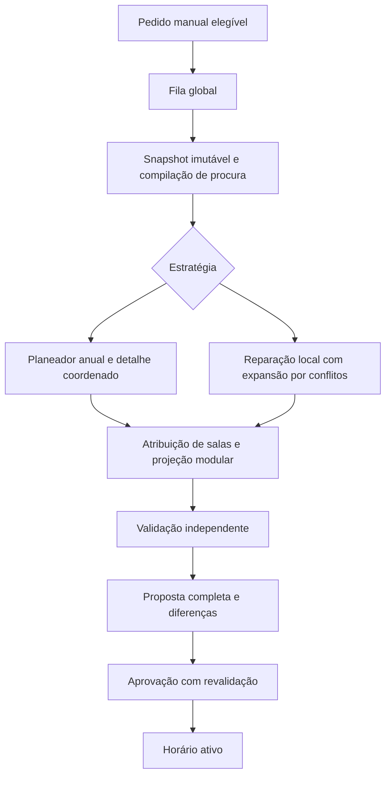

# Plano de execução — gerador Cronos v1

Data de consolidação: 23 de setembro de 2026.

Estado: plano de implementação. Nenhuma implementação ou limpeza resulta da criação deste documento.

Revisão de partida: `facd1d93bead7fc6ed481de6761644afd2e0be81`.

Branch de trabalho: `codex/scheduler-v1-revamp`.

Especificação de implementação: [SCHEDULER_V1_TECH_SPEC.md](SCHEDULER_V1_TECH_SPEC.md).

## 1. Resultado pretendido e 5Ws

| Pergunta | Resposta |
| :--- | :--- |
| What — O quê? | Substituir integralmente o planeamento de horários por uma nova v1. Adaptar dados, API, execução, progresso e interface ao novo domínio. |
| Why — Porquê? | Gerar horários anuais completos para escolas até 60 turmas. Recuperar perturbações durante o ano com qualidade, conservação de minutos e diagnóstico honesto. |
| Who — Quem? | O responsável técnico implementa, testa e produz evidência. O proprietário do produto valida comportamentos, realiza os testes de utilização e aceita a entrega. |
| When — Quando? | Por etapas com critérios de saída. Não há datas de calendário nem metas de duração inventadas antes das primeiras medições. |
| Where — Onde? | P0–P11 no Docker local do proprietário. CI sem deployment. P12 valida Railway e Cloudflare antes da ativação final. |

O desenvolvimento e os primeiros benchmarks decorrem exclusivamente no Docker local do proprietário.
Não executar testes, resets ou deployments em Railway ou Cloudflare durante P0–P11.
O ambiente atual de produção só será usado depois do gate local definido na secção 17.
Só contém dados criados pelo proprietário. Não é obrigatório criar outro ambiente Railway nessa fase final.
As baselines local e Railway são distintas. Tempos locais não certificam o desempenho de produção.
O plano não promete resolver qualquer instância de 60 turmas. A capacidade e as restrições podem tornar uma instância impossível.
O lançamento exige demonstração em várias instâncias anuais realistas, incluindo simulações de alterações durante o ano.

## 2. Decisões de produto fechadas

| ID | Decisão vinculativa |
| :--- | :--- |
| D01 | Nova baseline, sem obrigação de compatibilidade com o gerador anterior. |
| D02 | Os dados de teste atuais podem ser eliminados. Não há escolas utilizadoras a migrar. |
| D03 | Um único job de horários em execução globalmente. Os outros pedidos aguardam em fila. |
| D04 | O job pode usar vários workers internos CP-SAT. Testar 1, 2, 4, 8 e configurações superiores justificadas pelo hardware. |
| D05 | Não existe hoje qualquer meta fixa de p95, nem mesmo os anteriores 15 minutos ou dois minutos. |
| D06 | Medir desempenho por famílias de tamanho e dificuldade. O p95 é inicialmente um resultado observado. |
| D07 | A pesquisa termina por prova, proximidade certificada suficiente ou baixo retorno adicional estimado. Não termina por atingir um p95. |
| D08 | Há um timeout de segurança distinto. Interrupção nunca significa impossibilidade. |
| D09 | A escola define início, conclusão preferencial e limite absoluto. |
| D10 | A geração inicial deve terminar até à data preferencial e procurar antecipar as conclusões. |
| D11 | O adaptativo protege progressivamente a margem. Depois da data preferencial, reduzir o excesso prevalece sobre perturbação do futuro editável. |
| D12 | Priorizar sucessivamente as conclusões mais tardias. Permitir ceder capacidade de turmas adiantadas para ajudar turmas atrasadas. |
| D13 | Não atrasar uma turma apenas para igualar datas sem benefício para outras turmas. |
| D14 | A escola define a janela de estabilidade. Contar dias presentes na grelha semanal, não dias corridos. |
| D15 | Proteger qualquer alteração física dentro da janela, incluindo inserções de reposições. Preservar também passado e execução. |
| D16 | O módulo não é uma identidade permanente da aula futura. Resulta da sequência de minutos da disciplina. |
| D17 | Uma aula pode terminar um módulo e iniciar os seguintes. Os créditos têm minutos exatos e não se sobrepõem. |
| D18 | Recalcular automaticamente a previsão modular, inclusive dentro da janela. Não reescrever evidência executada. |
| D19 | A grelha define a capacidade máxima. Não transportar tetos implícitos de carga diária, semanal ou consecutiva. |
| D20 | Indisponibilidade obrigatória exclui períodos. Uma preferência desfavorável continua a permitir a colocação. |
| D21 | Entre soluções equivalentes nas prioridades superiores, reduzir primeiro furos dos professores, depois furos das turmas. |
| D22 | A escola atribui o professor a cada disciplina da turma. O solver não distribui serviço docente. |
| D23 | O administrador inicia sempre a geração. Nenhum evento inicia automaticamente o solver. |
| D24 | Só permitir geração inicial, atualização justificada, repetição de tentativa sem resultado ou renovação periódica elegível. |
| D25 | Após 28 dias corridos sem geração completa concluída, disponibilizar nova otimização manual. |
| D26 | Uma geração completa validada e persistida reinicia o relógio. Falha, cancelamento ou permanência em fila não reiniciam. |
| D27 | Se existir impossibilidade demonstrada, explicar os motivos e sugerir ações básicas. O diretor altera os dados ou as condições. |
| D28 | Acertos manuais de progresso recalculam procura e podem justificar reparação. O solver nunca inventa execução. |
| D29 | A interface usa linguagem escolar. Não apresenta CP-SAT, scopes, fingerprints, workers ou gaps matemáticos como linguagem do produto. |
| D30 | Manter proposta e aprovação administrativa. Gerar não publica automaticamente. |
| D31 | Desenvolver e testar primeiro no Docker local. Só validar Railway/Cloudflare após uma release candidate local sólida. |

As decisões posteriores substituem sugestões anteriores incompatíveis.
Não criar um segundo ambiente por obrigação. Não conservar o motor antigo como fallback.
Não manter a associação rígida entre módulo e aula para facilitar a implementação.

## 3. Fronteira do revamp

### Incluído

- Domínio de procura curricular, execução, dívida e previsão modular.
- CompleteGeneration e AdaptiveRecovery com formulações próprias.
- Planeamento anual, resolução detalhada, atribuição de salas e melhoria local.
- Comparação de qualidade, critérios de paragem e evidência de impossibilidade.
- Snapshot, elegibilidade, fila, cancelamento, propostas, aprovação e relógio de renovação.
- Persistência, API e UI necessárias para os novos contratos.
- Sumários, ocorrências, substituições, progresso, acertos e mapas afetados pela nova contabilização.
- Nova baseline de esquema, fixtures, testes, benchmarks, documentação e release.
- Remoção dos motores, contratos, caminhos, métricas e testes específicos do desenho substituído.

### Fora do âmbito

- Vários horários resolvidos simultaneamente.
- Microserviços novos, mudança de linguagem ou troca de solver sem evidência concreta.
- Escolha automática de docentes ou substitutos pelo gerador.
- Limites pedagógicos de carga que a escola não definiu.
- Publicação automática ou geração automática após ocorrências.
- Compatibilidade com bases de dados da versão antiga.
- Certificação legal das decisões administrativas sobre execução.
- Garantias de optimalidade global sem certificado correspondente.

Reaproveitar código correto é permitido. Reaproveitar contratos errados para evitar mudanças não é permitido.
Preservar autenticação, isolamento de organizações, acessibilidade e integridade que continuam necessários à nova v1.

## 4. Diagnóstico confirmado e inventário de substituição

| Área atual | Problema ou alteração necessária | Destino |
| :--- | :--- | :--- |
| `scheduler_candidates.py` | Produto atribuição × data × período × sala. | Domínios temporais compactos e capacidades de salas. |
| `scheduler_complete_engine.py` | Janela próxima seguida de universo distante anual. | Coordenação anual com detalhe revisível. |
| `scheduler_near_optimizer.py` | Qualidade antecipada e várias resoluções antes de existir solução anual. | Viabilidade anual antes de refinamento opcional. |
| `scheduler_far_fill.py` | Recontagem global repetida e reparação residual dependente de decisões anteriores. | Remover este caminho no corte para a v1. |
| `scheduler_adaptive_engine.py` | Candidatos anuais por tarefa; retorno no primeiro resultado completo; objetivo temporal inadequado. | Reparação por conflitos, melhor solução conservada e avaliação comum. |
| `scheduler_recovery_ladder.py` | Expansão por categorias amplas até à escola inteira. | Expansão dirigida por conflitos reais. |
| `scheduler_incremental_demand.py` | Contabilidade ligada a módulos permanentes nos blocos. | Procura residual por disciplina e projeção curricular derivada. |
| `scheduler/domain/contracts.py` | Um módulo por bloco e dependências semânticas do formato antigo. | Contratos novos, independentes de ORM e solver. |
| `scheduler/domain/quality.py` | Tetos de conforto automáticos e prioridades incompatíveis. | Política aprovada e versionada. |
| `scheduler_fingerprint_service.py` e `scheduler_planning.py` | Contagem atual da estabilidade por dias corridos em caminhos existentes. | Um único cálculo segundo a grelha semanal. |
| Ciclo de vida e aprovação | Estados e comparações derivados do desenho anterior. | Reescrever onde necessário, mantendo atomicidade e controlo de concorrência. |
| Testes de escola grande | Verificam interrupção controlada, não geração anual realista. | Corpus com procura anual e validação completa. |

Este inventário indica responsabilidades. Os nomes finais dos ficheiros devem resultar das unidades reais de código.
Antes de remover uma unidade, pesquisar definições, importações, chamadas, testes, documentação e consumidores de API.

## 5. Contratos do novo domínio

### 5.1 Três factos diferentes

1. Aula física: turma, disciplina, professor, sala, data e período ocupado.
2. Previsão curricular: distribuição dos minutos futuros pelos módulos, calculada a partir do progresso atual.
3. Execução: evidência dos minutos realizados e respetivas parcelas curriculares.

A previsão pode mudar sem mover a aula. A execução já registada não muda por um novo cálculo.
Uma correção administrativa gera evidência de correção. Não apaga o registo que está a corrigir.
Registar autor, data, motivo, valor anterior e novo efeito contabilístico.

### 5.2 Conservação de minutos

- Usar minutos inteiros. Converter horas apenas nas fronteiras de entrada e apresentação.
- A procura total por turma e disciplina é a soma dos requisitos curriculares vigentes.
- O progresso efetivo resulta de execução e acertos auditáveis.
- A procura futura é o requisito menos o progresso efetivo, com validações de limites.
- Uma aula cancelada deixa de contribuir para a cobertura futura útil.
- A dívida identifica a origem dos minutos em falta. Não acrescenta novamente esses minutos à procura residual.
- Uma recuperação planeada reserva procura; não credita execução.
- Uma recuperação executada credita progresso e reconcilia a dívida correspondente uma única vez.
- Um acerto de progresso que satisfaça procura com dívida exige reconciliação explícita da dívida ainda aberta.
- Não permitir que o mesmo minuto seja simultaneamente satisfeito por acerto, aula futura e recuperação.

Formalizar estas identidades antes de escrever o novo modelo CP-SAT.
Separar dívida ainda não executada de dívida ainda não planeada.
As ocorrências e recuperações preservam origem e revisão, sem impor um módulo futuro fixo.
Definir uma ordem determinística para reconciliar créditos administrativos não associados a uma ocorrência específica.
Usar dívida mais antiga primeiro como regra técnica inicial, mantendo a associação auditável.
Esta regra não escolhe datas nem prioridades de recuperação para o solver.

### 5.3 Distribuição modular

Ordenar módulos e percorrer os minutos curriculares cronologicamente.
Preencher o módulo atual até ao requisito. Distribuir o restante crédito pelos módulos seguintes.
Dois módulos de 75 minutos cabem em três aulas de 50 minutos: 50; 25+25; 50.
Uma ocorrência na terça permite que quarta passe ao módulo anterior e quinta avance para o seguinte.
Não manter o módulo anterior preso à identidade da reposição de quinta.
Recalcular a previsão com cancelamentos, movimentos, execução, acertos e alterações curriculares.
Sumários fora de ordem exigem tratar a execução efetiva por data, sem converter uma previsão antiga em verdade histórica.
Inconsistências entre correções retroativas e evidência posterior devem ser diagnosticadas, não silenciosamente relabeladas.

### 5.4 Duração física e crédito

Os conflitos e o almoço usam o intervalo físico completo do período.
Os requisitos curriculares usam os minutos creditados.
O último período de uma disciplina pode ter crédito inferior à duração física.
Não preencher essa sobra com outra disciplina nem introduzir subperíodos variáveis nesta v1.
Suportar durações de períodos diferentes quando a grelha as permite. Não assumir globalmente períodos de 50 minutos.
Uma contagem simples de aulas só é exata dentro de grupos com a mesma duração e sem perda de crédito relevante.

### 5.5 Histórico e estabilidade

Preservar passado, execução e identidade das ocorrências.
Proteger alterações físicas e inserções antes da fronteira editável.
A projeção modular pode mudar dentro dessa fronteira.
Contar os dias da estabilidade segundo os dias da semana presentes na grelha.
Feriados continuam a impedir colocações, sem alterar implicitamente a regra de contagem por grelha.
Convenção técnica: o dia local corrente é o primeiro contado quando pertence à grelha.
Se não pertence, começar no próximo dia da grelha. Proteger os N dias contados.
A primeira colocação editável fica no dia da grelha seguinte ao último protegido.
Com N igual a zero, permitir apenas posições ainda não iniciadas, respeitando início do ano e evidência existente.
Verificar esta convenção com exemplos datados antes de implementar o cálculo.
Usar a data local da escola, com relógio injetável nos testes.
Verificar novamente a fronteira ao aprovar uma proposta antiga.
Uma alteração de configuração não torna retroativamente ilegítima uma aula executada segundo a configuração anterior.

### 5.6 Datas e recursos

- Validar início ≤ data preferencial ≤ limite absoluto.
- CompleteGeneration não aceita um draft inicial depois da data preferencial.
- AdaptiveRecovery nunca aceita aulas depois do limite absoluto.
- O professor atribuído e a habilitação são restrições obrigatórias.
- Tipo, lotação e restrições específicas de sala são obrigatórios.
- Ausência de disponibilidade explícita não equivale a indisponibilidade, segundo a decisão da grelha disponível.
- Disponibilidade proibida exclui o candidato. Preferência desfavorável apenas afeta qualidade secundária.
- Preservar almoço e calendário aplicáveis. Não acrescentar tetos implícitos de carga.

## 6. Arquitetura interna e regras de implementação



Usar a estrutura existente de domínio, aplicação e infraestrutura onde for adequada.
Não criar um framework genérico de solvers ou interfaces com uma implementação sem necessidade concreta.

| Camada | Responsabilidade | Não pode depender de |
| :--- | :--- | :--- |
| Domínio | Minutos, procura, calendário, estabilidade, política de qualidade e validação. | FastAPI, SQLAlchemy, Celery, CP-SAT e relógio global. |
| Aplicação | Casos de uso, snapshots, elegibilidade, coordenação, resultados e aprovação. | Detalhes do modelo matemático ou objetos ORM nos contratos públicos internos. |
| Infraestrutura | CP-SAT, repositórios, transações, dispatch, métricas e configuração de execução. | Regras duplicadas que contradigam o domínio. |
| API e UI | Autorizações, comandos, consultas e explicação escolar dos resultados. | Formulações do solver ou parsing de mensagens técnicas como regras de negócio. |

Aplicar Clean Code, Clean Architecture, TDD e Ponytail full.
Escrever o teste observável que falha antes de cada alteração não trivial.
Implementar o mínimo correto, refatorar e executar os testes relevantes.
Não transformar decisões experimentais em dezenas de opções visíveis à escola.
Partilhar significado e avaliação das regras. Manter o validador independente da construção do modelo matemático.

## 7. CompleteGeneration

### 7.1 Compilação e verificações necessárias

- Compilar procura residual por turma, disciplina e professor atribuído.
- Calcular duração física e crédito sem arredondamento por módulo.
- Indexar calendário, disponibilidade, salas equivalentes e restrições específicas.
- Verificar capacidade necessária por turma, professor e sala crítica.
- Usar interseções temporais relevantes, além de simples somas semanais.
- Distinguir condições necessárias de provas suficientes de viabilidade.

### 7.2 Planeamento anual agregado

Representar a distribuição da procura por semanas, com grupos de duração quando necessário.
Preservar cobertura completa, limites de datas e capacidade agregada dos recursos.
Usar relaxações válidas para obter limites úteis de conclusão.
Não concluir viabilidade anual apenas porque as capacidades semanais somam corretamente.

### 7.3 Detalhe temporal e realimentação

Resolver semanas ou pequenas janelas com variáveis de atribuição e posição temporal.
Explorar primeiro recursos e períodos críticos quando isso reduzir bloqueios.
Conservar revisibilidade das decisões anteriores até existir um ano completo.
Um conflito demonstrado no detalhe devolve uma restrição válida ao planeador anual.
Um timeout não gera um corte de impossibilidade.
Um conflito que depende de decisões fixadas inclui essas decisões no âmbito da explicação.
Não excluir uma quota anual viável por causa de uma escolha local arbitrária.
Começar com cortes simples e corretos. Generalizar apenas perante resultados de benchmark.
Permitir alargar ou mudar janelas. O tamanho não fica fixado antecipadamente em três semanas.
Não conservar uma estratégia de congelamento irreversível de semanas que possa bloquear o fim do ano.

### 7.4 Salas

- Retirar a identidade das salas equivalentes da maioria das variáveis temporais.
- Garantir capacidade por tipo e patamares de lotação, descontando ocupações e reservas específicas.
- Modelar salas específicas como recursos explícitos quando necessário.
- Atribuir salas concretas favorecendo continuidade e preservação das salas publicadas.
- Validar matching completo. Devolver conflitos corretos à fase temporal quando necessário.
- Não declarar bom resultado antes de existirem salas concretas válidas.

### 7.5 Viabilidade e qualidade

Construir primeiro um horário anual completo, sem depender de refinamento estético para terminar.
Depois antecipar a sequência de conclusões, ordenada da mais tardia para a mais precoce.
Não substituir esta prioridade apenas pela soma das datas.
Evitar dezenas de provas caras sem benefício: permitir pesquisa aproximada com limites e âmbito explícitos.
Refinar mais o horizonte próximo. Manter validade e prioridade de conclusão em todo o ano.
Gaps de professores precedem gaps de turmas. Preferências e salas ficam depois.
A margem surge da antecipação e da flexibilidade útil, não de atrasar artificialmente aulas para criar espaços livres.
Avaliar a recuperabilidade com cenários de perturbação, sem impor reservas que contrariem as prioridades aprovadas.

## 8. AdaptiveRecovery

### 8.1 Entrada e identidade

Receber horário publicado, execução, dívida, recuperações planeadas, alterações curriculares, recursos e fronteira editável.
Usar todo o estado para contabilizar. Não transformar automaticamente todo o estado em variáveis.
O horário publicado é uma referência de perturbação. Só é uma solução viável se continuar válido nos novos dados.
Preservar as identidades de execução e ocorrência quando as aulas futuras são movidas.
Recalcular parcelas modulares depois de decidir posições físicas.

### 8.2 Pesquisa

1. Identificar procura sem cobertura e blocos inválidos ou excedentários.
2. Procurar inserções e substituições de posição com índices de disponibilidade conjunta.
3. Libertar pequenos conjuntos de aulas relacionados com os conflitos.
4. Explorar cadeias de movimentos, inclusive entre semanas afastadas.
5. Expandir por professores, turmas e salas efetivamente limitantes.
6. Comparar resultados pelo mesmo avaliador de qualidade usado nas métricas.
7. Conservar a melhor solução completa enquanto se procura melhorar.

Não devolver a primeira solução completa apenas porque pertence ao primeiro nível de uma escada.
Uma solução com extensão pode ser conservada enquanto se procura uma solução sem extensão.
Não usar o nível do bairro como objetivo de qualidade disfarçado.
Se o problema exigir expansão ampla, permiti-la dentro dos recursos de segurança e reportar o âmbito explorado.

### 8.3 Qualidade e margem

Definir `C[turma]` como conclusão prevista de toda a procura, não como média das datas das aulas.
Se houver procura sem posição, não atribuir uma conclusão completa fictícia à turma.
Guardar datas da primeira aprovação e da versão anterior para explicar impacto acumulado e incremental.
A data preferencial mantém-se fixa até decisão explícita da escola.

Prioridades:

1. Validade, proteção histórica e cobertura completa da procura.
2. Reduzir os excessos sobre a data preferencial, começando pelos mais tardios.
3. Antes da data preferencial, equilibrar conclusão coletiva e perturbação com proteção progressiva da margem.
4. Em comparações equivalentes de perturbação, priorizar a sequência de conclusões mais tardias.
5. Em conclusões equivalentes, preferir menos alterações, sobretudo próximas e repetidas.
6. Reduzir furos dos professores, depois das turmas; melhorar preferências e salas.

O compromisso do ponto 3 é deliberado. Uma prioridade absoluta à conclusão em todos os casos eliminaria o compromisso aprovado.
Não substituir o equilíbrio por um custo plano por aula movida.
Penalizar a extensão mais fortemente quando a conclusão projetada se aproxima da meta.
Calibrar uma função monótona e crescente com exemplos aprovados e benchmarks.
Não escolher coeficientes arbitrários nem apresentar a sua calibração como prova matemática.
As trocas devem permitir que uma turma adiantada ceda recursos quando isso melhora as conclusões atrasadas.
Nunca ceder margem apenas para igualar datas sem benefício operacional.

### 8.4 Sem solução completa

Não apresentar recuperação parcial como resolução do pedido.
Preservar o horário ativo. Guardar informação parcial apenas para diagnóstico e melhoria interna.
Impossibilidade demonstrada produz explicação e sugestões relativas ao conflito identificado.
Pesquisa inconclusiva produz mensagem distinta, sem acusar falta de capacidade não demonstrada.
Quantificar défices mínimos apenas quando o cálculo os suportar. Identificar estimativas como estimativas.
Sugestões podem incluir disponibilidade, atribuição de professor, salas, datas ou revisão de progresso.
Não sugerir um recurso específico como causa única com base apenas num insucesso heurístico.

## 9. Critérios de paragem e medição de qualidade

### 9.1 Separação obrigatória

- Qualidade: resultado segundo as prioridades do domínio.
- Limite matemático: melhor valor ainda possível no âmbito e objetivo certificados.
- Evolução: melhorias observadas durante a pesquisa.
- Previsão de retorno: estimativa empírica do benefício de mais esforço.

Não chamar 93/100 a 93% de optimalidade sem fundamento.
Não agregar gaps de modelos locais como certificado global.
Não tratar `OPTIMAL` de uma fase como prova de todo o vetor de qualidade.
Se usar tolerâncias nativas, registar tolerância, valores e limites; não depender apenas do nome do status.

### 9.2 Controlador de pesquisa

Monitorizar novas soluções, limites, diversidade de bairros e esforço consumido.
Continuar quando existir progresso relevante ou investigação justificada de ganhos importantes.
Parar por baixo retorno apenas depois de cumprir a exploração mínima definida para aquele âmbito.
Calibrar essas regras em trajetórias de execuções prolongadas.
Não criar inicialmente modelos de aprendizagem automática para estimar a próxima melhoria.
As regras simples precisam de evidência antes de qualquer aumento de complexidade.

Motivos técnicos de fim: ótimo demonstrado; tolerância certificada; retorno adicional estimado baixo; impossível demonstrado; inconclusivo; cancelado; falha.
Traduzir estes motivos para linguagem acessível sem inventar certezas.
Na interrupção de segurança, uma solução completa já validável pode ser conservada como proposta com pesquisa interrompida explícita.
No cancelamento pedido pelo administrador, não publicar ou persistir uma nova proposta contra esse pedido.

### 9.3 Segurança operacional

Definir limites finitos de segurança antes dos primeiros ensaios longos.
Os limites iniciais são parâmetros de laboratório documentados, não metas de desempenho.
Cobrir CPU, memória, duração extrema, cancelamento, construção, retorno, validação e persistência.
Medir a reserva de finalização com resultados reais. Não herdar automaticamente os atuais cinco minutos ou reservas fixas.
Timeout, perda de worker e interrupção deixam estados recuperáveis e não corrompem o horário ativo.

## 10. Elegibilidade, fila, propostas e aprovação

### 10.1 Motivos para gerar

| Evento | Efeito |
| :--- | :--- |
| Primeira geração com configuração completa | Disponibilizar geração inicial. |
| Dívida criada, revista ou anulada | Reavaliar procura e necessidade de atualização. |
| Acerto manual ou alteração de requisito curricular | Recalcular procura e impacto futuro. |
| Professor, disponibilidade, sala, calendário ou restrição alterados | Sinalizar apenas impacto relevante no planeamento. |
| Execução normal de uma aula conforme planeado | Atualizar progresso e projeção; não criar automaticamente um motivo para regeneração a cada sumário. |
| Alteração sem efeito semântico | Não desbloquear geração. |
| 28 dias desde geração completa persistida | Disponibilizar otimização manual. |
| Tentativa falhada, inconclusiva ou cancelada | Permitir nova tentativa; não consumir o motivo. |

Não permitir reexecuções repetidas do mesmo estado apenas por existirem minutos ainda não executados.
Separar versão de dados, motivos pendentes e último estado para o qual existe proposta completa.
Uma proposta pendente não é uma aprovação nem uma recuperação executada.
Se for rejeitada sem mudança de dados, não criar um novo motivo artificial; a interface deve explicar as ações disponíveis.
Uma nova alteração relevante ou a renovação periódica permite novo pedido.
Antes da primeira publicação, uma proposta rejeitada continua a poder ser revista mediante alteração dos dados; não invocar AdaptiveRecovery sem baseline.

### 10.2 Concorrência

- Uma réplica do serviço de solver, concorrência Celery um e prefetch um.
- Exclusão global robusta contra duplicação de entrega e sobreposição de deployments.
- Usar um mecanismo simples de exclusão na base de dados, com ligação e ciclo de vida explícitos.
- Não manter uma transação de escrita aberta durante a resolução.
- Snapshot imutável e versão de base associados ao pedido.
- Evitar pedidos duplicados para o mesmo estado.
- Usar FIFO inicialmente. Não introduzir preempção ou prioridades entre escolas sem necessidade demonstrada.
- Revalidar pedidos que ficaram em fila antes de consumir esforço de resolução.
- Se os dados mudarem, marcar o pedido ou proposta como desatualizado e disponibilizar nova ação manual.
- Não iniciar automaticamente um novo cálculo para substituir um pedido desatualizado.

Heartbeat e cancelamento precisam de funcionar durante um solve longo.
Não depender exclusivamente de uma tarefa de manutenção presa atrás do próprio solver na fila.
Os workers CP-SAT pertencem ao job. Não equivalem a jobs Celery adicionais.
Não multiplicar simultaneamente processos de janelas e workers CP-SAT sem medir o total de CPU e memória.

### 10.3 Publicação

Persistir proposta completa, diferenças, evidência de validação e métricas de forma atómica.
Na aprovação, revalidar versão, dados atuais, procura, dívida, estabilidade e cancelamento.
Reconciliar vínculos de recuperação e ativar o novo horário numa única transação.
Uma proposta desatualizada não pode ser aprovada silenciosamente.
Reiniciar o relógio de 28 dias na conclusão válida da geração, não na aprovação.
Não consumir alterações posteriores ao snapshot nem adiar o relógio por tentativas sem resultado.

## 11. Interface e contratos públicos

Inventariar todos os consumidores antes de alterar modelos e respostas.
Incluir configuração, horários, detalhe de turma, progresso, sumários, ocorrências, substituições e mapas semanais.

| Conceito interno | Apresentação escolar |
| :--- | :--- |
| Elegibilidade por alterações | Existem alterações por aplicar ao horário. |
| Pedido manual | Gerar proposta de horário. |
| Renovação após 28 dias | Já pode otimizar o horário das próximas semanas. |
| Espera na fila | A aguardar a conclusão de outro pedido. |
| Pesquisa de viabilidade | A organizar as aulas. |
| Refinamento | A melhorar a proposta. |
| Proposta desatualizada | Existem alterações mais recentes. Gere uma nova proposta. |
| Impossibilidade demonstrada | Não é possível colocar todas as aulas com estas condições. |
| Interrupção inconclusiva | Não foi possível concluir a pesquisa. Isto não significa que o horário seja impossível. |

Mostrar datas preferencial e absoluta, conclusão por turma, margem e alterações principais.
Mostrar excesso da data preferencial persistentemente enquanto existir.
Não culpar pessoas por ocorrências. Mostrar o recurso e a procura afetados quando conhecidos.
Não mostrar percentagens fictícias de progresso do solve nem previsões de tempo sem suporte.
Manter cancelamento acessível, estado persistente após refresh e mensagens sem detalhes de infraestrutura.
Mostrar previsão modular como previsão; distinguir da execução efetiva.
Continuar a cumprir navegação por teclado, contraste, leitores de ecrã e estados de carregamento.

## 12. Plano de testes e oráculos

### 12.1 Princípios

- TDD para alterações não triviais.
- Relógio, sementes e entradas controlados nos testes funcionais.
- Casos pequenos com resposta conhecida antes de casos grandes.
- Verificador independente para todos os resultados de benchmark.
- Não usar snapshots textuais do solver como único oráculo.
- Não exigir soluções idênticas entre contagens de workers; exigir validade e qualidade comparáveis.
- Não confundir monotonicidade matemática com garantia de uma heurística sob esforço limitado.
- Um teste de segurança que interrompe construção não demonstra escalabilidade.

### 12.2 Matriz mínima de regressões

| ID | Cenário | Resultado exigido |
| :--- | :--- | :--- |
| T01 | Dois módulos de 75 minutos, períodos de 50. | Três aulas e parcelas 50; 25+25; 50. |
| T02 | Aula de terça cancelada e recuperada quinta. | Quarta avança os minutos do módulo anterior; quinta recebe a projeção seguinte. |
| T03 | T02 com quarta dentro da estabilidade. | Só muda a previsão modular; a aula física permanece. |
| T04 | Recuperação planeada, executada e execução repetida. | Crédito único, dívida reconciliada e idempotência. |
| T05 | Cancelamento de uma recuperação e revisão da ocorrência original. | Sem perda de procura nem duplicação de dívida. |
| T06 | Acerto positivo e negativo de 600 minutos. | Procura e previsão atualizadas; nenhuma dupla cobertura. |
| T07 | Acerto torna aulas protegidas excedentárias. | Não apagar blocos protegidos; explicar o conflito de dados e proteção. |
| T08 | Grelhas de três, cinco e sete dias; janela de nove dias. | Fronteira corresponde à contagem de dias da grelha. |
| T09 | Feriados, mudança de hora, geração e aprovação em datas distintas. | Datas locais consistentes e nova fronteira respeitada. |
| T10 | Capacidades semanais suficientes, dois professores só disponíveis no mesmo período. | Rejeitar o detalhe impossível; não assumir viabilidade pelas somas. |
| T11 | Escolha inicial bloqueia últimas semanas, mas há solução alternativa. | Reconsiderar escolhas e encontrar o testemunho conhecido. |
| T12 | Sala específica consome a única sala de lotação suficiente. | Capacidade e matching concordam; nenhuma dupla utilização. |
| T13 | Dia carregado permitido pela grelha. | Não rejeitar nem adiar apenas por tetos antigos de conforto. |
| T14 | Preferência desfavorável versus indisponibilidade obrigatória. | Só a segunda proíbe a colocação. |
| T15 | Turmas A e B partilham professor após ausência prolongada. | Permitir cedência de capacidade que antecipa a conclusão mais tardia. |
| T16 | Atrasar turma adiantada sem beneficiar outra. | Não premiar igualdade artificial de datas. |
| T17 | Poucas alterações evitam extensão; muitas alterações evitam extensão pequena longe da meta. | Respeitar a política progressiva aprovada. |
| T18 | Extensão ultrapassa a meta em novembro. | Ativar a prioridade pela conclusão projetada, sem esperar por junho. |
| T19 | Conclusões e perturbação iguais, conflito entre furos de docentes e turmas. | Priorizar professores. |
| T20 | Mudança de professor atribuído ou sala invalida o baseline. | Não conservar esse baseline como solução válida. |
| T21 | Novo sumário normal, alteração sem efeito e dívida nova. | Só os eventos semanticamente relevantes desbloqueiam atualização. |
| T22 | Renovação aos 27 dias, 28 dias, falha e geração bem-sucedida. | Elegibilidade e reinício corretos. |
| T23 | Dois pedidos de escolas diferentes e entrega duplicada. | No máximo um job global em execução; nenhum efeito duplicado. |
| T24 | Alteração durante fila, solve, persistência ou aprovação. | Nenhum estado desatualizado é publicado. |
| T25 | Cancelamento em cada fase e morte do worker. | Sem proposta parcial ou publicação indevida; estado recuperável. |
| T26 | Ótimo local, timeout local e certificado anual. | Mensagens e métricas identificam corretamente âmbito e certeza. |
| T27 | Nova proposta anual de grande volume. | Cobertura completa, persistência atómica e memória medida. |
| T28 | Organização A tenta consultar ou alterar recursos de B. | Isolamento preservado em API, jobs, propostas e aprovação. |
| T29 | Substituição adianta outra disciplina e cria dívida na original. | Atualizar ambas sem manter cobertura futura redundante. |
| T30 | Toda a procura cumprida, sem futuro útil. | Não apresentar erro artificial nem proposta com aulas inventadas. |

### 12.3 Níveis

- Unitários: procura, projeção, estabilidade, qualidade, elegibilidade e classificação de resultados.
- Pequenos solves: comparar com enumeração exaustiva ou limites exatos para instâncias mínimas.
- Propriedades: conservação, exclusividade, idempotência, invariância a ordenação e renomeação de IDs.
- Integração: PostgreSQL e Redis reais; snapshots, transações, dívida, revisão, acertos e aprovação.
- Contratos: API, permissões, serialização e consistência entre estado mostrado e comandos permitidos.
- E2E: configurar, gerar, aprovar, executar, cancelar aula, reparar, corrigir progresso e renovar após 28 dias.
- Falhas: indisponibilidade de dependências, memória, timeout, reinício, entrega repetida e respostas fora de ordem.
- Longitudinais: reproduzir um ano com dezenas ou centenas de alterações e múltiplas aprovações.

Nos testes metamórficos, mais capacidade não pode destruir um testemunho válido existente.
Isso não implica que toda execução heurística limitada encontre sempre esse testemunho.
Separar testes de correção de testes de rendimento da pesquisa.

## 13. Corpus e protocolo de benchmarks

### 13.1 Construção do corpus

- Criar cenários mínimos com ótimos e impossibilidades demonstráveis.
- Criar escolas de 10, 30, 45 e 60 turmas com carga anual realista.
- Usar várias topologias de partilha de professores e salas por dimensão.
- Incluir margens folgadas, ocupação elevada e recursos críticos.
- Incluir calendários, grelhas e durações diferentes.
- Gerar parte das instâncias a partir de horários válidos conhecidos, para garantir testemunhos de viabilidade.
- Criar impossibilidades controladas alterando capacidade ou procura desse testemunho.
- Criar instâncias livres e adversariais para evitar um corpus artificialmente fácil.
- Separar instâncias de desenvolvimento, calibração e aceitação, com sementes e versões fixadas.
- Aproveitar dados de teste úteis apenas como fixtures convertidas para a nova semântica.
- Não exigir conservar a antiga base de dados para conseguir reproduzir um cenário.

### 13.2 Reparações

Cruzar 1 h, 10 h e 50 h de dívida com dispersão e concentração diferentes.
Variar distância à meta, janela de estabilidade, dívida já planeada e recursos partilhados.
Incluir ausência prolongada, como dois meses de um professor comum a várias turmas.
Incluir alterações curriculares e de recursos, além das ocorrências.
Incluir otimização por passagem de 28 dias sem nova dívida.
Executar sequências de alterações nas mesmas escolas, não apenas reparações isoladas.

### 13.3 Registo por execução

| Categoria | Dados |
| :--- | :--- |
| Identidade | Revisão, imagem, versão do schema, versões Python e OR-Tools, dataset, checksum e semente. |
| Hardware | Ambiente local ou Railway, CPU/RAM efetivas, limites Docker ou do serviço, workers, sistema operativo e carga concorrente. |
| Entrada | Turmas, atribuições, minutos, recursos, calendários, dívida e perfil de dificuldade. |
| Resultado | Validação, completude, motivo de fim, âmbito de prova e diagnóstico. |
| Qualidade | Conclusões ordenadas, excesso da meta, perturbação, furos docentes/alunos e salas. |
| Trajetória | Tempo e qualidade de cada melhor solução; limites correspondentes ao âmbito medido. |
| Fases | Fila, snapshot, compilação, planeamento, detalhe, matching, validação, persistência e aprovação. |
| Recursos | CPU consumida, duração, pico de memória, modelos/candidatos e custo estimado por execução. |

Tempo de execução vai do início do job até à proposta validada e persistida.
Medir espera na fila separadamente e também a experiência total do administrador.
Tempo por bloco é auxiliar para fases de volume. Não é o SLA da pesquisa.

### 13.4 Comparação

Comparar tempo para qualidade equivalente e qualidade com esforço equivalente.
Comparar decisões de paragem automática com execuções longas de referência.
Uma referência longa não é um ótimo sem prova.
Não ocultar falhas, cancelamentos, limites atingidos ou execuções inconclusivas.
Reportar taxa de sucesso e percentis com população e censura identificadas.
Não calcular um p95 favorável apenas sobre casos bem-sucedidos.
Começar com repetições de triagem. Ampliar a amostra quando a variabilidade impedir conclusões.
Não apresentar o percentil de cinco execuções como uma estimativa robusta.
Guardar resultados brutos e incerteza, além dos resumos.
Alternar a ordem das configurações para reduzir efeitos de carga e aquecimento.
Executar sem outros jobs de benchmark concorrentes no ambiente de referência.
Identificar a configuração Docker Desktop/WSL quando aplicável, incluindo CPU e memória disponibilizadas ao Docker.
Registar versões e imagens dos serviços locais. Evitar usar o computador intensivamente durante medições.
Separar resultados locais de resultados Railway. Não calcular um percentil que misture os dois ambientes.

### 13.5 Workers e hardware

Primeiro comparar 1, 2, 4 e 8 workers no mesmo hardware.
Na fase local, explorar valores superiores quando os recursos disponibilizados ao Docker o justificarem.
Depois comparar conjuntos de recursos CPU/RAM com os melhores candidatos.
Usar limites de containers para comparação controlada. Não tratar essa limitação como emulação fiel do hardware Railway.
Não assumir um ganho linear nem que oito threads equivalem a oito CPUs disponíveis.
Medir consumo real. Menor duração pode coexistir com maior custo e memória.
Escolher inicialmente uma configuração por motor se isso for suficiente.
Não construir seleção automática por instância sem vantagem demonstrada.
Considerar modelos detalhados sequenciais primeiro, evitando sobreposição descontrolada de paralelismo.
O benchmark é do pipeline completo; uma melhoria no CP-SAT pode ser irrelevante se outra fase dominar.
Em P12, repetir a comparação das configurações candidatas no hardware Railway efetivo.
A melhor configuração local é uma candidata, não a escolha definitiva de produção.

### 13.6 Baseline e aceitação quantitativa

Não fixar tempos antes das medições.
Estabelecer primeiro a baseline local da nova v1 e melhorar sem perder correção.
Depois do gate local, estabelecer uma baseline própria de Railway e validar o compromisso de produção.
Dados históricos do motor anterior são contexto, não um oráculo da nova semântica.
Não manter executáveis antigos para comparar permanentemente versões.
Antes de avaliar o conjunto final, congelar a política e os critérios quantitativos obtidos na calibração.
Não ajustar metas depois de observar falhas no conjunto de aceitação para declarar sucesso.
O proprietário aceita o compromisso de qualidade, duração e custo com evidência comparável.

## 14. Plano faseado de implementação

Cada pacote termina com código, testes relevantes, evidência e documentação coerentes.
As dependências abaixo substituem datas de entrega especulativas.
O responsável técnico executa os pacotes. O proprietário participa nos pontos de validação indicados.

| Pacote | Dependências | Trabalho e entregáveis | Critério de saída |
| :--- | :--- | :--- | :--- |
| P0 — Preparação local | Este plano | Inventário de chamadas, schema, endpoints e UI. Docker local de testes funcional. Plano de reset e deployments futuros. | Testes atuais caracterizados; serviços e volumes de teste locais identificados; nenhum deployment remoto provocado. |
| P1 — Contrato de domínio | P0 | Testes vermelhos T01–T09, T13–T14, T29. Procura, execução, acertos, dívida e projeção. | Conservação de minutos e exemplos da entrevista demonstrados. |
| P2 — Baseline de dados | P1 | Schema novo, migração inicial, RLS, constraints, fixtures, repositórios e serialização. | Instalação vazia reproduzível e auditorias aprovadas. |
| P3 — Validador e medição | P1–P2 | Validador independente, avaliador de qualidade, corpus mínimo e runner de solver. | Rejeita resultados forjados; produz artefactos completos e reproduzíveis. |
| P4 — Geração anual viável | P3 | Master anual, detalhe, cortes válidos, matching e projeção. | Horários completos nas instâncias conhecidas; contraexemplos T10–T12 resolvidos corretamente. |
| P5 — Qualidade da geração | P4 | Conclusões ordenadas, melhoria próxima, prioridade docente e conservação de solução. | Testemunhos de qualidade e primeira baseline real de escala. |
| P6 — Reparação | P3–P5 | Procura residual, bairros, cadeias, expansão por conflitos e comparação uniforme. | T15–T20 e cenários de dívida completos, sem dupla contagem. |
| P7 — Pesquisa e diagnósticos | P5–P6 | Provas por âmbito, paragem adaptativa, segurança, explicações e métricas de trajetória. | Nenhum timeout é tratado como impossível; política comparada com referências longas. |
| P8 — Ciclo de vida e operações | P2, P6–P7 | Elegibilidade, renovação, fila única, idempotência, cancelamento, persistência e aprovação. | T21–T28 e testes de falha aprovados. |
| P9 — API e experiência | P8 | Configuração das datas, horários, módulos previstos, execução, acertos, motivos e propostas. | Percurso completo utilizável pelo proprietário e E2E aprovados. |
| P10 — Escala e calibração local | P4–P9 | Corpus amplo no Docker, workers, recursos, qualidade/tempo, persistência e simulação anual. | Evidência local sólida; configurações candidatas e critérios de validação remota documentados. |
| P11 — Remoção e release candidate local | P10 | Remover código antigo, testes obsoletos, migrações antigas e documentação incompatível. | Instalação Docker limpa, gates funcionais e aceitação local aprovados; gate de passagem cumprido. |
| P12A — Validação em produção | P11 e gate local | Publicar a candidate em Railway/Cloudflare, testar recursos reais, corpus reservado e integrações de deployment. | Baseline remota e configuração final demonstradas; regressões resolvidas; aceitação do proprietário. |
| P12B — Merge e ativação final | P12A | Fixar release, acompanhar CI, limpar dados de ensaio e instalar a baseline final. | Critérios de lançamento satisfeitos e revisão efetivamente publicada verificada. |

P4 é uma prova completa do novo caminho, não uma melhoria temporária do motor antigo.
Não deixar os testes de 60 turmas apenas para P10. Executar smoke de escala assim que P4 permitir.
Esses primeiros testes de 60 turmas também decorrem no Docker local.
P12A não começa quando existe apenas um protótipo promissor. Exige o gate local completo.
O merge não é necessário para validar a candidate remota. A revisão da branch deve poder ser publicada de forma controlada.
Se a decomposição falhar sistematicamente, parar a expansão funcional e rever o modelo com o contraexemplo medido.
Não compensar uma arquitetura inviável acrescentando simplesmente workers ou timeout.

## 15. TDD, checks e infraestrutura de testes

O runner suportado atual é `scripts/test.mjs`.
O seu comando `benchmark` mede execução de suites; não substitui um benchmark de qualidade do solver.
Reutilizar execução, artefactos e preparação existentes quando aplicável.
Acrescentar uma entrada específica para o corpus do solver apenas com essa necessidade concreta.

Comandos existentes a validar em P0:

```powershell
node scripts/test.mjs setup --scope all
node scripts/test.mjs doctor --profile all
node scripts/test.mjs fast --scope all
node scripts/test.mjs integration
node scripts/test.mjs e2e --project app
node scripts/test.mjs all --scope all
```

Não instalar pytest num container de runtime para contornar permanentemente a infraestrutura de testes.
Usar dependências de desenvolvimento bloqueadas e o ambiente preparado pelo runner.
P0 deve garantir que suites e benchmarks iniciais podem executar em containers locais com essas dependências.
Reutilizar o Compose de testes e o runner. Adaptar a execução quando ainda depender de ferramentas instaladas no host.
O frontend em teste usa a API local; a API e o worker usam exclusivamente PostgreSQL e Redis locais.
Não reutilizar URLs Railway nas variáveis do ambiente local de testes.
Executar o menor conjunto relevante durante o ciclo TDD.
Antes de cada marco, executar as suites afetadas e os checks obrigatórios.
Antes da release, executar todos os gates backend, frontend e E2E definidos pela CI atualizada.
Preservar Ruff, ESLint, Knip, auditorias de dependências, coverage, Alembic e auditorias de RLS/constraints.
Não usar SQLite como substituto da integração PostgreSQL.
Não aprovar com testes ignorados, retries a esconder instabilidade ou artefactos em falta.
Após cada push, acompanhar a CI até passar e corrigir eventuais falhas.
Antes de qualquer push, garantir que a branch e a CI não provocam deployments automáticos Railway ou Cloudflare.
Se essa separação ainda não estiver garantida, manter a execução local até fechar a configuração de entrega.
CI funcional no GitHub não autoriza testes ou deployments nos fornecedores de produção durante P0–P11.
Após alterações frontend, reconstruir ou atualizar o container local correspondente quando estiver em uso.
Executar benchmarks caros numa via controlada, separada dos limites frágeis de tempo da CI funcional.

## 16. Limpeza de legado e nova baseline

Eliminar dados de teste das organizações e reconstruir a configuração necessária para a nova v1.
Não transportar horários, ocorrências, progresso, propostas ou jobs antigos.
Reconciliar identidades de teste no fornecedor de autenticação quando necessário.
Não apagar conta do fornecedor, subscrição, domínios ou segredos de deployment como consequência de um reset de dados da aplicação.

Criar uma migração inicial consolidada depois de estabilizar o novo schema.
Revalidar nela roles, RLS, índices, triggers e integridade, incluindo áreas não alteradas pelo solver.
Remover a cadeia anterior da branch final quando a instalação vazia tiver sido comprovada.
O deployment deve detetar schema antigo e falhar com orientação de reset. Não tentar adaptar silenciosamente a v1 a esse schema.

Remover:

- near/far antigo, escadas substituídas e configurações sem consumidor;
- campos que fixam módulos futuros à identidade da aula;
- tetos implícitos de conforto e métricas sem significado na nova política;
- flags de fallback, adaptadores antigos, endpoints e tipos sem consumidor;
- fixtures e testes que apenas cristalizam a implementação removida;
- seeds, documentação e instruções operacionais incompatíveis.

Conservar testes de invariantes ainda válidos, reescritos para os novos contratos quando necessário.
Preservar histórico Git. Não manter código morto na aplicação para efeitos históricos.
Verificar importações, chamadas, referências de schema, frontend, filas e documentação após a remoção.

## 17. Railway, Cloudflare e ativação

### 17.1 Gate de passagem do Docker local para produção

A divisão é entre P11 e P12A. P0–P11 são locais; P12A valida a candidate em produção.
Não depende de uma data, de um número de semanas ou de um p95 arbitrário.

Exigir todas as condições seguintes:

1. Instalação vazia e reset da nova baseline reproduzíveis no Docker.
2. Domínio, validação independente, integração e percursos E2E locais aprovados.
3. Geração anual completa para várias instâncias locais realistas, incluindo 60 turmas.
4. Recuperações de volumes e dificuldades diferentes, incluindo recursos críticos e proximidade do limite.
5. Simulações longitudinais aprovadas, sem perda de minutos, história ou identidade da dívida.
6. Comparação local documentada de qualidade/tempo, workers, CPU e memória.
7. Política de paragem avaliada com referências prolongadas e dados reservados locais.
8. Fila única, cancelamento, falhas, reinício, proposta desatualizada e aprovação testados.
9. Legado removido e revisão candidata identificada, sem mudanças de arquitetura fundamentais pendentes.
10. O proprietário considera os horários locais satisfatórios e os resultados justificam validar a produção.

O relatório do gate regista evidência por condição, limitações locais e a configuração candidata.
Se o hardware local não comportar um ensaio, não declarar o gate cumprido artificialmente.
Registar a limitação e submeter ao proprietário uma exceção explícita para esse ensaio remoto, antes de o executar.
Uma exceção não transforma um teste ainda não executado numa validação aprovada.

### 17.2 Validação no ambiente atual após o gate

1. Registar serviços, configuração, limites, revisão e ligações efetivamente usados.
2. Suspender deployments automáticos que possam recolocar uma versão incompatível durante o ensaio.
3. Parar pedidos e workers antes de resetar dados ou trocar schema.
4. Esvaziar apenas as filas e o armazenamento pertencentes a esta aplicação.
5. Recriar schema, roles e seed da nova v1 pelo processo testado.
6. Publicar a mesma revisão em API, worker, Beat e frontend.
7. Confirmar o frontend Cloudflare a usar o backend correto.
8. Executar smoke funcional antes dos benchmarks.
9. Não executar outras campanhas enquanto decorrem medições de referência.

Uma branch não isola serviços externos. O proprietário aceita o uso do ambiente atual para os testes.
Esta autorização só se aplica à fase posterior ao gate local, conforme a decisão D31.
Evitar, ainda assim, mistura de frontend antigo com backend novo e jobs antigos com schema novo.
Não é necessário preservar a antiga produção como fallback funcional.

Validar nesta fase os aspetos que o Docker local não demonstra:

- CPU, memória, variabilidade e custo efetivos no Railway.
- Contagem de workers adequada aos recursos reais, sem assumir o vencedor local.
- Ligações entre API, worker, Redis e PostgreSQL no deployment real.
- Reinícios, timeouts externos e comportamento de deployment dos serviços.
- Routing, configuração pública, cache e ligação à API no frontend Cloudflare.
- Mesmo resultado funcional e ausência de regressões nas instâncias portadas do laboratório local.
- Corpus de aceitação reservado, sem o usar para afinar silenciosamente os critérios de aprovação.

Problemas encontrados em P12A regressam ao ciclo local de correção e testes.
Revalidar a revisão corrigida no remoto. Não fazer alterações ad hoc apenas na produção.

### 17.3 Critérios de lançamento

- Todos os invariantes obrigatórios passam.
- Todas as instâncias de aceitação conhecidas como viáveis produzem resultados completos e independentes validados.
- Casos impossíveis conhecidos recebem classificação e explicação corretas.
- Não existe regressão de qualidade prioritária escondida por uma média de métricas.
- O corpus de 60 turmas e as simulações longitudinais foram executados no Railway.
- A política de paragem foi avaliada em dados reservados, além dos usados para calibração.
- O proprietário aceita horários concretos e o compromisso medido entre qualidade, duração e custo.
- Fila global, cancelamento, reinício e aprovação concorrente foram ensaiados.
- CI completa aprovada para a revisão candidata.
- Instalação vazia, reset e recuperação da nova v1 foram ensaiados.
- Documentação corresponde aos contratos efetivamente implementados.

### 17.4 Corte final

1. Fixar revisão e imagens da release candidate.
2. Guardar relatório de aceitação, configurações e artefactos dos benchmarks.
3. Aprovar e integrar a branch apenas depois dos gates.
4. Acompanhar a CI associada ao merge até passar.
5. Parar processamento e limpar os dados de teste destinados a ser descartados.
6. Instalar a baseline final vazia.
7. Publicar componentes compatíveis e verificar identidades de versão.
8. Criar organização de verificação e executar geração, aprovação, ocorrência, acerto e reparação.
9. Remover os dados de verificação antes da utilização real, conforme o procedimento de reset.
10. Registar a configuração operacional final e ativar a nova v1.

### 17.5 Recuperação de release

Antes de existirem utilizadores reais, a recuperação pode reinstalar a última release candidate v1 aceite e recriar dados de teste.
Não manter o motor antigo para rollback.
Se não existir uma v1 anterior válida, suspender a geração e corrigir antes de reativar.
Depois da entrada de dados reais, deixar de usar resets destrutivos como recuperação.
Ter backup/restauro e compatibilidade de revisões v1 verificados antes dessa entrada.

## 18. Riscos, experiências e critérios de decisão

| Risco ou parâmetro | Como fechar | Gate |
| :--- | :--- | :--- |
| Plano semanal não realizável | Contraexemplos e feedback correto entre master e detalhe. | P4 |
| Cortes demasiado fracos ou caros | Medir revisões, tempo e conflitos; melhorar apenas cortes sustentados. | P4–P10 |
| Durações variáveis e créditos parciais | Provas mínimas e conservação de minutos em todos os consumidores. | P1–P4 |
| Acertos e dívida contados duas vezes | Ledger, reconciliação e cenários de revisão/cancelamento. | P1–P8 |
| Política progressiva gasta margem cedo demais | Simulações anuais e comparação de cenários aprovados. | P6–P10 |
| Pesquisa local fica presa | Bairros alternativos, expansão e comparação com casos exatos e referências longas. | P6–P10 |
| Paragem prematura ou demasiado tardia | Curvas qualidade/tempo e conjunto reservado de avaliação. | P7–P12 |
| Mais workers pioram custo ou memória | Matriz de workers e recursos com repetições. | P10 |
| Validação/persistência dominam o tempo | Métricas por fase e inserções adequadas ao volume. | P8–P10 |
| Aprovação tardia invade estabilidade | Revalidação temporal e testes de fronteira. | P8 |
| Mesma fila bloqueia supervisão | Cancelamento e heartbeat testados durante solve longo. | P8 |
| Corpus irrealista ou demasiado fácil | Testemunhos válidos, casos adversariais e topologias independentes. | P3–P12 |
| Uso partilhado do ambiente altera medições | Registar e controlar carga; repetir resultados suspeitos. | P10 |
| Melhor configuração local não se mantém no Railway | Baselines separadas e repetição controlada das configurações candidatas. | P12A |
| Testes locais provocam alterações remotas | Ligações locais verificadas e branch sem deployments automáticos. | P0–P11 |
| Limpeza atinge recursos errados | Procedimento com alvos nomeados e verificados, separado da lógica do solver. | P0–P12 |

Por decidir com medições: tamanho de janelas, coeficientes de margem/perturbação, workers, recursos e limites operacionais.
Não são decisões de produto deixadas ao acaso. Cada parâmetro tem experiência, responsável técnico e gate antes do lançamento.
As convenções de fronteira temporal devem constar de exemplos executáveis antes de P1 terminar.
Não prometer que todos os riscos desaparecem. Demonstrar a mitigação e explicitar limites remanescentes.

## 19. Definition of Done e próxima ação

A nova v1 está concluída quando gera, valida, apresenta e publica horários completos nos cenários de aceitação.
Também deve absorver sequências de alterações sem perder história, duplicar minutos ou inventar provas.
O proprietário deve conseguir executar o percurso completo sem linguagem técnica nem intervenção na base de dados.
O compromisso de qualidade, tempo e recursos deve estar sustentado por artefactos reproduzíveis.
Código antigo removido, CI verde, reset ensaiado e release Railway/Cloudflare verificada são requisitos de conclusão.

Próxima ação de implementação: executar P0 e escrever os testes vermelhos de P1.
O primeiro caso é a projeção de dois módulos de 75 minutos sobre três aulas de 50 minutos.
O segundo é o cancelamento de terça com redistribuição modular de quarta e quinta.
Não começar por aumentar workers nem otimizar o FarFutureFiller antigo.

### Rastreabilidade das decisões

| Decisões | Pacotes responsáveis | Evidência principal |
| :--- | :--- | :--- |
| D01–D02: nova baseline e limpeza | P0, P2, P11–P12 | Instalação vazia, reset ensaiado, inventário de remoção e procura por consumidores antigos. |
| D03–D04: fila única e paralelismo interno | P8, P10 | T23, ensaios de duplicação/reinício e matriz CPU/RAM/workers. |
| D05–D08: medições e fim da pesquisa | P3, P7, P10 | Trajetórias, motivos de fim, censura e avaliação em corpus reservado. |
| D09–D13: datas e prioridades entre turmas | P1, P4–P7 | T11, T15–T18 e comparação com soluções pequenas conhecidas. |
| D14–D15: proteção física | P1, P8 | T03, T07–T09 e aprovação em data posterior. |
| D16–D18: módulos dinâmicos | P1–P3, P9 | T01–T06, T29 e percursos de execução/progresso. |
| D19–D22: carga, preferências e docentes | P1, P4–P6 | T13–T14, T19–T20 e ausência de regras antigas. |
| D23–D26: iniciativa manual e renovação | P8–P9 | T21–T24 e E2E de botão, motivos, fila e relógio. |
| D27–D28: diagnóstico e acertos | P1, P7–P9 | T04–T07, T26, impossibilidades conhecidas e reconciliação auditável. |
| D29–D30: linguagem e aprovação | P8–P9, P12 | E2E, acessibilidade, transação de aprovação e teste do proprietário. |
| D31: local primeiro, produção depois | P0–P11, P12A | Relatório do gate local e relatório separado de validação Railway/Cloudflare. |

## 20. Referências e evidência da preparação

- [Comportamento atual](SCHEDULER_BEHAVIOR.md): referência de partida, a substituir onde este plano diverge.
- [Arquitetura atual](SCHEDULER_ARCHITECTURE.md).
- [Operações atuais](SCHEDULER_OPERATIONS.md).
- [Domínio profissional](../02_domain_model/PROFESSIONAL_EDUCATION.md).
- [Execução de aulas](../04_operational_features/LESSON_EXECUTION.md).
- [Ocorrências e substituições](../04_operational_features/OCCURRENCES_AND_SUBSTITUTIONS.md).
- [Testes e CI](../08_security_quality/TESTING_AND_CI.md).
- [Deployment](../09_ops_observability/DEPLOYMENT_RUNBOOK.md).
- [CP-SAT: estados](https://developers.google.com/optimization/cp/cp_solver).
- [CP-SAT: valor e limite do objetivo](https://or-tools.github.io/docs/python/classortools_1_1sat_1_1python_1_1cp__model_1_1CpSolver.html).
- [Decomposição de Benders baseada em lógica](https://arxiv.org/abs/1910.11944).
- [Railway: controlo de recursos](https://docs.railway.com/pricing/cost-control).

Na análise anterior, foram executados três contraexemplos matemáticos.
Não foi executado um benchmark do novo motor, que ainda não existe.
A tentativa anterior de pytest falhou pelo ambiente local e ausência de pytest no container de runtime.
O runner suportado do repositório foi identificado nesta consolidação e será validado em P0.
Este documento não certifica desempenho, correção da implementação futura ou configuração efetiva do dashboard Railway.
