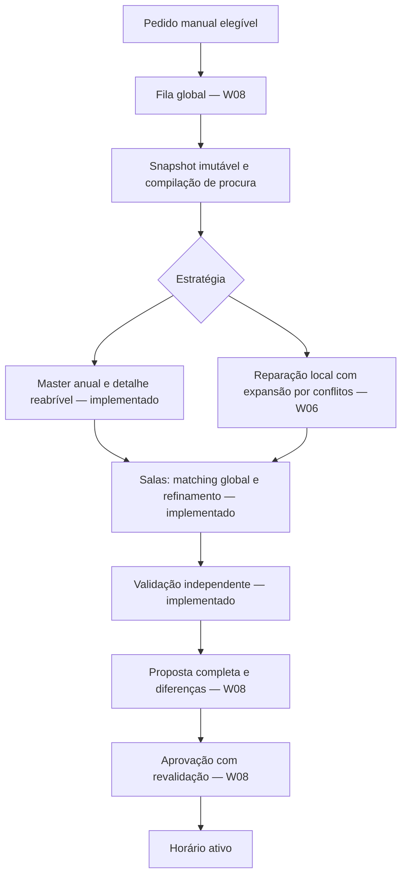

# Plano de execução — gerador Cronos v1 (Revisão 2)

Data de consolidação: 25 de setembro de 2026.

Estado: W00–W14 executados e fechados; a v1 está ativa em produção. Esta revisão substitui o plano de 23 de setembro de 2026 a partir de W06; o documento original permanece como referência histórica.

Integração: `main` (revisão entregue na W14).

Especificação de implementação: [SCHEDULER_V1_TECH_SPEC_V2.md](SCHEDULER_V1_TECH_SPEC_V2.md).
Decomposição de trabalho: [SCHEDULER_V1_WBS_V2.md](SCHEDULER_V1_WBS_V2.md).

## 1. Resultado pretendido e 5Ws

| Pergunta | Resposta |
| :--- | :--- |
| What — O quê? | Substituir integralmente o planeamento de horários por uma nova v1. Adaptar dados, API, execução, progresso e interface ao novo domínio. |
| Why — Porquê? | Gerar horários anuais completos para escolas até 60 turmas. Recuperar perturbações durante o ano com qualidade, conservação de minutos e diagnóstico honesto. |
| Who — Quem? | O responsável técnico implementa, testa e produz evidência. O proprietário do produto valida comportamentos, realiza os testes de utilização e aceita a entrega. |
| When — Quando? | W00–W14 concluídos por etapas com critérios de saída. Não há datas de calendário nem metas de duração inventadas. |
| Where — Onde? | P0–P11 no Docker local do proprietário. CI sem deployment. P12 valida Railway e Cloudflare antes da ativação final. |

O desenvolvimento e os primeiros benchmarks decorrem exclusivamente no Docker local do proprietário.
Não executar testes, resets ou deployments em Railway ou Cloudflare durante P0–P11.
O plano não promete resolver qualquer instância de 60 turmas. A capacidade e as restrições podem tornar uma instância impossível.
O lançamento exige demonstração em várias instâncias anuais realistas, incluindo simulações de alterações durante o ano.

## 1.1 Execução consolidada até W05 (registo as-built)

Sumário por pacote.

| Pacote | Pedido | Entregue | Como | Evidência principal |
| :--- | :--- | :--- | :--- | :--- |
| W00 — Ambiente e inventário | Inventário de consumidores, confirmação do Docker local de testes, bloqueio de deployments e checks atuais. | Inventário de chamadas e contratos; imagem `cronos-backend-test:local` (Python 3.14.7, OR-Tools 9.15.6755); runner reparado; suites de backend de 399 para 444 testes; limites de laboratório. | Execução de setup/doctor; falhas pré-existentes registadas à parte. Nenhum push nem deployment remoto. | Registo W00 (arquivo). |
| W01 — Domínio curricular e temporal | Valores imutáveis, procura `Q-E`, ledger de execução, dívida e reservas, projeção modular, calendário e estabilidade, qualidade e elegibilidade. | Pacote de domínio puro (`domain/`): `calendar`, `candidate`, `demand`, `debt`, `projection`, `quality`, `eligibility`, `capacity`, `constraint_policy`, `oracle`, `results`. Sem ORM, solver, HTTP ou relógio global. | TDD com os exemplos da entrevista; 458 testes unitários no registo; casos pequenos de C01, C09 e C13. | T01–T09, T13–T14, T21–T22, T29–T30 verdes; Registo W01 (arquivo). |
| W02 — Baseline de dados | Schema novo, RLS, constraints, transações de progresso e reset local. | Migração provisória `0011_scheduler_v1_curricular`: 13 tabelas relacionais com RLS forçada, evidência append-only, `scheduler_job_v1` e `scheduler_proposal_v1`, revisões `input_revision`/`planning_revision` no estado. Transações de execução, dívida e recuperação sob lock de estado (`infrastructure/progress`). | Integração em PostgreSQL real do Docker em bases de teste temporárias; instalação vazia reproduzível. Baseline Alembic consolidada na W12. | Testes `test_scheduler_v1_*`; Registo W02 (arquivo). |
| W03 — Oráculos, validador e laboratório | Validador independente, oráculo enumerativo, fixtures com testemunhos, manifests, modo de campanhas e comparador. | Validador `candidate_validation` (versão 4, 21 códigos tipados); oráculo enumerativo (limite de 50 000 combinações); `lab/`: fixtures mínimas com 13 mutações de testemunho, fixtures de escala e anuais com testemunhos construídos, manifests com digests SHA-256, CLI de campanhas com retoma por proveniência, comparador de regressões e revalidação independente. | Validador testado com candidatos deliberadamente adulterados; modo `campaign` no runner existente. | Registo W03 (arquivo); suites `test_scheduler_lab_*` |
| W04 — CompleteGeneration correto | Disponibilidade conjunta, quotas anuais exatas, detalhe com realimentação, salas com matching completo, materialização validada. | `capacity` (interseção conjunta de elegibilidade e pré-verificação com défices mínimos provados); master anual `annual_model` (quotas por duração com crédito exato, hint greedy earliest-week, no-goods completos); detalhe `placement_model` (janelas, pré-solve, limiares, congelamento, orçamento por janela, cache de janelas provadas, verificação de materialização, salas); coordenação `search`; caso de uso `application/generation` e composição. | Pacote RC07 do ciclo de correção W00–W04; campanhas em modo gerador. | T10–T14 verdes; campanha `w04-generation` {válido 20, inviável 6}; campanha `w04-annual` {válido 12} |
| W05 — Qualidade da geração inicial | Vetor de conclusões ordenado, furos docentes antes de turmas, incumbente anual com âmbito explícito, relatório de conclusão e margem. | `InitialQualityVector` lexicográfico; conclusões por contagens de limiar com equivalência ao vetor ordenado verificada contra o oráculo; congelamento de etapas provadas com distinção provado/conservado; incumbente pelo vetor completo; poda pela semana do incumbente; matching global de salas com refinamento; relatório de conclusão com avaliação de recuperabilidade de um cenário. | Revisão independente rejeitou o primeiro fecho (falhas F01–F11 reproduzidas); correções R45.00–R45.09; audit A01–A12 fixado com 16 regressões vermelho-primeiro (validador v2→v3); pacotes R55 e resíduos B01–B05 fechados; validador atual v4. | 613 unitários, 321 de integração e 47 de contratos no registo de fecho; T15–T19 verdes; `test_scheduler_w05_audit`; Registo W04/W05 (arquivo) |

Percursos de validação executados até W05: revisão independente de W00–W03 (correções RC00–RC08), revisão independente de W04/W05 que rejeitou o fecho (correções R45.00–R45.09) e audit final com contraexemplos A01–A12 fixados localmente com testes vermelho-primeiro. O gate G2 foi aceite no âmbito corrigido.

A produção executa o motor v1. O legado foi removido na W12.

Medições históricas: os registos de campanha de 24–25 de setembro de 2026 (Docker local, um worker CP-SAT) mostram geração semanal de 60 turmas em segundos e anuais de 60 turmas entre cerca de 51 e 125 segundos, conforme o perfil e o registo; o master anual de 60 turmas passou de mais de 90 para cerca de 22 segundos com o hint greedy. Estes números pertencem às medições anteriores. Esta revisão não os apresenta como nova comparação controlada nem como garantia universal.

## 1.2 Notas normativas desta revisão

1. Medições históricas não são metas nem garantias. A calibração quantitativa decorre das campanhas de W10–W11 e da validação remota de W13, com baselines separadas por ambiente.
2. A antecipação das conclusões resulta da política aprovada (D10–D12). Distribuir procura ao longo do ano exige uma decisão explícita de produto. Não introduzir limites semanais ou penalizações de antecipação para obter uma aparência mais uniforme.
3. O agrupamento de salas equivalentes e a calibração 1/2/4/8 workers foram fechados nas campanhas de W10–W11.

## 1.3 Otimizações consolidadas do gerador

Descobertas durante a implementação de W04–W05. Fazem parte da arquitetura v1 a partir de W06 e são obrigatórias para AdaptiveRecovery e pacotes seguintes.

| Nº | Melhoria | Decisão | Condição de correção vinculativa | Unidade principal |
| :--- | :--- | :--- | :--- | :--- |
| 1 | Master anual e detalhe reabrível | Manter | Cortes descrevem integralmente o subproblema excluído. | `search`, `annual_model`, `placement_model` |
| 2 | Hint greedy earliest-week | Manter | É um arranque de pesquisa; não prova viabilidade detalhada. | `annual_model` |
| 3 | Conclusões por contagens de limiar | Manter | Abranger todas as turmas e verificar equivalência com o vetor ordenado. | `placement_model` |
| 4 | Congelar prioridades superiores | Manter | Distinguir valores provados de valores conservados heuristicamente. | `placement_model` |
| 5 | Orçamento por janela e pré-solve | Manter | Contar construção e finalização; evitar starvation e certificados de etapas omitidas. | `placement_model` |
| 6 | Poda pela semana do incumbente | Manter | Permitir a mesma semana, para melhorar os restantes componentes. | `search`, `annual_model` |
| 7 | Matching global de salas após posições | Manter com correções | Considerar sobreposições físicas e reconhecer que as posições continuam fixas. | `placement_model` |
| 8 | Elegibilidade conjunta e proteção | Manter | Testar turma, docente, salas, passado, datas protegidas e timezone. | `capacity` |
| 9 | Cache de janelas provadas | Manter | Nunca reutilizar uma janela interrompida como ótima. | `placement_model` |

Cada condição de correção é requisito de regressão permanente. As nove têm regressões dedicadas (`test_scheduler_w05_audit`, `test_scheduler_w04_w05_regressions`, `test_scheduler_search_v1`, `test_scheduler_generation_v1`) e equivalências verificadas contra o oráculo enumerativo. A W06 tem de as preservar sob reparação (W06.6 do WBS).

## 2. Decisões de produto fechadas

Inalteradas desde 23 de setembro de 2026. Continuam vinculativas para W06–W14.

| ID | Decisão vinculativa |
| :--- | :--- |
| D01 | Nova baseline, sem obrigação de compatibilidade com o gerador anterior. |
| D02 | Os dados de teste atuais podem ser eliminados. Não há escolas utilizadoras a migrar. |
| D03 | Um único job de horários em execução globalmente. Os outros pedidos aguardam em fila. |
| D04 | O job pode usar vários workers internos CP-SAT. Testar 1, 2, 4, 8 e configurações superiores justificadas pelo hardware. |
| D05 | Não existe hoje qualquer meta fixa de p95, nem mesmo os anteriores 15 minutos ou dois minutos. |
| D06 | Medir desempenho por famílias de tamanho e dificuldade. O p95 é inicialmente um resultado observado. |
| D07 | A pesquisa termina por prova, proximidade certificada suficiente ou baixo retorno adicional estimado. Não termina por atingir um p95. |
| D08 | Há um timeout de segurança distinto. Interrupção nunca significa impossibilidade. |
| D09 | A escola define início, conclusão preferencial e limite absoluto. |
| D10 | A geração inicial deve terminar até à data preferencial e procurar antecipar as conclusões. |
| D11 | O adaptativo protege progressivamente a margem. Depois da data preferencial, reduzir o excesso prevalece sobre perturbação do futuro editável. |
| D12 | Priorizar sucessivamente as conclusões mais tardias. Permitir ceder capacidade de turmas adiantadas para ajudar turmas atrasadas. |
| D13 | Não atrasar uma turma apenas para igualar datas sem benefício para outras turmas. |
| D14 | A escola define a janela de estabilidade. Contar dias presentes na grelha semanal, não dias corridos. |
| D15 | Proteger qualquer alteração física dentro da janela, incluindo inserções de reposições. Preservar também passado e execução. |
| D16 | O módulo não é uma identidade permanente da aula futura. Resulta da sequência de minutos da disciplina. |
| D17 | Uma aula pode terminar um módulo e iniciar os seguintes. Os créditos têm minutos exatos e não se sobrepõem. |
| D18 | Recalcular automaticamente a previsão modular, inclusive dentro da janela. Não reescrever evidência executada. |
| D19 | A grelha define a capacidade máxima. Não transportar tetos implícitos de carga diária, semanal ou consecutiva. |
| D20 | Indisponibilidade obrigatória exclui períodos. Uma preferência desfavorável continua a permitir a colocação. |
| D21 | Entre soluções equivalentes nas prioridades superiores, reduzir primeiro furos dos professores, depois furos das turmas. |
| D22 | A escola atribui o professor a cada disciplina da turma. O solver não distribui serviço docente. |
| D23 | O administrador inicia sempre a geração. Nenhum evento inicia automaticamente o solver. |
| D24 | Só permitir geração inicial, atualização justificada, repetição de tentativa sem resultado ou renovação periódica elegível. |
| D25 | Após 28 dias corridos sem geração completa concluída, disponibilizar nova otimização manual. |
| D26 | Uma geração completa validada e persistida reinicia o relógio. Falha, cancelamento ou permanência em fila não reiniciam. |
| D27 | Se existir impossibilidade demonstrada, explicar os motivos e sugerir ações básicas. O diretor altera os dados ou as condições. |
| D28 | Acertos manuais de progresso recalculam procura e podem justificar reparação. O solver nunca inventa execução. |
| D29 | A interface usa linguagem escolar. Não apresenta CP-SAT, scopes, fingerprints, workers ou gaps matemáticos como linguagem do produto. |
| D30 | Manter proposta e aprovação administrativa. Gerar não publica automaticamente. |
| D31 | Desenvolver e testar primeiro no Docker local. Só validar Railway/Cloudflare após uma release candidate local sólida. |

## 3. Fronteira do revamp

### Concluído até W05

- Domínio de procura curricular, execução, dívida e previsão modular.
- CompleteGeneration com master anual, detalhe reabrível, salas e melhoria local.
- Comparação de qualidade, critérios de paragem por etapa e evidência de impossibilidade agregada.
- Validador independente, oráculo enumerativo, laboratório de campanhas e corpus de testemunhos.
- Baseline relacional provisória com transações de progresso auditadas.

### Concluído (W06–W14)

- AdaptiveRecovery com formulação própria, reconciliação de dívida e justiça entre turmas.
- Diagnósticos completos, controlador adaptativo de paragem e certificados por âmbito global.
- Snapshot, elegibilidade de fila, cancelamento, propostas, aprovação e relógio de renovação.
- API e UI necessárias para os novos contratos.
- Sumários, ocorrências, substituições, progresso, acertos e mapas afetados pela nova contabilização.
- Consolidação da baseline de esquema, fixtures finais, benchmarks de aceitação e release.
- Remoção dos motores, contratos, caminhos, métricas e testes específicos do desenho substituído.

### Fora do âmbito

- Vários horários resolvidos simultaneamente.
- Microserviços novos, mudança de linguagem ou troca de solver sem evidência concreta.
- Escolha automática de docentes ou substitutos pelo gerador.
- Limites pedagógicos de carga que a escola não definiu.
- Publicação automática ou geração automática após ocorrências.
- Compatibilidade com bases de dados da versão antiga.
- Certificação legal das decisões administrativas sobre execução.
- Garantias de optimalidade global sem certificado correspondente.

Reaproveitar código correto é permitido. Reaproveitar contratos errados para evitar mudanças não é permitido.
Preservar autenticação, isolamento de organizações, acessibilidade e integridade que continuam necessários à nova v1.

## 4. Diagnóstico confirmado e inventário de substituição — estado

| Área atual | Destino | Estado |
| :--- | :--- | :--- |
| `scheduler_candidates.py` | Domínios temporais compactos e capacidades de salas. | Substituído no motor v1 (`capacity`, `placement_model`). Legado removido na W12. |
| `scheduler_complete_engine.py` | Coordenação anual com detalhe revisível. | Substituído (`search`, `annual_model`, `placement_model`). Legado removido na W12. |
| `scheduler_near_optimizer.py` | Viabilidade anual antes de refinamento opcional. | Substituído. Legado removido na W12. |
| `scheduler_far_fill.py` | Remover este caminho no corte para a v1. | Removido na W12. |
| `scheduler_adaptive_engine.py` | Reparação por conflitos, melhor solução conservada e avaliação comum. | Substituído na W06; o legado foi removido na W12. |
| `scheduler_recovery_ladder.py` | Expansão dirigida por conflitos reais. | Substituído na W06. |
| `scheduler_incremental_demand.py` | Procura residual por disciplina e projeção derivada. | Substituído (`demand`, `projection`, `capacity`). Legado removido na W12. |
| Contratos de domínio antigos | Contratos novos, independentes de ORM e solver. | Substituídos; a fronteira legada foi removida na W12. |
| Tetos automáticos de conforto | Política aprovada e versionada. | Removidos no motor v1 e limpos na W12. |
| Estabilidade por dias corridos | Um único cálculo segundo a grelha semanal. | Implementado (`calendar`). |
| Ciclo de vida e aprovação | Reescrever mantendo atomicidade e concorrência. | Implementado (W08). |
| Testes de escola grande | Corpus com procura anual e validação completa. | Completo: corpora de escala e anual e replays anuais com eventos (W10). |

Antes de remover uma unidade em W12, pesquisar definições, importações, chamadas, testes, documentação e consumidores de API.

## 5. Contratos do novo domínio

Implementados e vinculativos. A formulação completa está na especificação técnica.

### 5.1 Três factos diferentes

1. Aula física: turma, disciplina, professor, sala, data e período ocupado.
2. Previsão curricular: distribuição dos minutos futuros pelos módulos, calculada a partir do progresso atual.
3. Execução: evidência dos minutos realizados e respetivas parcelas curriculares.

A previsão pode mudar sem mover a aula. A execução já registada não muda por um novo cálculo.
Uma correção administrativa gera evidência de correção. Não apaga o registo que está a corrigir.
Registar autor, data, motivo, valor anterior e novo efeito contabilístico.

### 5.2 Conservação de minutos

- Minutos inteiros; conversão de horas apenas nas fronteiras de entrada e apresentação.
- `R[a] = Q[a] - E[a]`; `0 <= E[a] <= Q[a]`; a soma dos créditos das aulas futuras é igual a `R[a]`.
- A dívida identifica a origem dos minutos em falta. Não acrescenta novamente esses minutos à procura residual.
- Uma recuperação planeada reserva procura; não credita execução.
- Uma recuperação executada credita progresso e reconcilia a dívida correspondente uma única vez.
- Não permitir que o mesmo minuto seja simultaneamente satisfeito por acerto, aula futura e recuperação.
- Dívida mais antiga primeiro como regra técnica de reconciliação, com associação auditável.

### 5.3 Distribuição modular

Ordenar módulos e percorrer os minutos curriculares cronologicamente.
Preencher o módulo atual até ao requisito. Distribuir o restante crédito pelos módulos seguintes.
Dois módulos de 75 minutos cabem em três aulas de 50 minutos: 50; 25+25; 50.
Uma ocorrência na terça permite que quarta passe ao módulo anterior e quinta avance para o seguinte.
Recalcular a previsão com cancelamentos, movimentos, execução, acertos e alterações curriculares.
Sumários fora de ordem exigem tratar a execução efetiva por data, sem converter uma previsão antiga em verdade histórica.
Inconsistências entre correções retroativas e evidência posterior devem ser diagnosticadas, não silenciosamente relabeladas.

### 5.4 Duração física e crédito

Os conflitos e o almoço usam o intervalo físico completo do período.
Os requisitos curriculares usam os minutos creditados.
O último período de uma disciplina pode ter crédito inferior à duração física.
Não preencher essa sobra com outra disciplina nem introduzir subperíodos variáveis nesta v1.
Suportar durações de períodos diferentes quando a grelha as permite.

### 5.5 Histórico e estabilidade

Preservar passado, execução e identidade das ocorrências.
Proteger alterações físicas e inserções antes da fronteira editável.
A projeção modular pode mudar dentro dessa fronteira.
Contar os dias da estabilidade segundo os dias da semana presentes na grelha.
Feriados continuam a impedir colocações, sem alterar implicitamente a regra de contagem por grelha.
Convenção: o dia local corrente é o primeiro contado quando pertence à grelha; se não pertence, começar no próximo dia da grelha. Com N igual a zero, permitir apenas posições ainda não iniciadas.
Usar a data local da escola, com relógio injetável nos testes.
Reverificar a fronteira ao aprovar uma proposta antiga.

### 5.6 Datas e recursos

- Validar início ≤ data preferencial ≤ limite absoluto.
- CompleteGeneration não aceita um draft inicial depois da data preferencial.
- AdaptiveRecovery nunca aceita aulas depois do limite absoluto.
- O professor atribuído e a habilitação são restrições obrigatórias.
- Tipo, lotação e restrições específicas de sala são obrigatórios.
- Disponibilidade proibida exclui o candidato. Preferência desfavorável apenas afeta qualidade secundária.
- Preservar almoço e calendário aplicáveis. Não acrescentar tetos implícitos de carga.

## 6. Arquitetura interna e regras de implementação



Estrutura real do pacote `backend/app/scheduler/`: `composition.py`; `application/` (`contracts`, `generation`, `recovery`, `publishing`); `domain/` (`candidate`, `candidate_validation`, `calendar`, `capacity`, `constraint_policy`, `demand`, `debt`, `diagnostics`, `projection`, `quality`, `recovery`, `eligibility`, `grid_versions`, `oracle`, `results`, `serialization`, `stop`, `timetable`); `infrastructure/` (`models`, `progress`, `annual_model`, `constructive`, `placement_model`, `search`, `snapshot`, `jobs`, `proposals`, `operations`, `occurrences`, `queries`, `diagnostics`, `curriculum`, `task_dispatcher`); `lab/` (fixtures, manifests, campanhas, relatórios, revalidação, matriz, calibração, replays).

| Camada | Responsabilidade | Não pode depender de |
| :--- | :--- | :--- |
| Domínio | Minutos, procura, calendário, estabilidade, política de qualidade e validação. | FastAPI, SQLAlchemy, Celery, CP-SAT e relógio global. |
| Aplicação | Casos de uso, coordenação, resultados. | Detalhes do modelo matemático ou objetos ORM nos contratos públicos internos. |
| Infraestrutura | CP-SAT, repositórios, transações, dispatch e configuração de execução. | Regras duplicadas que contradigam o domínio. |
| API e UI | Autorizações, comandos, consultas e explicação escolar dos resultados. | Formulações do solver ou parsing de mensagens técnicas como regras de negócio. |

Aplicar Clean Code, Clean Architecture, TDD e Ponytail full.
Manter o validador independente da construção do modelo matemático.
O oráculo enumerativo é implementação de teste; nunca é fallback de produção.

## 7. CompleteGeneration — registo as-built

Implementado, testado e revisto. As nove otimizações consolidadas (secção 1.3) realizam-se aqui.

### 7.1 Compilação e verificações necessárias

- Procura residual por atribuição com rejeição de acertos fora dos limites; crédito protegido descontado antes do residual editável.
- Interseção conjunta de elegibilidade única (`capacity.eligible_periods`): timezone da escola, datas dentro dos limites da estratégia, datas não bloqueadas, ausência de proteção física, grelha, disponibilidade de turma e docente, sala elegível livre e sem colisão com períodos fixados por aulas protegidas. O validador e o oráculo recompõem a mesma interseção de forma independente.
- Pré-verificação agregada com défices mínimos provados por recurso. Somas semanais nunca são tratadas como prova de viabilidade.

### 7.2 Master anual

- Quotas por (atribuição, semana, duração) com grupos finais e desperdício; equação de crédito exato por atribuição.
- Capacidades semanais por turma, docente e conjuntos de salas, descontando ocupações fixas.
- Hint greedy earliest-week como arranque de pesquisa. Não prova viabilidade detalhada.
- Objetivo: minimizar a semana de conclusão mais tardia e depois o desperdício.
- Poda `latest <= semana_do_incumbente`, com a mesma semana permitida para melhorar os restantes componentes. O limite relaxado é conservado separadamente do incumbente.
- Distribuições excluídas por no-goods que descrevem integralmente o subproblema: contagens positivas, contagens nulas condicionadas, grupo final e desperdício.

### 7.3 Detalhe reabrível

- Janelas por semana, resolvidas da mais tardia para a mais precoce dentro de orçamento próprio.
- Pré-solve de viabilidade limitado antes das etapas de qualidade; inviabilidade provada no pré-solve devolve corte ao master.
- Conclusões por contagens de limiar, minimizadas do valor mais alto para o mais baixo; equivalência ao vetor ordenado `C↓` verificada contra o oráculo (regressão permanente com seeds).
- Congelamento de cada etapa no valor atingido; só etapas `OPTIMAL` certificam; valores conservados heuristicamente ficam sem certificado; `SAFETY` des-certifica tudo.
- Orçamento por janela com reserva de finalização de salas e divisão igual pelo restante; construção e finalização contam no orçamento; etapa omitida nunca é certificada.
- Cache apenas de janelas com todas as etapas provadas; janela interrompida nunca é reutilizada como ótima.
- Verificação de materialização: o detalhe tem de coincidir exatamente com a distribuição anual.
- Cortes ao master apenas de inviabilidade provada no detalhe; timeouts nunca geram cortes; janelas são reabertas, não congeladas.

### 7.4 Salas

- Matching global após posições fixas: escolha por (aula, sala) com exclusão mútua por sala em todos os períodos sobrepostos, incluindo aulas fixas e protegidas.
- Etapas lexicográficas: custo de preferências de sala e depois excesso de continuidade por (turma, disciplina).
- Refinamento que reabre posições da mesma semana apenas quando o vetor de qualidade completo melhora estritamente.
- Em modo de janela única, a continuidade é otimizada dentro da própria janela.
- As posições continuam fixas durante o matching.

### 7.5 Viabilidade e qualidade

- A primeira solução completa é marco de pesquisa; o incumbente é conservado pelo vetor completo de qualidade.
- Resultados tipados e evidência por etapa com âmbito, incumbente, limite e motivo de fim.
- Candidatos são sempre revalidados pelo validador independente antes de aceites; métricas são recalculadas fora do solver.
- O relatório de conclusão inclui margem, excessos e uma avaliação de recuperabilidade de um cenário (cancelamento da última aula planeada seguida de nova resolução).

## 8. AdaptiveRecovery — implementado

### 8.1 Entrada e identidade

Receber horário publicado, execução, dívida, recuperações planeadas, alterações curriculares, recursos e fronteira editável.
Usar todo o estado para contabilizar. Não transformar automaticamente todo o estado em variáveis.
O horário publicado é uma referência de perturbação. Só é uma solução viável se continuar válido nos novos dados.
Preservar as identidades de execução e ocorrência quando as aulas futuras são movidas.
Recalcular parcelas modulares depois de decidir posições físicas.

### 8.2 Pesquisa

1. Identificar procura sem cobertura e blocos inválidos ou excedentários.
2. Procurar inserções e substituições de posição com índices de disponibilidade conjunta.
3. Libertar pequenos conjuntos de aulas relacionados com os conflitos.
4. Explorar cadeias de movimentos, inclusive entre semanas afastadas.
5. Expandir por professores, turmas e salas efetivamente limitantes.
6. Comparar resultados pelo mesmo avaliador de qualidade usado nas métricas.
7. Conservar a melhor solução completa enquanto se procura melhorar.

Não devolver a primeira solução completa apenas porque pertence ao primeiro nível de uma escada.
Não usar o nível do bairro como objetivo de qualidade disfarçado.
Se o problema exigir expansão ampla, permiti-la dentro dos recursos de segurança e reportar o âmbito explorado.

### 8.3 Qualidade e margem

Definir `C[turma]` como conclusão prevista de toda a procura, não como média das datas das aulas.
Se houver procura sem posição, não atribuir uma conclusão completa fictícia à turma.
Guardar datas da primeira aprovação e da versão anterior para explicar impacto acumulado e incremental.
A data preferencial mantém-se fixa até decisão explícita da escola.

Prioridades:

1. Validade, proteção histórica e cobertura completa da procura.
2. Reduzir os excessos sobre a data preferencial, começando pelos mais tardios.
3. Antes da data preferencial, equilibrar conclusão coletiva e perturbação com proteção progressiva da margem.
4. Em comparações equivalentes de perturbação, priorizar a sequência de conclusões mais tardias.
5. Em conclusões equivalentes, preferir menos alterações, sobretudo próximas e repetidas.
6. Reduzir furos dos professores, depois das turmas; melhorar preferências e salas.

O compromisso do ponto 3 é deliberado. Uma prioridade absoluta à conclusão em todos os casos eliminaria o compromisso aprovado.
Não substituir o equilíbrio por um custo plano por aula movida.
Penalizar a extensão mais fortemente quando a conclusão projetada se aproxima da meta.
Calibrar uma função monótona e crescente com exemplos aprovados e benchmarks.
As trocas devem permitir que uma turma adiantada ceda recursos quando isso melhora as conclusões atrasadas.
Nunca ceder margem apenas para igualar datas sem benefício operacional.

### 8.4 Sem solução completa

Não apresentar recuperação parcial como resolução do pedido.
Preservar o horário ativo. Guardar informação parcial apenas para diagnóstico e melhoria interna.
Impossibilidade demonstrada produz explicação e sugestões relativas ao conflito identificado.
Pesquisa inconclusiva produz mensagem distinta, sem acusar falta de capacidade não demonstrada.
Quantificar défices mínimos apenas quando o cálculo os suportar. Identificar estimativas como estimativas.
Sugestões podem incluir disponibilidade, atribuição de professor, salas, datas ou revisão de progresso.
Não sugerir um recurso específico como causa única com base apenas num insucesso heurístico.

### 8.5 Integração com as otimizações consolidadas (nova nesta revisão)

- A reparação herda o master/detalhe reabrível: movimentos reabrem as janelas afetadas; cortes continuam a descrever integralmente o subproblema excluído.
- O hint pode partir do baseline publicado; nunca prova viabilidade detalhada.
- As conclusões por limiar abrangem todas as turmas também na reparação; a equivalência ao vetor ordenado mantém-se como regressão.
- O congelamento distingue provado de conservado em todos os estágios de reparação.
- O orçamento por janela conta construção e finalização da reparação; sem starvation; etapas omitidas não são certificadas.
- A poda usa a semana do incumbente de reparação; a mesma semana é permitida.
- As salas voltam a matching global após os movimentos; posições fixas; refinamento só com melhoria estrita do vetor completo.
- A elegibilidade conjunta é a mesma interseção única, incluindo passado, datas protegidas e timezone.
- O cache de janelas provadas invalida quando protegidos, baseline ou fronteira editável mudam; janela interrompida nunca é ótima.

## 9. Critérios de paragem e medição de qualidade

### 9.1 Separação obrigatória

- Qualidade: resultado segundo as prioridades do domínio.
- Limite matemático: melhor valor ainda possível no âmbito e objetivo certificados.
- Evolução: melhorias observadas durante a pesquisa.
- Previsão de retorno: estimativa empírica do benefício de mais esforço.

Não chamar 93/100 a 93% de optimalidade sem fundamento.
Não agregar gaps de modelos locais como certificado global.
Não tratar `OPTIMAL` de uma fase como prova de todo o vetor de qualidade.
O prefixo certificado é a sequência contígua de etapas provadas; o resto são valores conservados.
Se usar tolerâncias nativas, registar tolerância, valores e limites; não depender apenas do nome do status.

### 9.2 Controlador de pesquisa

Monitorizar novas soluções, limites, diversidade de bairros e esforço consumido.
Continuar quando existir progresso relevante ou investigação justificada de ganhos importantes.
Parar por baixo retorno apenas depois de cumprir a exploração mínima definida para aquele âmbito.
Calibrar essas regras em trajetórias de execuções prolongadas.
Não criar inicialmente modelos de aprendizagem automática para estimar a próxima melhoria.

Motivos técnicos de fim: ótimo demonstrado; tolerância certificada; retorno adicional estimado baixo; impossível demonstrado; inconclusivo; cancelado; falha.
Traduzir estes motivos para linguagem acessível sem inventar certezas.
Na interrupção de segurança, uma solução completa já validável pode ser conservada como proposta com pesquisa interrompida explícita.
No cancelamento pedido pelo administrador, não publicar ou persistir uma nova proposta contra esse pedido.

### 9.3 Segurança operacional e honestidade de orçamento

Definir limites finitos de segurança antes dos primeiros ensaios longos.
Os limites iniciais são parâmetros de laboratório documentados, não metas de desempenho.
Cobrir CPU, memória, duração extrema, cancelamento, construção, retorno, validação e persistência.
O orçamento de execução conta construção, pesquisa e finalização. Uma execução que excede o orçamento nunca é reportada como dentro do orçamento. Etapas omitidas por orçamento ficam sem certificado.
Timeout, perda de worker e interrupção deixam estados recuperáveis e não corrompem o horário ativo.

## 10. Elegibilidade, fila, propostas e aprovação — implementado

### 10.1 Motivos para gerar

| Evento | Efeito |
| :--- | :--- |
| Primeira geração com configuração completa | Disponibilizar geração inicial. |
| Dívida criada, revista ou anulada | Reavaliar procura e necessidade de atualização. |
| Acerto manual ou alteração de requisito curricular | Recalcular procura e impacto futuro. |
| Professor, disponibilidade, sala, calendário ou restrição alterados | Sinalizar apenas impacto relevante no planeamento. |
| Execução normal de uma aula conforme planeado | Atualizar progresso e projeção; não criar automaticamente um motivo para regeneração a cada sumário. |
| Alteração sem efeito semântico | Não desbloquear geração. |
| 28 dias desde geração completa persistida | Disponibilizar otimização manual. |
| Tentativa falhada, inconclusiva ou cancelada | Permitir nova tentativa; não consumir o motivo. |

A regra de domínio `generation_eligibility` está implementada e testada (T21–T22). O cablage à fila e ao relógio persistido está implementado (W08).

### 10.2 Concorrência

- Uma réplica do serviço de solver, concorrência Celery um e prefetch um.
- Exclusão global robusta contra duplicação de entrega e sobreposição de deployments.
- Mecanismo simples de exclusão na base de dados, com ligação e ciclo de vida explícitos.
- Não manter uma transação de escrita aberta durante a resolução.
- Snapshot imutável e versão de base associados ao pedido.
- FIFO inicialmente. Revalidar pedidos que ficaram em fila antes de consumir esforço de resolução.
- Se os dados mudarem, marcar o pedido ou proposta como desatualizado e disponibilizar nova ação manual.

Heartbeat e cancelamento precisam de funcionar durante um solve longo.
Os workers CP-SAT pertencem ao job. Não equivalem a jobs Celery adicionais.

### 10.3 Publicação

Persistir proposta completa, diferenças, evidência de validação e métricas de forma atómica.
Na aprovação, revalidar versão, dados atuais, procura, dívida, estabilidade e cancelamento.
Reconciliar vínculos de recuperação e ativar o novo horário numa única transação.
Uma proposta desatualizada não pode ser aprovada silenciosamente.
Reiniciar o relógio de 28 dias na conclusão válida da geração, não na aprovação.

## 11. Interface e contratos públicos — implementado

Inventariar todos os consumidores antes de alterar modelos e respostas.
Incluir configuração, horários, detalhe de turma, progresso, sumários, ocorrências, substituições e mapas semanais.

| Conceito interno | Apresentação escolar |
| :--- | :--- |
| Elegibilidade por alterações | Existem alterações por aplicar ao horário. |
| Pedido manual | Gerar proposta de horário. |
| Renovação após 28 dias | Já pode otimizar o horário das próximas semanas. |
| Espera na fila | A aguardar a conclusão de outro pedido. |
| Pesquisa de viabilidade | A organizar as aulas. |
| Refinamento | A melhorar a proposta. |
| Proposta desatualizada | Existem alterações mais recentes. Gere uma nova proposta. |
| Impossibilidade demonstrada | Não é possível colocar todas as aulas com estas condições. |
| Interrupção inconclusiva | Não foi possível concluir a pesquisa. Isto não significa que o horário seja impossível. |

Mostrar datas preferencial e absoluta, conclusão por turma, margem e alterações principais.
Mostrar excesso da data preferencial persistentemente enquanto existir.
Não culpar pessoas por ocorrências. Mostrar o recurso e a procura afetados quando conhecidos.
Não mostrar percentagens fictícias de progresso do solve nem previsões de tempo sem suporte.
Manter cancelamento acessível, estado persistente após refresh e mensagens sem detalhes de infraestrutura.
Mostrar previsão modular como previsão; distinguir da execução efetiva.
Continuar a cumprir navegação por teclado, contraste, leitores de ecrã e estados de carregamento.

## 12. Plano de testes — estado da matriz T01–T30

| ID | Cenário | Resultado exigido | Estado |
| :--- | :--- | :--- | :--- |
| T01 | Dois módulos de 75 minutos, períodos de 50. | Três aulas e parcelas 50; 25+25; 50. | Verde (`test_scheduler_module_projection`) |
| T02 | Aula de terça cancelada e recuperada quinta. | Quarta avança os minutos do módulo anterior; quinta recebe a projeção seguinte. | Verde (idem) |
| T03 | T02 com quarta dentro da estabilidade. | Só muda a previsão modular; a aula física permanece. | Verde (`test_scheduler_calendar`) |
| T04 | Recuperação planeada, executada e execução repetida. | Crédito único, dívida reconciliada e idempotência. | Verde (`test_scheduler_progress_domain`) |
| T05 | Cancelamento de uma recuperação e revisão da ocorrência original. | Sem perda de procura nem duplicação de dívida. | Verde (`test_scheduler_debt_domain`) |
| T06 | Acerto positivo e negativo de 600 minutos. | Procura e previsão atualizadas; nenhuma dupla cobertura. | Verde (idem T04) |
| T07 | Acerto torna aulas protegidas excedentárias. | Não apagar blocos protegidos; explicar o conflito. | Verde (idem T01) |
| T08 | Grelhas de três, cinco e sete dias; janela de nove dias. | Fronteira corresponde à contagem de dias da grelha. | Verde (idem T03) |
| T09 | Feriados, mudança de hora, geração e aprovação em datas distintas. | Datas locais consistentes e nova fronteira respeitada. | Verde (idem T03) |
| T10 | Capacidades semanais suficientes, dois professores só disponíveis no mesmo período. | Rejeitar o detalhe impossível; não assumir viabilidade pelas somas. | Verde (`test_scheduler_search_v1`) |
| T11 | Escolha inicial bloqueia últimas semanas, mas há solução alternativa. | Reconsiderar escolhas e encontrar o testemunho conhecido. | Verde (idem T10) |
| T12 | Sala específica consome a única sala de lotação suficiente. | Capacidade e matching concordam; nenhuma dupla utilização. | Verde (`test_scheduler_generation_v1`) |
| T13 | Dia carregado permitido pela grelha. | Não rejeitar nem adiar apenas por tetos antigos de conforto. | Verde (idem T12) |
| T14 | Preferência desfavorável versus indisponibilidade obrigatória. | Só a segunda proíbe a colocação. | Verde (idem T12) |
| T15 | Turmas A e B partilham professor após ausência prolongada. | Permitir cedência de capacidade que antecipa a conclusão mais tardia. | Verde (solver e comparador) |
| T16 | Atrasar turma adiantada sem beneficiar outra. | Não premiar igualdade artificial de datas. | Verde (solver e comparador) |
| T17 | Poucas alterações evitam extensão; muitas alterações evitam extensão pequena longe da meta. | Respeitar a política progressiva aprovada. | Verde (solver e comparador) |
| T18 | Extensão ultrapassa a meta em novembro. | Ativar a prioridade pela conclusão projetada, sem esperar por junho. | Verde (solver e comparador) |
| T19 | Conclusões e perturbação iguais, conflito entre furos de docentes e turmas. | Priorizar professores. | Verde (`test_scheduler_initial_quality_v1`, `test_scheduler_generation_quality_v1`) |
| T20 | Mudança de professor atribuído ou sala invalida o baseline. | Não conservar esse baseline como solução válida. | Verde (`test_scheduler_recovery_v1`) |
| T21 | Novo sumário normal, alteração sem efeito e dívida nova. | Só os eventos semanticamente relevantes desbloqueiam atualização. | Verde (`test_scheduler_eligibility_v1`) |
| T22 | Renovação aos 27 dias, 28 dias, falha e geração bem-sucedida. | Elegibilidade e reinício corretos. | Verde (idem T21) |
| T23 | Dois pedidos de escolas diferentes e entrega duplicada. | No máximo um job global em execução; nenhum efeito duplicado. | Verde (`test_scheduler_v1_lifecycle`) |
| T24 | Alteração durante fila, solve, persistência ou aprovação. | Nenhum estado desatualizado é publicado. | Verde (idem T23) |
| T25 | Cancelamento em cada fase e morte do worker. | Sem proposta parcial ou publicação indevida; estado recuperável. | Verde (idem T23) |
| T26 | Ótimo local, timeout local e certificado anual. | Mensagens e métricas identificam corretamente âmbito e certeza. | Verde (`test_scheduler_w07_results_v1`) |
| T27 | Nova proposta anual de grande volume. | Cobertura completa, persistência atómica e memória medida. | Verde (`test_scheduler_v1_lifecycle`) |
| T28 | Organização A tenta consultar ou alterar recursos de B. | Isolamento preservado em API, jobs, propostas e aprovação. | Verde (`test_scheduler_tenant_isolation`, `test_scheduler_v1_api`) |
| T29 | Substituição adianta outra disciplina e cria dívida na original. | Atualizar ambas sem manter cobertura futura redundante. | Verde (`test_scheduler_progress_domain`) |
| T30 | Toda a procura cumprida, sem futuro útil. | Não apresentar erro artificial nem proposta com aulas inventadas. | Verde (idem T04 e T12) |

### 12.1 Princípios e níveis

- TDD para alterações não triviais. Relógio, sementes e entradas controlados.
- Verificador independente para todos os resultados de benchmark; oráculo enumerativo para instâncias mínimas.
- Não exigir soluções idênticas entre contagens de workers; exigir validade e qualidade comparáveis.
- Propriedades metamórficas: renomear entidades não altera qualidade; mais disponibilidade não destrói testemunho válido; permutar entradas não altera o comparador.
- Níveis executados: unitários, pequenos solves com oráculo, propriedades, integração PostgreSQL, contratos de API, E2E, falhas operacionais e longitudinais completos.

## 13. Corpus e protocolo de benchmarks

### 13.1 Estado do corpus

- Fixtures mínimas com testemunhos e 13 mutações rastreáveis; oráculo enumerativo como árbitro.
- Corpus de geração: 26 casos (famílias C01–C10, contraexemplos T10–T14/T19, escala 10/30/45/60 turmas).
- Corpus anual: 12 casos (10/30/45/60 turmas × perfis `loose`, `shared-teacher`, `scarce-rooms`), testemunhos construídos por construção, validação independente de cada candidato e revalidação de digests.
- Manifests com digests SHA-256; seeds de fixture, eventos e solver separadas; retoma de campanha por proveniência.
- Entregues: corpus de reparações, sequências anuais com eventos e avaliação reservada final.

### 13.2 Registo por execução

| Categoria | Dados |
| :--- | :--- |
| Identidade | Revisão, imagem, versão do schema, versões Python e OR-Tools, dataset, checksum e semente. |
| Hardware | Ambiente local ou Railway, CPU/RAM efetivas, limites Docker ou do serviço, workers, sistema operativo e carga concorrente. |
| Entrada | Turmas, atribuições, minutos, recursos, calendários, dívida e perfil de dificuldade. |
| Resultado | Validação, completude, motivo de fim, âmbito de prova e diagnóstico. |
| Qualidade | Conclusões ordenadas, excesso da meta, perturbação, furos docentes/alunos e salas. |
| Trajetória | Tempo e qualidade de cada melhor solução; limites correspondentes ao âmbito medido. |
| Fases | Fila, snapshot, compilação, planeamento, detalhe, matching, validação, persistência e aprovação. |
| Recursos | CPU consumida, duração, pico de memória, modelos/candidatos e custo estimado por execução. |

Tempo de execução vai do início do job até à proposta validada e persistida.
Medir espera na fila separadamente. Tempo por bloco é auxiliar; não é o SLA da pesquisa.

### 13.3 Comparação

Comparar tempo para qualidade equivalente e qualidade com esforço equivalente.
Comparar decisões de paragem automática com execuções longas de referência.
Não ocultar falhas, cancelamentos, limites atingidos ou execuções inconclusivas.
Reportar taxa de sucesso e percentis com população e censura identificadas.
Alternar a ordem das configurações; executar sem jobs concorrentes no ambiente de referência.
Separar resultados locais de resultados Railway. Não calcular um percentil que misture os dois ambientes.
As campanhas de gerador passam a verificar sistematicamente: certificados correspondem a etapas executadas; o cache não reutiliza janelas interrompidas; o orçamento conta construção e finalização.

### 13.4 Workers e hardware

Primeiro comparar 1, 2, 4 e 8 workers no mesmo hardware (W11).
Não assumir ganho linear nem que oito threads equivalem a oito CPUs disponíveis.
Medir consumo real. Menor duração pode coexistir com maior custo e memória.
O benchmark é do pipeline completo. Em W13, repetir as configurações candidatas no hardware Railway efetivo.

### 13.5 Baseline e aceitação quantitativa

Não fixar tempos antes das medições.
Estabelecer a baseline local da v1 e melhorar sem perder correção.
Depois do gate local, estabelecer uma baseline própria de Railway.
Antes de avaliar o conjunto final, congelar a política e os critérios quantitativos obtidos na calibração.
O proprietário aceita o compromisso de qualidade, duração e custo com evidência comparável.

## 14. Plano faseado — estado e revisão

| Pacote | Estado | Trabalho e entregáveis | Critério de saída |
| :--- | :--- | :--- | :--- |
| P0 — Preparação local | Concluído (W00) | Inventário, Docker local de testes, limites de laboratório. | Ambiente reproduzível; nenhum deployment remoto. |
| P1 — Contrato de domínio | Concluído (W01) | Procura, execução, acertos, dívida e projeção. | Conservação de minutos e exemplos da entrevista demonstrados. |
| P2 — Baseline de dados | Concluído (W02) | Schema provisório, migração, RLS, constraints, transações. | Instalação vazia reproduzível e auditorias aprovadas. Baseline consolidada em W12. |
| P3 — Validador e medição | Concluído (W03) | Validador independente, oráculo, corpus mínimo, campanhas. | Rejeita resultados forjados; artefactos reproduzíveis. |
| P4 — Geração anual viável | Concluído (W04) | Master anual, detalhe reabrível, cortes válidos, salas e projeção. | Horários completos nas instâncias conhecidas; T10–T12 resolvidos. |
| P5 — Qualidade da geração | Concluído (W05) | Conclusões ordenadas, prioridade docente, incumbente conservado. | Testemunhos de qualidade e baseline de escala registadas. |
| P6 — Reparação | Concluído (W06) | Procura residual, bairros, cadeias, expansão por conflitos, comparação uniforme e integração das nove otimizações (W06.6). | T15–T20 no solver e cenários de dívida completos, sem dupla contagem. |
| P7 — Pesquisa e diagnósticos | Concluído (W07) | Provas por âmbito, paragem adaptativa, segurança, explicações, métricas de trajetória e honestidade de orçamento. | Nenhum timeout tratado como impossível; T26; política comparada com referências longas. |
| P8 — Ciclo de vida e operações | Concluído (W08) | Elegibilidade persistida, fila única, idempotência, cancelamento, persistência e aprovação. Cablage do motor v1 à produção. | T21–T28 e testes de falha aprovados. |
| P9 — API e experiência | Concluído (W09) | Configuração, horários, módulos previstos, execução, acertos, motivos e propostas. | Percurso completo utilizável e E2E aprovados. |
| P10 — Escala e calibração local | Concluído (W10–W11) | Corpus amplo, replays anuais com eventos, workers 1/2/4/8, quotas CPU/RAM, agrupamento de salas equivalentes, política de paragem e simulação anual. | Evidência local sólida; configurações candidatas e critérios de validação remota documentados. |
| P11 — Remoção e candidate local | Concluído (W12) no âmbito corrigido | Remover código antigo, consolidar baseline Alembic, avaliação reservada. | Instalação Docker limpa, gates funcionais e aceitação final concluída. |
| P12A — Validação em produção | Concluído (W13) | Candidate publicada na API; validação remota e frontend Cloudflare confirmados. | Baseline remota e configuração final demonstradas; regressões resolvidas. |
| P12B — Merge e ativação final | Concluído (W14) | Release fixada, CI verde, dados de ensaio limpos e baseline final instalada; smoke validado. | Critérios de lançamento satisfeitos e revisão efetivamente publicada verificada. |

P6 é a primeira fase nova. Não compensar uma arquitetura inviável acrescentando workers ou timeout.
Se a decomposição falhar sistematicamente na reparação, parar a expansão funcional e rever o modelo com o contraexemplo medido.

## 15. TDD, checks e infraestrutura de testes

O runner suportado é `scripts/test.mjs`. O modo `campaign` existe e executa os corpora do solver:

```powershell
node scripts/test.mjs setup --scope all
node scripts/test.mjs doctor --profile all
node scripts/test.mjs fast --scope all
node scripts/test.mjs integration
node scripts/test.mjs e2e --project app
node scripts/test.mjs all --scope all
node scripts/test.mjs campaign --manifest backend/tests/scheduler_lab/generation_manifest.json --mode generator
```

Reutilizar execução, artefactos e preparação existentes.
Não instalar pytest num container de runtime para contornar a infraestrutura de testes.
Não usar SQLite como substituto da integração PostgreSQL.
Não aprovar com testes ignorados, retries a esconder instabilidade ou artefactos em falta.
Após cada push, acompanhar a CI até passar e corrigir eventuais falhas.
Antes de qualquer push, garantir que a branch e a CI não provocam deployments automáticos Railway ou Cloudflare.
Após alterações frontend, reconstruir ou atualizar o container local correspondente quando estiver em uso.
Executar benchmarks caros numa via controlada, separada dos limites frágeis de tempo da CI funcional.

## 16. Limpeza de legado e nova baseline — W12

Eliminar dados de teste das organizações e reconstruir a configuração necessária para a nova v1.
Não transportar horários, ocorrências, progresso, propostas ou jobs antigos.
Consolidar a migração provisória `0011_scheduler_v1_curricular` numa baseline Alembic nova depois de estabilizar o schema.
Revalidar nela roles, RLS, índices, triggers e integridade.
O deployment deve detetar schema antigo e falhar com orientação de reset.

Remover:

- Motores near/far antigos, escadas substituídas e configurações sem consumidor;
- Campos que fixam módulos futuros à identidade da aula;
- Tetos implícitos de conforto e métricas sem significado na nova política;
- Flags de fallback, adaptadores antigos, endpoints e tipos sem consumidor;
- Fixtures e testes que apenas cristalizam a implementação removida;
- Seeds, documentação e instruções operacionais incompatíveis.

Conservar testes de invariantes ainda válidos, reescritos para os novos contratos quando necessário.
Verificar importações, chamadas, referências de schema, frontend, filas e documentação após a remoção.

## 17. Railway, Cloudflare e ativação

### 17.1 Gate de passagem do Docker local para produção

A divisão é entre P11 e P12A. Exigir todas as condições seguintes:

1. Instalação vazia e reset da nova baseline reproduzíveis no Docker.
2. Domínio, validação independente, integração e percursos E2E locais aprovados.
3. Geração anual completa para várias instâncias locais realistas, incluindo 60 turmas.
4. Recuperações de volumes e dificuldades diferentes, incluindo recursos críticos e proximidade do limite.
5. Simulações longitudinais aprovadas, sem perda de minutos, história ou identidade da dívida.
6. Comparação local documentada de qualidade/tempo, workers, CPU e memória.
7. Política de paragem avaliada com referências prolongadas e dados reservados locais.
8. Fila única, cancelamento, falhas, reinício, proposta desatualizada e aprovação testados.
9. Legado removido e revisão candidata identificada, sem mudanças de arquitetura fundamentais pendentes.
10. O proprietário considera os horários locais satisfatórios e os resultados justificam validar a produção.

O relatório do gate regista evidência por condição, limitações locais e a configuração candidata.
Se o hardware local não comportar um ensaio, registar a limitação e submeter exceção explícita ao proprietário.

### 17.2 Validação no ambiente atual após o gate

1. Registar serviços, configuração, limites, revisão e ligações efetivamente usados.
2. Suspender deployments automáticos durante o ensaio.
3. Parar pedidos e workers antes de resetar dados ou trocar schema.
4. Esvaziar apenas as filas e o armazenamento pertencentes a esta aplicação.
5. Recriar schema, roles e seed da nova v1 pelo processo testado.
6. Publicar a mesma revisão em API, worker, Beat e frontend.
7. Confirmar o frontend Cloudflare a usar o backend correto.
8. Executar smoke funcional antes dos benchmarks.
9. Não executar outras campanhas enquanto decorrem medições de referência.

Validar os aspetos que o Docker local não demonstra: CPU, memória, variabilidade e custo efetivos no Railway; contagem de workers adequada aos recursos reais; ligações entre serviços; reinícios e timeouts externos; routing e cache do frontend Cloudflare; ausência de regressões nas instâncias portadas; corpus de aceitação reservado.

Problemas encontrados em P12A regressam ao ciclo local de correção e testes.

### 17.3 Critérios de lançamento

- Todos os invariantes obrigatórios passam.
- Todas as instâncias de aceitação conhecidas como viáveis produzem resultados completos e independentes validados.
- Casos impossíveis conhecidos recebem classificação e explicação corretas.
- Não existe regressão de qualidade prioritária escondida por uma média de métricas.
- O corpus de 60 turmas e as simulações longitudinais foram executados no Railway.
- A política de paragem foi avaliada em dados reservados, além dos usados para calibração.
- O proprietário aceita horários concretos e o compromisso medido entre qualidade, duração e custo.
- Fila global, cancelamento, reinício e aprovação concorrente foram ensaiados.
- CI completa aprovada para a revisão candidata.
- Instalação vazia, reset e recuperação da nova v1 foram ensaiados.
- Documentação corresponde aos contratos efetivamente implementados.

### 17.4 Corte final

1. Fixar revisão e imagens da release candidate.
2. Guardar relatório de aceitação, configurações e artefactos dos benchmarks.
3. Aprovar e integrar a branch apenas depois dos gates.
4. Acompanhar a CI associada ao merge até passar.
5. Parar processamento e limpar os dados de teste destinados a ser descartados.
6. Instalar a baseline final vazia.
7. Publicar componentes compatíveis e verificar identidades de versão.
8. Criar organização de verificação e executar geração, aprovação, ocorrência, acerto e reparação.
9. Remover os dados de verificação antes da utilização real, conforme o procedimento de reset.
10. Registar a configuração operacional final e ativar a nova v1.

### 17.5 Recuperação de release

Antes de existirem utilizadores reais, a recuperação pode reinstalar a última release candidate v1 aceite e recriar dados de teste.
Não manter o motor antigo para rollback.
Depois da entrada de dados reais, deixar de usar resets destrutivos como recuperação.
Ter backup/restauro e compatibilidade de revisões v1 verificados antes dessa entrada.

## 18. Riscos, experiências e critérios de decisão

| Risco ou parâmetro | Como fechar | Gate |
| :--- | :--- | :--- |
| Plano semanal não realizável | Contraexemplos e feedback correto entre master e detalhe. | Fechado em P4; regressões permanentes. |
| Cortes demasiado fracos ou caros | Medir revisões, tempo e conflitos; melhorar apenas cortes sustentados. | P4–P10. |
| Durações variáveis e créditos parciais | Provas mínimas e conservação de minutos em todos os consumidores. | Fechado em P1–P4. |
| Acertos e dívida contados duas vezes | Ledger, reconciliação e cenários de revisão/cancelamento. | Fechado em P1–P2; sequências de reparação na P6. |
| Política progressiva gasta margem cedo demais | Simulações anuais e comparação de cenários aprovados. | P6–P10. |
| Pesquisa local fica presa | Bairros alternativos, expansão e comparação com casos exatos e referências longas. | P6–P10. |
| Paragem prematura ou demasiado tardia | Curvas qualidade/tempo e conjunto reservado de avaliação. | P7–P12. |
| Otimizações consolidadas degradam qualidade na reparação | Regressões das nove condições de correção em cenários de reparação (C02–C04, C08, C10–C11). | P6. |
| Mais workers pioram custo ou memória | Matriz de workers e recursos com repetições. | P10. |
| Validação/persistência dominam o tempo | Métricas por fase e inserções adequadas ao volume. | P8–P10. |
| Aprovação tardia invade estabilidade | Revalidação temporal e testes de fronteira. | P8. |
| Mesma fila bloqueia supervisão | Cancelamento e heartbeat testados durante solve longo. | P8. |
| Corpus irrealista ou demasiado fácil | Testemunhos válidos, casos adversariais e topologias independentes. | P3–P12. |
| Melhor configuração local não se mantém no Railway | Baselines separadas e repetição controlada das configurações candidatas. | P12A. |
| Limpeza atinge recursos errados | Procedimento com alvos nomeados e verificados. | P0–P12. |

Por decidir com medições: tamanho de janelas, coeficientes de margem/perturbação, workers, agrupamento de salas equivalentes, recursos e limites operacionais.
Cada parâmetro tem experiência, responsável técnico e gate antes do lançamento.

## 19. Definition of Done e próxima ação

A nova v1 está concluída quando gera, valida, apresenta e publica horários completos nos cenários de aceitação.
Também deve absorver sequências de alterações sem perder história, duplicar minutos ou inventar provas.
O proprietário deve conseguir executar o percurso completo sem linguagem técnica nem intervenção na base de dados.
O compromisso de qualidade, tempo e recursos deve estar sustentado por artefactos reproduzíveis.
Código antigo removido, CI verde, reset ensaiado e release Railway/Cloudflare verificada são requisitos de conclusão.

W06 e W07 foram concluídos.
W10–W12 foram concluídos.
W13 e W14 foram concluídos.
A v1 está ativa em produção. Não começar por otimizar desempenho nem por calibrar workers sem nova medição.

### Rastreabilidade das decisões

| Decisões | Pacotes responsáveis | Evidência principal |
| :--- | :--- | :--- |
| D01–D02: nova baseline e limpeza | W00, W02, W12–W14 | Instalação vazia, reset ensaiado, inventário de remoção. |
| D03–D04: fila única e paralelismo interno | W08, W11 | T23, ensaios de duplicação/reinício e matriz CPU/RAM/workers. |
| D05–D08: medições e fim da pesquisa | W03, W07, W11 | Trajetórias, motivos de fim, censura e avaliação em corpus reservado. |
| D09–D13: datas e prioridades entre turmas | W01, W04–W07 | T11, T15–T18 e comparação com soluções pequenas conhecidas. |
| D14–D15: proteção física | W01, W08 | T03, T07–T09 e aprovação em data posterior. |
| D16–D18: módulos dinâmicos | W01–W03, W09 | T01–T06, T29 e percursos de execução/progresso. |
| D19–D22: carga, preferências e docentes | W01, W04–W06 | T13–T14, T19–T20 e ausência de regras antigas. |
| D23–D26: iniciativa manual e renovação | W08–W09 | T21–T24 e E2E de botão, motivos, fila e relógio. |
| D27–D28: diagnóstico e acertos | W01, W07–W09 | T04–T07, T26, impossibilidades conhecidas e reconciliação auditável. |
| D29–D30: linguagem e aprovação | W08–W09, W14 | E2E, acessibilidade, transação de aprovação e teste do proprietário. |
| D31: local primeiro, produção depois | W00–W12, W13 | Relatório do gate local e relatório separado de validação Railway/Cloudflare. |

## 20. Referências e evidência

Documentos atuais desta revisão:

- [Especificação técnica v2](SCHEDULER_V1_TECH_SPEC_V2.md): contratos implementados e operações.
- [WBS técnico v2](SCHEDULER_V1_WBS_V2.md): pacotes, campanhas e gates.

Contexto de domínio e operações:

- [Domínio profissional](../02_domain_model/PROFESSIONAL_EDUCATION.md).
- [Execução de aulas](../04_operational_features/LESSON_EXECUTION.md) e [ocorrências e substituições](../04_operational_features/OCCURRENCES_AND_SUBSTITUTIONS.md).
- [Testes e CI](../08_security_quality/TESTING_AND_CI.md) e [deployment](../09_ops_observability/DEPLOYMENT_RUNBOOK.md).
- [CP-SAT: estados](https://developers.google.com/optimization/cp/cp_solver).

Os números de desempenho citados na secção 1.1 pertencem aos registos de campanha de 24–25 de setembro de 2026 no Docker local com um worker. Esta revisão não certifica desempenho em produção nem apresenta esses números como comparação controlada nova.
