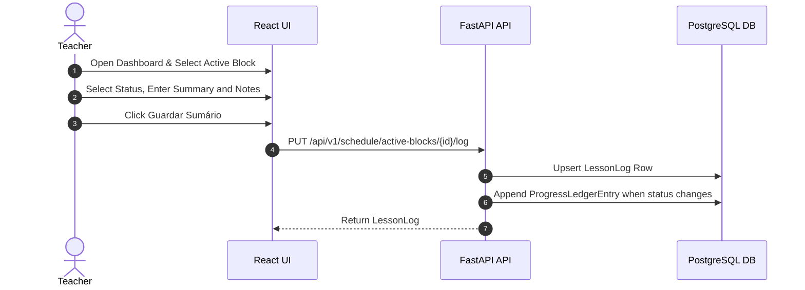

# Lesson Execution

## Purpose
This document specifies the operational workflow for entering lesson logs (*Sumários*), tracking attendance, and updating module progress.

## Intended Reader
This document targets frontend and backend engineers maintaining lesson logging features.

## Prerequisites
Read [Professional Education](../02_domain_model/PROFESSIONAL_EDUCATION.md).

## What the System Does
Teachers set execution status for active or operational blocks. They can add an optional summary and notes.

## Lesson Execution Workflow

## Lesson Log Fields Table

| Field Name | Type | Constraints | Description |
| :--- | :--- | :--- | :--- |
| `status` | Enum | `PENDING`, `COMPLETED`, or `OCCURRENCE` | Execution decision for the block |
| `summary` | String | Optional, max 2000 chars | Text describing topics taught |
| `notes` | String | Optional, max 1000 chars | Free operational notes |

## Contracts and Invariants
- Admins can edit published block logs. Teachers can edit only their assigned published or operational blocks.
- A `COMPLETED` log credits the block duration to the active module.
- An `OCCURRENCE` log creates or reuses an open occurrence for an active block.
- Submitted and approved weeks block later log edits.

## Failure Modes
- Future Lesson: The API rejects `COMPLETED` before the timeslot ends.
- Active Occurrence Conflict: The API rejects completion while a decided occurrence exists.

## Verification Procedure
Log in with a linked teacher profile. Open `/my-schedules`, complete a past block, and verify its `COMPLETED` log.

## Source Map
- Router: `backend/app/api/v1/endpoints/schedule.py`
- Service: `backend/app/services/lesson_log_service.py`
- Component: `frontend/src/components/LessonLogModal.jsx`

## Related Documents
- [Occurrences and Substitutions](OCCURRENCES_AND_SUBSTITUTIONS.md)
- [Timesheets and Progress](TIMESHEETS_AND_PROGRESS.md)
