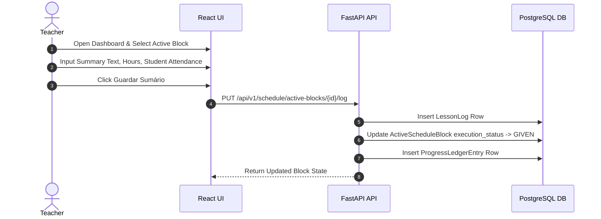

# Lesson Execution

## Purpose
This document specifies the operational workflow for entering lesson logs (*Sumários*), tracking attendance, and updating module progress.

## Intended Reader
This document targets frontend and backend engineers maintaining lesson logging features.

## Prerequisites
Read [Professional Education](../02_domain_model/PROFESSIONAL_EDUCATION.md).

## What the System Does
Teachers enter formal lesson summaries (*Sumários*) for scheduled active blocks. The system registers executed hours, updates attendance counts, and appends entries to the module progress ledger.

## Lesson Execution Workflow

## Lesson Log Fields Table

| Field Name | Type | Constraints | Description |
| :--- | :--- | :--- | :--- |
| `summary_text` | String | Mandatory, max 2000 chars | Text describing topics taught |
| `executed_hours` | Decimal | Positive, e.g., `1.5` | Actual instructional hours completed |
| `students_present` | Integer | Non-negative | Number of students attending |
| `students_absent` | Integer | Non-negative | Number of students absent |

## Contracts and Invariants
- Teachers can log lessons only for blocks where they are assigned as primary or substitute teacher.
- Logging a lesson automatically transitions the block status to `GIVEN`.

## Failure Modes
- Missing Mandatory Text: Submitting an empty summary returns HTTP `422 Unprocessable Entity`.

## Verification Procedure
Log in as teacher (`ana.matos@epnorte.pt`). Open dashboard, select lesson block, submit summary, verify block badge changes to green `GIVEN`.

## Source Map
- Router: `backend/app/api/v1/endpoints/schedule.py`
- Model: `backend/app/models.py` (`LessonLog`, `ProgressLedgerEntry`)
- Component: `frontend/src/components/LessonLogModal.jsx`

## Related Documents
- [Occurrences and Substitutions](OCCURRENCES_AND_SUBSTITUTIONS.md)
- [Timesheets and Progress](TIMESHEETS_AND_PROGRESS.md)
