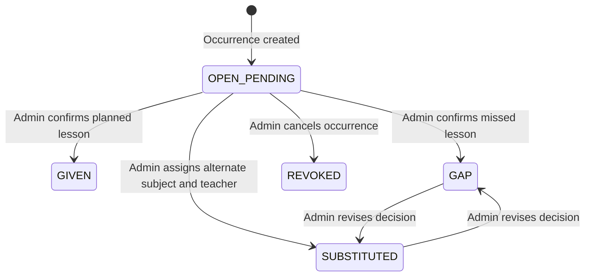

# Occurrences and Substitutions

## Purpose
This document details occurrence state machines, teacher absence registration (*Faltas*), and substitute teacher recommendation logic (*Substituições*).

## Intended Reader
This document targets backend and frontend developers working on operational features.

## Prerequisites
Read [Lesson Execution](LESSON_EXECUTION.md).

## What the System Does
When a scheduled lesson does not proceed normally, Cronos creates a `LessonOccurrence` record. The occurrence categorizes the operational event and tracks replacement teachers or subjects.

## Occurrence State Machine

## Occurrence Status Descriptions

| Status | Description | Impact on Credit Hours |
| :--- | :--- | :--- |
| `OPEN_PENDING` | Occurrence awaits an administrative decision | None |
| `GIVEN` | Lesson completed by assigned teacher | Credit Granted |
| `GAP` | Lesson missed due to absence (*Falta*) | Credit Lost (Creates Debt) |
| `SUBSTITUTED` | Alternate teacher and subject receive an operational block | Planned subject debt remains |
| `REVOKED` | Occurrence history was canceled through a revision | Reversed |

## Substitute Recommendation Algorithm
When an absence occurs, the system evaluates available replacement teachers via `GET /api/v1/occurrences/{id}/substitutes/recommendations`:

1. **Class Assignment**: Candidate must teach a different subject in the same class and grade.
2. **Room and Availability**: Room type must match; availability cannot be `IMPOSSIBLE`.
3. **Conflict Filter**: Candidate must have no active or operational block in the slot.
4. **Ranking**: Prefer fewer recent substitutions, lower daily load, and longer time since last cover.

## Contracts and Invariants
- Assigning a substitute requires a different teacher and subject already linked to the class.
- The system creates an `OperationalScheduleBlock` for the substitute.
- A substitute teacher gains permission to log that operational block.

## Failure Modes
- No Available Substitutes: Endpoint returns empty recommendations list. Administrator must schedule an adaptive repair.

## Verification Procedure
Navigate to `/occurrences`. Select an absence block, click **Find Substitutes**, select a qualified teacher, and click **Assign Cover**.

## Source Map
- Occurrence Router: `backend/app/api/v1/endpoints/occurrences.py`
- Occurrence and Recommendation Service: `backend/app/services/occurrence_service.py`
- Frontend Page: `frontend/src/pages/Occurrences.jsx`

## Related Documents
- [Lesson Execution](LESSON_EXECUTION.md)
- [Scheduler Operations](../03_scheduler_engine/SCHEDULER_OPERATIONS.md)
