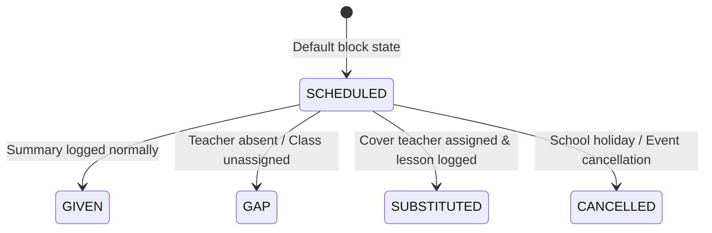

# Occurrences and Substitutions

## Purpose
This document details occurrence state machines, teacher absence registration (*Faltas*), and substitute teacher recommendation logic (*Substituições*).

## Intended Reader
This document targets backend and frontend developers working on operational features.

## Prerequisites
Read [Lesson Execution](LESSON_EXECUTION.md).

## What the System Does
When a scheduled lesson does not proceed normally, Cronos creates a `LessonOccurrence` record. The occurrence categorizes the operational event and tracks replacement teachers or subjects.

## Occurrence State Machine

## Occurrence Status Descriptions

| Status | Description | Impact on Credit Hours |
| :--- | :--- | :--- |
| `SCHEDULED` | Future planned lesson block | Pending |
| `GIVEN` | Lesson completed by assigned teacher | Credit Granted |
| `GAP` | Lesson missed due to absence (*Falta*) | Credit Lost (Creates Debt) |
| `SUBSTITUTED` | Lesson completed by substitute teacher | Credit Granted |
| `CANCELLED` | Official school cancellation | Credit Deferred |

## Substitute Recommendation Algorithm
When an absence occurs, the system evaluates available replacement teachers via `GET /api/v1/occurrences/{id}/substitutes/recommendations`:

1. **Availability Filter**: Teacher must be free during the block timeslot.
2. **Subject Qualification**: Teacher must be qualified for the subject or enrolled in the same course team.
3. **Workload Balance**: System ranks teachers with lowest current weekly hour load first.

## Contracts and Invariants
- Assigning a substitute requires a valid teacher qualified for the course or subject.
- A substitute teacher gain permissions to log summaries for assigned substitution blocks.

## Failure Modes
- No Available Substitutes: Endpoint returns empty recommendations list. Administrator must schedule an adaptive repair.

## Verification Procedure
Navigate to `/occurrences`. Select an absence block, click **Find Substitutes**, select a qualified teacher, and click **Assign Cover**.

## Source Map
- Occurrence Router: `backend/app/api/v1/endpoints/occurrences.py`
- Recommendation Service: `backend/app/services/occurrence_service.py`
- Frontend Page: `frontend/src/pages/Occurrences.jsx`

## Related Documents
- [Lesson Execution](LESSON_EXECUTION.md)
- [Scheduler Operations](../03_scheduler_engine/SCHEDULER_OPERATIONS.md)
