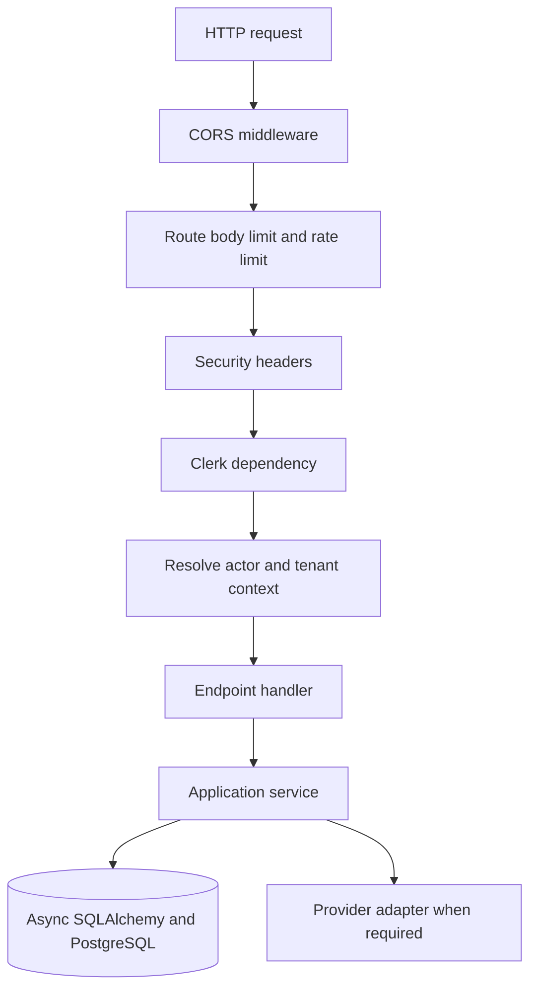

# Backend Architecture

## Purpose

This document describes the FastAPI lifecycle, dependency injection, middleware, services, and provider adapters.

## Intended Reader

This document targets Python backend engineers.

## Prerequisites

Read [System Architecture](../01_system_architecture/SYSTEM_ARCHITECTURE.md) and [API Reference](API_REFERENCE.md).

## What the System Does

The backend exposes a JSON API under `/api/v1`.
It uses async SQLAlchemy sessions, synchronous service helpers where required, Clerk authentication, and PostgreSQL RLS.

## Why the Behavior Exists

Dependencies centralize tenant context and access checks.
Provider adapters isolate external HTTP calls from application services.

## Components and Ownership

| Component | Implementation | Responsibility |
| :--- | :--- | :--- |
| Application | `backend/app/main.py` | Lifespan, middleware, handlers, routes |
| Dependencies | `backend/app/api/deps.py` | DB, Clerk, actor, admin context |
| Services | `backend/app/services/` | Transactions and domain rules |
| Contact adapters | `backend/app/contact/` | Turnstile and Resend integration |
| Database | `backend/app/db/` | Async engine and tenant context |
| Schemas | `backend/app/schemas.py` | Request and response validation |
| Exceptions | `backend/app/core/exceptions.py` | Error classification and mapping |

## Data or Request Flow

1. FastAPI validates the request and applies route middleware.
2. Protected dependencies verify Clerk and resolve the active actor.
3. The database session installs tenant context.
4. A handler calls a service and returns a schema or error.
5. The session commits on success and rolls back on failure.

## Contracts and Invariants

- Queries scope tenant-owned data by `organization_id`.
- The database session sets `app.current_organization_id` before protected work.
- Contact delivery uses one lifespan-scoped `httpx.AsyncClient`.
- The contact application service does not import FastAPI, Resend, Cloudflare, or `httpx`.
- Production validates required secrets and HTTPS origin settings at startup.
- API error handlers return JSON `detail` values.

## States and Transitions

Application errors map to `400`, `422`, `404`, `409`, `403`, or `503` by error kind.
Unhandled errors log a traceback and return a safe `500` response.

## Failure Modes

- Invalid configuration prevents production startup.
- Redis unavailable during lifespan logs a readiness warning.
- Database failure returns a dependency or application error.
- Provider timeout returns `503` without retrying the web request.

## Verification Procedure

1. Run backend tests with a database name containing `test` or `ci`.
2. Run `ruff format --check .` and `ruff check .`.
3. Run migration drift and database audits.
4. Build the hardened backend runtime image.

## Source Map

- `backend/app/main.py`
- `backend/app/api/deps.py`
- `backend/app/db/database.py`
- `backend/app/db/tenant.py`
- `backend/app/contact/`
- `backend/tests/test_error_handlers.py`

## Related Documents

- [API Reference](API_REFERENCE.md)
- [Errors and Transactions](ERRORS_AND_TRANSACTIONS.md)
- [Security and Tenant Isolation](../08_security_quality/SECURITY_AND_TENANT_ISOLATION.md)
