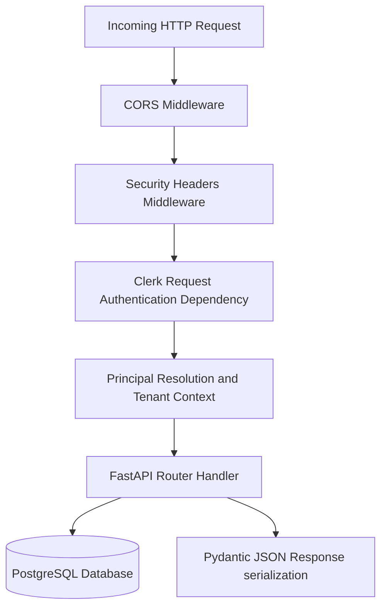

# Backend Architecture

## Purpose
This document describes the internal backend software architecture, dependency injection framework, and request middleware pipeline.

## Intended Reader
This document targets backend Python engineers.

## Prerequisites
Read [System Architecture](../01_system_architecture/SYSTEM_ARCHITECTURE.md).

## What the System Does
The backend is built with Python 3.12 and FastAPI. It exposes a JSON REST API under `/api/v1`.

## Middleware Pipeline Execution

## Dependency Injection Components
FastAPI dependencies (`backend/app/api/deps.py`) supply context objects to router handlers:
- `get_db`: Yields an async SQLAlchemy session. It commits on success and rolls back on error.
- `get_clerk_payload`: Validates the Clerk request and authorized party.
- `get_current_user`: Calls `app_security.resolve_principal` and installs tenant context.
- `AdminActor`: Requires the active membership to have the admin capability.

## Contracts and Invariants
- Public API payloads use Pydantic schemas where endpoints declare response models.
- Handlers must not execute raw blocking SQL queries on the main async loop.

## Failure Modes
- Database Transaction Error: `get_db` rolls back the session and re-raises the exception.

## Verification Procedure
Run backend test suite: `cd backend && pytest tests/ -v`.

## Source Map
- FastAPI App Init: `backend/app/main.py`
- Dependencies: `backend/app/api/deps.py`
- Router Directory: `backend/app/api/v1/endpoints/`

## Related Documents
- [API Reference](API_REFERENCE.md)
- [Errors and Transactions](ERRORS_AND_TRANSACTIONS.md)

## Tenant Context

`get_current_user` and webhook dispatch install tenant context. `get_db` owns the transaction boundary.
