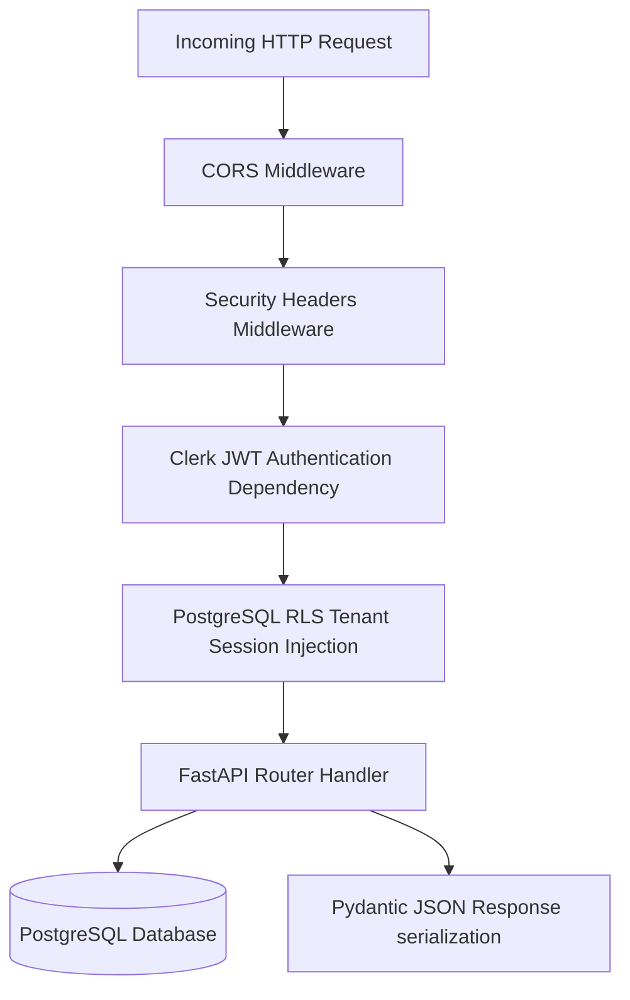

# Backend Architecture

## Purpose
This document describes the internal backend software architecture, dependency injection framework, and request middleware pipeline.

## Intended Reader
This document targets backend Python engineers.

## Prerequisites
Read [System Architecture](../01_system_architecture/SYSTEM_ARCHITECTURE.md).

## What the System Does
The backend is built with Python 3.12 and FastAPI. It exposes a JSON REST API under `/api/v1`.

## Middleware Pipeline Execution

## Dependency Injection Components
FastAPI dependencies (`backend/app/api/deps.py`) supply context objects to router handlers:
- `get_db`: Yields an async SQLAlchemy database session. Configures tenant RLS session variable `app.current_organization_id`.
- `get_current_user`: Validates Clerk JWT, fetches or bootstraps `User` record.
- `require_admin`: Enforces administrative role capability requirement.
- `require_teacher`: Enforces teacher role capability requirement.

## Contracts and Invariants
- All endpoints must declare explicit response models using Pydantic schemas (`backend/app/schemas.py`).
- Handlers must not execute raw blocking SQL queries on the main async loop.

## Failure Modes
- Database Transaction Error: SQLAlchemy automatically rolls back uncommitted transactions on unhandled exceptions.

## Verification Procedure
Run backend test suite: `cd backend && pytest tests/ -v`.

## Source Map
- FastAPI App Init: `backend/app/main.py`
- Dependencies: `backend/app/api/deps.py`
- Router Directory: `backend/app/api/v1/endpoints/`

## Related Documents
- [API Reference](API_REFERENCE.md)
- [Errors and Transactions](ERRORS_AND_TRANSACTIONS.md)
