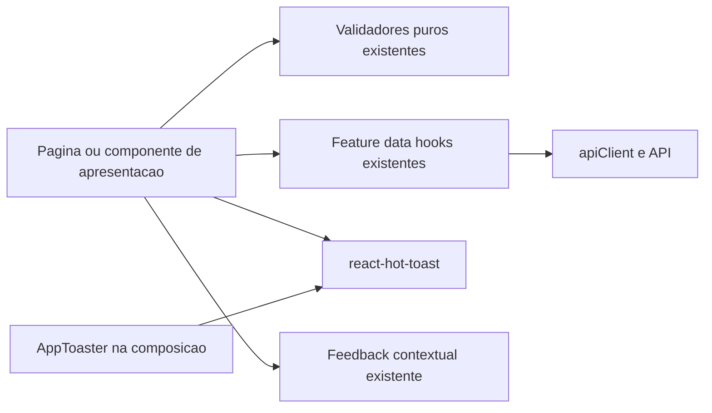

# Tech Spec — Modernização do Feedback Visual

## Purpose

Este documento especifica a modernização do feedback visual do Cronos.
Define comportamento, arquitetura, migração, TDD e critérios de aceitação.

**Estado:** implementado na branch `feat/feedback-ux-modernization`. As decisões de produto estão fechadas.
**Data:** 3 de outubro de 2026.
**Base observada:** código local da branch `main`, consultado nesta data.

Os guias existentes descrevem o comportamento atual.
Os requisitos deste documento descrevem o comportamento implementado na branch.
A secção de riscos ainda dependentes da implementação regista o que falta confirmar na integração.

## Intended Reader

Este documento destina-se a engenheiros frontend, revisores e responsáveis pela validação do Cronos.

## Prerequisites

Leia os seguintes documentos antes da implementação:

- [Documentation Standard](../00_getting_started/DOCUMENTATION_STANDARD.md).
- [Frontend Architecture](FRONTEND_ARCHITECTURE.md).
- [Design System](DESIGN_SYSTEM.md).
- [Accessibility](ACCESSIBILITY.md).
- [Testing and CI](../08_security_quality/TESTING_AND_CI.md).
- [Local Runtime](../09_ops_observability/LOCAL_RUNTIME.md).
- [Repository Agent Instructions](../../AGENTS.md).

Use Node e npm nas versões exigidas pelo [package.json](../../frontend/package.json).
Mantenha o skill `ponytail` na intensidade `full`.
Consulte o código e os testes antes de editar cada fluxo.

## What the System Does

### Comportamento atual observado

O frontend usa React, CoreUI e TanStack React Query.
Não existe uma dependência de toasts no `package.json` consultado.

O feedback atual combina quatro mecanismos:

| Mecanismo | Uso observado |
| :--- | :--- |
| `FeedbackBanner` | Sucessos, erros de mutação e mensagens de acesso. |
| `CAlert` e classes `alert` | Validações, avisos, estados de carregamento e painéis com ações. |
| `useTransientMessage` | Mensagens temporárias na configuração escolar. |
| `StatePanel`, `FailureState` e feedback de campo | Estados de página e explicações associadas ao contexto. |

`index.css` contém estilos `.zen-toast` sem referências de produção encontradas.
Confirme novamente os consumidores antes de remover esses estilos.

O anexo inicial mistura inventário, alternativas e um plano de conversão integral.
Esta especificação substitui esse plano integral pelas decisões seguintes.
Não trate quantidades ou estimativas do anexo como critérios de aceitação.

### Decisões de produto fechadas

| ID | Decisão | Requisito |
| :--- | :--- | :--- |
| D01 | Modernizar todo o feedback visual. | Remover a apresentação antiga das mensagens abrangidas. Preservar a informação necessária. |
| D02 | Adotar `react-hot-toast`. | Usar a biblioteca para feedback temporário. |
| D03 | Confirmar ações concluídas por toast. | Mostrar confirmações curtas durante 4 segundos. |
| D04 | Comunicar falhas pontuais recuperáveis por toast. | Mostrar erros curtos durante 6 segundos. Preservar os dados e permitir nova tentativa. |
| D05 | Validar junto ao campo ou grupo. | Não acrescentar resumo de validação nem toast de validação. |
| D06 | Integrar avisos persistentes no conteúdo. | Usar ícone, texto e eventual ação, com destaque discreto. |
| D07 | Preservar estados de página. | Mostrar a explicação no conteúdo quando uma página ou secção estiver indisponível. |
| D08 | Preservar conteúdo estruturado. | Manter listas de problemas, progresso e ações de aprovação nos respetivos contextos. |
| D09 | Adaptar a posição dos toasts. | Usar superior direito no computador e topo ao centro no telemóvel. |
| D10 | Adaptar o visual da biblioteca ao Cronos. | Manter estrutura, ícones e animações. Aplicar fonte e cores existentes. |

Os 4 e 6 segundos são tempos de apresentação ativa.
A pausa de leitura pode aumentar o tempo total.
A remoção do DOM pode incluir o atraso de saída da biblioteca.

### Regra de classificação

Classifique a mensagem pelo seu significado e pelo fluxo afetado.
Não classifique pelo nome do componente, pela cor ou apenas pela severidade.

1. Mantenha estados de página e conteúdo estruturado no contexto.
2. Coloque validações junto ao campo ou grupo afetado.
3. Mantenha explicações de bloqueios no contexto enquanto a situação existir.
4. Use toast para resultados curtos de ações e falhas pontuais recuperáveis.

`retryable` não determina sozinho a apresentação.
Uma mensagem recuperável pode exigir uma alteração de configuração antes da nova tentativa.

| Mensagem ou situação | Apresentação proposta | Condição |
| :--- | :--- | :--- |
| “Preferências guardadas.” | Toast de sucesso. | A gravação terminou com sucesso. |
| “Não foi possível guardar. Tente novamente.” | Toast de erro. | O rascunho permanece e o botão permite nova tentativa. |
| “Registo removido.” | Toast de sucesso. | A remoção terminou com sucesso. |
| “Registo arquivado.” | Toast de sucesso. | Preserve a distinção entre arquivo e remoção física. |
| “Nome do curso é obrigatório.” | Mensagem junto ao campo. | O campo precisa de correção. |
| “O ano de fim tem de ser posterior ao ano de início.” | Mensagem junto ao grupo de datas. | Dois valores participam na validação. |
| “Apague primeiro as turmas atuais deste curso.” | Aviso junto à ação. | Existe um bloqueio de negócio. |
| “Repita a pré-visualização antes de guardar.” | Aviso integrado na pré-visualização. | Os dados usados pela pré-visualização estão desatualizados. |
| “Não foi possível carregar a grelha.” | Estado de erro na secção. | O conteúdo solicitado está indisponível. |
| Problemas detetados na importação. | Lista no contexto. | O utilizador precisa de consultar cada problema. |
| Proposta pendente ou desatualizada. | Painel existente, com avisos integrados. | Existem decisões e ações sobre uma proposta. |
| Geração em fila ou em execução. | Estado de progresso no contexto. | A operação continua em curso. |
| Falha de gravação automática. | Estado discreto junto ao indicador de gravação. | O utilizador precisa de saber que o rascunho não está sincronizado. |

### Âmbito

Modernize o feedback próprio do Cronos nas áreas autenticadas, configuração inicial, guia, contacto e recuperação de acesso.
Reutilize o feedback de campo que já satisfaz esta especificação.
Revise mensagens visuais em vez de substituir indiscriminadamente atributos ARIA.

Preserve instruções pedagógicas, indicadores de modo, contadores e conteúdo normal da aplicação.
Preserve componentes de terceiros que não pertencem à camada de feedback do Cronos.
Não altere autenticação, permissões, regras de negócio, contratos HTTP ou persistência.

Não acrescente histórico de notificações, preferências de duração, centro de notificações ou notificações entre separadores.
Não acrescente um sistema de eventos, uma máquina de estados global ou outra biblioteca de UI.
Não mova decisões Aprovar/Rejeitar ou listas de problemas para toasts.

## Why the Behavior Exists

Confirmações temporárias não precisam de ocupar espaço permanente na página.
Falhas pontuais podem usar o mesmo mecanismo quando os dados e a recuperação permanecem disponíveis.

Validações explicam como corrigir dados.
Essas mensagens precisam de uma associação ao campo ou grupo correspondente.
Os formulários observados não justificam um resumo adicional de validação.

Avisos persistentes explicam condições que continuam a existir.
Fechar uma notificação não resolve essas condições.
A mensagem deve acompanhar o conteúdo afetado.

As durações escolhidas são decisões de produto.
Não constituem uma declaração de conformidade WCAG.
Verifique leitura, anúncios e recuperação durante a implementação.

## Components and Ownership

### Clean Architecture

As regras de domínio e validação continuam independentes de React, CoreUI e `react-hot-toast`.
Os componentes de apresentação escolhem onde comunicar resultados e problemas.
Os feature hooks continuam responsáveis pelos pedidos, cache e invalidação.



As setas representam dependências.
O diagrama não propõe camadas ou interfaces adicionais.

| Responsabilidade | Local proposto | Regra |
| :--- | :--- | :--- |
| Montar o host global. | `main.jsx` | Montar exatamente uma instância dentro de `ErrorBoundary`. |
| Configurar posição, tema e durações. | Novo `components/AppToaster.jsx` | Manter um componente pequeno de composição. |
| Emitir feedback de uma ação. | Página ou componente que controla a ação. | Emitir no resultado da tentativa, nunca durante o render. |
| Executar pedidos e invalidar cache. | Feature data hooks existentes. | Não importar a biblioteca de toasts. |
| Interpretar erros da API. | `utils/apiErrors.js` | Reutilizar as funções e mensagens existentes. |
| Validar dados. | Validadores puros existentes. | Não importar componentes, hooks ou notificações. |
| Apresentar avisos contextuais. | `FeedbackBanner.jsx` e consumidores. | Reutilizar e redesenhar o componente existente. |
| Apresentar estados de secção ou página. | `StatePanel.jsx` e `FailureState.jsx` | Preservar explicação, ações e referência de apoio. |
| Estilizar feedback partilhado. | `styles/app-components.css` | Usar tokens existentes e seletores específicos. |

Monte `AppToaster` como irmão de `App`, dentro de `UserQueryProvider`.
Mantenha-o fora dos layouts e das páginas para evitar montagens duplicadas.
Não acrescente um segundo router para posicionar ou limpar toasts.

### Clean Code e Ponytail

Use nomes que expressem a função da mensagem.
Distinga erro de campo, bloqueio contextual e falha pontual nos estados locais.
Não mantenha um estado genérico que misture essas categorias quando exigem comportamentos diferentes.

Centralize durações e estilos em `AppToaster`.
Use `toast.success` e `toast.error` diretamente na apresentação.
Não crie inicialmente um wrapper `notify`, provider próprio ou interface de notificações.
A configuração global já evita repetir durações e opções ARIA.

Reutilize `FeedbackBanner` para avisos simples.
Retire fundo preenchido, caixa exterior e borda lateral da apresentação contextual.
Preserve os consumidores que precisam de título, ação ou conteúdo associado.
Não elimine o componente apenas porque o nome contém “Banner”.

Retire estado, timers e callbacks usados exclusivamente por mensagens temporárias migradas.
Elimine `useTransientMessage` apenas quando não existirem consumidores.
Não acrescente novos arquivos para separar valores fixos ou uma única implementação.

### Dependência

Instale `react-hot-toast` como dependência de produção do frontend.
A documentação consultada apresenta a versão 2.6.0.
Confirme compatibilidade e auditoria na instalação.
Registe a versão resolvida em `package-lock.json`.

Não instale dependências de validação, animação, gestão de estado ou testes para esta mudança.

## Data or Request Flow

### Ação curta

1. Valide os dados com os validadores existentes.
2. Mostre falhas de validação junto ao campo ou grupo.
3. Mantenha o rascunho e execute a mutação existente.
4. Preserve o estado pendente do botão.
5. Emita um toast depois do sucesso ou da falha pontual.
6. Mostre bloqueios de negócio no contexto.
7. Permita nova tentativa quando o estado da operação permitir.

Uma rejeição não fecha automaticamente o formulário nem elimina o rascunho.
Um sucesso só fecha o formulário quando esse comportamento já pertence ao fluxo.
Uma rejeição não marca os dados como guardados.

### Dono único do feedback

Escolha um único dono para cada resultado.
`SmartTable` controla a confirmação e o feedback da remoção que executa.
Uma página não deve emitir outra confirmação para a mesma remoção.

Use callbacks locais da tentativa ou handlers já existentes.
Não adicione efeitos que observem `isError` ou `isSuccess` apenas para emitir toasts.
Esses efeitos podem repetir mensagens durante remount, Strict Mode ou mudanças de dependências.

Use IDs da biblioteca quando uma tentativa puder voltar a emitir a mesma notificação.
Inclua ação e recurso no ID quando existir uma identificação de recurso.
Não use o texto completo como identificador de negócio.
Não use um ID único para ações distintas que precisem de mensagens independentes.

### Operações prolongadas

Preserve indicadores existentes de botão, gravação automática e geração.
Não transforme atualizações de polling em toasts.
Não acrescente `toast.loading` ou `toast.promise` apenas por existir uma Promise.

“Regeneração pedida” confirma o envio do pedido.
Essa confirmação não significa que existe uma proposta pronta ou um horário publicado.
Mostre execução, resultado e ações no painel existente.

### Sessão, organização e guia

Limpe toasts visíveis quando mudar o utilizador ou a organização.
Reutilize o ponto existente de limpeza de contexto em `App.jsx`.
Não limpe todas as mensagens em cada mudança de rota.
Uma confirmação pode precisar de acompanhar a navegação causada pela própria ação.

Uma resposta atrasada de outro contexto não pode apresentar feedback no contexto atual.
Teste esse comportamento antes de acrescentar uma guarda local de identidade ou cancelamento.
Limpar toasts existentes não impede, sozinho, a emissão de uma resposta atrasada.

Limpe mensagens da simulação quando terminar ou substituir o contexto do guia.
Preserve a fronteira de dados existente do tutorial.
Não misture sucesso simulado com confirmação de uma ação operacional.

## Contracts and Invariants

### Toasts

| Propriedade | Contrato |
| :--- | :--- |
| Host | Uma instância global. |
| Sucesso | Duração ativa de 4000 ms. |
| Erro pontual | Duração ativa de 6000 ms. |
| Informação temporária curta | Duração ativa de 4000 ms, quando não exigir consulta posterior. |
| Desktop | `top-right`, a partir de 768 px. |
| Telemóvel | `top-center`, até 767 px. |
| Conteúdo | Texto curto em português, com o resultado e recuperação quando aplicável. |
| Semântica | Sucesso e informação com `role="status"`; erro com `role="alert"`. |
| Identidade | Ícone e texto identificam o resultado. A cor não é a única distinção. |
| Visual | Estrutura e animações da biblioteca, adaptadas aos tokens existentes. |

O breakpoint segue as media queries existentes do frontend.
Use `matchMedia` e remova o listener no cleanup do componente.
Atualize a posição quando mudar a largura do ecrã.
Não crie dois hosts para simular uma posição responsiva.

Use `--cronos-font-body`, `--cronos-surface`, `--cronos-ink`, `--cronos-success` e `--cronos-danger`.
A fonte atual de `--cronos-font-body` é `IBM Plex Sans`.
Use o token como fonte de verdade, mesmo perante orientações antigas com outra família.

Defina margem lateral e largura máxima compatíveis com ecrãs pequenos.
Respeite a área segura do dispositivo.
Verifique a sobreposição com cabeçalhos e modais.
Não altere globalmente os níveis de todos os componentes para resolver uma sobreposição local.

Use a pausa de leitura da biblioteca ao passar o rato.
Confirme essa pausa com um teste de comportamento.
Na primeira versão, não coloque ações obrigatórias dentro dos toasts.
Os botões Guardar e Tentar novamente continuam no contexto operacional.

Não acrescente toasts persistentes para todos os erros.
Não acrescente um renderer totalmente personalizado.
Use `ToastBar` apenas se uma necessidade concreta exigir adaptar o renderer padrão.

### Validação de campo ou grupo

Mostre a mensagem abaixo do campo ou junto ao grupo relacionado.
Use `CFormFeedback` ou o padrão nativo existente.
Preserve `label`, IDs e descrições já associadas ao campo.

Marque o campo com `aria-invalid` e o estado visual inválido.
Associe a mensagem através de `aria-describedby`.
Preserve outros IDs existentes nesse atributo.
Não substitua uma descrição de unidade pela descrição do erro.

Após uma tentativa inválida, coloque o foco no primeiro campo inválido do formulário ou grupo submetido.
Não altere o foco durante cada mudança de valor.
Mantenha a mensagem enquanto o valor ou grupo permanecer inválido.
Não use timers para remover validações.

Preserve regras, limites, normalizações e payloads existentes.
Não introduza novos critérios de validação nesta migração.
Não altere globalmente o modo de validação sem uma necessidade demonstrada.

`validateClassDraft` devolve atualmente `{ error }` ou `{ value }`.
Use a mensagem junto ao grupo quando o resultado não identificar um campo.
Acrescente metadados de campo apenas quando necessários para associação ou foco.
Nesse caso, preserve a mensagem, o resultado válido e os consumidores existentes.
Não descubra o campo com comparação de frases em português.

`normalizeModule` continua responsável pela normalização existente.
Uma falha conjunta de nome e horas pode ser comunicada junto ao grupo Módulos.
Não replique as regras num segundo validador para produzir uma apresentação diferente.

### Avisos e conteúdo persistente

Use ícone decorativo com `aria-hidden`, texto legível e eventual ação adjacente.
Use cores semânticas existentes para o ícone ou destaque.
Mantenha o texto principal com contraste adequado.
Não use uma caixa colorida exterior para uma mensagem simples.

Preserve listas, ligações e botões dentro de conteúdo estruturado.
Use uma região ou secção apropriada para painéis completos.
Não transforme um painel de proposta num `FeedbackBanner` genérico.
Retire `CAlert` como caixa exterior desses painéis.

Não permita ocultar uma explicação necessária sem resolver a situação.
Se uma ação resolver o problema, retire ou atualize a mensagem com base no novo estado.
Uma alteração não relacionada não elimina um erro de outro campo.

### Erros da API

Reutilize `getApiErrorCode`, `getApiErrorMessage` e `getApiErrorPresentation`.
Use códigos conhecidos e o contexto do fluxo para distinguir bloqueios de falhas pontuais.
Não use pesquisa de palavras na mensagem para classificar erros.
Não modifique o envelope HTTP para decidir a apresentação.

Erros de sessão, autorização, configuração obrigatória e conflitos exigem a recuperação existente.
Erros com listas, referência de apoio ou instruções extensas permanecem consultáveis no contexto.
Uma falha genérica de uma tentativa manual pode usar toast quando preservar dados e permitir recuperação.
Uma falha de polling ou gravação automática precisa de um estado consultável, sem uma sequência de toasts.

Erros de campo conhecidos ficam junto ao campo.
Validações sem identificação de campo ficam junto ao grupo ou ação afetada.
Não invente associações que a resposta ou o validador não sustentem.

### Acessibilidade

Preserve anúncios imediatos para erros e anúncios discretos para outros resultados.
Não duplique a mesma mensagem em várias regiões de anúncio.
Não coloque `role="status"` num contentor que englobe erros com anúncio próprio.
Não acrescente `aria-live="polite"` a um erro que requer anúncio imediato.

Um toast não desloca o foco.
Um erro de submissão pode deslocar o foco para o primeiro campo inválido.
Preserve o foco e o comportamento Escape dos modais existentes.

Verifique os anúncios com um modal aberto.
Um `z-index` elevado não garante acesso por leitor de ecrã.
Se o modal ocultar o host global, ajuste a região de anúncio dentro do contexto ativo.
Mantenha um único toast visual e evite um segundo anúncio da mesma mensagem.

Respeite `prefers-reduced-motion` e os objetivos de contraste do guia de acessibilidade.
Não considere 6 segundos ou `role="alert"` suficientes para certificar acessibilidade.

## States and Transitions

### Mutação manual

| Estado | Resultado visível | Transição |
| :--- | :--- | :--- |
| Edição | Campos e indicação existente de alterações. | Submissão ou cancelamento. |
| Validação inválida | Erro junto ao campo ou grupo. | Correção dos valores afetados. |
| Pedido pendente | Botão pendente e ações protegidas. | Sucesso ou rejeição. |
| Sucesso | Toast de 4 segundos e estado atualizado. | Fluxo de sucesso existente. |
| Falha pontual | Toast de 6 segundos; dados preservados. | Nova tentativa. |
| Bloqueio contextual | Explicação junto à ação ou conteúdo. | Correção, atualização ou recuperação específica. |

### Página, geração e gravação automática

| Fluxo | Requisito |
| :--- | :--- |
| Carregamento de página | Manter carregamento, vazio e erro no conteúdo. |
| Pedido de geração aceite | Confirmar apenas o início solicitado. |
| Polling de geração | Atualizar o painel sem emitir mensagens repetidas. |
| Proposta pronta | Manter resultado e ações de revisão disponíveis. |
| Proposta desatualizada | Manter a explicação e impedir aprovação conforme as regras existentes. |
| Gravação automática falhada | Manter indicação de falha até recuperar a sincronização. |
| Mudança de contexto | Remover mensagens anteriores e bloquear resultados atrasados incompatíveis. |

## Migration Map

Este mapa cobre os mecanismos encontrados na inspeção.
Confirme handlers, mensagens e consumidores antes de editar cada linha.
Acrescente qualquer nova ocorrência encontrada ao mesmo mapa.

Os caminhos abaixo são relativos a `frontend/src/`.

| Grupo | Arquivos e componentes | Trabalho previsto |
| :--- | :--- | :--- |
| Composição | `main.jsx`, `App.jsx` | Montar `AppToaster`; integrar limpeza de contexto. |
| Feedback partilhado | `components/FeedbackBanner.jsx`, `components/GenericModalForm.jsx` | Redesenhar avisos; separar falha pontual de bloqueio. |
| Estados de página | `components/StatePanel.jsx`, `components/FailureState.jsx` | Preservar conteúdo e recuperação; alinhar visual e semântica. |
| Tabelas e remoção | `components/SmartTable.jsx` | Migrar confirmações e falhas pontuais; manter bloqueios no contexto. |
| Preferências | `pages/MyAvailability.jsx` | Migrar sucesso e falha manual; preservar rascunho e estado por guardar. |
| Cursos e turmas | `pages/Courses.jsx`, `pages/CourseDetails.jsx`, `pages/ClassDetails.jsx`, `pages/ClassSubjects.jsx` | Separar mutações, bloqueios de negócio e estados de página. |
| Salas e disciplinas | `pages/Rooms.jsx`, `pages/Subjects.jsx` | Evitar feedback duplicado com tabelas e modais. |
| Equipa | `pages/Members.jsx` | Separar falhas de convite, sincronização, bloqueios e erro de carregamento. |
| Formulários | `components/Forms/CourseForm.jsx`, `SubjectForm.jsx`, `ClassInCourseForm.jsx`, `RoomForm.jsx` | Aplicar mensagens locais e foco; reutilizar validação já adequada. |
| Campo horário | `components/TimeField.jsx` | Preservar unidade, mensagem e associação acessível. |
| Configuração escolar | `features/schoolConfig/SchoolConfigSections.jsx` | Separar mensagens misturadas; migrar sucessos e falhas pontuais. |
| Intervalos | `features/timetable/BreakTimelineEditor.jsx`, `features/schoolConfig/BreakTimelineModal.jsx` | Manter validação e conflitos no grupo ou editor. |
| Configuração inicial | `features/foundation/components/FoundationWizard.jsx`, `ConflictResolutionModal.jsx`, `PreviewStep.jsx`, `InternshipFlowsStep.jsx` | Preservar autosave, conflitos e correções locais. Modernizar alertas próprios. |
| Passos com campos | Outros passos em `features/foundation/components/` | Auditar mensagens e preservar feedback local já adequado. |
| Importação | `pages/BulkImport.jsx` | Manter listas e resultados consultáveis; migrar apenas falhas pontuais da tentativa. |
| Horários | `pages/Schedules.jsx`, `components/schedules/GenerationStatusPanel.jsx`, `DraftPanel.jsx` | Preservar prevalidation, progresso, propostas e ações; retirar caixas de alerta exteriores. |
| Operação docente | `components/LessonLogModal.jsx`, `pages/MySchedules.jsx`, `pages/Occurrences.jsx`, `pages/Timesheets.jsx`, `pages/MyProgress.jsx` | Preservar estados operacionais e listas; distinguir falha manual de bloqueio. |
| Grelha | `components/WeekGrid.jsx` | Manter aviso de transição no contexto; alinhar apresentação quando necessário. |
| Acesso | `components/DefaultLayout.jsx`, `routeGuards.jsx`, `pages/FoundationWaiting.jsx` | Manter motivos de acesso e requisitos consultáveis. |
| Recuperação de acesso | `pages/ForgotPasswordPage.jsx` | Distinguir erros de campo, estado de recuperação e falha pontual. |
| Contacto | `features/contact/components/ContactDetailsStep.jsx`, `QuestionnaireOptionStep.jsx`, `ContactMessageStep.jsx`, `TurnstileWidget.jsx` | Preservar feedback local e alternativa por email; manter isolamento de estilos. |
| Guia | `features/tutorial/TutorialInstructionPanel.jsx`, `TutorialShell.jsx`, `TutorialWorkspace.jsx` | Modernizar falhas próprias; preservar instruções e indicadores de simulação. |
| Limpeza | `hooks/useTransientMessage.js`, `index.css`, `styles/app-components.css` | Eliminar código sem consumidores e estilos antigos substituídos. |
| Dependências | `frontend/package.json`, `frontend/package-lock.json` | Adicionar apenas a biblioteca escolhida. |

### Casos que exigem tratamento explícito

`SchoolConfigSections` usa canais temporários para resultados e avisos de pré-visualização.
Separe a confirmação curta do aviso que obriga a repetir a pré-visualização.
Esse aviso não deve desaparecer por timer.

O reinício do ano letivo apresenta atualmente uma confirmação extensa.
Use uma confirmação curta no toast.
Preserve consequências e histórico na confirmação prévia e no contexto relevante.
Não transforme uma explicação necessária sobre perda ou conservação de dados num texto efémero.

`GenericModalForm` usa atualmente `onClose` para fechar um banner de erro.
Não associe a resolução de um erro ao cancelamento do formulário.
Preserve o formulário aberto e os valores após uma rejeição.

`SmartTable` não deve perder a confirmação quando a lista ficar vazia após uma remoção.
O host global recebe a mensagem mesmo quando a tabela muda para o estado vazio.

O contacto contém mensagens com uma alternativa por email.
Essa alternativa precisa de continuar consultável no contexto.
Não imponha uma duração temporária apenas porque a mensagem contém um erro de envio.

## TDD and Delivery Plan

### Ciclo obrigatório

1. Escolha um comportamento observável do fluxo.
2. Escreva um teste que falhe pelo comportamento atual.
3. Execute o teste e confirme a causa da falha.
4. Implemente a menor mudança correta.
5. Execute o teste até passar.
6. Refatore apenas a duplicação demonstrada.
7. Execute os testes próximos dos consumidores afetados.

Não faça a migração completa antes de escrever testes.
Não substitua asserções por mocks apenas para acomodar o novo componente.
Prefira texto, papel semântico, associação de campo e resultados de interação.
Não teste detalhes internos de animação da biblioteca.

### Matriz de testes

| Comportamento | Evidência exigida | Base existente |
| :--- | :--- | :--- |
| Host global | Uma confirmação fica disponível após fechar um modal ou navegar por sucesso. | `main.test.jsx`, `AppRoutes.test.jsx` e teste de integração do host. |
| Duração | Sucesso sai após 4000 ms; erro sai após 6000 ms, incluindo pausa e saída. | Novo teste focado de `AppToaster`. |
| Posição | 767 px usa topo ao centro; 768 px usa superior direito; resize atualiza. | Teste do host e verificação no browser. |
| Repetição | Render, Strict Mode e polling não repetem feedback de uma tentativa. | Testes do consumidor e painéis de geração. |
| Gravação manual falhada | Dados permanecem; estado por guardar permanece; nova tentativa funciona. | `MyAvailability.test.jsx`. |
| Remoção | Distinguir arquivo e remoção; manter tentativa recuperável após rejeição. | `SmartTable.test.jsx`. |
| Último registo | A confirmação aparece quando a tabela passa para vazia. | `SmartTable.test.jsx`. |
| Validação | Mensagem associada ao campo ou grupo; foco correto; nenhum toast de validação. | `CourseForm.test.jsx`, `SubjectForm.test.jsx`, `ClassInCourseForm.test.jsx`, `RoomForm.test.jsx`. |
| Campo horário | Unidade e erro coexistem em `aria-describedby`. | `TimeField.test.jsx`, `FoundationBreakTimeline.test.jsx`. |
| Aviso desatualizado | O aviso permanece após avançar o relógio; aprovação continua bloqueada. | `DraftPanel.test.jsx`, `SchoolConfigGridChange.test.jsx`. |
| Erro de página | Conteúdo explica a falha e mantém recuperação após qualquer timeout. | Testes de páginas e painéis afetados. |
| Importação | Problemas e avisos permanecem consultáveis; não existe toast por problema. | `BulkImport.test.jsx`. |
| Geração | Polling não emite toasts; resultado não confunde proposta com publicação. | `GenerationStatusPanel.test.jsx`, `SchedulesSchedulerFlow.test.jsx`. |
| Modais | Uma falha preserva dados e foco; o anúncio fica acessível. | `ConfirmationModal.test.jsx`, `LessonLogModal.test.jsx` e validação no browser. |
| Configuração | Sucessos temporários e bloqueios persistentes seguem canais diferentes. | `SchoolConfigSchedulerSettings.test.jsx`, `SchoolConfigInternshipFlows.test.jsx`. |
| Autosave e conflito | Estado de erro permanece; recuperação não elimina rascunho indevidamente. | `Foundation.test.jsx` e testes E2E existentes de conflitos. |
| Contacto e acesso | Associação local e alternativas de recuperação continuam disponíveis. | `TurnstileWidget.test.jsx`, `PasswordRecovery.test.jsx`, `AppRouteGuards.test.jsx` e testes DOM dos campos sem cobertura existente. |
| Contexto | Mudança de utilizador, organização ou simulação remove mensagens incompatíveis. | `AppRoutes.test.jsx`, `Guide.test.jsx` e teste de conclusão atrasada. |

Crie apenas testes novos que cubram contratos sem cobertura existente.
Use testes de componentes para semântica e dados.
Use o browser para layout, camadas, movimento e comportamento real de modais.

### Infraestrutura de testes

Reutilize Vitest, Testing Library, `user-event` e MSW.
Os projetos `node` e `dom` têm configurações separadas.
Não introduza referências obrigatórias ao DOM no projeto `node`.
`ContactQuestionnaire.test.jsx` pertence ao projeto `node` e verifica regras puras.
Use um teste DOM separado quando precisar de verificar a associação visual dos campos de contacto.

Acrescente a montagem do host como opção dos helpers existentes.
Os testes com toasts ativam essa opção ou renderizam explicitamente `AppToaster`.
Não monte uma segunda instância quando testar a composição real da aplicação.

Limpe o store com `toast.remove()` entre testes DOM.
Desmonte os componentes e restaure timers e mocks de `matchMedia`.
Preserve a falha automática para erros inesperados de consola.
Não silencie avisos de `act` ou pedidos MSW não tratados.

Use fake timers apenas nos testes de duração.
Avance o relógio dentro de `act` e restaure timers no cleanup.
Configure `user-event` para avançar timers nesses testes.
Use Promises controladas para simular pendência e rejeição.
Não espere 4 ou 6 segundos reais nos testes unitários.

### Fases de implementação

| Fase | Implementação | Saída exigida |
| :--- | :--- | :--- |
| 1 | Confirmar inventário e classificar cada mensagem. | Mapa atualizado, dono do feedback identificado e casos ambíguos resolvidos pelo contexto. |
| 2 | Instalar biblioteca; implementar host, tema, posição e limpeza. | Testes do host e composição passam. |
| 3 | Migrar `MyAvailability` e `SmartTable` por TDD. | Sucesso, rejeição, dados preservados e remoção do último registo passam. |
| 4 | Migrar feedback temporário dos restantes consumidores. | Uma mensagem por tentativa; nenhum estado de negócio perdido. |
| 5 | Redesenhar avisos contextuais e validações locais. | Associação, foco e persistência corretos; nenhum resumo ou toast de validação. |
| 6 | Modernizar estados de página e painéis estruturados. | Ações, problemas, progresso e recuperação permanecem no contexto. |
| 7 | Remover código morto e atualizar guias. | Sem consumidores antigos esquecidos; documentação descreve o código implementado. |
| 8 | Executar gates, validar no browser e atualizar Docker. | Evidência de verificação e frontend local atualizado. |

Migre um fluxo completo de cada vez.
Não adicione um feature flag para manter permanentemente dois sistemas temporários.
Use commits pequenos e coerentes por comportamento.
Depois de cada push, monitorize a CI até passar.
Corrija falhas e repita a monitorização após o novo push.

## Failure Modes

| Risco | Mitigação | Verificação |
| :--- | :--- | :--- |
| Toast substitui uma explicação necessária. | Classificar pelo significado; preservar bloqueios e instruções no contexto. | Teste com relógio avançado e problema ainda ativo. |
| Dados parecem guardados após rejeição. | Preservar rascunho, indicação e ações. | Rejeição seguida de nova tentativa. |
| Mensagem duplicada. | Definir um dono por tentativa; evitar efeitos de emissão. | Strict Mode, remount e tabela com callbacks. |
| Timer elimina uma validação. | Separar feedback local de feedback temporário. | Avançar relógio sem corrigir o campo. |
| Mensagem atravessa contextos. | Limpar store e proteger conclusões atrasadas incompatíveis. | Concluir pedido após mudança de organização. |
| Toast visível mas não anunciado num modal. | Verificar camadas e árvore de acessibilidade. | Browser, teclado e leitor de ecrã. |
| CSS interfere com marketing ou CoreUI. | Usar seletores específicos e tokens existentes. | Rotas públicas e autenticadas. |
| Conteúdo longo desaparece antes de ser consultado. | Manter detalhes no contexto e encurtar o toast. | Importação, reinício anual e apoio técnico. |
| Estado do scheduler perde ações. | Preservar painéis e estados existentes. | Testes de geração e aprovação. |
| Testes partilham mensagens ou timers. | Limpar store, desmontar e restaurar relógios. | Executar suites afetadas em conjunto. |
| Container apresenta versão antiga. | Recriar apenas o serviço frontend com a configuração ativa. | Abrir uma rota e verificar o novo feedback. |

### Riscos ainda dependentes da implementação

Confirme os anúncios do host global com os modais CoreUI reais.
Confirme a proteção contra resultados atrasados na mudança de contexto.
Confirme os consumidores indiretos que também apresentam o mesmo erro de mutação.
Não declare estes comportamentos verificados apenas porque constam neste documento.

## Verification Procedure

### Verificação durante a implementação

Execute os testes do fluxo alterado antes dos gates completos.
O exemplo seguinte usa arquivos existentes:

```powershell
Set-Location frontend
npm test -- src/test/SmartTable.test.jsx src/test/MyAvailability.test.jsx
```

Acrescente o teste do host quando esse arquivo existir.
Não execute comandos sobre caminhos de testes ainda propostos.

### Gates do frontend

Execute os gates após concluir a migração:

```powershell
Set-Location frontend
npm run audit:production
npm run verify
```

`verify` inclui lint, Knip, contratos legais, verificações de build, cobertura e build de produção.
Não reduza os thresholds nem desative testes para acomodar a mudança.
Use `npm ci --ignore-scripts` num checkout limpo com o lockfile atualizado.

Antes da integração, execute o pipeline completo exigido pelo [Contributing Guidelines](../00_getting_started/CONTRIBUTING.md).
Use o runner existente e o ambiente de testes apropriado:

```powershell
node scripts/test.mjs all --scope all
```

O comando `all` executa os gates backend e frontend do runner.
Não substitui os projetos E2E nem todas as etapas adicionais de `npm run verify`.
Execute também os projetos E2E que cobrem os fluxos alterados:

```powershell
node scripts/test.mjs e2e --project public
node scripts/test.mjs e2e --project app
```

As credenciais E2E são pré-requisitos operacionais.
Registe limitações de ambiente sem declarar que os checks passaram.

### Validação no browser

1. Abra um formulário em desktop e telemóvel.
2. Provoque uma falha pontual e repita a tentativa.
3. Confirme que os valores e o estado por guardar permanecem corretos.
4. Submeta um campo inválido e verifique mensagem, associação e foco.
5. Abra uma proposta desatualizada e confirme o aviso persistente.
6. Abra uma importação com vários problemas e consulte a lista.
7. Confirme anúncios e foco com um modal aberto.
8. Verifique 375, 768 e 1440 px.
9. Verifique zoom, contraste e movimento reduzido.
10. Mude organização e confirme a ausência de feedback incompatível.

### Atualização do frontend Docker

Identifique a configuração Compose usada pelo frontend local.
Para o runtime Nginx, execute na raiz:

```powershell
docker compose up -d --build --no-deps frontend
docker compose ps frontend
```

Para o runtime Vite com o override existente, execute na raiz:

```powershell
docker compose -f docker-compose.yml -f docker-compose.dev.yml up -d --build --no-deps frontend
docker compose -f docker-compose.yml -f docker-compose.dev.yml ps frontend
```

Não troque o modo ativo apenas para validar feedback.
Confirme que o frontend abriu com a dependência nova e os estilos atuais.
Não execute `down`, elimine volumes ou reinicie os restantes serviços para esta mudança.

### Documentação e revisão

Atualize `ACCESSIBILITY.md`, `FRONTEND_ARCHITECTURE.md` e `DESIGN_SYSTEM.md` após implementar o comportamento.
Valide os links relativos e caminhos mencionados.
Execute `git diff --check` e reveja o diff final.
Registe testes executados e limitações reais.

### Critérios de aceitação

- [ ] Existe um único host global de `react-hot-toast`.
- [ ] Confirmações duram 4 segundos ativos; falhas pontuais duram 6 segundos ativos.
- [ ] A posição muda entre desktop e telemóvel conforme D09.
- [ ] Fonte e cores usam os tokens atuais do Cronos.
- [ ] Validações ficam junto ao campo ou grupo, sem resumo nem toast adicional.
- [ ] Os campos inválidos mantêm associação acessível e foco após submissão.
- [ ] Falhas de gravação preservam dados, estado por guardar e nova tentativa.
- [ ] Avisos simples persistentes aparecem integrados no conteúdo.
- [ ] Pré-visualizações desatualizadas não perdem avisos por timeout.
- [ ] Listas, progresso, decisões e recuperação permanecem consultáveis.
- [ ] A mesma tentativa não produz feedback duplicado.
- [ ] Contextos anteriores não apresentam mensagens no contexto atual.
- [ ] Os testes de duração não usam esperas reais.
- [ ] Código temporário e CSS sem consumidores são removidos.
- [ ] Os gates obrigatórios passam sem reduzir os critérios existentes.
- [ ] A validação no browser cobre desktop, telemóvel e modais.
- [ ] Os guias correspondem ao comportamento implementado.
- [ ] O frontend Docker local apresenta a versão atualizada.
- [ ] A CI associada passa após cada push realizado.

## Source Map

### Código observado

- [Entry point](../../frontend/src/main.jsx).
- [App e limpeza de contexto](../../frontend/src/App.jsx).
- [FeedbackBanner](../../frontend/src/components/FeedbackBanner.jsx).
- [StatePanel](../../frontend/src/components/StatePanel.jsx).
- [FailureState](../../frontend/src/components/FailureState.jsx).
- [GenericModalForm](../../frontend/src/components/GenericModalForm.jsx).
- [SmartTable](../../frontend/src/components/SmartTable.jsx).
- [MyAvailability](../../frontend/src/pages/MyAvailability.jsx).
- [SchoolConfigSections](../../frontend/src/features/schoolConfig/SchoolConfigSections.jsx).
- [GenerationStatusPanel](../../frontend/src/components/schedules/GenerationStatusPanel.jsx).
- [DraftPanel](../../frontend/src/components/schedules/DraftPanel.jsx).
- [BulkImport](../../frontend/src/pages/BulkImport.jsx).
- [CourseForm](../../frontend/src/components/Forms/CourseForm.jsx).
- [SubjectForm](../../frontend/src/components/Forms/SubjectForm.jsx).
- [ClassInCourseForm](../../frontend/src/components/Forms/ClassInCourseForm.jsx).
- [TimeField](../../frontend/src/components/TimeField.jsx).
- [Validação de turma](../../frontend/src/utils/classDraft.js).
- [Normalização de módulos](../../frontend/src/utils/subjectModules.js).
- [Apresentação de erros](../../frontend/src/utils/apiErrors.js).
- [Mensagens temporárias atuais](../../frontend/src/hooks/useTransientMessage.js).
- [Tokens](../../frontend/src/styles/brand.tokens.css).
- [Estilos partilhados](../../frontend/src/styles/app-components.css).
- [Vitest](../../frontend/vitest.config.js).
- [Helpers de testes](../../frontend/src/test/testUtils.jsx).
- [Setup de testes](../../frontend/src/test/setup.js).
- [Compose](../../docker-compose.yml).
- [Override de desenvolvimento](../../docker-compose.dev.yml).

`components/AppToaster.jsx` e o seu teste são arquivos propostos.
Não existem na base consultada e não têm links de arquivo nesta versão.

### Referências externas

A biblioteca permite configuração global por tipo e por posição. Consulte a [API de Toaster](https://react-hot-toast.com/docs/toaster).
As durações deste spec substituem os valores padrão. Consulte a [API de toast](https://react-hot-toast.com/docs/toast).
IDs permitem atualizar mensagens e evitar duplicações. Consulte a mesma API antes de configurar consumidores.
Para adaptações justificadas do renderer, consulte a [API de ToastBar](https://react-hot-toast.com/docs/toast-bar).

As referências descrevem capacidades da biblioteca.
As decisões D01–D10 definem a experiência escolhida para o Cronos.

## Related Documents

- [Frontend UX Index](README.md).
- [Frontend Architecture](FRONTEND_ARCHITECTURE.md).
- [Design System](DESIGN_SYSTEM.md).
- [Accessibility](ACCESSIBILITY.md).
- [Testing and CI](../08_security_quality/TESTING_AND_CI.md).
- [Local Runtime](../09_ops_observability/LOCAL_RUNTIME.md).
