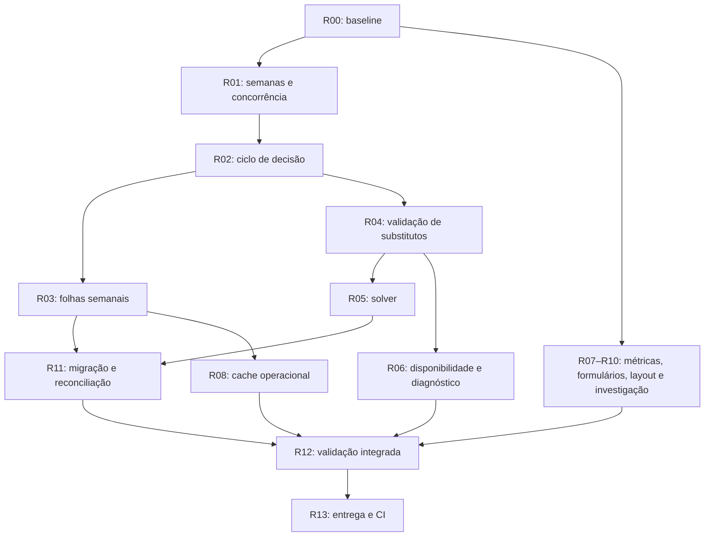

# Cronos — WBS técnico de correção UI/UX, versão 2

**Data:** 3 de outubro de 2026.  
**Estado:** plano de trabalho remanescente, após revisão do código.  
**Referência:** relatório de 2 de outubro, findings F01–F18, e resumo de implementação fornecido pelo utilizador.  
**Baseline:** commit `ccbae96`, incluindo as alterações locais revistas nesta data.

## Purpose

Este WBS decompõe o trabalho necessário para fechar os findings e completar os contratos operacionais associados.
Inclui lacunas adicionais encontradas na implementação local.
Não declara concluídos os pacotes apresentados abaixo.

O código confirma grande parte da implementação reportada.
Contudo, UX02, UX03, UX04, UX05 e UX07 precisam de trabalho adicional antes do fecho.
O procedimento UX13 também precisa de correções e evidência de execução.

## Intended Reader

Este documento destina-se aos responsáveis pelo backend, frontend, solver, testes e operação do Cronos.
Cada pacote identifica dependências, tarefas técnicas, testes e condições de aceitação.
Os responsáveis indicados são funções técnicas, não pessoas atribuídas.

## Prerequisites

- Leia [Occurrences and Substitutions](../04_operational_features/OCCURRENCES_AND_SUBSTITUTIONS.md).
- Leia [Lesson Execution](../04_operational_features/LESSON_EXECUTION.md).
- Leia o [tech spec do scheduler](../03_scheduler_engine/SCHEDULER_V1_TECH_SPEC_V2.md).
- Siga [Testing and CI](../08_security_quality/TESTING_AND_CI.md).
- Preserve as alterações locais existentes, incluindo alterações de outras tarefas.
- Prepare identidades de teste dedicadas para Diretor, Professor e uma segunda organização.
- Use relógio controlado nos testes temporais.
- Use PostgreSQL real nos testes de transações, concorrência e migrations.

Este WBS segue Clean Code, Clean Architecture, TDD e Ponytail na intensidade `full`.
Reutilize os serviços, o ledger, os componentes e o runner existentes.
Não crie outro sistema de ocorrências, execução ou notificações para executar este plano.

## What the System Does

### Estado verificado

| WBS anterior | Estado após revisão | Evidência e trabalho remanescente |
| :--- | :--- | :--- |
| UX00 — Baseline | Atualizado nesta revisão | Baseline atual e alterações locais identificadas; produção permanece por verificar. |
| UX01 — Guarda temporal | Implementado, com validação final pendente | Regra pura e sete testes aprovados; caminhos v1 e legados usam a guarda. |
| UX02 — Persistência | Parcial | Migration 0018 existe; faltam proteção completa do downgrade e validação coerente do ano letivo. |
| UX03 — Decisão e dívida | Parcial | Pendente não cria dívida; transições posteriores podem manter execução ou impedir recriação da dívida. |
| UX04 — Substituição e execução | Parcial | Planeamento separado da execução; faltam guardas completas de elegibilidade, semana e concorrência. |
| UX05 — Projeções | Parcial | Grelha semanal inclui substituições; folhas semanais v1 ainda consultam apenas aulas canónicas. |
| UX06 — Solver | Por implementar | Snapshot não incorpora blocos operacionais; falta reserva e contabilização de planeamento. |
| UX07 — Reversão | Parcial | Compensações e confirmação existem; recriação, semanas fechadas e corridas precisam de cobertura. |
| UX08 — Elegibilidade e disponibilidade | Por implementar | Falta edição administrativa e diagnóstico utilizável de exclusões. |
| UX09 — Geração e métricas | Parcial | Revisão prévia da geração implementada; contrato anual de métricas permanece por implementar. |
| UX10 — Formulários e feedback | Parcial | Confirmações melhoradas; gravação genérica e erros associados aos campos permanecem incompletos. |
| UX11 — Responsividade e acessibilidade | Parcial | Durações e histórico melhorados; calendário, scroll, largura útil e contraste precisam de fecho. |
| UX12 — Downloads, filtros e diagnóstico | Parcial | Datas inválidas e referência de erro melhoradas; downloads reais e causa de F15 permanecem pendentes. |
| UX13 — Reconciliação | Documento parcial | Inventário omite casos antigos; invariante de settlement incorreto; aplicação não foi demonstrada. |
| UX14 — Validação | Parcial | Suites reportadas aprovadas; faltam testes dos contratos adicionais, E2E, browser e axe. |
| UX15 — Entrega | Por executar | Sem commit ou push desta implementação; CI associada e entrega permanecem pendentes. |

### Evidência executada nesta revisão

| Verificação | Resultado |
| :--- | :--- |
| Backend: `fast --scope backend -- -k lesson_time_rule` | 7 aprovados; 861 testes não selecionados. |
| Frontend: seis ficheiros selecionados | 52 testes aprovados. |
| Ficheiros frontend | `OccurrencesTabs`, `ConfirmationModal`, `formValidity`, `BulkImport`, `SchedulesSchedulerFlow`, `formatUtils`. |

Os totais de 868 unidades backend, 418 integrações, 61 contracts e 511 testes frontend foram reportados pelo utilizador.
Esta revisão não repetiu essas suites completas, migrations, audits ou verificações de saúde da stack.
Os testes selecionados não cobrem todas as lacunas identificadas abaixo.

### Lacunas adicionais observadas

Estas observações resultam da leitura do código e dos seus consumidores.
As consequências descritas precisam de testes de reprodução antes da correção.
As corridas de concorrência são riscos identificados, ainda sem reprodução nesta revisão.

| ID | Evidência local | Consequência a verificar | Pacote |
| :--- | :--- | :--- | :--- |
| A01 | `record_lesson_log`, `update_occurrence` e `cancel_occurrence` v1 não verificam folhas fechadas. | Alterações operacionais podem atravessar semanas submetidas ou aprovadas. | R01 |
| A02 | `_v1_week_lessons` e `_v1_slot_counts` consultam apenas `SchedulerLessonV1`. | Substituição operacional não aparece no detalhe, contagem ou validação de submissão. | R03 |
| A03 | Ramo `GAP`/`SUBSTITUTED` não compensa execução original ao sair de `GIVEN`. | Decisão de falta pode coexistir com crédito original e `status=COMPLETED`. | R02 |
| A04 | Sumário normal aceita alterar o estado de um log com decisão existente. | API direta pode contornar decisão, dívida e substituição. | R02 |
| A05 | Reversão mantém decisão anterior; projeção semanal prioriza `log.decision`; criação exige `log is None`. | Aula revertida pode continuar bloqueada ou mal identificada na UI. | R02 |
| A06 | `_ensure_debt_claim` termina quando encontra qualquer claim anterior. | `GAP → GIVEN → GAP` pode manter dívida zero; recriação também precisa de cobertura. | R02 |
| A07 | Versão é comparada com `item` lido antes do lock; ordem de locks difere entre comandos. | Duas decisões podem usar uma revisão antiga; conclusão e reversão podem competir. | R01 |
| A08 | `_plan_substitution` procura assignment sem ano ou docente; conflito ignora blocos operacionais. | API pode aceitar associação inadequada ou dupla reserva de docente. | R04 |
| A09 | Invalidações operacionais omitem algumas queries de progresso, dashboard e folhas. | Estado persistido correto pode continuar desatualizado noutras vistas. | R08 |
| A10 | Validação portuguesa não trata `stepMismatch` nem produz erro associado junto ao campo. | Validação pode continuar em inglês ou sem contexto acessível. | R08 |
| A11 | `GenericModalForm` permite fecho durante gravação; histórico usa viewport de 1000 px. | F03 e F12 permanecem parcialmente resolvidos. | R08, R09 |
| A12 | Inventário histórico exclui `COMPLETED` sem decisão; exige settlement após substituição. | Pode omitir F09 antigo e liquidar indevidamente a dívida da disciplina original. | R11 |
| A13 | Downgrade 0018 verifica decisões e blocos v1, mas não metadados de reversão isolados. | Reversão pendente sem decisão pode perder autoria, instante e motivo. | R11 |

## Why the Behavior Exists

O plano fecha contratos completos, não apenas caminhos felizes.
Uma UI correta depende da coerência entre decisão, dívida, execução, horário, folha semanal e solver.
Uma suite aprovada só demonstra os comportamentos incluídos nos seus testes.

A prioridade inicial é impedir alterações incompatíveis com semanas fechadas e eliminar incoerências no ledger.
O solver recebe apenas estados operacionais já validados.
A reconciliação histórica usa essas mesmas regras e preserva evidência anterior.

## Components and Ownership

| Componente | Responsável técnico | Limite de responsabilidade |
| :--- | :--- | :--- |
| Regras temporais e curriculares | Backend/domínio | Regras puras, minutos inteiros, independência de HTTP e persistência. |
| Comandos de ocorrência e execução | Backend/aplicação | Autorizações, transação, revisão, idempotência e compensações. |
| Queries, locks e constraints | Backend/infraestrutura | Tenant, ano, exclusividade e acesso coerente ao estado persistido. |
| Folhas semanais | Backend/operações | Detalhe, contagens, submissão, aprovação e proteção de semanas. |
| Snapshot, solução e publicação | Scheduler | Reserva de recursos, demanda, validação e preservação de blocos. |
| Formulários, grelhas e cache | Frontend | Estado explícito, acessibilidade e atualização de vistas dependentes. |
| Migração e reconciliação | Backend/operação | Inventário, evidência, dry-run, compensação e auditoria. |
| Verificação e entrega | Qualidade/DevOps | Regressão, browser, CI, imagens e evidência de fecho. |

### Estrutura do novo WBS

| Pacote | Entregável | Prioridade | Dependências | Origem |
| :--- | :--- | :--- | :--- | :--- |
| R00 | Baseline e rastreabilidade | P1 | Nenhuma | UX00 |
| R01 | Semanas fechadas e concorrência | P1 | R00 | UX03/04/07, A01/A07 |
| R02 | Ciclo de decisão, compensação e recriação | P1 | R01 | UX03/07, F09/F10, A03–A06 |
| R03 | Substituições nas folhas semanais | P1 | R01, R02 | UX05, A02 |
| R04 | Validação autoritativa de substitutos | P1 | R01, R02 | UX04/08, F17, A08 |
| R05 | Blocos operacionais no solver | P1 | R02, R04 | UX06 |
| R06 | Disponibilidade administrativa e diagnóstico | P2 | R04 | UX08, F17 |
| R07 | Métricas anuais do horário aprovado | P2 | R00 | UX09, F02 |
| R08 | Formulários, gravação e cache | P2 | R02, R03 para cache operacional | UX10/12, F03/F04/F14, A09–A11 |
| R09 | Responsividade e acessibilidade visual | P2/P3 | R00 | UX11, F06/F07/F12/F16/F18 |
| R10 | Downloads reais e investigação semanal | P2/P3 | R00 | UX12, F08/F15 |
| R11 | Migração segura e reconciliação histórica | P1 | R01–R05 | UX02/13, F09, A12/A13 |
| R12 | Validação integrada e fecho dos findings | P1 | R01–R11 | UX14, F01–F18 |
| R13 | Entrega, CI e verificação da stack | P1 | R12 | UX15 |

R00 está concluído para a revisão local.
Todos os outros pacotes permanecem abertos.
As prioridades deste plano não alteram a classificação original do relatório.

## Data or Request Flow

### Ordem de execução



As frentes independentes podem decorrer em paralelo.
Uma dependência autoriza preparação antecipada de testes; não autoriza declarar concluído o pacote dependente.

### R00 — Baseline e rastreabilidade

**Objetivo:** distinguir implementação presente, evidência executada e trabalho ainda aberto.

- **R00.1:** Relacione F01–F18 com os pacotes anteriores e os pacotes remanescentes.
- **R00.2:** Registe commit, alterações locais, suites reportadas e suites repetidas.
- **R00.3:** Identifique lacunas de comportamento nos consumidores, não apenas nos comandos modificados.

**Aceitação:** este documento fornece a matriz, as observações A01–A13 e os resultados selecionados.
**Estado:** concluído nesta revisão; atualize a baseline quando iniciar a implementação.

### R01 — Semanas fechadas, revisão e concorrência

**Objetivo:** impedir alterações ilegais e decidir sempre sobre estado atual.
**Responsável:** backend/operações. **Fontes:** `operations.py`, `occurrences.py`, `timesheet_service.py`.

- **R01.1:** Escreva testes de criação, decisão, conclusão e reversão com semana `SUBMITTED` ou `APPROVED`.
- **R01.2:** Cubra o docente original e o substituto, incluindo substituto sem aulas canónicas.
- **R01.3:** Aplique a guarda partilhada nos comandos v1 e preserve os caminhos legados.
- **R01.4:** Verifique versão e estado após adquirir os locks; releia dados que possam estar obsoletos.
- **R01.5:** Uniformize a ordem de locks entre decisão, execução, reversão e submissão semanal.
- **R01.6:** Teste duas sessões com barreiras determinísticas: decisão/decisão, conclusão/reversão e alteração/submissão.
- **R01.7:** Faça `can_complete` e `blocked_reason` refletirem as mesmas guardas do comando.

**TDD:** confirme falha antes da correção; use transações reais e coordenação explícita, sem sleeps arbitrários.
**Aceitação:** semana fechada bloqueia a mutação sem alterações persistidas; revisão obsoleta devolve `409`.
Repetição válida não duplica minutos.
Uma reversão concorrente nunca elimina execução concluída sem confirmação explícita.
Reabertura administrativa permite alterações pelos caminhos existentes.

### R02 — Decisão, crédito, dívida, reversão e recriação

**Objetivo:** manter coerência durante todo o ciclo de vida.
**Responsável:** backend/domínio e frontend operacional. **Fontes:** `occurrences.py`, `operations.py`, `LessonLogModal.jsx`.

- **R02.1:** Escreva a matriz de testes apresentada em States and Transitions.
- **R02.2:** Compense execução original em `GIVEN → GAP` e `GIVEN → SUBSTITUTED`.
- **R02.3:** Corrija `status`, decisão e projeções na mesma transação.
- **R02.4:** Bloqueie alterações de estado pelo sumário normal enquanto existir ocorrência administrativa ativa.
- **R02.5:** Preserve edição de texto autorizada sem alterar crédito ou decisão.
- **R02.6:** Faça dívida acompanhar a decisão atual, mesmo quando existe claim anteriormente compensado.
- **R02.7:** Corrija a projeção de reversão; priorize o estado revertido antes da decisão histórica.
- **R02.8:** Permita nova ocorrência após reversão, com nova revisão e preservação da evidência anterior.
- **R02.9:** Teste recriação com outro substituto, repetição do mesmo pedido e falha após cada efeito persistente.

**TDD:** reproduza `GAP → GIVEN → GAP`, `GIVEN → GAP` e reversão/recriação pela API e pela UI.
**Aceitação:** Português em falta conserva a dívida correta; Matemática executada recebe apenas o seu crédito.
Uma decisão `GAP` nunca mantém crédito da aula original.
Uma nova ocorrência começa pendente, sem dívida nem execução.
Reversão e recriação não sobrescrevem a evidência necessária à auditoria.
Reutilize o ledger e as revisões existentes antes de introduzir persistência adicional.

### R03 — Folhas semanais com blocos operacionais v1

**Objetivo:** projetar todo o trabalho do docente e validar a semana completa.
**Responsável:** backend/operações. **Fonte principal:** `timesheet_service.py`.

- **R03.1:** Teste detalhe, contagens e listagem com aula original substituída e bloco operacional.
- **R03.2:** Inclua os blocos operacionais ativos do docente nas consultas v1.
- **R03.3:** Preserve a ocorrência original na folha do docente original, sem contar execução da disciplina substituta.
- **R03.4:** Inclua substitutos sem aulas canónicas na população de docentes da semana.
- **R03.5:** Bloqueie submissão com substituição por concluir; aceite após conclusão válida.
- **R03.6:** Cubra aprovação, reabertura, reversão e blocos cancelados.
- **R03.7:** Preserve budgets de queries e isolamento por organização e ano.

**TDD:** expanda `test_timesheets_v1.py` com as duas perspetivas de docente.
**Aceitação:** grelha, folha e contagens concordam.
Uma aula substituta conta uma vez para o docente efetivo.
Não devolva “Sem aulas planeadas” quando existe bloco operacional válido.

### R04 — Validação autoritativa da substituição

**Objetivo:** rejeitar planos impossíveis mesmo quando a API recebe um pedido manual.
**Responsável:** backend/domínio e infraestrutura. **Fontes:** `_plan_substitution`, `_substitute_conflict`, recomendações existentes.

- **R04.1:** Teste docente inadequado, assignment de outro ano e recursos já reservados por outro bloco operacional.
- **R04.2:** Valide organização, ano, turma, disciplina, docente associado, competências e estado ativo.
- **R04.3:** Exija disponibilidade explícita admissível, coerente com a regra das recomendações.
- **R04.4:** Verifique conflitos de docente, turma e sala, incluindo blocos operacionais ativos.
- **R04.5:** Verifique capacidade curricular e compatibilidade da sala antes de criar o plano.
- **R04.6:** Use a mesma avaliação na recomendação, no diagnóstico e na confirmação.
- **R04.7:** Revalide dentro da transação; a recomendação anterior não garante elegibilidade atual.

**TDD:** teste API direta e dois pedidos concorrentes para o mesmo recurso.
**Aceitação:** o mesmo estado produz o mesmo motivo de exclusão em todos os caminhos.
Uma rejeição não cria bloco, dívida parcial ou crédito.
Referências válidas no mesmo tenant também precisam de pertencer ao ano e contexto corretos.

### R05 — Reserva operacional e demanda no solver

**Objetivo:** impedir que geração, reparação ou publicação contradigam substituições ativas.
**Responsável:** scheduler. **Fonte principal:** `snapshot.py` e consumidores do snapshot.

- **R05.1:** Crie fixtures pequenas com substituição planeada, concluída e revertida.
- **R05.2:** Transporte blocos operacionais ativos no snapshot com identificadores, revisões e minutos necessários.
- **R05.3:** Reserve docente, turma e sala no intervalo efetivo.
- **R05.4:** Retire a ocupação original substituída quando o contrato operacional assim determina.
- **R05.5:** Desconte planeamento substituto da demanda por planear, mantendo execução zero até conclusão.
- **R05.6:** Após conclusão, contabilize execução sem voltar a descontar os mesmos minutos como planeamento pendente.
- **R05.7:** Inclua alterações operacionais no fingerprint e na deteção de snapshot obsoleto.
- **R05.8:** Cubra construção, reparação adaptativa, caminhos alternativos existentes e validador independente.
- **R05.9:** Preserve blocos operacionais ao publicar nova versão; revalide o estado atual antes da publicação.
- **R05.10:** Execute regressões de estabilidade semanal, preferência de salas, almoço, limites e recuperação adaptativa.

**TDD:** comece por colisão mínima e dupla contabilização de minutos; amplie para geração e republicação.
**Aceitação:** nenhum horário válido colide com reservas operacionais.
Planeamento não cria execução.
Publicação obsoleta é rejeitada ou reconstruída pelo fluxo existente.
Cancelamento liberta reservas sem apagar histórico.
O solver atual inclui alterações posteriores ao WBS original; use a baseline desta revisão.

### R06 — Disponibilidade administrativa e diagnóstico F17

**Objetivo:** permitir corrigir configuração e explicar exclusões de candidatos.
**Responsável:** backend/API e frontend/membros.

- **R06.1:** Reutilize `set_teacher_availability` para uma operação administrativa sobre `/{teacher_id}/availability`.
- **R06.2:** Aplique permissões administrativas e isolamento do tenant no servidor.
- **R06.3:** Registe autor, instante, docente e alteração pelo mecanismo de auditoria existente.
- **R06.4:** Disponibilize edição para `scheduler_only`, sem convite nem concessão de acesso.
- **R06.5:** Devolva motivos estruturados de exclusão e ações para configurar disponibilidade ou associação.
- **R06.6:** Reutilize o endpoint de recomendações se o contrato permitir; preserve consumidores existentes.
- **R06.7:** Substitua “Registe como GAP” por orientação baseada no diagnóstico.

**TDD:** teste Diretor autorizado, Professor sem privilégio, outro tenant e docente sem sessão.
**Aceitação:** configurar disponibilidade admissível faz surgir um candidato válido, mantendo os restantes critérios.
Cada exclusão explica o critério falhado.
GAP continua disponível como decisão administrativa, sem ser sugerido como única solução para configuração incompleta.

### R07 — Métricas anuais F02

**Objetivo:** apresentar médias com período e população verificáveis.
**Responsável:** backend/dashboard e frontend/dashboard.

- **R07.1:** Teste catálogo com 48 turmas e versão aprovada contendo uma população diferente.
- **R07.2:** Obtenha o denominador das turmas distintas presentes no horário aprovado do ano letivo.
- **R07.3:** Conte blocos do ano completo; não use todas as atribuições nem semanas futuras como substituto.
- **R07.4:** Exponha período, numerador e denominador no contrato e na apresentação adequada.
- **R07.5:** Preserve métricas realmente semanais com limite superior da semana quando continuarem expostas.
- **R07.6:** Teste ausência de versão, população vazia, troca de ano e isolamento entre organizações.
- **R07.7:** Investigue os identificadores adicionais do relatório com evidência de produção, antes de classificá-los como dados incorretos.

**TDD:** use populações diferentes no catálogo, assignments e linhas publicadas.
**Aceitação:** a média anual equivale ao total anual dividido pelas turmas presentes na versão aprovada.
Turmas ativas fora desse horário não entram no denominador.
Não force o denominador para 48 apenas porque esse era o catálogo observado.
O relatório de produção continua uma divergência por confirmar até existir evidência dos dados consultados.

### R08 — Formulários, gravação e atualização de cache

**Objetivo:** completar F03/F04/F14 e mostrar imediatamente o estado persistido.
**Responsável:** frontend, com investigação backend quando necessária.

- **R08.1:** Teste operação lenta, duplo submit, erro e fecho pelo botão, Escape ou cancelamento.
- **R08.2:** Reutilize o padrão de progresso na gravação genérica, incluindo aviso após cinco segundos.
- **R08.3:** Uniformize rótulos e impeça repetição ou fecho que abandone uma mutação em curso.
- **R08.4:** Preserve valores e foco ao devolver erros de validação.
- **R08.5:** Apresente erros em português junto ao campo, com `aria-invalid` e `aria-describedby`.
- **R08.6:** Cubra obrigatório, whitespace, intervalo, tipo, formato e passo numérico.
- **R08.7:** Associe o erro de intervalo invertido aos filtros; não envie pedido inválido.
- **R08.8:** Invalide queries afetadas de ocorrências, dívida, grelha, classes, progresso, dashboard e folhas.
- **R08.9:** Preserve o âmbito da organização nas invalidações e teste vistas já abertas.
- **R08.10:** Meça latência de curso e remoção de turma; identifique a causa antes de propor otimizações.

**TDD:** use timers falsos para feedback e MSW para erro, latência e cache.
**Aceitação:** não existe submissão duplicada nem mensagem nativa inglesa nos casos cobertos.
Erros têm associação acessível e as vistas dependentes convergem sem recarregar a página.
Feedback de espera não constitui prova de resolução da latência de F03.
Não acrescente dependências de notificações para cumprir este pacote.

### R09 — Calendário, scroll, histórico e contraste

**Objetivo:** completar os ajustes visuais e provar acessibilidade dos estados alterados.
**Responsável:** frontend/design system.

- **R09.1:** Reorganize seletor e ação do calendário com CSS existente, preservando o valor selecionado legível.
- **R09.2:** Acrescente pista de scroll horizontal e acesso por teclado à matriz.
- **R09.3:** Reduza a altura dos cartões de sala em mobile ou reutilize filtros existentes.
- **R09.4:** Faça o histórico responder à largura útil do conteúdo, incluindo sidebar e zoom.
- **R09.5:** Preserve datas legíveis e acesso ao sumário completo nos dois layouts.
- **R09.6:** Meça contraste composto dos estados revertidos e badges, após remover a opacidade global.
- **R09.7:** Verifique nomes acessíveis, foco e distinção entre navegação e remoção da turma.

**Verificação:** use 375, 768, aproximadamente 1178 e 1280 px, com sidebar e zoom de 200%.
**Aceitação:** ações e valores continuam legíveis e acessíveis sem sobreposição.
O histórico usa cartões quando a área útil não suporta a tabela.
Texto normal alcança contraste mínimo de 4,5:1 nos estados verificados.
Registe screenshots e resultados de teclado e axe.

### R10 — Downloads reais F08 e investigação F15

**Objetivo:** transformar observações inconclusivas em resultados verificáveis.
**Responsável:** frontend/browser e backend/observabilidade.

- **R10.1:** Teste cada modelo CSV num browser real, incluindo evento de download e conteúdo do ficheiro.
- **R10.2:** Verifique nome, MIME, cabeçalhos CSV, bytes e tratamento de falha HTTP.
- **R10.3:** Confirme o ciclo de vida de Blob e object URL; altere apenas se o teste mostrar falha.
- **R10.4:** Correlacione falhas da grelha com `X-Request-ID`, logs e resposta HTTP.
- **R10.5:** Prepare a semana de 12–16 de outubro, com dados controlados, nas vistas de turma e professor.
- **R10.6:** Teste troca rápida de filtros, pedidos concorrentes, retry e falhas de serviço induzidas.
- **R10.7:** Corrija a causa reproduzida de F15 e acrescente teste de regressão adequado.

**Aceitação F08:** cada download produz ficheiro utilizável ou erro explícito.
Mocks de `downloadBlob` não bastam para fechar o finding.
**Aceitação F15:** a evidência identifica a causa e demonstra a correção.
Se não houver reprodução nem telemetria suficiente, mantenha F15 aberto e documente o que falta observar.
Não atribua a falha a rede, servidor ou frontend apenas pela mensagem apresentada.

### R11 — Persistência segura e reconciliação histórica

**Objetivo:** preservar auditoria e corrigir dados antigos sem inferir decisões indevidas.
**Responsável:** backend/migrations e operação.

- **R11.1:** Teste downgrade com reversão pendente, decisão nula e metadados de reversão preenchidos.
- **R11.2:** Proteja toda a evidência introduzida por 0018 contra perda no downgrade.
- **R11.3:** Teste referências de anos diferentes; acrescente constraints apenas quando a validação transacional não proteger a invariância necessária.
- **R11.4:** Use migration posterior para alterações de schema; preserve o upgrade 0018 já aplicado.
- **R11.5:** Inclua logs antigos `COMPLETED` sem decisão no inventário de candidatos à reconciliação.
- **R11.6:** Inventarie créditos, compensações, dívida, settlements e blocos, com origem, revisão, organização e ano.
- **R11.7:** Classifique com evidência; uma aula concluída isolada não prova uma decisão administrativa válida.
- **R11.8:** Produza manifest de dry-run com IDs, razões, saldo anterior, alterações previstas e saldo esperado.
- **R11.9:** Defina comandos de aplicação, verificação e recuperação, com checkpoints e unidade transacional explícita.
- **R11.10:** Teste segunda aplicação sem efeitos adicionais e falha sem alteração parcial.
- **R11.11:** Corrija o invariante de settlement no procedimento existente.
- **R11.12:** Prepare a reversão dos 50 minutos QA e a análise de referências do docente sintético.

**TDD:** use fixtures anteriores a 0018, incluindo futura GIVEN sintética, dívida provisória e substituição histórica.
**Aceitação:** nenhuma classificação depende apenas do nome, saldo ou status concluído.
Registos ambíguos permanecem identificados e impedem o fecho da reconciliação.
Execução de Matemática não liquida automaticamente a dívida de Português.
O dry-run explica cada diferença e a aplicação preserva o ledger anterior.
O procedimento atual precisa de correção; a sua existência não demonstra reconciliação concluída.
Execução em produção exige âmbito autorizado e evidência concreta; não faz parte desta revisão documental.

### R12 — Validação integrada e fecho

**Objetivo:** comprovar os contratos finais e fechar cada finding com evidência própria.
**Responsável:** qualidade, backend, frontend e scheduler.

- **R12.1:** Execute testes focados após cada correção e suites completas após integração.
- **R12.2:** Execute migrations, audits de integridade, RLS e contratos com PostgreSQL real.
- **R12.3:** Complete o percurso futuro → pendente → decisão → execução → folha → reversão → recriação.
- **R12.4:** Cubra Diretor, Professor, recurso sem sessão e segunda organização.
- **R12.5:** Execute axe, teclado, zoom e browser nos percursos alterados.
- **R12.6:** Complete as lacunas relevantes do plano original de 154 casos, mantendo casos condicionados explicitamente abertos.
- **R12.7:** Atualize os guias que atualmente afirmam guardas ainda ausentes.
- **R12.8:** Anexe logs, relatórios, screenshots, traces e matriz de fecho.

**Aceitação:** testes determinísticos, sem skips ou retries usados para ocultar falhas.
F02, F08 e F15 conservam o seu estado de investigação até existir evidência suficiente.
A aprovação das suites não substitui os testes específicos de A01–A13.

### R13 — Entrega, CI e stack atualizada

**Objetivo:** disponibilizar uma versão verificável e acompanhar a sua validação.
**Responsável:** equipa de entrega/DevOps.

- **R13.1:** Prepare diff e descrição com comportamento final, migrations, limites e resultados.
- **R13.2:** Exclua alterações de outras tarefas e remoções de CSV sem relação com este trabalho.
- **R13.3:** Quando houver push autorizado, acompanhe a CI associada até aprovação.
- **R13.4:** Corrija falhas, volte a enviar e acompanhe novamente até aprovação.
- **R13.5:** Reconstrua ou atualize o container frontend após alterações frontend.
- **R13.6:** Atualize backend e worker quando necessário; aplique migrations pelo procedimento existente.
- **R13.7:** Verifique readiness, frontend, revisão efetiva e smoke tests operacionais.
- **R13.8:** Registe rollback compatível com decisões e auditoria persistidas.

**Aceitação:** a stack mostra a revisão entregue e a CI dessa revisão está aprovada.
Sem push, este pacote continua pendente de entrega; não invente uma execução de CI.
Alterações documentais deste WBS não exigem reconstrução dos containers.

## Contracts and Invariants

1. Ocorrência pendente produz zero dívida e zero execução.
2. `GAP` produz dívida da disciplina original uma vez por ciclo válido.
3. `SUBSTITUTED` produz dívida original e planeamento substituto, com execução inicial zero.
4. Conclusão substituta credita apenas a disciplina substituta, depois do término.
5. `GIVEN` credita apenas a aula original, depois do término.
6. Reversão produz compensações auditáveis e não elimina entradas anteriores.
7. Semana fechada bloqueia alterações com efeito nessa semana e nos docentes afetados.
8. Idempotência distingue repetição do mesmo comando de uma nova decisão válida.
9. Revisão obsoleta não altera dados.
10. Decisão, dívida, execução e projeções mudam na mesma transação.
11. Todas as referências respeitam organização, ano letivo e associação curricular.
12. Solver reserva planeamento operacional sem o contabilizar como execução.
13. Publicação preserva blocos operacionais e rejeita estado operacional obsoleto.
14. UI reflete as guardas do servidor; comandos HTTP diretos respeitam as mesmas regras.

**Exemplo obrigatório:** Português em falta durante 50 minutos gera dívida de 50 minutos.
Uma substituição de Matemática planeada durante 50 minutos mantém execução zero.
Concluir Matemática credita 50 minutos nessa disciplina; a dívida de Português permanece 50 minutos.

## States and Transitions

Os nomes abaixo descrevem estados de negócio.
Não exigem criar novos enums ou outra máquina de estados na implementação.

| Transição | Dívida original | Execução original | Execução substituta | Guarda principal |
| :--- | :--- | :--- | :--- | :--- |
| Aula → pendente | 0 | 0 | 0 | Autorização, semana e ausência de ocorrência ativa. |
| Pendente → GIVEN | 0 | Minutos da aula | 0 | Término e semana aberta. |
| Pendente → GAP | Minutos em falta | 0 | 0 | Decisão administrativa. |
| Pendente → SUBSTITUTED planeada | Minutos em falta | 0 | 0 | Elegibilidade e reserva atuais. |
| Planeada → substituta concluída | Mantém dívida original | 0 | Minutos substitutos | Término, capacidade e semana aberta. |
| GIVEN → GAP | Minutos em falta | Compensada | 0 | Revisão atual e semana aberta. |
| GIVEN → SUBSTITUTED planeada | Minutos em falta | Compensada | 0 | Elegibilidade e compensação transacional. |
| GAP → GIVEN | Compensada | Minutos da aula | 0 | Término e revisão atual. |
| GAP → GIVEN → GAP | Reposta uma vez | Compensada | 0 | Novo efeito válido, distinto de repetição. |
| Substituição concluída → revertida | Compensada conforme ciclo | 0 | Compensada | Confirmação explícita e semanas abertas. |
| Revertida → nova pendente | 0 | 0 | 0 | Nova revisão; histórico preservado. |

Preserve as transições já rejeitadas pelo contrato, incluindo `SUBSTITUTED → GIVEN` sem reversão prévia.
Teste rejeições pela API direta, além das opções expostas pela UI.

## Failure Modes

| Falha | Comportamento exigido |
| :--- | :--- |
| Aula ainda em curso | `422 lesson_not_finished`, sem efeitos persistidos. |
| Versão obsoleta | `409`, sem alteração parcial. |
| Semana fechada | Rejeição com motivo operacional; nenhuma compensação ou crédito novo. |
| Substituição concluída sem confirmação de reversão | `SUBSTITUTE_LOG_LOCKED`. |
| Docente ou referência inválidos | Rejeição no servidor, mesmo quando a UI apresentou recomendação anterior. |
| Conflito operacional ou snapshot antigo | Rejeição ou reconstrução pelo fluxo existente; nenhuma publicação incoerente. |
| Erro após criar dívida ou crédito | Rollback integral da transação. |
| Dados históricos ambíguos | Interrupção da classificação daquele registo; evidência pendente explícita. |
| Falha de download | Estado de erro recuperável; nunca confirmação fictícia. |
| F15 sem diagnóstico | Finding aberto com referência de pedido e evidência recolhida. |

## Verification Procedure

### Comandos de fecho

Execute a partir da raiz do repositório, no ambiente preparado pelo runner.

```powershell
node scripts/test.mjs doctor --profile all
node scripts/test.mjs fast --scope backend
node scripts/test.mjs fast --scope frontend
node scripts/test.mjs integration
npm --prefix frontend run verify
node scripts/test.mjs e2e --project app
node scripts/test.mjs e2e --project faults
git diff --check
```

O comando `e2e --project faults` fica histórico: o projeto `faults` foi retirado e os seus dois casos passaram para os projetos `isolated` e `readonly`. O equivalente atual é `node scripts/test.mjs e2e --project isolated` seguido de `node scripts/test.mjs e2e --project readonly`.

Execute os restantes gates, migrations e audits definidos no [workflow de CI](../../.github/workflows/ci.yml).
Execute os projetos E2E adicionais exigidos pelos fluxos alterados e pelas dependências do Playwright.
Execute regressões e campanhas do solver adequadas a R05.
Use os comandos documentados de capacidade quando os contratos ou budgets afetados o exigirem.

### Matriz de fecho F01–F18

| Finding | Estado local atual | Pacote de fecho | Evidência necessária |
| :--- | :--- | :--- | :--- |
| F01 | Implementação e testes presentes | R12 | Browser confirma revisão prévia; cancelamento não inicia geração. |
| F02 | Por implementar; produção por confirmar | R07, R12 | Fórmula anual, população publicada e reconciliação dos IDs observados. |
| F03 | Parcial | R08, R12 | Gravações protegidas, espera clara e diagnóstico da latência. |
| F04 | Parcial | R08, R12 | Erros portugueses associados aos campos, incluindo passo numérico. |
| F05 | Implementação presente | R12 | Singular e plural corretos. |
| F06 | Por implementar | R09, R12 | Calendário legível em larguras e zoom definidos. |
| F07 | Por implementar | R09, R12 | Scroll descobrível, teclado funcional e salas compactas. |
| F08 | Feedback parcial; download por confirmar | R10, R12 | Ficheiros reais válidos ou erro explícito. |
| F09 | Guarda presente; ciclo e histórico incompletos | R01, R02, R11, R12 | Limite temporal, compensações, semanas e reconciliação. |
| F10 | Decisão explícita presente; ciclo incompleto | R02, R08, R12 | Decisão, dívida, grelha e cache coerentes após transições. |
| F11 | Implementação e testes presentes | R12 | `50 min` e `1 h 40 min`, sem precisão interna exposta. |
| F12 | Parcial | R09, R12 | Layout responde à área útil; texto integral acessível. |
| F13 | Implementação presente | R12 | Aviso único com orientação correta para cada perfil. |
| F14 | Bloqueio local presente; associação a verificar | R08, R12 | Erro junto dos filtros, zero pedido inválido e recuperação. |
| F15 | Recuperação melhorada; causa desconhecida | R10, R12 | Telemetria, reprodução e regressão da causa. |
| F16 | Opacidade removida; contraste por medir | R09, R12 | Medição composta, axe e inspeção visual. |
| F17 | Por implementar; validação também incompleta | R04, R06, R12 | Diagnóstico, edição auditada e candidato elegível confirmado. |
| F18 | Nomes acessíveis presentes | R09, R12 | Árvore acessível, teclado e distinção das ações. |

Um finding só fecha quando a evidência demonstra o comportamento esperado.
Uma entrega parcial deve listar findings e lacunas ainda abertos.
R13 não transforma verificações pendentes em aprovação.

## Source Map

### Backend e scheduler

- [Regra temporal](../../backend/app/scheduler/domain/lesson_time.py).
- [Operações e projeção semanal v1](../../backend/app/scheduler/infrastructure/operations.py).
- [Decisões, reversão e recomendações v1](../../backend/app/scheduler/infrastructure/occurrences.py).
- [Ledger de progresso](../../backend/app/scheduler/infrastructure/progress.py).
- [Snapshot do scheduler](../../backend/app/scheduler/infrastructure/snapshot.py).
- [Folhas semanais](../../backend/app/services/timesheet_service.py).
- [Execução legada](../../backend/app/services/lesson_log_service.py).
- [Ocorrências legadas](../../backend/app/services/occurrence_service.py).
- [Dashboard](../../backend/app/services/dashboard_service.py).
- [Disponibilidade de docentes](../../backend/app/services/teacher_service.py).
- [Rotas de disponibilidade](../../backend/app/api/v1/endpoints/teachers.py).
- [Rotas de horário e sumário](../../backend/app/api/v1/endpoints/schedule.py).
- [Migration 0018](../../backend/alembic/versions/0018_occurrence_decisions.py).

### Frontend

- [Queries e mutações operacionais](../../frontend/src/features/operations/data.js).
- [Modal de sumário](../../frontend/src/components/LessonLogModal.jsx).
- [Modal de confirmação](../../frontend/src/components/ConfirmationModal.jsx).
- [Modal de gravação](../../frontend/src/components/GenericModalForm.jsx).
- [Validação portuguesa](../../frontend/src/utils/formValidity.js).
- [Ocorrências e histórico](../../frontend/src/pages/Occurrences.jsx).
- [Horários](../../frontend/src/pages/Schedules.jsx).
- [Calendário e configuração](../../frontend/src/features/schoolConfig/SchoolConfigSections.jsx).
- [Matriz com scroll](../../frontend/src/components/AnalyticsHeatmap.jsx).
- [Downloads](../../frontend/src/pages/BulkImport.jsx).

### Testes e entrega

- [Testes da regra temporal](../../backend/tests/unit/test_lesson_time_rule.py).
- [Testes de ocorrências v1](../../backend/tests/integration/committed/test_scheduler_v1_occurrences.py).
- [Testes de operações v1](../../backend/tests/integration/committed/test_scheduler_v1_operations.py).
- [Testes de folhas v1](../../backend/tests/integration/committed/test_timesheets_v1.py).
- [Testes de alterações adaptativas](../../backend/tests/integration/committed/test_scheduler_v1_adaptive_changes.py).
- [Runner](../../scripts/test.mjs).
- [Configuração Playwright](../../frontend/playwright.config.js).
- [Gates de CI](../../.github/workflows/ci.yml).

## Related Documents

- [Documentation Standard](../00_getting_started/DOCUMENTATION_STANDARD.md).
- [System Architecture](../01_system_architecture/SYSTEM_ARCHITECTURE.md).
- [Scheduler WBS](../03_scheduler_engine/SCHEDULER_V1_WBS_V2.md).
- [Occurrences and Substitutions](../04_operational_features/OCCURRENCES_AND_SUBSTITUTIONS.md).
- [Lesson Execution](../04_operational_features/LESSON_EXECUTION.md).
- [API Reference](../05_backend_api/API_REFERENCE.md).
- [Frontend Architecture](FRONTEND_ARCHITECTURE.md).
- [Accessibility](ACCESSIBILITY.md).
- [Occurrence Reconciliation](../09_ops_observability/OCCURRENCE_RECONCILIATION.md).
- [Local Runtime](../09_ops_observability/LOCAL_RUNTIME.md).
