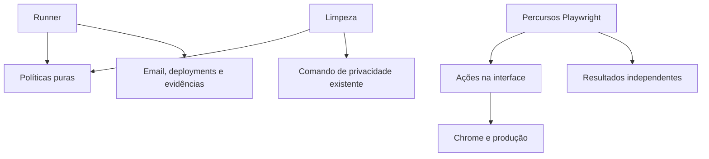

# WBS técnico — Parte 1: Base técnica, Gmail e evidências

Revisão: 2026-10-07. Versão: 2.0. Baseline: `91a9d28bcb9c9a829a8578872156a6b90fa04bcf`.

## Objetivo

Preparar dados, configuração, Gmail, políticas de aceitação e evidências.
W00 começa com o checkout atual. Os acessos externos permanecem por verificar.
G1 exige também W04 da parte 2.
Verificar cedo o canal administrativo de W10.6.

Este plano contém 22 tarefas, com os IDs originais.

## Leitor e pré-requisitos

Destina-se a quem implementa esta parte.
Ler o [índice](REAL_BROWSER_TESTING_WBS.md), o [PRD](REAL_BROWSER_TESTING_PLAN.md) e os guias relevantes.

Aplicar as [regras comuns](REAL_BROWSER_TESTING_WBS.md#contratos-e-invariantes) em todas as tarefas.
Usar Clean Architecture, Clean Code, TDD e Ponytail full.
Preservar os IDs e verificar dependências entre partes.
Um comportamento já correto exige reutilização dos seus testes, sem criar uma falha artificial.
Escrever RED antes de alterar um comportamento não trivial.

## Comportamento atual e motivo da revisão

| Evidência atual | Consequência |
| :--- | :--- |
| E2E usa `127.0.0.1:5174`; CI externa usa `localhost:5173`. | Substituir ambos na aceitação de produção. |
| Há espera pela sessão Clerk, mas login usa `clerk.signIn`. | Reutilizar espera e locators; remover autenticação programática. |
| Runtime guards ignoram erros fora da origem frontend. | Observar também API e autenticação necessárias ao percurso. |
| Sanitizador apaga `trace.zip` e ignora segredos inferiores a oito caracteres. | Provar proteção do trace e de códigos recebidos durante a execução. |
| Relatórios antigos e `test-disposition.json` não existem no checkout. | Usar relatórios do runner; criar registo adicional apenas com consumidor concreto. |

As correções de produto já existentes não comprovam a aceitação em produção.
Reutilizar essas correções e acrescentar as provas em falta.

## Componentes e tarefas

### W00 — Fixar baseline e mapear consumidores

Ficheiros: `scripts/test.mjs`, `frontend/e2e/`, `backend/tests/`, `frontend/src/test/` e guias atuais.

| ID | Dependências | RED / prova inicial | Implementação mínima e DONE |
| :--- | :--- | :--- | :--- |
| W00.1 | Nenhuma | Identificar branch, SHA e alterações externas. | Registar baseline imutável e preservar alterações externas. Preparar checkout isolado quando começar código. |
| W00.2 | W00.1 | Comparar rotas, atores e estados com E2E-01–18. | Mapear casos concretos e resultados. Incluir feedback, datas preferenciais, calendário, ocorrências e 404 atuais. |
| W00.3 | W00.1 | Quantidades de ficheiros não identificam regressões únicas. | Classificar casos, parametrizações, fixtures e helpers: preservar, substituir ou eliminar. Registar a prova restante. |
| W00.4 | W00.2 | Estado externo de contas, email e fornecedores está por verificar. | Conferir métodos de login, caixas, contacto, deployments e canal administrativo. Registar dependências sem pressupor configuração. |

### W01 — Moldes completos e configuração segura

Ficheiros: `frontend/e2e/utils/e2e-config.js`, `scripts/test.mjs`, `scripts/test.test.mjs`, dados E2E e inspetor Python.

| ID | Dependências | RED / prova inicial | Implementação mínima e DONE |
| :--- | :--- | :--- | :--- |
| W01.1 | W00.1 | CSV truncado, ausente ou com bytes diferentes deve falhar. | Copiar os cinco originais completos. Registar SHA-256, nomes, bytes e quantidades antes de usar dados. |
| W01.2 | W01.1 | Assumir um separador único ou dividir strings produz leitura incorreta. | Usar `csv` e `Decimal` da biblioteca padrão Python. Gerar expectativas sem importar o parser do produto. |
| W01.3 | W01.2 | Referências desconhecidas ou minutos arredondados devem falhar. | Conferir 48 salas, 40 professores, 52 disciplinas, 208 módulos, 48 turmas, 16 cursos e 336 atribuições. |
| W01.4 | W00.4 | HTTP, destino local, SHA ausente ou conta não autorizada deve falhar antes dos efeitos. | Exigir `https://cronos.pt`, SHA completo e caixas dedicadas. Recusar fallbacks locais e aliases não autorizados. |
| W01.5 | W01.4 | Importar políticas não deve iniciar browser, Docker ou rede. | Resolver ambiente no ponto de entrada. Separar validação pura da composição e dos adaptadores. |

### W02 — OAuth inicial e leitura real do Gmail

Ficheiros: `scripts/authorize-e2e-gmail.mjs`, `frontend/e2e/utils/gmail.js` e testes focados.

| ID | Dependências | RED / prova inicial | Implementação mínima e DONE |
| :--- | :--- | :--- | :--- |
| W02.1 | W00.4 | Ausência de consentimento ou token deve impedir leitura com diagnóstico seguro. | Configurar Gmail API e cliente OAuth Desktop. Solicitar apenas `gmail.readonly` nas duas caixas. |
| W02.2 | W02.1 | Callback com state incorreto ou código ausente deve ser recusado. | Implementar PKCE, callback loopback e acesso offline. Transferir refresh tokens sem os imprimir. |
| W02.3 | W02.2 | Token revogado ou caixa diferente deve impedir execução. | Renovar o acesso e conferir a caixa com `users.getProfile`. Classificar falhas do fornecedor. |
| W02.4 | W02.3 | Mensagem antiga, destinatário errado ou outra execução deve ser rejeitada. | Pesquisar destinatário e timestamp epoch. Ler a mensagem completa e confirmar `internalDate`. |
| W02.5 | W02.4 | MIME multipart, base64url e códigos ambíguos precisam de prova. | Percorrer partes MIME. Conferir remetente, finalidade e data; recusar ambiguidades. |
| W02.6 | W02.5 | Ligação inesperada ou código inválido deve falhar. | Validar esquema e hosts das ligações recebidas. Aceitar apenas mensagens do percurso real esperado. |

### W03 — Resultado rigoroso e evidências protegidas

Ficheiros: Política de aceitação, reporter, runner, `runtime-guards.js`, sanitizador e proteção de binários.

| ID | Dependências | RED / prova inicial | Implementação mínima e DONE |
| :--- | :--- | :--- | :--- |
| W03.1 | W00.2 | Casos ausentes, saltados ou duplicados não podem certificar a matriz. | Definir IDs obrigatórios por caso concreto. Agregar resultados, elegibilidade e proveniência. |
| W03.2 | W03.1 | Playwright verde numa seleção parcial não representa aceitação completa. | Exportar resultados estruturados. Conferir a matriz no runner e preservar código não zero. |
| W03.3 | W01.4 | Código de seis dígitos ou token recebido não pode aparecer no texto publicado. | Redigir segredos de relatórios e logs. Excluir storage state; não imprimir valores de autenticação. |
| W03.4 | W03.3 | O teste atual confirma que trace.zip é apagado; isso perde a prova requerida. | Atualizar essa expectativa antes do sanitizador. Cifrar traces e vídeos com AES-256-GCM; mascarar screenshots. |
| W03.5 | W03.4 | Chave errada, ficheiro adulterado ou caminho indevido deve falhar. | Provar recuperação íntegra e confinamento. Publicar apenas binários protegidos; manter a chave separada. |
| W03.6 | W03.2–5 | Falha de reporter, sanitização ou limpeza não pode produzir verde. | Preservar a primeira falha e acrescentar falhas auxiliares. Produzir resumo em sucesso e falha. |
| W03.7 | W01.4, W03.1–2 | Um 500 de api.cronos.pt não pode ser ignorado como erro externo. | Classificar frontend, API, Clerk e telemetria separadamente. Limitar exceções por método, host, caminho, estado e ação. |

## Contratos e ordem de execução

### Arquitetura mínima

Manter políticas puras separadas dos adaptadores Gmail, deployments, browser e ficheiros.
Resolver configuração no runner. Passar dados e funções explícitos.
Reutilizar `scripts/test.mjs`, Playwright e o sanitizador existente.
Usar biblioteca padrão antes de adicionar dependências.

Ficheiros previstos, apenas quando necessários:

- `frontend/e2e/utils/acceptance-policy.js`: matriz, revisão, elegibilidade e propriedade.
- `frontend/e2e/utils/gmail.js`: renovação OAuth e leitura de mensagens.
- `frontend/e2e/utils/deployments.js`: adaptadores de publicação.
- `frontend/e2e/acceptance-reporter.js`: resultados estruturados por caso.
- `scripts/inspect-e2e-data.py`: expectativas independentes dos cinco CSV.
- `scripts/authorize-e2e-gmail.mjs`: consentimento inicial local.
- `scripts/protect-test-evidence.mjs`: proteção de binários com `node:crypto`.

### Contrato do registo

Guardar `schema_version`, `run_id`, modo, SHA dos testes, SHA esperado, início UTC, hashes e deployments.
Guardar organizações com IDs local/Clerk, atores, criação, proveniência e tipo descartável/persistente.
Guardar casos com requisito, nome concreto, estado, timestamps e referências de provas.
Registar resultado da limpeza.
Não guardar corpos de email, códigos, cookies ou tokens no relatório legível.

Usar `validated`, `failed`, `dependency_unavailable` e `incomplete`.
Apenas `validated` para a matriz completa pode certificar produção.
Um filtro de projeto é diagnóstico parcial.

### Configuração prevista

| Valor | Uso |
| :--- | :--- |
| `BASE_URL=https://cronos.pt` | Destino obrigatório. |
| `E2E_EXPECTED_REVISION` | SHA completo a certificar. |
| `E2E_ADMIN_EMAIL`, `E2E_TEACHER_EMAIL` | Contas Gmail dedicadas. |
| Credenciais reais da aplicação/Google, quando necessárias | Métodos efetivamente apresentados. |
| `E2E_GMAIL_CLIENT_ID`, `E2E_GMAIL_CLIENT_SECRET` | Cliente OAuth. |
| `E2E_GMAIL_ADMIN_REFRESH_TOKEN`, `E2E_GMAIL_TEACHER_REFRESH_TOKEN` | Leitura das caixas. |
| `E2E_PERSISTENT_REGISTRY` | Proveniência das escolas históricas. |
| Conta/projeto e token Cloudflare | Consulta do Pages. |
| Projeto/ambiente, quatro serviços e token Railway | Consulta dos deployments. |
| Credenciais administrativas separadas | Limpeza limitada. |
| `E2E_ARTIFACT_KEY` | Chave aleatória de 32 bytes para binários. |

Confirmar nomes e permissões durante a implementação.
Não exigir chave secreta Clerk ao browser nem pedir segredos na conversa.

### Email e evidências

Verificar validade e estado de publicação do OAuth.
Tokens de aplicações externas em Testing podem expirar após sete dias nestes âmbitos.
Resolver o requisito aplicável; não prometer consentimento permanente.

Usar polling com prazo e intervalo limitados.
Não marcar, apagar ou enviar emails através da Gmail API.
Aceitar links de convite realmente entregues. Não fabricar tickets de login.

Usar AES-256-GCM, nonce aleatório por ficheiro e metadados autenticados.
Guardar versão do envelope, nonce e tag; guardar a chave separadamente.
Mascarar campos sensíveis antes de capturar screenshots.
Cifrar imagens cuja ausência de segredos não possa ser garantida.

Desativar capturas automáticas que não garantam proteção.
Decifrar localmente numa pasta controlada para abrir o trace.
Não publicar storage state ou binários brutos.

## Estados, falhas e verificação

Registar tarefa, commit, ficheiros, RED, GREEN e referências das provas.
Usar `PENDENTE`, `EM_CURSO`, `CONCLUÍDO` ou `DEPENDÊNCIA`.
Concluir apenas quando DONE estiver comprovado.

Uma falha de fornecedor ou falta de histórico não é RED de uma regra do produto.
Não reduzir critérios nem usar retries para apagar uma falha.
Aplicar os [comandos comuns](REAL_BROWSER_TESTING_WBS_PART_4_CLEANUP_AND_CI.md#comandos-e-checks-comuns).
Conferir as [condições globais](REAL_BROWSER_TESTING_WBS.md#condições-de-passagem) antes de avançar.

## Fontes e documentos relacionados

- [Runner](../../scripts/test.mjs)
- [Configuração Playwright](../../frontend/playwright.config.js)
- [Guards atuais](../../frontend/e2e/utils/runtime-guards.js)
- [Sanitizador](../../scripts/sanitize-test-artifacts.mjs)
- [Guia atual de testes](TESTING_AND_CI.md)
- [Padrão de documentação](../00_getting_started/DOCUMENTATION_STANDARD.md)
- [Parte seguinte](REAL_BROWSER_TESTING_WBS_PART_2_SCHOOL_AND_SCHEDULING.md)
