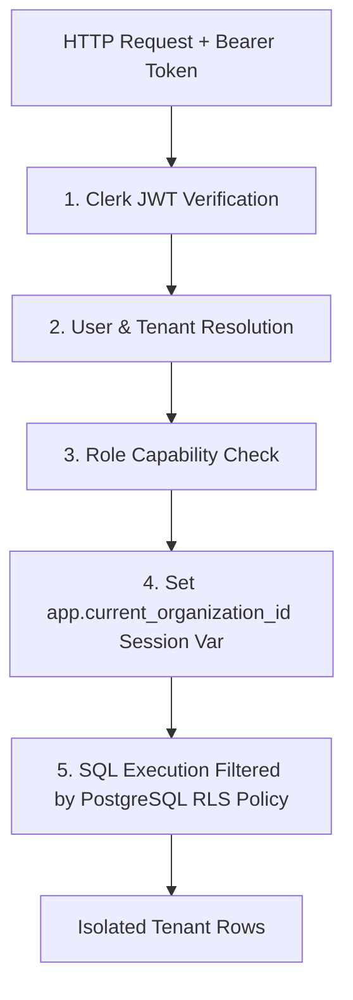

# Security and Tenant Isolation

## Purpose
This document specifies security architecture, Clerk authentication verification, tenant isolation policies, and database Row-Level Security (RLS).

## Intended Reader
This document targets security engineers, backend developers, and system administrators.

## Prerequisites
Read [System Architecture](../01_system_architecture/SYSTEM_ARCHITECTURE.md).

## What the System Does
Cronos enforces multi-tenant security across all application layers. User authentication uses Clerk. Data isolation uses PostgreSQL RLS.

## Multi-Tenant Security Layers



## Security Controls Summary

| Security Layer | Enforced Mechanism | Implementation |
| :--- | :--- | :--- |
| **Authentication** | Bearer JWT Signature Verification | FastAPI dependency checking Clerk public keys |
| **Tenant Isolation** | PostgreSQL Row-Level Security (RLS) | Database policies filtering rows by `organization_id` |
| **Role Authorization** | Role capability dependencies | `require_admin` and `require_teacher` dependencies |
| **Cross-Origin Security** | CORS Middleware | Explicit origin whitelist (`CORS_ORIGINS`) |
| **HTTP Security Headers** | Security Headers Middleware | HSTS, X-Content-Type-Options, X-Frame-Options |
| **Rate Limiting** | Slowapi Rate Limiter | IP and user rate limits on sensitive endpoints |

## PostgreSQL RLS Policy Example
Every tenant table enforces Row-Level Security:

```sql
ALTER TABLE classes ENABLE ROW LEVEL SECURITY;

CREATE POLICY tenant_isolation_policy ON classes
    USING (organization_id = NULLIF(current_setting('app.current_organization_id', true), '')::uuid);
```

## Contracts and Invariants
- Direct database queries must set `app.current_organization_id` before executing statements.
- Production environment configurations must disable `ALLOW_NON_TEST_DATABASE` override flags.

## Failure Modes
- Missing Tenant Header/Context: RLS policy evaluates to false, returning zero rows or throwing permission exception.

## Verification Procedure
Run database RLS safety tests: `pytest backend/tests/test_rls_database_policies.py -v`.

## Source Map
- Auth Dependencies: `backend/app/api/deps.py`
- RLS Test Suite: `backend/tests/test_rls_database_policies.py`
- RLS Migration Script: `backend/alembic/versions/`

## Related Documents
- [System Architecture](../01_system_architecture/SYSTEM_ARCHITECTURE.md)
- [Testing and CI](TESTING_AND_CI.md)
