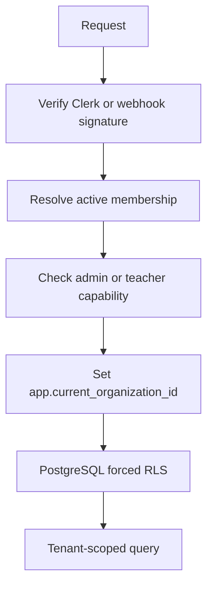

# Security and Tenant Isolation

## Purpose

This document describes Clerk verification, capability checks, PostgreSQL RLS, proxy handling, and security headers.

## Intended Reader

This document targets security engineers, backend engineers, and operators.

## Prerequisites

Read [System Architecture](../01_system_architecture/SYSTEM_ARCHITECTURE.md) and [Members and Access](../02_domain_model/MEMBERS_AND_ACCESS.md).

## What the System Does

Cronos resolves an authenticated actor, checks local membership, installs tenant context, and lets PostgreSQL enforce row isolation.

Public contact and webhook routes use separate provider-specific controls.

## Why the Behavior Exists

Application checks improve user feedback.
Database policies provide a second boundary when application code or a query is incomplete.

## Components and Ownership

| Control | Implementation |
| :--- | :--- |
| Clerk verification | `backend/app/core/clerk.py`, `backend/app/api/deps.py` |
| Actor and capability checks | `backend/app/api/deps.py` |
| Tenant context | `backend/app/db/tenant.py` |
| RLS policies and functions | `backend/alembic/versions/0001_initial.py` |
| Request body protection | `backend/app/middleware/request_body_limit.py` |
| Proxy IP policy | `backend/app/core/client_ip.py` |
| HTTP headers and CORS | `backend/app/main.py` |
| Webhook signature | `backend/app/api/v1/endpoints/webhooks.py` |

## Data or Request Flow

1. The API validates identity or provider signature.
2. The API resolves the organization membership.
3. The dependency sets the transaction-local tenant setting.
4. PostgreSQL evaluates the RLS policy.
5. The service executes only scoped work.

## Contracts and Invariants

- The application role is `cronos_app LOGIN NOSUPERUSER NOBYPASSRLS`.
- The migration role is `cronos_migrator LOGIN NOSUPERUSER BYPASSRLS`.
- Tenant context uses `app.current_organization_id`.
- Policies compare tenant rows with `app_security.current_organization_id()`.
- Production requires HTTPS origins and Clerk secrets.
- Only configured trusted proxy networks may provide client IP headers.

## States and Transitions

Membership access and lifecycle states are defined in [Members and Access](../02_domain_model/MEMBERS_AND_ACCESS.md).
Webhook events move through received, processing, processed, ignored, retryable, sync-error, or dead-letter states.

## Failure Modes

- Missing tenant context hides tenant rows and rejects writes.
- Invalid authorized parties return `401`.
- Missing capability returns `403`.
- Invalid webhook signatures return `401`.
- Excessive contact bodies return `413`.

## Verification Procedure

1. Run `pytest backend/tests/test_rls_database_policies.py -v`.
2. Run tenant isolation tests.
3. Run `python -m scripts.audit_triggers` from `backend/`.
4. Inspect security headers in frontend and API tests.

## Source Map

- `backend/app/api/deps.py`
- `backend/app/db/tenant.py`
- `backend/alembic/versions/0001_initial.py`
- `backend/tests/test_rls_database_policies.py`
- `backend/tests/test_tenant_isolation_complete.py`
- `frontend/public/_headers`

## Related Documents

- [Members and Access](../02_domain_model/MEMBERS_AND_ACCESS.md)
- [Testing and CI](TESTING_AND_CI.md)
- [Backend Architecture](../05_backend_api/BACKEND_ARCHITECTURE.md)
