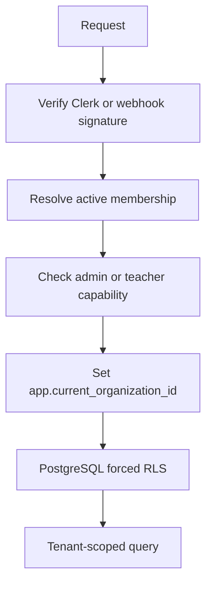

# Security and Tenant Isolation

## Purpose

This document describes Clerk verification, capability checks, PostgreSQL RLS, proxy handling, and security headers.

## Intended Reader

This document targets security engineers, backend engineers, and operators.

## Prerequisites

Read [System Architecture](../01_system_architecture/SYSTEM_ARCHITECTURE.md) and [Members and Access](../02_domain_model/MEMBERS_AND_ACCESS.md).

## What the System Does

Cronos resolves an authenticated actor, checks local membership, installs tenant context, and lets PostgreSQL enforce row isolation.

Public contact and webhook routes use separate provider-specific controls.

## Why the Behavior Exists

Application checks improve user feedback.
Database policies provide a second boundary when application code or a query is incomplete.

## Components and Ownership

| Control | Implementation |
| :--- | :--- |
| Clerk verification | `backend/app/core/clerk.py`, `backend/app/api/deps.py` |
| Actor and capability checks | `backend/app/api/deps.py` |
| Tenant context | `backend/app/db/tenant.py` |
| RLS policies and functions | `backend/alembic/versions/0001_scheduler_v1_baseline.py` |
| Request body protection | `backend/app/middleware/request_body_limit.py` |
| Rate limiting | `backend/app/core/ratelimit.py` |
| Proxy IP policy | `backend/app/core/client_ip.py` |
| HTTP headers and CORS | `backend/app/main.py` |
| Webhook signature and idempotency | `backend/app/api/v1/endpoints/webhooks.py` |

## Data or Request Flow

1. The API validates identity or provider signature.
2. The API resolves the organization membership.
3. The dependency sets the transaction-local tenant setting.
4. PostgreSQL evaluates the RLS policy.
5. The service executes only scoped work.

## Contracts and Invariants

- The application role is `cronos_app LOGIN NOSUPERUSER NOBYPASSRLS`.
- The migration role is `cronos_migrator LOGIN NOSUPERUSER BYPASSRLS`.
- The definer role is `cronos_auth_definer NOLOGIN NOSUPERUSER BYPASSRLS`.
- Tenant tables use `ENABLE ROW LEVEL SECURITY` and `FORCE ROW LEVEL SECURITY`.
- Tenant context uses `app.current_organization_id`.
- Policies compare tenant rows with `app_security.current_organization_id()`.
- Tenant context is transaction-local through `set_config(..., true)`.
- Production requires HTTPS origins and Clerk secrets.
- CORS allows only configured origins and denies credentials.
- CORS permits `Authorization` and `Content-Type`, and exposes `X-Request-ID`.
- API responses set `nosniff`, `DENY`, `no-referrer`, and `Permissions-Policy`.
- API responses set `Cache-Control: no-store` for paths under `/api/`.
- The Clerk protect host appears in `script-src`, `connect-src`, and `frame-src`.
- Only connections allow non-default Clerk protect ports (`https://*.protect.clerk.com:*`).
- `script-src` and `frame-src` keep `https://*.protect.clerk.com` without the port wildcard.
- The frontend Docker build context excludes `.test-artifacts/` and the secret folders or env files.
- Request bodies default to 1 MiB, except contact at 16 KiB, Clerk webhook at 256 KiB, client errors at 4 KiB, and imports at 8 MiB.
- Rate limiting fails closed when the Redis store is unavailable.
- Only configured trusted proxy networks may provide client IP headers.
- The Clerk webhook verifies `CLERK_WEBHOOK_SECRET` and keys events by Svix ID.

## States and Transitions

Membership access and lifecycle states are defined in [Members and Access](../02_domain_model/MEMBERS_AND_ACCESS.md).
Webhook events move through received, processing, processed, ignored, retryable, sync-error, or dead-letter states.

## Failure Modes

- Missing tenant context hides tenant rows and rejects writes.
- Invalid authorized parties return `401`.
- Missing capability returns `403`.
- Invalid webhook signatures return `401`.
- Excessive request bodies return `413`.
- An unavailable rate limit store returns `503`.

## Verification Procedure

1. Run `pytest backend/tests/contracts/test_rls_database_policies.py -v`.
2. Run `pytest backend/tests/integration/committed/test_tenant_isolation_complete.py -v`.
3. Run `python -m scripts.audit_triggers` from `backend/`.
4. Inspect security headers in frontend and API tests.

## Source Map

- `backend/app/api/deps.py`
- `backend/app/db/tenant.py`
- `backend/alembic/versions/0001_scheduler_v1_baseline.py`
- `backend/tests/contracts/test_rls_database_policies.py`
- `backend/tests/integration/committed/test_tenant_isolation_complete.py`
- `frontend/public/_headers`

## Onboarding Security Boundaries

The onboarding flow has explicit actor boundaries:

| Actor | Allowed before Foundation completion | Allowed after completion |
| :--- | :--- | :--- |
| Signed-in member | Session bootstrap, Foundation status, waiting page | Member features allowed by capability. |
| Foundation administrator | Read, save, and complete Foundation | Same operations are idempotent or rejected after completion. |
| Active administrator | No normal operational routes | Admin, readiness, dashboard, and configuration routes. |
| Active teacher | No normal operational routes | Teacher routes with a linked teacher profile. |

Clerk identity is external input.
The backend resolves the local organization and member and applies tenant-scoped authorization before business operations.
Foundation status does not grant admin capability; it only controls whether a capable administrator may complete setup.

The tutorial stores only a minimal, expiring checkpoint in browser storage. It has no backend telemetry and is not trusted as an operational record.

The organization legal gate is enforced before Foundation and operational dependencies. `GET /legal/status` remains available to members; acceptance requires an administrator and is append-only with forced RLS. Legal identity fields do not block onboarding.

## Related Documents

- [Members and Access](../02_domain_model/MEMBERS_AND_ACCESS.md)
- [Testing and CI](TESTING_AND_CI.md)
- [Backend Architecture](../05_backend_api/BACKEND_ARCHITECTURE.md)
