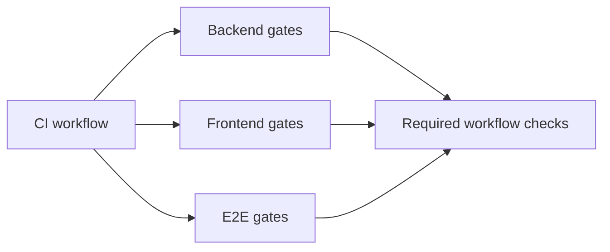

# Testing and CI

## Purpose

This document describes local verification, test suites, coverage gates, and the current GitHub Actions workflow.

## Intended Reader

This document targets developers, QA engineers, and release engineers.

## Prerequisites

Install Python 3.12, Node 24, Docker, PostgreSQL tooling, and Redis support.
Read [Contributing Guidelines](../00_getting_started/CONTRIBUTING.md).

## What the System Does

CI validates backend dependencies, formatting, migrations, database contracts, backend tests, frontend quality, and full-stack E2E flows.
The comparable baseline is 10 minutes and 45 seconds. The target is at most 6 minutes and 30 seconds.

## Why the Behavior Exists

The pipeline checks both isolated workspaces and the composed application.
Database safeguards prevent destructive tests from targeting a real database.

## Components and Ownership

| Area | Tool or source | Gate |
| :--- | :--- | :--- |
| Backend tests | Pytest and coverage | Combined coverage at least 70% |
| Backend quality | Ruff, pip check, pip-audit | No unexpected drift or lint errors |
| Database | Alembic and audit scripts | Upgrade, check, downgrade, upgrade |
| Frontend tests | Vitest and V8 coverage | Thresholds in `frontend/vite.config.js` |
| Frontend quality | ESLint and Knip | `npm run verify` |
| E2E | Playwright and Docker Compose | Clerk test identities and full stack |
| Workflow | `.github/workflows/ci.yml` | Runs on `main`, `develop`, and pull requests |

## Backend Test Suite Classification

Pytest infers the `unit` or `integration` marker during collection.
The inference uses resources, not test file locations.

| Marker | Meaning |
| :--- | :--- |
| `unit` | Test uses no database or external resource fixture |
| `integration` | Test uses a database fixture or declares PostgreSQL integration |
| `postgresql` | Test requires a PostgreSQL schema or service |
| `redis` | Test requires Redis; it receives no suite marker |
| `solver` | Orthogonal CP-SAT scheduler dimension |
| `slow` | Orthogonal duration dimension; exclude it from the fast command |

The database fixtures `migrated_test_database`, `clean_database`, `db_session`, `runtime_db_session`, `sync_db`, `async_client`, and `real_async_client` imply `integration`.
An explicit `integration` or `postgresql` marker takes precedence.
The `solver` and `slow` markers do not change suite classification.

Use the fast backend suite during TDD:

```powershell
cd backend
pytest -m "unit and not slow" -q
```

Run the complete backend suite with PostgreSQL and Redis configured:

```powershell
cd backend
pytest tests/ -v
```

The collection result is the source of truth for the complete suite. Check it with:

```powershell
pytest --collect-only -q
```

## Data or Request Flow

1. CI starts the backend, frontend, and E2E jobs in parallel.
2. The backend job installs locked Python dependencies, then runs Ruff, migrations, audits, and split Redis test suites.
3. The backend job builds the hardened backend image.
4. The frontend job installs dependencies and runs production audit and `npm run verify`.
5. The E2E job builds its own Compose stack and runs Playwright tests.
6. The E2E job removes the Compose project and volumes in an `always()` cleanup step.



## Contracts and Invariants

- Test database names must contain `test` or `ci`.
- CI uses separate migrator and application database credentials.
- CI fails when backend coverage is below 70%.
- Scheduler domain constraints require full coverage in their dedicated report.
- Skipped tests fail the backend job.
- The current workflow has no tag-triggered image publication job.

## States and Transitions

CI moves through checkout, dependency installation, static checks, tests, image build, E2E, and cleanup.
Any failed required job prevents a green workflow.

## Failure Modes

- Lockfile drift fails the dependency job.
- Migration drift fails `alembic check`.
- Database trigger drift fails the audit job.
- Missing Clerk E2E secrets stops identity validation.
- Compose health failures stop the E2E stack.

## Verification Procedure

### Backend

```powershell
cd backend
ruff format --check .
ruff check .
pytest -m "unit and not slow" -q
pytest tests/ -v
```

Run migration and audit commands with the configured migrator role.

### Frontend

```powershell
cd frontend
npm ci
npm run audit:production
npm run verify
```

Run `npm run test:school-config:stability` only as a diagnostic.
It is not a normal CI gate because `npm run verify` already covers the scheduler settings tests.

### Runtime Environment Selection

The 15 pure JavaScript test files declare `// @vitest-environment node`.
JSX tests continue to use the JSDOM default from `vite.config.js`.
Keep a DOM-using `.test.js` file on JSDOM by declaring that environment explicitly.

### Images and E2E

```powershell
docker build --target runtime -t cronos-backend:test backend
docker compose -f docker-compose.ci.yml config
```

Run the full E2E workflow only with dedicated Clerk test identities.

## Source Map

- Workflow: `.github/workflows/ci.yml`
- Compose CI: `docker-compose.ci.yml`
- Backend tests: `backend/tests/`
- Frontend tests: `frontend/src/test/`
- E2E tests: `frontend/e2e/`
- Frontend thresholds: `frontend/vite.config.js`

## Related Documents

- [Contributing Guidelines](../00_getting_started/CONTRIBUTING.md)
- [Security and Tenant Isolation](SECURITY_AND_TENANT_ISOLATION.md)
- [Local Runtime](../09_ops_observability/LOCAL_RUNTIME.md)
