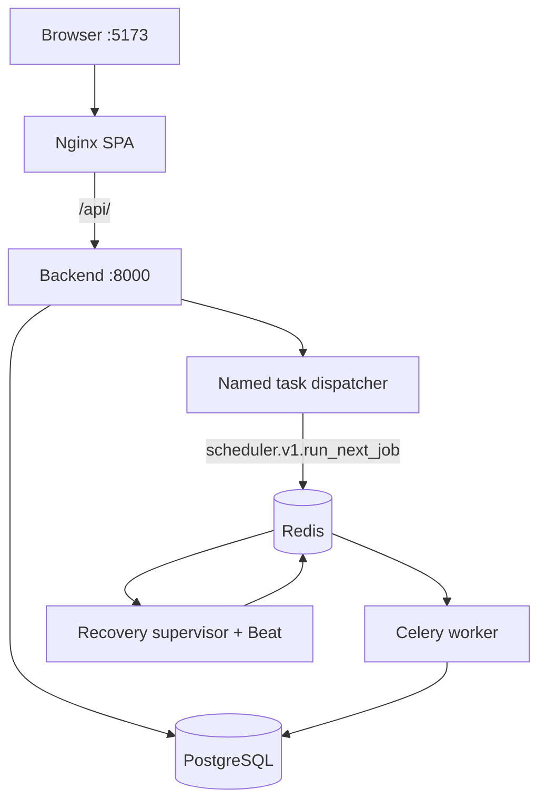

# Local Runtime

## Purpose

This document describes the local Docker Compose runtime, maintenance profiles, ports, and verification commands.

## Intended Reader

This document targets developers, DevOps engineers, and operators.

## Prerequisites

Install Docker Desktop with Compose.
Copy `.env.example` to `.env` and `backend/.env.example` to `backend/.env`.

## What the System Does

The root `docker-compose.yml` runs PostgreSQL 18, Redis 8.2, API, worker, scheduler supervisor with embedded Beat, and the Nginx SPA.
The `local` target of `frontend/Dockerfile` inherits `ci` and uses `nginx.ci.conf` for Clerk development origins.
The production image uses `nginx.conf`.
`docker-compose.dev.yml` overrides only the `frontend` service, replacing it with Vite hot reload; the other services are unchanged.
Local, test, and CI stacks use PostgreSQL 18 and Redis 8.2, pinned by digest.
Verify managed provider versions separately; see the [Deployment Runbook](DEPLOYMENT_RUNBOOK.md#production-topology).
The API dispatches `scheduler.v1.run_next_job` through Redis; the worker imports and executes that task.

## Why the Behavior Exists

Maintenance jobs apply database changes before normal containers start.
This prevents concurrent services from changing production-like schemas during startup.

## Components and Ownership

| Service | Host access | Purpose |
| :--- | :--- | :--- |
| `db` | `127.0.0.1:5432` | PostgreSQL 18 |
| `redis` | Internal only | Celery broker and rate-limit storage |
| `provision-db` | Maintenance profile | Create and rotate database roles |
| `db-maintenance` | Maintenance profile | Run Alembic migrations |
| `backend` | `127.0.0.1:8000` | FastAPI API |
| `worker` | Internal only | Scheduler v1 generation tasks |
| `scheduler-supervisor` | Internal only | Recovery-only worker on the `scheduler-supervisor` queue; its embedded Beat publishes hourly reconciliation, daily maintenance, and 60-second supervision |
| `frontend` | `127.0.0.1:5173` | Nginx SPA (`local` target) and `/api/` proxy; Vite with the dev override |

## Data or Request Flow

1. Provision roles on a new database or password rotation with `provision-db`, which runs `backend/scripts/provision_database.sh`.
2. Apply migrations with `db-maintenance`.
3. Start normal services.
4. Use the Nginx frontend on port `5173`.
5. Use the Vite override on port `5173` for development.

## Contracts and Invariants

- Normal application services do not run Alembic on startup.
- Database and Redis ports bind to loopback or remain internal.
- Runtime containers use read-only roots and temporary writable paths.
- The API image exposes port `8000`.
- The frontend runtime exposes host port `5173` and listens on container port `8080`.
- The worker command uses `--max-tasks-per-child=1`.
- The API process does not import `app.scheduler_v1_worker` or OR-Tools.
- The worker process includes `app.scheduler_v1_worker` and owns solver imports.
- The supervisor process includes `app.scheduler_recovery_worker` and consumes only the `scheduler-supervisor` queue.
- The supervisor's Beat stores its schedule under `/tmp`.

## States and Transitions

`provision-db` -> `db-maintenance` -> `backend`, `worker`, `scheduler-supervisor`, `frontend`.

The development override changes only the frontend service.

## Failure Modes

- Missing required environment variables prevents Compose interpolation.
- Unprovisioned roles prevent migrations or application connections.
- Missing migrations cause application schema errors.
- Redis failure affects rate limits, readiness, and background dispatch.
- A PostgreSQL 16 data volume cannot start with the PostgreSQL 18 image.
  The named volume is `cronos_postgres_data_v18`, so an old volume is not reused. Back up required data before you switch majors.
- The PostgreSQL 18 image mounts its volume at `/var/lib/postgresql`, not `/var/lib/postgresql/data`.

## Safe Stop and Cleanup

- Use `docker compose stop` when you only need to stop Cronos.
- Obtain explicit approval before running `docker compose down`.
- Never run `docker compose down -v` during repository cleanup or recovery.
- Never prune Docker volumes during repository cleanup or recovery.
- Preserve database and Redis volumes until recovery checks pass.

## Verification Procedure

1. Run `docker compose config` with required variables.
2. Run `docker compose build backend`. `db-maintenance` reuses the `cronos-backend:local` image and cannot build it.
3. Run `docker compose --profile maintenance run --rm provision-db`.
4. Run `docker compose --profile maintenance run --rm db-maintenance`.
5. Run `docker compose up -d --build`.
6. Check `docker compose ps`.
7. Query `http://127.0.0.1:8000/health/live`, `/health/ready`, and `/api/v1/health`.
8. Inspect registered tasks with `docker compose exec worker celery -A app.celery_worker.celery_app inspect registered`.

The test stack uses `docker-compose.test.yml`.
`scripts/test.mjs` starts each run under a unique Compose project `cronos-test-<token>`, with generated passwords.
It provisions roles through its `provision-db` service and removes the project at the end.
The E2E stack also binds host port `5174`, so only one E2E run can work at a time.
Integration runs do not bind fixed host ports and can run in parallel.
`docker-compose.ci.yml` is the equivalent stack used by the `e2e-browser` CI job.

## Source Map

- `docker-compose.yml`
- `docker-compose.dev.yml`
- `docker-compose.ci.yml`
- `docker-compose.test.yml`
- `scripts/test.mjs`
- `backend/scripts/provision_database.sh`
- `backend/Dockerfile`
- `frontend/Dockerfile`
- `frontend/nginx.conf`

## Related Documents

- [Deployment Runbook](DEPLOYMENT_RUNBOOK.md)
- [Observability and Recovery](OBSERVABILITY_AND_RECOVERY.md)
- [Testing and CI](../08_security_quality/TESTING_AND_CI.md)
