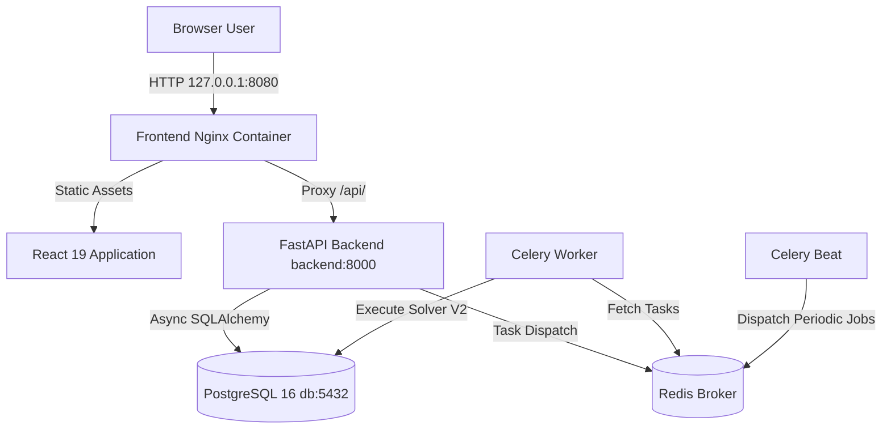

# Local Runtime

## Purpose
This document specifies the local Docker runtime deployment, container topology, maintenance jobs, and production readiness guidelines for Cronos.

## Intended Reader
This document targets DevOps engineers, software developers, and site reliability engineers.

## Prerequisites
Install Docker Desktop with Docker Compose. Install Python 3.12 for local host commands.

Configure root environment variables in `.env` using `.env.example`:
- `POSTGRES_PASSWORD`: Superuser database password.
- `CRONOS_MIGRATOR_PASSWORD`: Migration role password.
- `CRONOS_APP_PASSWORD`: Application connection password.
- `VITE_CLERK_PUBLISHABLE_KEY`: Public Clerk key passed to frontend builds.

Configure `backend/.env` with Clerk secrets and backend settings. Contact delivery requires `RESEND_API_KEY` and `TURNSTILE_SECRET_KEY`.

## What the System Does
Cronos executes locally using Docker Compose (`docker-compose.yml`). The production-like runtime contains six core services.

## Why the Behavior Exists
Normal runtime services never alter database schemas automatically on startup. Separating schema changes into explicit maintenance jobs prevents race conditions, database locks, and accidental production schema mutations.

## Components and Ownership

| Service Name | Purpose | Host Access | Container Base |
| :--- | :--- | :--- | :--- |
| `db` | PostgreSQL 16 database with RLS | `127.0.0.1:5432` | `postgres:16-alpine` |
| `redis` | Persistent Celery broker and cache | Internal only | `redis:7-alpine` |
| `backend` | FastAPI REST API application | `127.0.0.1:8000` | Custom Python 3.12 |
| `worker` | Scheduler and reconciliation tasks | Internal only | Custom Python 3.12 |
| `beat` | Hourly reconciliation dispatch | Internal only | Custom Python 3.12 |
| `frontend` | Production Nginx SPA server | `127.0.0.1:8080` | Custom Node 24 / Nginx |

### Maintenance Profile Services

| Maintenance Job | Command | Purpose |
| :--- | :--- | :--- |
| `provision-db` | `/scripts/provision_database.sh` | Role setup and password rotation |
| `db-maintenance` | `alembic upgrade head` | Database schema migrations |

## Data or Request Flow



## Contracts and Invariants
- Normal runtime containers do not execute automatic Alembic migrations on startup.
- Production deployments must complete `db-maintenance` before starting new application containers.
- Published container ports bind exclusively to loopback interface (`127.0.0.1`).
- Backend containers use read-only root filesystems with temporary writable `/tmp` mounts.

## States and Transitions

### Maintenance Lifecycle
1. Execute `docker compose --profile maintenance run --rm provision-db` for initial setup.
2. Execute `docker compose --profile maintenance run --rm db-maintenance` before every release containing migrations.
3. Execute `docker compose up -d --build` to start normal application services.

### Frontend Runtime Modes
- **Production Mode (Default)**: Nginx serves static SPA files on port `8080` and proxies `/api/` requests.
- **Development Mode (Vite)**: Execute `docker compose -f docker-compose.yml -f docker-compose.dev.yml up -d --build`. Serves Vite hot reload on port `5173`.

## Failure Modes

| Failure Scenario | Root Cause | Recovery Action |
| :--- | :--- | :--- |
| **Database Connection Refused** | `db` container initializing | Backend retries connection automatically |
| **Missing Migration Error** | `db-maintenance` job skipped | Run `docker compose --profile maintenance run --rm db-maintenance` |
| **Worker Out of Memory** | Large solver allocation | Celery recycles child processes automatically after each task (`max-tasks-per-child=1`) |

## Verification Procedure

1. **Verify Resolved Compose Configuration**:
   ```bash
   docker compose config --quiet
   ```
2. **Provision Database Roles**:
   ```bash
   docker compose --profile maintenance run --rm provision-db
   ```
3. **Execute Database Maintenance**:
   ```bash
   docker compose --profile maintenance run --rm db-maintenance
   ```
4. **Start Normal Runtime Stack**:
   ```bash
   docker compose up -d --build
   ```
5. **Inspect Active Containers**:
   ```bash
   docker compose ps
   ```
6. **Verify Readiness and Registered Worker Tasks**:
   ```bash
   curl http://127.0.0.1:8000/health/ready
   docker compose exec worker celery -A app.celery_worker.celery_app inspect registered
   ```

## Source Map
- Normal Compose Spec: `docker-compose.yml`
- Dev Override Spec: `docker-compose.dev.yml`
- CI Compose Spec: `docker-compose.ci.yml`
- Backend Dockerfile: `backend/Dockerfile`
- Frontend Dockerfile: `frontend/Dockerfile`
- Frontend Nginx Config: `frontend/nginx.conf`

## Related Documents
- [Observability and Recovery](OBSERVABILITY_AND_RECOVERY.md)
- [Testing and CI](../08_security_quality/TESTING_AND_CI.md)
